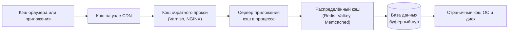

import { Aside } from '@astrojs/starlight/components';

Кэш хранит копию данных ближе к месту, где они нужны, чтобы следующие запросы пропускали медленную работу: сетевой переход, чтение с диска, запрос к базе или рендеринг страницы. Кэширование — самый дешёвый способ снизить задержку (latency) и защитить базу данных, и оно встречается на каждом уровне системы. Оно же — источник многих аварий и ошибок с устаревшими данными, поэтому проектировщик должен понимать, что даёт и чего стоит каждый уровень.

<Aside type="tip" title="Коротко">
- Кэш работает, потому что доступ **неравномерен**: небольшая доля ключей получает большую часть запросов, а недавно использованные данные, скорее всего, понадобятся снова.
- Кэши есть на каждом уровне: браузер, CDN, обратный прокси, приложение (внутри процесса и распределённый) и сама база данных.
- Кэшируйте **объекты** (профиль пользователя, отрендеренный фрагмент), а не сырые результаты запросов: объекты однозначно связаны с событиями инвалидации.
- Эффективная задержка равна `h·t_cache + (1−h)·t_origin`. Рост доли попаданий с 90% до 99% снижает нагрузку на источник в десять раз.
- Для общего кэша хороши и Valkey (BSD), и Redis (с Redis 8 доступна лицензия AGPLv3); Memcached остаётся самым простым «чистым» кэшем.
</Aside>

## Почему кэш работает и чего он стоит

Эффективность кэша держится на двух свойствах реальных нагрузок:

- **Временная локальность.** Только что прочитанные данные, скорее всего, скоро прочитают снова (вирусный пост, профиль вошедшего пользователя).
- **Перекос популярности.** Популярность подчиняется распределению с длинным хвостом, близкому к закону Ципфа. При показателе Ципфа 1 на миллионе объектов самый популярный 1% получает около 68% запросов, а верхние 10% — около 84%. Поэтому кэширование небольшого горячего набора поглощает большую часть трафика.

Перекос объясняет и то, почему кэш защищает базу. База распределяет нагрузку по партициям по ключу, а популярный объект концентрирует трафик на одной партиции. Кэш перед базой поглощает эти горячие чтения и сглаживает всплески.

Издержки столь же реальны:

- **Устаревание.** Кэшированная копия может расходиться с источником истины. Для каждого кэша нужен ответ на вопрос «насколько устаревшими могут быть данные и кто это исправляет?»
- **Модальное поведение.** При доле попаданий 95% база видит лишь 5% чтений. Если кэш очищен, перезапущен или отрезан сетью, на базу внезапно приходит в 20 раз больше обычной нагрузки. Кэш стал несущей конструкцией.
- **Холодный старт.** Новые узлы кэша и свежие деплои стартуют пустыми и нагружают источник, пока не прогреются.
- **Память и сложность.** Оперативная память намного дороже диска, а каждый кэш добавляет ветки кода для промахов, отказов и инвалидации.

## Где кэшировать



Каждый уровень ближе к пользователю (и дешевле в пересчёте на попадание), чем уровень правее, но хранит менее специфичные и хуже управляемые данные.

| Уровень | Что кэширует | Чем управляется | Типичная задержка попадания | На что обратить внимание |
|---|---|---|---|---|
| Браузер или мобильное приложение | Статика, ответы API | `Cache-Control`, `ETag`, service workers | ~0 мс (локально) | Очистить нельзя; версионируйте URL ресурсов |
| CDN | Статика, медиа, кэшируемые API и HTML | HTTP-заголовки, правила CDN, API очистки | От единиц до десятков мс | Персональный контент, утёкший в общий кэш |
| Обратный прокси | Полные HTTP-ответы, фрагменты | Конфигурация прокси (например, VCL в Varnish) | Меньше миллисекунды плюс сеть | Ключ кэша без нужного заголовка, например `Accept-Language` |
| Внутри процесса (L1) | Горячие объекты, конфигурация, шаблоны | Код приложения (например, Caffeine) | Микросекунды | У каждого сервера своя копия; рассылка инвалидаций |
| Распределённый кэш | Объекты, сессии, счётчики, фрагменты | Код приложения | Меньше миллисекунды в той же зоне | Сетевой переход, горячие ключи, отказы кластера |
| Буферный кэш базы | Страницы данных и индексов | Настройки БД | Микросекунды внутри БД | Слишком маленький буферный пул превращает чтения в дисковый ввод-вывод |

Несколько замечаний по уровням:

- **Кэш клиента** — бесплатная ёмкость: ответ, который браузер использует повторно, до вас не доходит. Стандартный рецепт — долгоживущие URL ресурсов с отпечатком (`app.3f9c.js` с `Cache-Control: max-age=31536000, immutable`) плюс короткоживущий HTML. Заголовки разобраны на странице [HTTP](/communication/http/).
- **Кэш CDN** описан в разделе [Сети доставки контента](/traffic/cdn/). CDN всё чаще кэшируют и ответы API — с короткими TTL и `stale-while-revalidate`.
- **Кэш веб-сервера и обратного прокси**: Varnish давно служит классическим HTTP-ускорителем. Его открытый проект переименовали в **Vinyl Cache** (объявлено в 2025 году, Vinyl Cache 9.0 вышел в марте 2026-го), а Varnish Software продолжает отдельный проект под именем Varnish Cache. Похожее кэширование ответов есть в NGINX и большинстве API-шлюзов. См. [Обратный прокси и API-шлюз](/traffic/reverse-proxy-and-api-gateway/).
- **Кэш базы данных**: любая база кэширует страницы в памяти. `shared_buffers` в PostgreSQL (типичная отправная точка — 25% памяти выделенного сервера) работает вместе со страничным кэшем ОС; буферному пулу InnoDB в MySQL часто отдают до 80% памяти. Настройка под рабочий набор данных — часто самый дешёвый выигрыш. MySQL убрал встроенный кэш результатов запросов в 8.0: он плохо масштабировался и инвалидировался целыми таблицами.
- **Кэш приложения**: хранилище «ключ-значение» в памяти между приложением и базой. Кэш внутри процесса самый быстрый, но дублируется на каждом сервере; распределённый кэш общий, переживает деплои и масштабируется отдельно. Многие системы используют оба: маленький L1 с TTL в секунды перед общим L2.

## Кэширование запросов и объектов

Есть два основных подхода к тому, **что считать записью кэша**.

**Кэширование на уровне запросов** превращает текст запроса и параметры в хеш-ключ и хранит результат. Его легко прикрутить, но проблема в инвалидации: при изменении одной строки дёшево понять, какие кэшированные запросы её включали, нельзя. Приходится сбрасывать записи целыми таблицами или мириться с устареванием до истечения TTL. Именно поэтому кэш запросов MySQL вывели из обращения.

**Кэширование на уровне объектов** хранит то, чем оперирует приложение: `User` с настройками, модель страницы товара, отрендеренную ветку комментариев. Ключ выводится из идентичности объекта (`user:v1:42`), поэтому при изменении данных приложение знает, какой ключ удалить. Объекты можно собирать и асинхронно: воркеры слушают изменения и пересобирают закэшированный объект, так что читатели почти не промахиваются.

| | На уровне запросов | На уровне объектов |
|---|---|---|
| Ключ | Хеш SQL и параметров | Идентичность из предметной области (`user:42`, `feed:42:page:1`) |
| Инвалидация | Сложная: изменение строки затрагивает неизвестные запросы | Понятная: изменение сущности затрагивает известные ключи |
| Переиспользование разным кодом | Низкое (попадают только идентичные запросы) | Высокое (попадает каждый читатель объекта) |
| Трудозатраты | Добавить легко | Нужно смоделировать кэшируемые объекты |

Гранулярность — это шкала: строка, результат запроса, собранный объект, отрендеренный фрагмент, страница целиком. Чем выше уровень, тем больше работы экономит попадание, но тем больше видов изменений его инвалидирует.

## Что кэшировать

Хорошие кандидаты часто читаются, дорого вычисляются и терпят кратковременное устаревание:

- Отрендеренные HTML-фрагменты или целые страницы для анонимных пользователей.
- Собранные объекты: профили пользователей, карточки товаров, права доступа.
- Агрегаты и производные данные: счётчики, таблицы лидеров, ленты и потоки активности, списки смежности социального графа.
- Результаты медленных внешних вызовов: курсы валют, геолокация, ответы сторонних API.
- Конфигурация, флаги функций и открытые ключи для проверки токенов.
- Отрицательные результаты («такого пользователя нет») с коротким TTL.

Плохие кандидаты: данные, которые должны быть абсолютно актуальны (баланс счёта во время перевода), данные, которые пишут гораздо чаще, чем читают, и огромные бинарные объекты, которым место в объектном хранилище за CDN. **Сессии** — особый случай: их часто хранят в Redis или Valkey, но тогда это хранилище — источник истины для сессий, а не кэш, и его нужно настраивать с персистентностью и репликацией.

## Проектирование ключей кэша

Ключ кэша должен меняться всякий раз, когда изменилось бы закэшированное значение, и не меняться в остальных случаях.

- **Пространство имён и версия:** `user:v2:42`. Увеличение `v2` при смене формата сериализации делает старые записи недостижимыми, вместо того чтобы ронять новый код.
- **Включайте все входные данные, влияющие на результат:** локаль, валюту, уровень пользователя, вариант A/B-теста, версию API. Пропустите одно — и один пользователь получит вариант другого.
- **Нормализуйте:** сортируйте параметры запроса, приводите регистронезависимые значения к нижнему регистру, отбрасывайте параметры отслеживания (`utm_*`), чтобы эквивалентные запросы делили одну запись.
- **Ограничивайте длину:** хешируйте длинные составные входные данные. Memcached ограничивает ключ 250 символами, а длинные ключи тратят память везде.
- **Изолируйте арендаторов и пользователей:** персонализированное значение должно содержать ID пользователя или арендатора; общий кэш никогда не должен отдавать приватные данные по общему ключу.
- **Избегайте неограниченных ключей, которые контролирует атакующий:** кэширование каждой произвольной поисковой строки ведёт к исчерпанию памяти и засоряет кэш.

## Расчёт доли попаданий

При доле попаданий `h`, задержке кэша `t_cache` и задержке источника `t_origin`:

```text
эффективная задержка = h · t_cache + (1 − h) · t_origin
нагрузка на источник = (1 − h) · частота запросов
```

(В кэше со стратегией cache-aside промах на самом деле стоит `t_cache + t_origin`, что добавляет `t_cache` к каждому запросу; при субмиллисекундной задержке кэша разница пренебрежимо мала.)

Пример: Redis отвечает за 0,5 мс, запрос к базе — за 20 мс, 50 000 чтений в секунду:

| Доля попаданий | Эффективная задержка | Ускорение | Чтений доходит до базы |
|---|---|---|---|
| 0% | 20,0 мс | 1,0× | 50 000/с |
| 50% | 10,3 мс | 2,0× | 25 000/с |
| 80% | 4,4 мс | 4,5× | 10 000/с |
| 90% | 2,5 мс | 8,2× | 5000/с |
| 95% | 1,5 мс | 13,6× | 2500/с |
| 99% | 0,7 мс | 28,8× | 500/с |
| 99,9% | 0,5 мс | 38,5× | 50/с |

Два вывода. Во-первых, важнее всего последние проценты: переход с 90% на 99% снижает нагрузку на базу в десять раз. Во-вторых, источник всё равно должен выдерживать трафик промахов, а холодный или упавший кэш обнуляет `h`. Планируйте ёмкость базы с запасом на просевшую долю попаданий или защищайте её объединением запросов и ограничением частоты запросов (см. [Стратегии кэширования](/caching/cache-strategies/)).

## Redis, Valkey и Memcached

**История с лицензиями.** До версии 7.2 Redis распространялся под BSD. В марте 2024 года Redis Ltd. перевела новые версии на двойную source-available-лицензию (RSALv2 или SSPLv1), при которой облачные провайдеры не могли предлагать Redis как управляемый сервис без соглашения. Через несколько недель Linux Foundation запустила **Valkey** — форк Redis 7.2.4 под лицензией BSD при поддержке AWS, Google Cloud, Oracle, Ericsson и других. В мае 2025 года **Redis 8** добавил третью лицензию — одобренную OSI **AGPLv3** — и включил в ядро бывшие модули Redis Stack (JSON, временные ряды, вероятностные структуры, движок запросов) и новый тип vector set. Valkey продолжил развиваться самостоятельно: Valkey 9.0 (октябрь 2025 года) добавил атомарную миграцию слотов, истечение срока отдельных полей хеша и нумерованные базы в кластерном режиме, а Valkey 9.1 (май 2026 года) — ACL на уровне отдельных баз для изоляции арендаторов и меньшие накладные расходы памяти на ключ. Среди управляемых сервисов теперь есть ElastiCache и Memorystore for Valkey наряду с Redis Cloud.

| | Redis 8.x | Valkey 9.x | Memcached |
|---|---|---|---|
| Лицензия | RSALv2, SSPLv1 или AGPLv3 (на выбор) | BSD-3-Clause | BSD-3-Clause |
| Управление проектом | Redis Ltd. | Linux Foundation | Сообщество |
| Модель данных | Строки, хеши, списки, множества, сортированные множества, потоки, JSON, временные ряды, фильтры Блума, vector sets | Типы Redis 7.2 и последующие дополнения; JSON, Bloom и поиск через официальные модули | Строки (непрозрачные байтовые значения) |
| Потоки выполнения | Однопоточное выполнение команд с потоками ввода-вывода | Однопоточное выполнение с улучшенным многопоточным вводом-выводом | Полностью многопоточный |
| Персистентность | Снимки RDB и AOF | Снимки RDB и AOF | Нет (чистый кэш) |
| Репликация и кластеризация | Встроенные реплики, Sentinel, Cluster | Встроенные реплики, Sentinel, Cluster | Встроенных нет; ключи шардируют клиенты |
| Размер значения | До 512 МБ на строку | До 512 МБ на строку | 1 МБ на элемент по умолчанию (настраивается) |
| Сильная сторона | Богатые структуры данных, широкий набор функций, поддержка вендора | Открытая совместимая с Redis альтернатива, управляемые сервисы в облаках | Простой, очень быстрый и экономный по памяти кэш объектов |

Практический совет: для нового кэша в облаке Valkey — естественный выбор: AWS и Google Cloud предлагают его как управляемый сервис, и он работает с существующими клиентами Redis. Выбирайте Redis 8, если нужны его встроенные модули или поддержка вендора и устраивают его лицензии. Выбирайте Memcached, если нужен простой многопоточный кэш объектов и ничего больше. Что бы вы ни выбрали, помните: по умолчанию и в Redis, и в Valkey политика вытеснения — `noeviction`, поэтому для кэша настройте `maxmemory` и политику вытеснения.

## Не кэшируйте в файлы на серверах без состояния

Кэширование на локальный диск (или в локальную память) серверов приложения выглядит бесплатным, но мешает горизонтальному масштабированию:

- Каждый сервер прогревает свою копию, поэтому при N серверах доля попаданий ниже, а источник видит до N раз больше промахов.
- Экземпляры перестают быть взаимозаменяемыми: автомасштабирование, деплои и падения выбрасывают кэш.
- Инвалидация должна дойти до каждого сервера, а для этого нужен канал широковещательной рассылки.
- Дисковые кэши заполняют диски и переживают код, который их написал.

Держите серверы приложения без состояния, а общие кэшированные данные выносите в отдельный слой (распределённый кэш, обратный прокси, CDN). Небольшой L1-кэш в процессе допустим, если у записей короткий TTL или они инвалидируются через pub/sub или серверную поддержку клиентского кэширования (в Redis команда `CLIENT TRACKING` есть с версии 6).

<Aside type="note" title="На собеседовании">
- Для каждого уровня говорите, где кэшируете и зачем: «статика на CDN, ленты в Redis, объект пользователя в L1-кэше с TTL 5 секунд».
- Считайте: ожидаемая доля попаданий, сэкономленная задержка, нагрузка на базу при этой доле и что будет при холодном кэше.
- Будьте готовы к вопросу «а если кластер кэша упадёт?». Ответы: реплики, объединение запросов, ограничение нагрузки на источник, отдача устаревших данных, прогрев перед переключением трафика.
- Объясните ключи кэша для персонализированных данных: утечка данных одного пользователя через общий ключ — классическая ошибка.
- Знайте в общих чертах историю лицензий Redis и Valkey — об этом спрашивают всё чаще.
</Aside>

## Что почитать

- [HTTP caching](https://developer.mozilla.org/en-US/docs/Web/HTTP/Guides/Caching) (MDN) и [RFC 9111: HTTP Caching](https://www.rfc-editor.org/rfc/rfc9111).
- [Caching challenges and strategies](https://aws.amazon.com/builders-library/caching-challenges-and-strategies/) — Amazon Builders' Library о модальном поведении, холодном старте и отрицательном кэшировании.
- [Scaling Memcache at Facebook](https://www.usenix.org/conference/nsdi13/technical-sessions/presentation/nishtala) — NSDI 2013, по-прежнему лучший разбор большого кэша приложения.
- [Introducing Valkey 9.0](https://valkey.io/blog/introducing-valkey-9/) и [Redis is now available under the AGPLv3 open source license](https://redis.io/blog/agplv3/).
- [Лицензии Redis](https://redis.io/legal/licenses/) — какая версия под какой лицензией.

## Связанные темы

- [Стратегии кэширования](/caching/cache-strategies/) — как данные попадают в кэш и покидают его, вытеснение и режимы отказа.
- [Сети доставки контента (CDN)](/traffic/cdn/) — пограничный уровень иерархии кэшей.
- [Обратный прокси и API-шлюз](/traffic/reverse-proxy-and-api-gateway/) — кэширование ответов перед серверами приложения.
- [Задержки, которые должен знать каждый программист](/reference/latency-numbers/) — тайминги памяти, сети и диска, стоящие за расчётом доли попаданий.
- [LRU-кэш](/ood/lru-cache/) — реализация классической политики вытеснения.
- [Системы на базе LLM](/architecture/llm-applications/) — кэширование промптов и семантический кэш, и как последний допускает утечки между пользователями.
