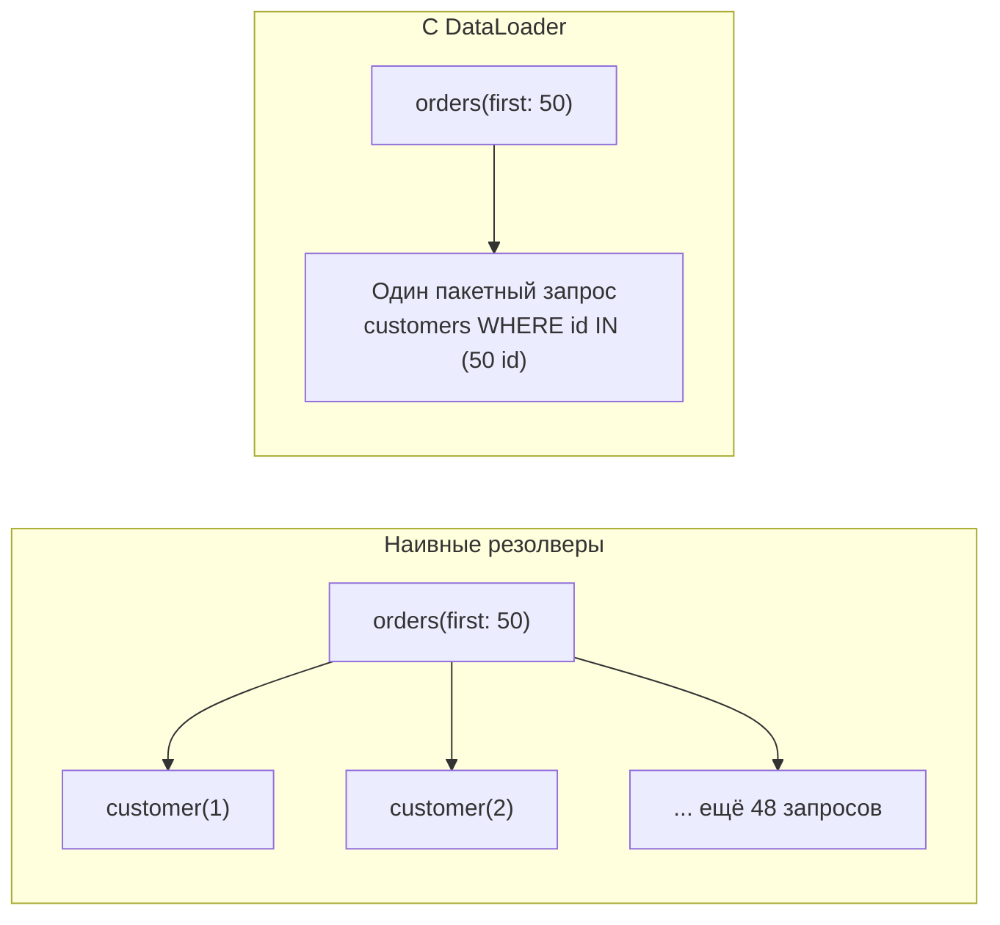
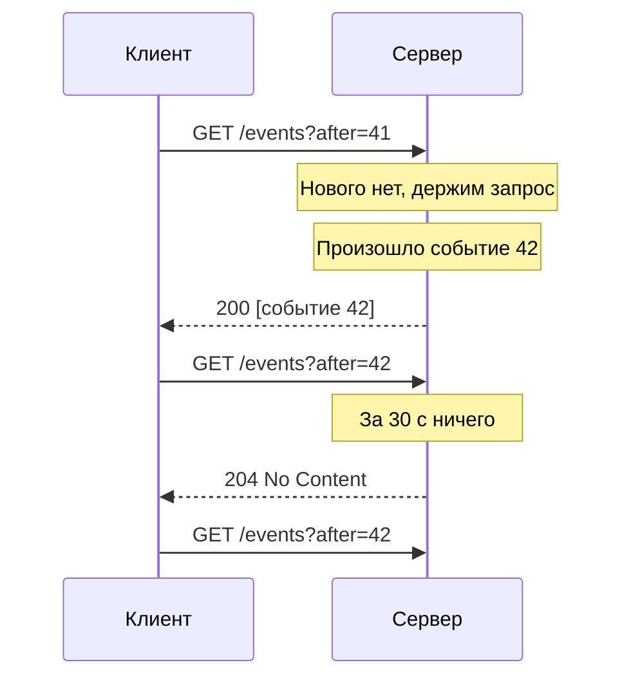
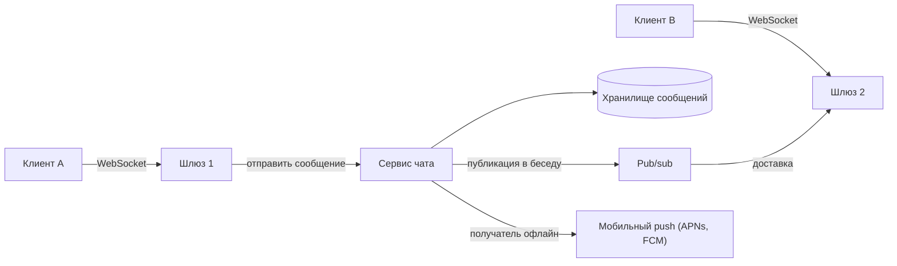

import { Aside } from '@astrojs/starlight/components';

API в стиле «запрос — ответ» ([RPC и REST](/communication/rpc-and-rest/)) покрывают большую часть
трафика, но две потребности постоянно выталкивают дизайн за их пределы: клиенты хотят выбирать,
*какие именно данные* получать, а серверам нужно *отправлять* данные в момент, когда что-то
произошло. Первую задачу решает GraphQL; вторую по-разному решают long polling, Server-Sent Events,
WebSocket и вебхуки. Каждый вариант переносит затраты куда-то — на сервер, на слой соединений или на
принимающую систему, — поэтому выбор между ними — проектное решение, а не дело моды.

<Aside type="tip" title="Коротко">
- GraphQL: один эндпоинт, запросы в форме, нужной клиенту. Отлично для разнообразных интерфейсов; придётся бороться с N+1 (DataLoader), слабым HTTP-кэшированием и ограничивать стоимость запросов.
- Push в браузер: SSE для одностороннего потока (уведомления, дашборды, токены LLM), WebSocket для двустороннего трафика с низкой задержкой (чат, совместная работа, игры), long polling — универсальный запасной вариант.
- Push в чужие *серверы*: вебхуки — подписанные, с повторами и экспоненциальной задержкой, доставка «хотя бы один раз», поэтому получатель обязан дедуплицировать.
- Долгоживущим соединениям нужны слой рассылки (pub/sub), heartbeat, переподключение с продолжением и план на время деплоя.
</Aside>

## GraphQL

GraphQL, открытый Facebook в 2015 году, предоставляет типизированную **схему** через единственный
эндпоинт. Клиент отправляет запрос с перечнем нужных полей, а сервер возвращает JSON той же формы:

```graphql
query OrderPage($id: ID!) {
  order(id: $id) {
    status
    total { amount currency }
    items(first: 10) { name quantity }
    customer { name loyaltyTier }
  }
}
```

**Сильные стороны.** Один запрос собирает целый экран, для которого REST потребовал бы три-четыре
вызова; каждый клиент получает только те поля, которые отображает (нет over-fetching); схема —
строго типизированный контракт с интроспекцией, из которого генерируется код; поля можно добавлять и
помечать устаревшими без версионирования эндпоинта. Слой GraphQL часто служит «бэкендом для
фронтенда» (BFF), агрегирующим множество внутренних сервисов, а федерация позволяет нескольким
командам вносить свои части в общую схему.

### Проблема N+1 и DataLoader

Каждое поле вычисляет **резолвер**. Если писать их в лоб, то список из 50 заказов с клиентами
выполнит один запрос за заказами и затем 50 отдельных запросов за клиентами — N+1 вызов, а вложенные
списки множат их дальше. Стандартное решение — **пакетирование** (batching): DataLoader собирает все
ключи, запрошенные за один такт выполнения, и делает один запрос `WHERE id IN (...)`, а ещё
запоминает результаты на время одного запроса.



Создавайте новый загрузчик на каждый запрос, чтобы его кэш не передавал данные между пользователями.

### Кэшировать сложнее

REST получает кэширование почти даром: у `GET /orders/981` есть URL, по которому CDN строит ключ.
GraphQL традиционно отправляет каждый запрос как POST на `/graphql`, и HTTP-кэши не видят ничего
кэшируемого. Обходные пути:

- **Сохранённые запросы** (persisted queries). Клиент отправляет хеш заранее зарегистрированного запроса вместо его текста; запрос становится достаточно коротким для GET, кэшируется на CDN, а сервер может отвергать незнакомые запросы.
- **Нормализованные кэши на клиенте** (Apollo Client, Relay) хранят объекты по типу и ID и обновляют все представления, где они показаны.
- **Кэширование ответов или резолверов на сервере** с подсказками кэширования для типов и полей.

### Ограничение стоимости запросов

Запросы пишут клиенты, а значит, клиент может написать и очень дорогой: глубокая вложенность,
огромные страницы, сотни алиасов. Публичному GraphQL API нужен явный **контроль нагрузки** (demand
control):

- Ограничивайте глубину, ширину и число алиасов в операции и требуйте размер страницы у каждого списка.
- Оценивайте стоимость до выполнения и отклоняйте или списывайте её. Публичный API GitHub, например, требует `first` или `last` от 1 до 100 у каждой связи, отклоняет запросы, способные затронуть больше 500 000 узлов, и выдаёт каждому пользователю бюджет 5 000 очков в час.
- Ставьте тайм-ауты выполнения и ограничивайте частоту по стоимости, а не по числу запросов.
- Проверяйте права в резолверах или доменном слое для каждого объекта, а не на уровне эндпоинта.

**GraphQL уместен**, когда многим клиентам (веб, iOS, Android, партнёры) нужны разные представления
богатой связанной предметной области. **Не стоит** брать его для простых CRUD-сервисов, передачи
файлов и внутренних вызовов между сервисами, где gRPC проще и быстрее.

## Как сервер отправляет данные клиенту

HTTP задуман так, что спрашивает клиент. Чтобы сервер мог заговорить первым, есть три техники,
дружественные браузерам, плюс базовый вариант «просто спрашивать почаще»:

- **Короткий опрос** (short polling): клиент спрашивает каждые N секунд. Просто и без состояния, но 1 млн клиентов с опросом раз в 5 секунд — это 200 000 запросов в секунду, почти все с ответом «ничего нового», а обновления приходят с опозданием до N секунд.
- **Long polling**, **SSE** и **WebSocket** — ниже.

### Long polling

Клиент отправляет запрос; сервер держит его открытым, пока не появится что отправить или не истечёт
тайм-аут (скажем, 30 секунд), и затем отвечает; клиент сразу отправляет следующий запрос.



Это работает через любой прокси и файрвол, ведь это обычный HTTP. Издержки: каждое сообщение стоит
полного запроса с заголовками, между ответом и следующим запросом есть зазор, и клиент должен
передавать курсор (`after=42`), чтобы в этом зазоре ничего не потерялось и не задвоилось. Сегодня
это в основном запасной вариант, когда SSE или WebSocket заблокированы.

### Server-Sent Events (SSE)

SSE — долгоживущий HTTP-ответ с `Content-Type: text/event-stream`, в который сервер пишет события
текстовыми строками:

```text
id: 1042
event: order.updated
data: {"order_id":"ord_981","status":"shipped"}

retry: 5000
```

- **Только одно направление:** от сервера к клиенту. Всё остальное клиент отправляет обычными запросами.
- **Переподключение встроено.** Браузерный `EventSource` переподключается сам и отправляет `Last-Event-ID`, так что сервер может продолжить с места обрыва.
- **Обычный HTTP:** работают существующие cookie аутентификации, прокси, HTTP/2 и HTTP/3. В HTTP/1.1 браузеры разрешают лишь шесть соединений на домен, общих для всех вкладок, поэтому отдавайте SSE по HTTP/2 или новее.
- **Только текст** (UTF-8). Двоичные данные нужно кодировать.
- `EventSource` не умеет добавлять свои заголовки вроде `Authorization`, поэтому многие клиенты читают поток через `fetch()`. Так API больших языковых моделей обычно
стримят сгенерированные токены.

### WebSocket

WebSocket (RFC 6455) начинается как HTTP-запрос с `Upgrade: websocket`; сервер отвечает
`101 Switching Protocols`, и дальше TCP-соединение несёт **полнодуплексные** текстовые или двоичные
фреймы в обе стороны с накладными расходами всего в несколько байт. RFC 8441 и RFC 9220 описывают
запуск WebSocket поверх потоков HTTP/2 и HTTP/3.

Чего WebSocket *не* даёт и что придётся строить самим:

- **Переподключение и продолжение.** Оборванное соединение теряет всё, что было в пути; клиентам нужна экспоненциальная задержка с джиттером (чтобы не устроить шторм переподключений после деплоя) и номер последовательности, чтобы запросить пропущенное.
- **Heartbeat.** Прокси и балансировщики закрывают соединения, которые выглядят простаивающими; отправляйте ping/pong чаще их тайм-аута простоя.
- **Семантика доставки.** Подтверждений на уровне приложения нет; если нужна доставка «хотя бы один раз», добавьте ID сообщений и подтверждения.
- **Аутентификация и авторизация** при подключении *и* при истечении токена посреди долгой сессии.
- **Эксплуатация.** Соединения хранят состояние и живут долго: плавающий деплой должен аккуратно их «осушать», а L4-балансировка может оставить новые серверы без нагрузки, пока старые переполнены.

**WebTransport** — потоки и ненадёжные датаграммы поверх HTTP/3 — стал доступен во всех основных
браузерах в 2026 году и подходит играм и медиа, которым нужно поведение в духе UDP прямо в браузере,
но по сравнению с WebSocket он ещё молод.

## Вебхуки: push от сервера к серверу

Вебхук — это HTTP POST, который ваша система отправляет на URL, зарегистрированный другой системой,
когда происходит событие, на которое она подписана: платёж прошёл, сборка завершилась, заказ
отправлен. Это стандартный способ передавать события через границы организаций.

**Отправителю:**

- **Повторы.** Получатели падают. Повторяйте неудачные доставки с экспоненциальной задержкой и джиттером часами или днями (Stripe повторяет до трёх суток), считайте неудачей любой ответ не из `2xx` и отключайте эндпоинты, которые падают постоянно, сообщая владельцу по другому каналу.
- **Подписи.** Подписывайте каждую доставку, чтобы получатель мог убедиться, что она от вас и не изменена: HMAC-SHA256 от ID события, метки времени и «сырого» тела, передаваемый в заголовках. Поддерживайте два секрета одновременно, чтобы менять их без простоя.
- **Доставка из очереди**, а не прямо внутри запроса, породившего событие, с ограничением параллельности на эндпоинт, чтобы один медленный получатель не тормозил остальных.
- **Безопасность.** URL от клиента может указывать во внутреннюю сеть; разрешайте имя и блокируйте частные диапазоны адресов, чтобы не допустить подделки серверных запросов (SSRF).
- **Тонкие полезные нагрузки.** Многие провайдеры отправляют только тип события и ID объекта, а получатель забирает текущее состояние через API. Это снимает проблемы порядка и не пускает чувствительные данные в логи.

**Получателю:**

- Проверяйте подпись по **сырому** телу и отклоняйте устаревшие метки времени (типичный допуск — 5 минут), чтобы блокировать повторы.
- Отвечайте `2xx` быстро и обрабатывайте асинхронно из очереди.
- **Дедуплицируйте**: доставка «хотя бы один раз», поэтому храните ID обработанных событий и пропускайте повторы — та же идея идемпотентности, что и для запросов к API.
- Не рассчитывайте на порядок. События могут приходить вразнобой; сравнивайте версии или запрашивайте актуальное состояние.

```python title="verify_webhook.py"
import base64
import hashlib
import hmac
import time

TOLERANCE_S = 300  # отклоняем доставки старше или «новее» 5 минут


def sign(secret: bytes, msg_id: str, timestamp: int, body: bytes) -> str:
    signed = f"{msg_id}.{timestamp}.".encode() + body
    return "v1," + base64.b64encode(hmac.new(secret, signed, hashlib.sha256).digest()).decode()


def verify(secret: bytes, headers: dict[str, str], body: bytes, seen_ids: set[str]) -> bool:
    msg_id = headers["webhook-id"]
    timestamp = int(headers["webhook-timestamp"])
    if abs(time.time() - timestamp) > TOLERANCE_S:
        return False                                   # слишком старое: возможен повтор
    expected = sign(secret, msg_id, timestamp, body)
    if not any(hmac.compare_digest(expected, s) for s in headers["webhook-signature"].split()):
        return False                                   # подделка или изменённое тело
    if msg_id in seen_ids:
        return False                                   # дубликат: уже обработано
    seen_ids.add(msg_id)
    return True


secret = b"whsec-demo-secret-32-bytes-long!"
body = b'{"type":"order.shipped","order_id":"ord_981"}'
now = int(time.time())
headers = {"webhook-id": "msg_2Lq9", "webhook-timestamp": str(now),
           "webhook-signature": sign(secret, "msg_2Lq9", now, body)}
seen: set[str] = set()
print(verify(secret, headers, body, seen))                          # True
print(verify(secret, headers, body, seen))                          # False: дубликат
print(verify(secret, headers, body.replace(b"981", b"982"), set())) # False: тело изменено
```

Имена заголовков взяты из открытой спецификации Standard Webhooks; Stripe, GitHub и другие называют
те же поля по-своему. В продакшене храните `seen_ids` в базе или кэше с TTL длиннее окна повторов
отправителя.

## Сравнение

| Стиль | Направление | Соединение | Встроенное восстановление | Лучше всего для |
|---|---|---|---|---|
| REST / RPC | Спрашивает клиент | Короткие запросы по пулу соединений | Повторы, ключи идемпотентности | CRUD, команды, большинство API |
| GraphQL | Спрашивает клиент (подписки — push) | Как у REST | Как у REST | Разные клиенты над связанной предметной областью |
| Короткий опрос | Клиент спрашивает снова и снова | Короткие запросы | Следующий опрос | Редкие обновления, максимальная простота |
| Long polling | От сервера к клиенту | Удерживаемый запрос, повторяется | Курсор в следующем запросе | Запасной путь, где потоки заблокированы |
| SSE | От сервера к клиенту | Один долгий HTTP-ответ | Автопереподключение с `Last-Event-ID` | Ленты, уведомления, дашборды, стриминг LLM |
| WebSocket | В обе стороны | Одно долгоживущее соединение после Upgrade | Нет — стройте сами | Чат, совместная работа, игры, торговые интерфейсы |
| Вебхуки | От сервера к другому серверу | Короткий POST на событие | Отправитель повторяет с задержкой | Интеграции между организациями |

## Проектирование функций реального времени

У всех push-дизайнов одна форма: клиенты держат соединения с парком **шлюзов соединений**, а **слой
pub/sub** (pub/sub в Redis или Valkey, NATS или лог вроде Kafka) доставляет каждое событие тому
шлюзу, где сидит соединение получателя.



Шлюзы остаются тонкими и без состояния, если не считать сокетов; хранение и бизнес-логика живут за
ними. Размер парка считают по одновременным соединениям: если один шлюз спокойно держит 100 000
преимущественно простаивающих соединений (это допущение для бенчмарка, а не константа), то 10 млн
пользователей онлайн потребуют около 100 шлюзов — без учёта резерва.

- **Чат и совместная работа:** WebSocket — обе стороны пишут часто, и задержка важна. Сохраняйте каждое сообщение до рассылки, давайте ему номер последовательности внутри беседы, чтобы клиент мог досинхронизироваться после переподключения, и переходите на мобильный push, когда получатель офлайн. См. дизайн [онлайн-чата](/ood/online-chat/).
- **Уведомления:** SSE (или уже открытый WebSocket приложения), пока приложение открыто; мобильный push или почта, когда закрыто; вебхуки, когда потребитель — система другой компании.
- **Живые дашборды:** обычно хватает SSE — данные идут в одну сторону, а автопереподключение бесплатно. Если допустима задержка в несколько секунд, ещё проще опрашивать закэшированный эндпоинт. Агрегируйте на сервере и отправляйте изменения с фиксированной частотой (скажем, раз в секунду), а не каждое сырое событие.
- **Ленты и тикеры с огромной аудиторией:** рассылайте через CDN или edge-сервис с поддержкой стриминга, чтобы серверы origin не держали миллионы соединений.

<Aside type="note" title="На собеседовании">
- На любое требование «в реальном времени» сначала спросите, насколько свежими должны быть данные. «В пределах 30 секунд» может означать опрос; «меньше секунды и в обе стороны» — WebSocket.
- Объясните, как сообщение доходит до пользователя, подключённого к *другому* серверу, — интервьюер ждёт именно слой pub/sub.
- Разберите переподключения: номера последовательности, досинхронизацию пропущенного, задержку с джиттером, поведение во время деплоя.
- Про GraphQL ждите N+1 и «как остановить дорогой запрос?»; про вебхуки — повторы, подписи и дубликаты.
- Типичные ошибки: WebSocket для односторонних обновлений, где хватит SSE; нет пути для офлайн-пользователей; вера в то, что вебхуки приходят ровно один раз и по порядку.
</Aside>

## Что почитать

- [GraphQL: Performance](https://graphql.org/learn/performance/) и [Security](https://graphql.org/learn/security/) — официальные рекомендации по N+1, сохранённым запросам, ограничениям глубины и стоимости.
- [DataLoader](https://github.com/graphql/dataloader) — эталонная утилита пакетирования и кэширования.
- [MDN: Using server-sent events](https://developer.mozilla.org/en-US/docs/Web/API/Server-sent_events/Using_server-sent_events) — формат event-stream, переподключение и лимиты соединений.
- [RFC 6455: The WebSocket Protocol](https://www.rfc-editor.org/rfc/rfc6455.html) — рукопожатие, фреймы и закрытие.
- [Спецификация Standard Webhooks](https://github.com/standard-webhooks/standard-webhooks/blob/main/spec/standard-webhooks.md) — подписи, повторы и идемпотентность для отправителей вебхуков.
- [Stripe: Receive events in your webhook endpoint](https://docs.stripe.com/webhooks) — боевой пример повторов, подписей и обработки дубликатов.

## Связанные темы

- [RPC и REST](/communication/rpc-and-rest/) — базовая модель «запрос — ответ», которую расширяют эти стили.
- [HTTP](/communication/http/) — HTTP/2 и HTTP/3 делают практичными SSE и множество параллельных потоков.
- [TCP и UDP](/communication/tcp-and-udp/) — долгоживущие соединения под капотом и почему игры выбирают UDP.
- [Потоки событий](/async/event-streaming/) — слой pub/sub и логов для рассылки в реальном времени.
- [Ограничение частоты запросов](/reliability/rate-limiting/) — лимиты по стоимости для GraphQL и лимиты соединений для сокетов.
- [Онлайн-чат](/ood/online-chat/) — объектная модель чат-системы.
- [Системы на базе LLM](/architecture/llm-applications/) — почему SSE стал обычным транспортом для потоковой выдачи токенов модели.
