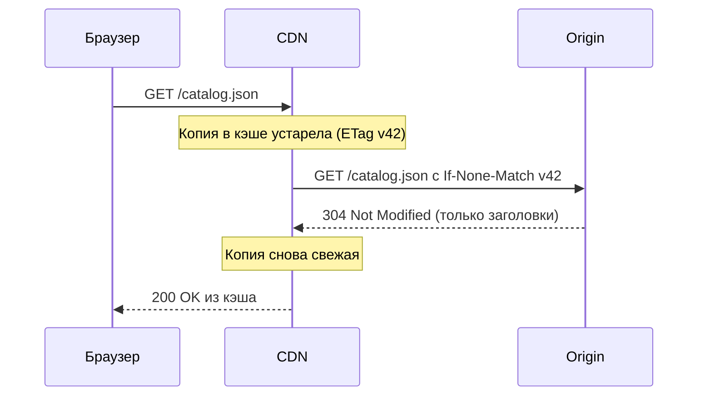
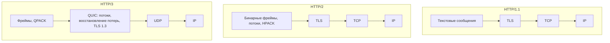

import { Aside } from '@astrojs/starlight/components';

HTTP — протокол «запрос — ответ», на котором работают браузеры, публичные API, большинство
внутренних вызовов между сервисами, CDN и объектные хранилища. Его *семантика* (методы, коды ответа,
заголовки, правила кэширования) почти не меняется десятилетиями, а *транспорт* сменился трижды: текст
поверх TCP, бинарные фреймы поверх TCP и потоки поверх QUIC. Проектировщику важны обе половины:
семантика определяет, что промежуточные узлы могут кэшировать и повторять, а транспорт — задержку,
число соединений и характер отказов.

<Aside type="tip" title="Коротко">
- Безопасные методы (GET, HEAD, OPTIONS, TRACE) ничего не меняют; идемпотентные (безопасные плюс PUT и DELETE) можно автоматически повторять. Для безопасного повтора POST и PATCH нужен ключ идемпотентности.
- На практике кэшируются только ответы на GET и HEAD. Управляйте этим через `Cache-Control`, а дешёвую перепроверку делайте через `ETag` и `If-None-Match` (ответ `304`).
- HTTP/2 мультиплексирует много запросов в одном TCP-соединении, но потеря одного пакета всё равно тормозит их все. HTTP/3 работает поверх QUIC (UDP) и снимает эту блокировку.
- Холодный HTTPS-запрос стоит 3 круговых задержки (RTT) с TCP + TLS 1.3, 2 — с QUIC и 1 — на переиспользованном соединении. Поэтому соединения нужно переиспользовать и держать в пулах.
</Aside>

## Запрос и ответ

Клиент открывает соединение, отправляет запрос (метод, цель, заголовки, необязательное тело) и
получает ответ (код состояния, заголовки, необязательное тело). Каждое сообщение самоописательно,
поэтому прокси, балансировщики нагрузки, CDN и кэши могут стоять на пути и действовать по заголовкам,
не понимая логики приложения.

```http
GET /v1/orders/8812 HTTP/1.1
Host: api.example.com
Accept: application/json
Authorization: Bearer eyJhbGciOi...
If-None-Match: "a1f3"

HTTP/1.1 200 OK
Content-Type: application/json
Cache-Control: private, max-age=60
ETag: "b7c9"

{"id": 8812, "status": "shipped"}
```

Сервер не хранит состояние диалога между запросами: всё нужное (личность, локаль, версию) клиент
передаёт в каждом запросе, либо сервер берёт это из общего хранилища. Именно отсутствие состояния
позволяет поставить сколько угодно одинаковых серверов за
[балансировщик нагрузки](/traffic/load-balancers/).

## Методы: безопасность, идемпотентность, кэшируемость

Таблица составлена по RFC 9110 (и RFC 5789 для PATCH). Многие популярные шпаргалки, включая
оригинальный Primer, ошибаются в столбце кэшируемости.

| Метод | Типичное применение | Безопасный | Идемпотентный | Ответ кэшируется |
|---|---|---|---|---|
| GET | Прочитать представление | Да | Да | Да |
| HEAD | GET без тела | Да | Да | Да |
| OPTIONS | Возможности сервера, CORS preflight | Да | Да | Нет |
| TRACE | Диагностическое «эхо», обычно выключен | Да | Да | Нет |
| PUT | Создать или полностью заменить по известному URI | Нет | Да | Нет |
| DELETE | Удалить ресурс | Нет | Да | Нет |
| POST | Создать в коллекции, выполнить действие | Нет | Нет | Редко (см. ниже) |
| PATCH | Частичное обновление | Нет | Нет | Редко (см. ниже) |
| CONNECT | Открыть туннель через прокси | Нет | Нет | Нет |

- **Безопасный** — клиент не запрашивает изменения состояния, поэтому краулеры и предзагрузчики могут вызывать такой метод свободно. Логи и метрики на сервере не в счёт.
- **Идемпотентный** — два одинаковых запроса дают тот же *задуманный* эффект, что и один. Именно это позволяет HTTP-клиентам, прокси и сервисной сетке повторять запрос после обрыва соединения.
- **Кэширование POST и PATCH.** Ответ можно переиспользовать, только если в нём есть явная свежесть *и* `Content-Location`, совпадающий с URI запроса, — и только для последующего GET или HEAD. Сам RFC 9110 отмечает, что большинство кэшей поддерживает лишь GET и HEAD, поэтому в дизайне считайте ответы на POST и PATCH некэшируемыми.
- Успешный PUT, DELETE или POST через кэш **инвалидирует** сохранённые ответы для этого URI.
- PATCH *можно* сделать идемпотентным (например, через `If-Match`), а POST — безопасным для повтора с помощью [ключа идемпотентности](/communication/rpc-and-rest/).

## Коды ответа

Первая цифра задаёт класс: `1xx` — информационные, `2xx` — успех, `3xx` — перенаправление, `4xx` —
клиент должен что-то изменить, `5xx` — сбой на сервере или за ним. Коды, которые стоит знать наизусть:

| Код | Значение | Заметка для дизайна |
|---|---|---|
| 200 / 204 | OK / OK без тела | |
| 201 Created | Ресурс создан | URI нового ресурса — в `Location` |
| 202 Accepted | Принято в асинхронную обработку | Верните URL задачи для опроса |
| 301 / 308 | Перемещён навсегда | 308 сохраняет метод и тело |
| 302 / 307 | Временное перенаправление | 307 сохраняет метод и тело |
| 304 Not Modified | Копия в кэше ещё актуальна | Без тела, экономит трафик |
| 400 / 422 | Некорректный / семантически неверный ввод | Не повторять |
| 401 / 403 | Не аутентифицирован / нет прав | 401 — это «кто вы?» |
| 404 / 409 | Не найдено / конфликт состояния | 409 — дубликат или конфликт версий |
| 412 Precondition Failed | `If-Match` не совпал | Оптимистичная блокировка |
| 429 Too Many Requests | Сработал rate limiting | Отправляйте `Retry-After` |
| 500 | Необработанная ошибка сервера | |
| 502 / 504 | Ошибка шлюза / тайм-аут шлюза | Вышестоящий сервис упал или тормозит |
| 503 Service Unavailable | Перегрузка или обслуживание | Отправляйте `Retry-After` |

Эмпирическое правило повторов: `429` и `503` повторяйте с экспоненциальной задержкой (backoff),
учитывая `Retry-After`; `502`/`504` — только для идемпотентных запросов; остальные `4xx` без изменений
не повторяйте никогда. Возвращайте машиночитаемые тела ошибок — стандартный формат описан в
RFC 9457 «problem details» (`application/problem+json`).

## Заголовки кэширования

Кэширование — место, где семантика HTTP окупается сильнее всего: кэш браузера, [CDN](/traffic/cdn/) и
обратный прокси могут отдать ответ, не трогая ваши серверы, если заголовки это разрешают.

```http
Cache-Control: public, max-age=31536000, immutable      # ассет с хешем в имени: app.3f9a.js
Cache-Control: public, max-age=60, s-maxage=300, stale-while-revalidate=30
Cache-Control: private, no-cache                         # персональная страница: хранить, но перепроверять
Cache-Control: no-store                                  # секреты: не хранить нигде
Vary: Accept-Encoding
```

- `max-age` задаёт время свежести для всех кэшей; `s-maxage` переопределяет его для общих кэшей (CDN, прокси).
- `private` не пускает ответ в общие кэши — обязательно для всего персонализированного.
- `no-cache` **не** означает «не кэшировать»: копию можно хранить, но перед каждым использованием её нужно перепроверить. Запрещает хранение именно `no-store`.
- `stale-while-revalidate` и `stale-if-error` (RFC 5861) позволяют кэшу отдавать слегка устаревшую копию, пока он обновляет её в фоне или пока origin недоступен.
- `Vary` перечисляет заголовки запроса, от которых зависит ответ; каждое дополнительное значение умножает число записей в кэше.

**Валидаторы и условные запросы.** `ETag` — непрозрачный тег версии (часто хеш содержимого);
`Last-Modified` — более грубая метка времени. Когда сохранённая копия устаревает, кэш не скачивает её
заново, а спрашивает у origin, изменилась ли она:



Те же валидаторы защищают запись. Клиент отправляет PUT с `If-Match: "v42"`; если кто-то уже обновил
ресурс, сервер отвечает `412`, а не перезаписывает молча. Это оптимистичное управление параллельным доступом — без блокировок.

## От HTTP/1.1 к HTTP/3



**HTTP/1.1** сделал соединения постоянными по умолчанию (keep-alive): несколько запросов могут
использовать одно TCP-соединение, но строго по очереди. Конвейеризация (pipelining) — отправка
нескольких запросов без ожидания ответов — есть в спецификации, но на практике не используется:
ответы должны приходить по порядку, и один медленный блокирует остальные. Браузеры обходят это,
открывая около шести соединений на origin.

**HTTP/2** (RFC 9113) режет сообщения на бинарные фреймы с идентификатором потока, так что множество
запросов и ответов чередуются в одном соединении, а заголовки сжимаются HPACK. Это убирает блокировку
*на уровне HTTP*, но не *в TCP*: TCP доставляет один упорядоченный поток байтов, и при потере одного
пакета все потоки соединения ждут его повторной передачи (подробно — в разделе
[TCP и UDP](/communication/tcp-and-udp/)). Поэтому в мобильных сетях с потерями одно соединение
HTTP/2 может работать хуже, чем шесть соединений HTTP/1.1. Server push на практике отменён (Chrome
выключил его в версии 106); его заменяют `103 Early Hints` и preload.

**HTTP/3** (RFC 9114, 2022) переносит ту же семантику на QUIC (RFC 9000) — транспорт поверх UDP,
который объединяет в одном слое потоки, восстановление потерь, контроль перегрузки и TLS 1.3. Потеря
в одном потоке больше не тормозит остальные, рукопожатия транспорта и TLS совмещены, а соединение
переживает смену сети клиентом (Wi-Fi → мобильная сеть), потому что идентифицируется connection ID,
а не IP-адресом и портом. Клиенты узнают о поддержке HTTP/3 из заголовка ответа `Alt-Svc` или
DNS-записи `HTTPS` (RFC 9460) и откатываются на HTTP/2, если UDP заблокирован.

На октябрь 2026 года все основные браузеры включают HTTP/3 по умолчанию, а W3Techs насчитывает
около 41% сайтов с его поддержкой — в основном через CDN и управляемые балансировщики. При
самостоятельном хостинге картина пестрее (в nginx модуль HTTP/3 до сих пор помечен как
экспериментальный), а QUIC обычно тратит больше CPU на байт, чем TCP в ядре: он работает в
пространстве пользователя и шифрует каждый пакет.

| | HTTP/1.1 | HTTP/2 | HTTP/3 |
|---|---|---|---|
| Транспорт | TCP | TCP | QUIC поверх UDP |
| Параллельность в соединении | 1 запрос за раз | Много потоков | Много потоков |
| Блокировка начала очереди | На уровне HTTP и TCP | На уровне TCP | Только внутри потока |
| Сжатие заголовков | Нет | HPACK | QPACK |
| RTT до отправки запроса (с TLS 1.3) | 2 | 2 | 1 |
| Переживает смену сети | Нет | Нет | Да (миграция соединения) |

## Цена защищённого соединения

Прежде чем придёт первый байт ответа, новое HTTPS-соединение оплачивает рукопожатия. TLS 1.3
(RFC 8446, в 2026 году переизданный как RFC 9846) требует одного RTT против двух у TLS 1.2, а QUIC
укладывает транспортное рукопожатие в тот же обмен.

| Установка соединения | RTT до первого байта ответа | При RTT 100 мс |
|---|---|---|
| Новое TCP + TLS 1.2 | 4 | 400 мс |
| Новое TCP + TLS 1.3 | 3 | 300 мс |
| TCP + возобновление TLS 1.3 с 0-RTT | 2 | 200 мс |
| Новое QUIC (HTTP/3) | 2 | 200 мс |
| Возобновление QUIC с 0-RTT | 1 | 100 мс |
| Тёплое переиспользуемое соединение | 1 | 100 мс |

**0-RTT и повтор.** При возобновлении сессии клиент может отправить запрос прямо в первом пакете
(«ранние данные», early data). Злоумышленник, перехвативший этот пакет, может воспроизвести его, и
уровень TLS не может полностью предотвратить повторы между соединениями. Поэтому серверы и CDN должны
принимать ранние данные только для безопасных идемпотентных запросов; на остальные сервер отвечает
`425 Too Early` (RFC 8470), и клиент повторяет запрос после полного рукопожатия.

Современные браузеры также по умолчанию согласуют гибридный постквантовый обмен ключами
(X25519MLKEM768); он добавляет больше килобайта к первому сообщению рукопожатия, но не добавляет
RTT.

## Переиспользование соединений и пулы

Рукопожатия — лишь часть цены: новое TCP-соединение ещё и стартует с маленьким окном перегрузки и
разгоняется до полной скорости за несколько RTT. Переиспользование тёплых соединений убирает обе
проблемы.

- **Пулы на клиенте.** HTTP-клиенты и SDK держат простаивающие соединения для каждого хоста. В HTTP/1.1 размер пула ограничивает параллельность (один запрос в полёте на соединение); в HTTP/2 и HTTP/3 одно соединение несёт много параллельных потоков — до лимита, заданного сервером (часто около 100).
- **Тайм-ауты простоя.** Тайм-аут простоя на клиенте должен быть короче, чем на сервере и балансировщике, иначе клиент возьмёт соединение, которое сервер только что закрыл, и получит сброс.
- **Долгие соединения и балансировка.** Пул HTTP/2-соединений, привязанный к нескольким бэкендам, обесценивает L4-балансировщик: новые серверы не получают трафика. Используйте L7-балансировку (по запросам), балансировку на клиенте или максимальный возраст соединения, вынуждающий периодически переподключаться.
- **Терминирование на краю сети.** Завершайте TLS и HTTP/3 на CDN или балансировщике рядом с пользователем, а оттуда к origin ходите по небольшому числу тёплых соединений.

<Aside type="note" title="На собеседовании">
- Ждите вопросов «идемпотентен ли PUT? а POST?» и «как сделать POST платежа безопасным для повтора?» — отвечайте про ключи идемпотентности.
- Покажите, что знаете, что и где кэшировать: `private` для пользовательских данных, `s-maxage` для CDN, `immutable` для ассетов с хешем, `ETag` для перепроверки.
- На вопрос «зачем HTTP/3?» назовите блокировку начала очереди в TCP, короткое рукопожатие и миграцию соединений — и издержки: UDP блокируется в некоторых сетях, выше нагрузка на CPU, менее зрелые инструменты для самостоятельного хостинга.
- Типичные ошибки: считать `no-cache` запретом кэширования, повторять неидемпотентные запросы по тайм-ауту, забывать о переиспользовании соединений при оценке задержки.
</Aside>

## Что почитать

- [RFC 9110: HTTP Semantics](https://www.rfc-editor.org/rfc/rfc9110.html) — первоисточник по методам, кодам ответа и условным запросам.
- [RFC 9111: HTTP Caching](https://www.rfc-editor.org/rfc/rfc9111.html) — свежесть, валидация и директивы `Cache-Control`.
- [MDN: HTTP caching](https://developer.mozilla.org/en-US/docs/Web/HTTP/Guides/Caching) — практическое руководство по частным и общим кэшам.
- [High Performance Browser Networking: HTTP/2](https://hpbn.co/http2/) — глава Ильи Григорика о фреймах, потоках и HPACK.
- [HTTP/3 explained](https://http3-explained.haxx.se/) — бесплатная книга Даниэля Стенберга о QUIC и HTTP/3.
- [A detailed look at TLS 1.3](https://blog.cloudflare.com/rfc-8446-aka-tls-1-3/) — Cloudflare о рукопожатии за 1 RTT и рисках 0-RTT.

## Связанные темы

- [TCP и UDP](/communication/tcp-and-udp/) — транспорт под HTTP и подробно о блокировке начала очереди.
- [RPC и REST](/communication/rpc-and-rest/) — стили API, построенные на семантике HTTP.
- [CDN](/traffic/cdn/) — где `Cache-Control` и терминирование HTTP/3 важнее всего.
- [Уровни кэширования](/caching/caching-layers/) — HTTP-кэш как один из нескольких слоёв.
- [Балансировщики нагрузки](/traffic/load-balancers/) — L4 и L7 для долгоживущих соединений.
- [Безопасность](/reliability/security/) — TLS, cookie и заголовки с точки зрения защиты.
