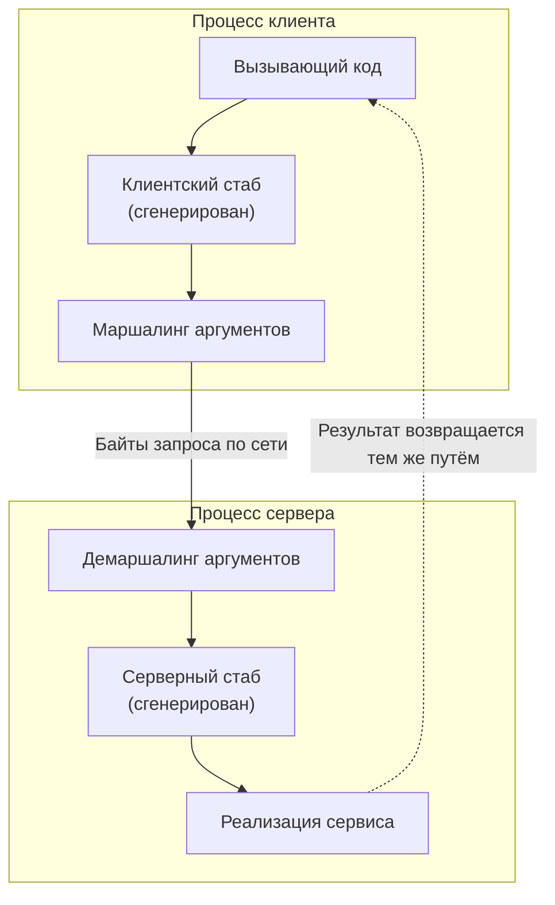

import { Aside } from '@astrojs/starlight/components';

Как только двум процессам нужно общаться, кто-то должен решить, как выглядит разговор. **RPC**
представляет его как вызов функций на удалённом сервере; **REST** — как чтение и изменение ресурсов
через небольшой единообразный набор операций. Сегодня оба обычно работают поверх HTTP, и выбор
определяется не столько технологией, сколько тем, кто клиенты, насколько независимо они должны
развиваться и какая инфраструктура (кэши, шлюзы, браузеры) стоит посередине.

<Aside type="tip" title="Коротко">
- RPC публикует *операции* (`CancelOrder`), REST — *ресурсы* (`POST /orders/981:cancel` или `PATCH /orders/981`).
- gRPC = Protocol Buffers + HTTP/2 + сгенерированные стабы: компактно, типизированно, с потоками; идеален между внутренними сервисами. Браузерам нужен gRPC-Web или Connect.
- REST поверх JSON — выбор по умолчанию для публичных API: подходит любой HTTP-клиент, работают HTTP-кэши и инструменты, контракт описывает OpenAPI.
- Независимо от стиля: версионируйте осознанно, пагинируйте курсорами, делайте записи безопасными для повтора с помощью ключей идемпотентности и ставьте дедлайн на каждый вызов.
</Aside>

## RPC: вызов функции где-то ещё

Удалённый вызов процедуры (remote procedure call) делает сетевой запрос похожим на локальный вызов
функции. Вызывающий код обращается к **клиентскому стабу** с обычными аргументами; стаб
**маршалирует** их (сериализует в байты), отправляет сообщение и ждёт; **серверный стаб**
демаршалирует запрос, вызывает настоящую реализацию и тем же путём возвращает результат.



Стабы генерируются из файла на **языке описания интерфейсов** (IDL), поэтому стороны согласуют имена
и типы ещё при компиляции. Но иллюзия локального вызова — это и самая старая ловушка RPC: удалённый вызов
занимает микросекунды или миллисекунды вместо наносекунд, может упасть по тайм-ауту и может
завершиться ошибкой *после* того, как сервер уже сделал работу. Хорошие RPC-фреймворки не прячут эти
различия, а делают их явными: дедлайны, коды статуса, политики повторов.

### gRPC и Protocol Buffers

gRPC — фреймворк, открытый Google и ныне развиваемый в CNCF, — стал основным выбором для трафика
между сервисами. Контракт задаётся файлом `.proto`:

```protobuf title="orders.proto"
syntax = "proto3";

package shop.orders.v1;

import "google/protobuf/timestamp.proto";

service OrderService {
  // Унарный вызов: один запрос, один ответ.
  rpc GetOrder(GetOrderRequest) returns (Order);
  rpc CancelOrder(CancelOrderRequest) returns (Order);
  // Серверный поток: сервер присылает смены статуса, пока заказ не доставлен.
  rpc WatchOrder(GetOrderRequest) returns (stream OrderEvent);
}

message GetOrderRequest {
  string order_id = 1;
}

message CancelOrderRequest {
  string order_id = 1;
  string reason = 2;
  string request_id = 3;  // ключ идемпотентности
}

message Order {
  string order_id = 1;
  Status status = 2;
  int64 total_cents = 3;
  google.protobuf.Timestamp updated_at = 4;
  reserved 5;  // удалённое поле: номер больше никогда не используется

  enum Status {
    STATUS_UNSPECIFIED = 0;
    STATUS_PLACED = 1;
    STATUS_SHIPPED = 2;
    STATUS_DELIVERED = 3;
    STATUS_CANCELLED = 4;
  }
}

message OrderEvent {
  Order order = 1;
}
```

Что важно знать проектировщику:

- **Кодирование.** Protocol Buffers записывают *номера* полей, а не имена, в компактном бинарном формате. Заполненный значениями `ord_981`, `STATUS_PLACED`, 4999 центов и меткой времени, `Order` выше кодируется в 22 байта, а те же значения в компактном JSON занимают около 100. Добавление полей обратно совместимо; перенумерация или повторное использование номера — нет, отсюда `reserved`.
- **Транспорт.** Каждый вызов — это HTTP/2 POST на `/package.Service/Method` с `content-type: application/grpc`; итоговый статус передаётся в HTTP-трейлерах (`grpc-status`). Много вызовов делят одно соединение.
- **Четыре формы вызова:** унарный, серверный поток, клиентский поток и двунаправленный поток. Потоки подходят для лент, загрузок и долгих подписок без отдельного канала push-уведомлений.
- **Дедлайны и отмена** распространяются по цепочке: если вызывающий сдался через 300 мс, нижележащие сервисы тоже могут прекратить работу.
- **Экосистема:** перехватчики (interceptors), проверки здоровья, повторы, хеджирование запросов и балансировка на клиенте встроены или стандартны в сервисных сетках.
- **Ограничения:** браузеры не умеют «чистый» gRPC (им недоступны HTTP/2-трейлеры), поэтому веб-клиенты используют gRPC-Web через прокси или протокол Connect; без инструментов полезная нагрузка нечитаема; долгоживущие HTTP/2-соединения требуют L7- или клиентской [балансировки нагрузки](/traffic/load-balancers/).

### Thrift и Avro

- **Apache Thrift**, созданный в Facebook, объединяет IDL, генераторы кода для многих языков и сменный стек протоколов (binary, compact, JSON) и транспортов. Он поддерживается и используется в крупных компаниях, но новые проекты чаще выбирают gRPC из-за более широкой экосистемы.
- **Apache Avro** — прежде всего формат сериализации и лишь во вторую очередь RPC. Данные записываются вместе со схемой (или с идентификатором схемы из реестра схем), а читатель согласует различия между схемой писателя и своей. Поэтому Avro силён в **эволюции схем** в конвейерах данных и потоках событий вроде Kafka. Генерация кода необязательна.
- **JSON-RPC 2.0** — минималистичный вариант: имя метода и параметры в JSON поверх любого транспорта. Его легко реализовать, и он пережил второе рождение как формат сообщений Model Context Protocol (MCP) для инструментов ИИ.

## REST: ресурсы и единообразный интерфейс

REST — архитектурный стиль, описанный Роем Филдингом в 2000 году, а не протокол. Его ограничения:
разделение клиента и сервера, **отсутствие состояния** (statelessness), **кэшируемые** ответы,
многоуровневая система, необязательный код по запросу — и то, что делает REST особенным,
**единообразный интерфейс** (uniform interface):

1. **Ресурсы идентифицируются URI:** `/orders/981`, `/customers/42/orders`.
2. **Ресурсами управляют через представления:** клиент отправляет и получает JSON (или другой media type), а не внутренние объекты сервера.
3. **Сообщения самоописательны:** смысл несут метод, код ответа и заголовки, поэтому их понимают промежуточные узлы. `GET` безопасен и кэшируем, `PUT` идемпотентен, `404` везде значит одно и то же.
4. **Гипермедиа как двигатель состояния приложения (HATEOAS):** ответы содержат ссылки на доступные дальше действия, и клиент переходит по ссылкам, а не собирает URL сам.

```json
{
  "id": "ord_981",
  "status": "placed",
  "total_cents": 4999,
  "_links": {
    "self":   { "href": "/orders/ord_981" },
    "cancel": { "href": "/orders/ord_981/cancellation", "method": "POST" },
    "items":  { "href": "/orders/ord_981/items" }
  }
}
```

**HATEOAS на практике встречается редко.** Большинство «REST» API останавливаются на втором уровне
модели зрелости Ричардсона: ресурсы, правильные методы и коды ответа, но клиенты зашивают шаблоны URL
из документации или описания OpenAPI. Полноценная гипермедиа встречается в основном в ссылках
пагинации и в нескольких стандартах (HAL, JSON:API). Это прагматичный выбор, а не провал, — но не
заявляйте HATEOAS, если клиенты на самом деле не ходят по ссылкам.

Для масштабирования важнее всего отсутствие состояния: каждый запрос несёт всё, что нужно серверу
(включая токен аутентификации), поэтому его может обслужить любой экземпляр, а экземпляры можно
свободно добавлять и убирать.

## Один и тот же API в двух стилях

Сервис заказов интернет-магазина, спроектированный обоими способами:

| Операция | В стиле RPC (gRPC или JSON через POST) | В стиле REST |
|---|---|---|
| Оформить заказ | `OrderService.PlaceOrder(items, address)` | `POST /orders` → `201`, `Location: /orders/ord_981` |
| Получить заказ | `OrderService.GetOrder(order_id)` | `GET /orders/ord_981` |
| Список заказов клиента | `OrderService.ListOrders(customer_id, page_token)` | `GET /customers/42/orders?limit=20&cursor=...` |
| Сменить адрес доставки | `OrderService.UpdateAddress(order_id, address)` | `PATCH /orders/ord_981` с новым адресом |
| Отменить заказ | `OrderService.CancelOrder(order_id, reason)` | `POST /orders/ord_981/cancellation` или `POST /orders/ord_981:cancel` |
| Частичный возврат денег | `PaymentService.Refund(order_id, amount)` | `POST /orders/ord_981/refunds` |
| Отслеживать доставку вживую | `OrderService.WatchOrder(order_id)` (серверный поток) | Нет естественного варианта: опрос, SSE или вебхуки |

Отмена и возврат показывают, где REST становится неудобным: это *действия*, а не правка поля. Хорошие
REST-дизайны моделируют их как создание подресурса (отмены, возврата) или, как в руководстве Google по
API, как **пользовательские методы** с глаголом через двоеточие (`POST /orders/ord_981:cancel`).
Строка с отслеживанием показывает, где сильны RPC-фреймворки: поток — часть контракта.

## Недостатки каждого подхода

**RPC**

- Клиенты привязаны к списку операций сервера; каждый новый сценарий обычно добавляет метод.
- Бинарный формат и HTTP/2-трейлеры усложняют отладку без инструментов (`grpcurl`, reflection).
- Всё — POST, поэтому HTTP-кэши, CDN и браузерные инструменты не помогают; кэширование уходит в приложение.
- Для браузеров нужен gRPC-Web или Connect; публичные потребители ждут обычный JSON.

**REST**

- Не всякая операция укладывается в CRUD над ресурсами; втискивание действий в методы HTTP даёт неуклюжий дизайн.
- Составной экран может требовать нескольких запросов (заказ, его позиции, клиент) — или специальных параметров «expand».
- Ответы со временем разрастаются, и клиенты скачивают ненужные поля (over-fetching); именно эту проблему решает GraphQL (см. [Стили API](/communication/api-styles/)).
- JSON многословен и нетипизирован, если не вкладываться в OpenAPI и генерацию кода.

## Версии, пагинация и идемпотентность

**Версионирование.** Предпочитайте аддитивные обратно совместимые изменения (новые необязательные
поля, новые эндпоинты), а новую мажорную версию оставляйте для ломающих. Распространённые схемы:
префикс пути (`/v1/orders`) — просто и дружит с кэшами; версия в заголовке или media type; версии по
датам, закреплённые за клиентом, как у Stripe. В Protobuf мажорную версию несёт имя пакета
(`shop.orders.v1`). О выводе из эксплуатации сообщайте заголовками ответа `Deprecation` (RFC 9745)
и `Sunset` (RFC 8594).

**Пагинация.** Пагинация по смещению (`?offset=10000&limit=20`) проста, но замедляется с глубиной и
пропускает или дублирует элементы, если данные меняются между страницами. **Курсорная** (keyset)
пагинация возвращает непрозрачный токен с последней позицией (`?cursor=eyJpZCI6...`); она одинаково
быстра на любой глубине и устойчива к вставкам. gRPC API следуют той же идее с `page_size`,
`page_token` и `next_page_token`.

**Идемпотентность.** Сеть может отказать уже *после* того, как сервер выполнил действие, поэтому клиенты
повторяют запросы, и повторное «списать деньги с карты» не должно списать дважды. GET, PUT и DELETE
идемпотентны по определению; для POST клиент отправляет уникальный **ключ идемпотентности**
(заголовок `Idempotency-Key` в HTTP API, поле `request_id` в RPC). Сервер сохраняет первый результат
под этим ключом и воспроизводит его при повторах:

```python title="idempotency.py"
import hashlib
import json
from dataclasses import dataclass
from typing import Callable


@dataclass(frozen=True)
class StoredResponse:
    request_hash: str
    status: int
    body: dict


class IdempotencyStore:
    """В продакшене: таблица или ключ Redis с TTL (например, 24 ч), запись атомарная."""

    def __init__(self) -> None:
        self._data: dict[str, StoredResponse] = {}

    def handle(self, key: str, payload: dict, action: Callable[[dict], tuple[int, dict]]) -> tuple[int, dict]:
        request_hash = hashlib.sha256(json.dumps(payload, sort_keys=True).encode()).hexdigest()
        if (seen := self._data.get(key)) is not None:
            if seen.request_hash != request_hash:
                return 422, {"error": "Idempotency-Key reused with a different payload"}
            return seen.status, seen.body          # вернуть первый результат, не выполнять заново
        status, body = action(payload)
        self._data[key] = StoredResponse(request_hash, status, body)
        return status, body


charges: list[dict] = []

def create_charge(payload: dict) -> tuple[int, dict]:
    charges.append(payload)
    return 201, {"charge_id": f"ch_{len(charges)}", **payload}


store = IdempotencyStore()
first = store.handle("8e1f-uuid", {"amount": 4999}, create_charge)
retry = store.handle("8e1f-uuid", {"amount": 4999}, create_charge)   # клиент не дождался ответа и повторил
misuse = store.handle("8e1f-uuid", {"amount": 10}, create_charge)
print(first, retry, misuse[0], len(charges))
assert first == retry and misuse[0] == 422 and len(charges) == 1
```

Боевая версия должна также обрабатывать два одновременных повтора (заблокировать ключ или отвечать
`409`, пока первый запрос выполняется) и записывать ключ и бизнес-изменение в одной транзакции.
Черновик IETF о стандартном заголовке `Idempotency-Key` (ныне истёкший) описывал тот же контракт: `400` при
отсутствии ключа, `422` при повторе ключа с другим телом, `409` при одновременном повторе.

## Компромиссы: что выбрать

| Ситуация | Обычный выбор | Почему |
|---|---|---|
| Публичный API для сторонних разработчиков | REST + JSON + OpenAPI | Работает из любого языка и `curl`, HTTP-кэширование, привычные соглашения |
| Внутренние вызовы между сервисами | gRPC | Типизированные контракты, компактное кодирование, дедлайны, потоки, сгенерированные клиенты |
| Браузер или мобильное приложение к вашему бэкенду | REST или GraphQL при множестве разных экранов | Нативно для браузера; GraphQL — когда клиентам нужна гибкая агрегация |
| Высоконагруженный поток событий или данных | Сообщения Avro или Protobuf в логах вроде Kafka | Эволюция схем и компактность важнее модели «запрос — ответ» |
| Push от сервера к клиенту | gRPC-потоки внутри; SSE, WebSocket или вебхуки снаружи | См. [Стили API](/communication/api-styles/) |

Многие организации используют оба стиля: gRPC внутри и
[API-шлюз](/traffic/reverse-proxy-and-api-gateway/), отдающий REST/JSON наружу (транскодирование
gRPC в JSON — частая функция шлюзов). Каким бы ни был стиль, самые трудные задачи одинаковы:
контракты, которые развиваются, не ломая клиентов, тайм-ауты, повторы и идемпотентность.

<Aside type="note" title="На собеседовании">
- Набросайте API пораньше: 4–6 эндпоинтов или RPC с полями запроса и ответа. Интервьюер оценивает именование, моделирование ресурсов и коды ответа.
- Обосновывайте выбор стиля тем, кто ваши клиенты: «публичные партнёры → REST; наши 40 внутренних сервисов → gRPC с дедлайнами».
- Ждите вопроса «что будет, если клиент повторит `POST /payments`?» — отвечайте про ключи идемпотентности и где они хранятся.
- Ждите вопроса «как пагинировать ленту?» — курсоры, а не смещения, и почему.
- Типичные ошибки: глаголы в путях REST (`/getOrder`), `200` с ошибкой в теле, отсутствие стратегии версий, заявленный HATEOAS без ссылок.
</Aside>

## Что почитать

- [Диссертация Филдинга, глава 5: REST](https://ics.uci.edu/~fielding/pubs/dissertation/rest_arch_style.htm) — исходное определение и ограничения.
- [Richardson Maturity Model](https://martinfowler.com/articles/richardsonMaturityModel.html) — Мартин Фаулер об уровнях от RPC поверх HTTP до гипермедиа.
- [gRPC core concepts](https://grpc.io/docs/what-is-grpc/core-concepts/) — типы вызовов, дедлайны и отмена.
- [Документация Protocol Buffers](https://protobuf.dev/) — кодирование, правила эволюции схем и руководство по стилю.
- [Google API Improvement Proposals: pagination](https://google.aip.dev/158) — продуманное руководство по дизайну; см. также пользовательские методы (AIP-136).
- [Designing robust APIs with idempotency](https://stripe.com/blog/idempotency) — Stripe о ключах идемпотентности, повторах и разбросе задержек (jitter).

## Связанные темы

- [HTTP](/communication/http/) — методы, коды ответа и кэширование, на которые опирается REST.
- [Стили API](/communication/api-styles/) — GraphQL, WebSocket, SSE и вебхуки.
- [Обратный прокси и API-шлюз](/traffic/reverse-proxy-and-api-gateway/) — где публичные API аутентифицируют, ограничивают и транскодируют.
- [Монолит и микросервисы](/architecture/monolith-and-microservices/) — почему число RPC между сервисами резко растёт.
- [Паттерны устойчивости](/reliability/resilience-patterns/) — тайм-ауты, повторы с экспоненциальной задержкой и предохранители вокруг каждого вызова.
