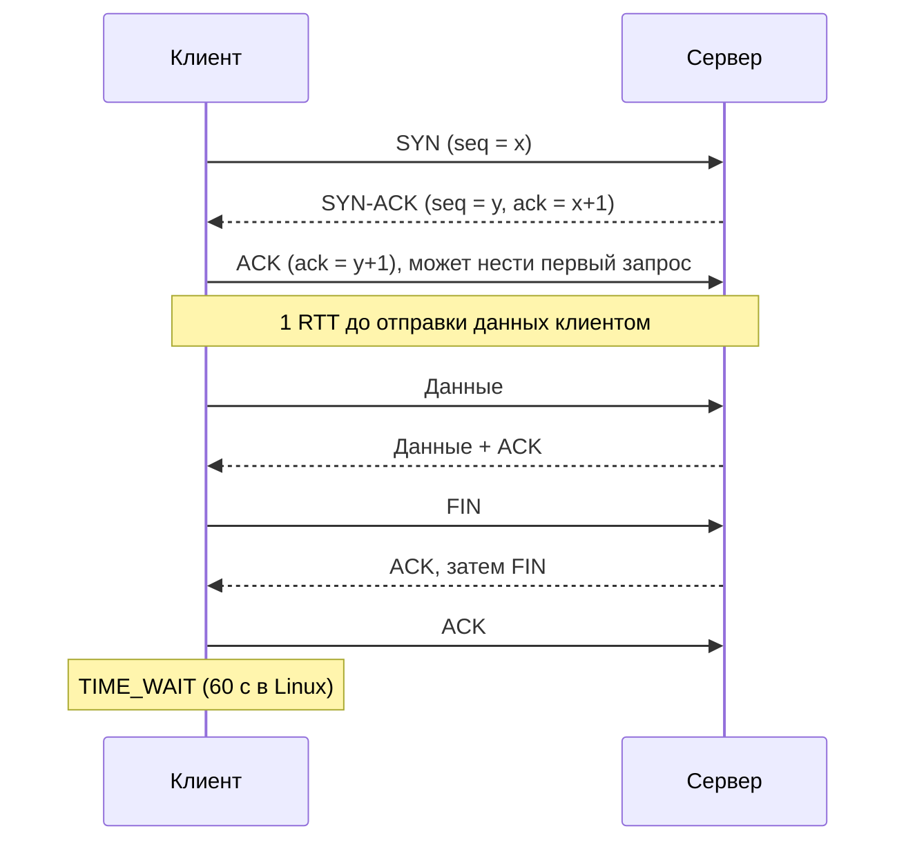
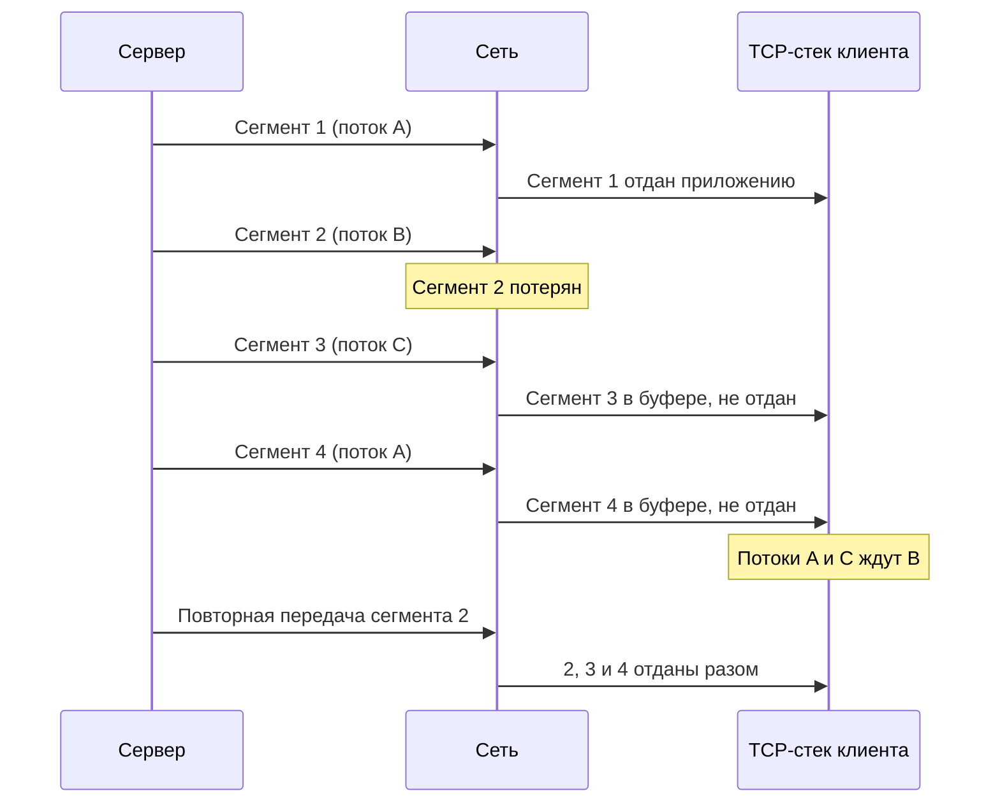

import { Aside } from '@astrojs/starlight/components';

Почти каждый байт вашей системы едет по одному из двух транспортных протоколов. TCP превращает
ненадёжную сеть в надёжный упорядоченный поток байтов и платит за это круговыми задержками (RTT) и
состоянием на каждое соединение. UDP передаёт сети отдельные датаграммы и больше ничего не обещает.
Выбор между ними — или QUIC, который строит гарантии уровня TCP поверх UDP, — определяет задержку,
масштабируемость и поведение системы при потере пакетов.

<Aside type="tip" title="Коротко">
- TCP: установка соединения стоит один RTT; дальше — надёжная доставка по порядку, управление потоком (не перегрузить получателя) и управление перегрузкой (не перегрузить сеть).
- UDP: нет соединения, порядка, повторной передачи и контроля перегрузки — 8 байт заголовка, всё остальное решает приложение.
- Соединения не бесплатны: рукопожатия, медленный старт, буферы ядра, поток или процесс на соединение у некоторых серверов, эфемерные порты в TIME_WAIT. Держите их в пулах и переиспользуйте.
- Блокировка начала очереди (head-of-line blocking): один потерянный TCP-сегмент задерживает всё, что идёт за ним, даже данные других запросов. QUIC решает это независимыми потоками поверх UDP.
</Aside>

## TCP: надёжный поток байтов

### Установка и закрытие соединения

TCP (RFC 9293) ориентирован на соединения. Прежде чем пойдут данные, стороны обмениваются начальными
номерами последовательности в тройном рукопожатии; закрытие идёт через сегменты FIN в каждую сторону.

Сторона, закрывшая соединение первой, держит сокет в состоянии **TIME_WAIT**, чтобы запоздавшие
сегменты старого соединения не приняли за сегменты нового. TCP Fast Open (RFC 7413) позволяет
передавать данные уже в SYN при повторных подключениях, но из-за проблем с промежуточным
оборудованием остался нишевым; на практике задержку установки сильнее сокращают переиспользование
соединений и TLS 1.3 или QUIC.

### Надёжная упорядоченная доставка

- У каждого байта есть **номер последовательности**; получатель подтверждает принятое, а отправитель повторяет всё, что не подтверждено за тайм-аут или помечено как пропавшее повторными ACK.
- **Контрольная сумма** ловит повреждения; испорченные сегменты отбрасываются и позже приходят заново.
- Получатель **переупорядочивает** сегменты и отдаёт приложению непрерывный поток байтов. Приложение никогда не видит дыр — но и ничего *после* дыры не видит, пока она не закрыта.

TCP передаёт байты, а не сообщения. Протоколы поверх него (HTTP, gRPC, протоколы СУБД) добавляют
собственную разметку, например префикс длины, чтобы находить границы сообщений.

### Управление потоком и управление перегрузкой

Объём неподтверждённых данных «в полёте» ограничивают два разных окна; действует меньшее из них.

- **Управление потоком** (flow control) защищает *получателя*. Он объявляет окно приёма (rwnd) — сколько места осталось в буфере. Медленный потребитель сужает окно, и отправитель ждёт: это встроенное [обратное давление (backpressure)](/async/queues-and-back-pressure/).
- **Управление перегрузкой** (congestion control) защищает *сеть*. Отправитель держит окно перегрузки (cwnd): растит его, пока приходят ACK, и урезает, когда потери или растущая задержка сигналят о перегрузке.

Новое соединение начинает с **медленного старта** (slow start) с маленьким окном — 10 сегментов,
около 14,6 КБ (RFC 6928, значение по умолчанию в Linux) — и примерно удваивает его каждый RTT. При
таком темпе ответ в 1 МБ требует около 7 RTT; при RTT 100 мс это 0,7 с ещё до того, как начнёт
играть роль пропускная способность канала. Поэтому тёплые переиспользуемые соединения намного
быстрее новых, а Linux по умолчанию снова сужает окно после простоя соединения.

Чтобы загрузить длинный быстрый канал, окно должно дорасти до **произведения пропускной способности
на задержку** (bandwidth-delay product): 1 Гбит/с × 100 мс = 12,5 МБ в полёте. Буферы меньше этого
ограничивают скорость независимо от ширины канала.

Алгоритмы по-разному понимают перегрузку. **CUBIC** (RFC 9438), алгоритм по умолчанию в Linux,
Windows и стеках Apple, реагирует на потери пакетов. **BBR**, разработанный в Google, вместо этого
моделирует пропускную способность узкого места и RTT, что помогает на длинных каналах с потерями;
Google использует его для собственного трафика, а его спецификация в 2026 году всё ещё остаётся
черновиком IETF.

## UDP: датаграммы и больше ничего

UDP (RFC 768) добавляет к IP порты и контрольную сумму — 8 байт заголовка — и на этом
останавливается. Каждый `send` — одна датаграмма, которая придёт целиком, придёт поздно, придёт
дважды, придёт не по порядку или не придёт вовсе. Нет состояния соединения, повторной передачи и
управления перегрузкой: приложение само решает, как обрабатывать потери и с какой скоростью можно
слать.

Что это даёт:

- **Нет платы за установку.** Первая же датаграмма несёт данные. DNS-запрос — одна датаграмма туда и одна обратно.
- **Нет блокировки начала очереди.** Потерянная датаграмма ничего не задерживает; приложение может её пропустить.
- **Широковещание и мультикаст.** Одна отправка может дойти до всех хостов подсети (broadcast) или до подписанной группы (multicast); TCP общается только с одним собеседником.
- **Дешёвый приём от многих.** Один сокет может обслуживать миллионы клиентов без состояния в ядре на каждого.

Где применяется:

- **Протоколы начальной настройки.** У DHCP-клиента ещё нет IP-адреса, поэтому он рассылает широковещательный запрос с UDP-порта 68 на порт 67, и ответить может любой сервер. DNS, NTP и SNMP работают поверх UDP по схожим причинам — задержка и простота.
- **Медиа в реальном времени.** Голос и видео (WebRTC передаёт SRTP, обычно поверх UDP) предпочитают сбой зависанию: перепосланный аудиофрейм, пришедший на 300 мс позже, бесполезен.
- **Игры.** Динамичные многопользовательские игры шлют снимки состояния много раз в секунду; важен только последний, поэтому потерянный просто заменяется следующим.
- **Горячие пути, терпимые к потерям.** Клиенты memcache в Facebook отправляли чтения по UDP и считали потерянный ответ промахом кэша, сократив задержку примерно на пятую часть; записи и удаления остались на TCP.

Обратная сторона: UDP — любимый инструмент **DDoS-атак с усилением** (amplification). Атакующий
подделывает адрес жертвы, и сервер отправляет ей большой ответ. Никогда не отвечайте на маленький
неаутентифицированный UDP-запрос намного большим ответом: memcached в 2018 году выключил UDP по
умолчанию именно после такой атаки, а сервер QUIC может отправить не более чем втрое больше байтов,
чем получил, пока адрес клиента не подтверждён.

## Цена соединений

По отдельности TCP-соединения дёшевы, в сумме — дороги:

| Издержка | Где проявляется | Типичное решение |
|---|---|---|
| RTT рукопожатий (плюс TLS) | Каждое новое соединение, особенно между регионами | Keep-alive, пулы соединений, терминирование на краю сети |
| Медленный старт | Первые сотни КБ каждого нового соединения | Переиспользовать тёплые соединения |
| Буферы ядра | Много простаивающих или медленных клиентов | Автонастройка, лимиты, короткие тайм-ауты простоя |
| Процесс или поток на соединение | PostgreSQL порождает процесс на каждое клиентское соединение | Пулер вроде PgBouncer, меньше экземпляров приложения |
| Эфемерные порты в TIME_WAIT | Частые короткие соединения к одному бэкенду | Переиспользовать соединения, распределять по IP бэкендов |
| Состояние на балансировщике и NAT | Миллионы долгоживущих соединений | Лимиты соединений, тайм-ауты простоя |

Две быстрые оценки. Linux выделяет эфемерные порты 32768–60999 — около 28 000 на пару «исходный IP —
адресат»; при TIME_WAIT в 60 секунд клиент, открывающий новое соединение на каждый запрос к одному
бэкенду, упрётся в предел примерно на 470 новых соединениях в секунду. А 500 экземпляров приложения
по 20 соединений с базой — это уже 10 000 серверных соединений, намного больше, чем комфортно
выдерживает одна реляционная СУБД. Отсюда **пулы соединений** на клиенте и **пулеры или прокси**
перед базами и кэшами.

## Блокировка начала очереди — один раз и понятно

Блокировка начала очереди (head-of-line blocking, HOL) возникает, когда независимые порции данных
делят один упорядоченный канал: застрявший первый элемент задерживает всё, что стоит за ним.

- **На прикладном уровне** от неё страдает HTTP/1.1: ответы в одном соединении должны возвращаться в порядке запросов.
- **На транспортном уровне** — TCP, потому что он обещает один упорядоченный поток байтов. HTTP/2 мультиплексирует много потоков поверх TCP, но когда теряется сегмент 2 (поток B), ядро придерживает и сегменты 3 и 4, хотя они относятся к другим потокам. Задержка длится минимум один RTT, а если потеряется и повтор — намного дольше.

Протоколы на UDP избегают этого, доставляя каждую датаграмму независимо, а QUIC сохраняет порядок
внутри потока, не навязывая его между потоками, — потеря в потоке B задерживает только поток B.

## QUIC: надёжность заново, поверх UDP

QUIC (RFC 9000, 2021) — полноценный надёжный транспорт, который работает поверх UDP и живёт в
пространстве пользователя, а не в ядре. UDP позволяет ему проходить через существующее сетевое
оборудование и развиваться, не дожидаясь обновлений операционных систем.

- **Потоки:** много независимых упорядоченных надёжных потоков в одном соединении, с управлением потоком на уровне каждого потока и соединения в целом.
- **Встроенный TLS 1.3:** транспортное и криптографическое рукопожатия совмещены (1 RTT, или 0-RTT при возобновлении), а почти все заголовки зашифрованы, так что промежуточное оборудование не может «закостенить» протокол.
- **Идентификаторы соединения:** соединение переживает смену IP или порта клиента, например переход с Wi-Fi на мобильную сеть.
- **Современное восстановление потерь:** номера пакетов никогда не используются повторно, и не возникает вопроса, какая копия повторной передачи подтверждена.
- **Необязательные ненадёжные датаграммы** (RFC 9221) — для медиа и игр, которым нужны шифрование и контроль перегрузки QUIC без повторных передач.

QUIC — транспорт для HTTP/3 и WebTransport. Издержки: больше CPU на байт, чем у TCP в ядре; UDP
блокируется или ограничивается в некоторых корпоративных сетях (поэтому клиенты держат запасной путь
через TCP); меньше инструментов наблюдаемости, ведь полезная нагрузка и большинство заголовков
зашифрованы.

## Компромиссы

| Потребность | TCP | UDP (свой протокол) | QUIC |
|---|---|---|---|
| Все байты, по порядку | Да, встроено | Придётся строить самим | Да, внутри потока |
| Минимальная задержка, поздние данные бесполезны | Встаёт при потерях | Да | С расширением датаграмм |
| Много независимых запросов в одном соединении | Блокировка HOL | Да | Да |
| Широковещание или мультикаст | Нет | Да | Нет |
| Цена установки | 1 RTT + TLS | Нет | 1 RTT вместе с TLS, 0-RTT при возобновлении |
| Управление перегрузкой | Встроено | Ваша ответственность | Встроено |
| Проходит любой файрвол | Да | Часто блокируется | Часто блокируется, нужен откат на TCP |
| Типичные пользователи | HTTP/1.1–2, СУБД, SSH, SMTP, Kafka | DNS, DHCP, NTP, VoIP, игры | HTTP/3, WebTransport, современные мобильные приложения |

По умолчанию берите TCP (или HTTP поверх него) для всего, что должно дойти целиком. UDP — когда
своевременность важнее полноты или нужно широковещание, и тогда управление перегрузкой и безопасность
на вас. QUIC — обычно включением HTTP/3 на CDN или балансировщике — когда клиенты сидят в сетях с
потерями или часто меняют сеть.

<Aside type="note" title="На собеседовании">
- Пройдите по тройному рукопожатию и назовите цену: один RTT плюс ещё один на TLS 1.3.
- Для видеозвонка или игры объясните выбор UDP: поздние данные хуже потерянных. Для чата объясните, почему подходит TCP (или WebSocket поверх него).
- Ждите вопроса «что такое блокировка начала очереди и как HTTP/3 её устраняет?» — различайте её на уровне HTTP и на уровне TCP.
- Упоминайте пулы соединений, если в дизайне много серверов приложений обращаются к одной базе или кэшу; считайте «соединений на экземпляр × экземпляров».
- Типичные ошибки: говорить, что UDP «быстрее», не уточняя, чем за это платим; забывать, что на UDP нужны управление перегрузкой и защита от усиления на уровне приложения.
</Aside>

## Что почитать

- [RFC 9293: Transmission Control Protocol](https://www.rfc-editor.org/rfc/rfc9293.html) — сводная спецификация TCP 2022 года.
- [High Performance Browser Networking: Building Blocks of TCP](https://hpbn.co/building-blocks-of-tcp/) — рукопожатия, медленный старт и блокировка очереди в цифрах.
- [High Performance Browser Networking: Building Blocks of UDP](https://hpbn.co/building-blocks-of-udp/) — обход NAT, STUN, TURN и ICE.
- [RFC 9000: QUIC](https://www.rfc-editor.org/rfc/rfc9000.html) — спецификация транспорта QUIC.
- [UDP vs. TCP](https://gafferongames.com/post/udp_vs_tcp/) — Гленн Фидлер о том, почему игры реального времени используют UDP.
- [Scaling Memcache at Facebook](https://www.usenix.org/system/files/conference/nsdi13/nsdi13-final170_update.pdf) — статья NSDI 2013; см. чтения по UDP.

## Связанные темы

- [HTTP](/communication/http/) — HTTP/1.1, HTTP/2 и HTTP/3 поверх этих транспортов.
- [Стили API](/communication/api-styles/) — WebSocket, SSE и long polling работают на долгоживущих TCP-соединениях.
- [Балансировщики нагрузки](/traffic/load-balancers/) — L4-балансировка работает на уровне TCP/UDP.
- [Цифры задержек](/reference/latency-numbers/) — RTT, из-за которых рукопожатия дороги.
- [Очереди и обратное давление](/async/queues-and-back-pressure/) — управление потоком как backpressure на транспортном уровне.
