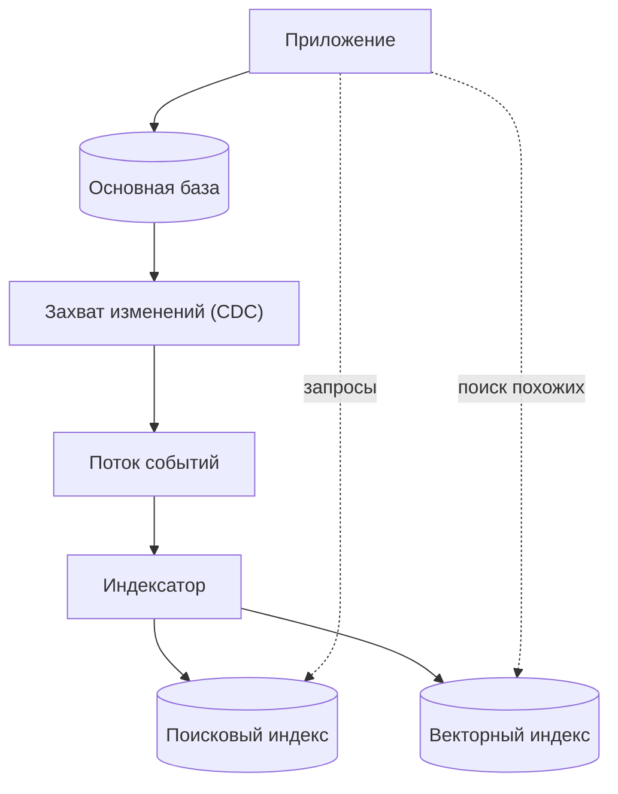

import { Aside } from '@astrojs/starlight/components';

«NoSQL» — общее название для баз данных, которые отказываются от реляционной модели ради чего-то другого: более простой модели данных, которую легко разбить на партиции, гибкой схемы или формата хранения, заточенного под один вид запросов. Проектировщику полезен не абстрактный вопрос «SQL или NoSQL?», а конкретный: «какая модель данных соответствует тому, как эти данные читают и пишут?»

<Aside type="tip" title="Коротко">
- NoSQL-хранилища жертвуют join-ами, произвольными запросами и (часто) транзакциями между записями ради горизонтального масштабирования, предсказуемой задержки (latency) и гибкой схемы.
- Четыре классических семейства: **«ключ-значение»**, **документные**, **колоночные (wide-column)**, **графовые**. В 2026 году важны ещё три: **временные ряды**, **поисковые движки** и **векторные хранилища**.
- BASE описывает подход к проектированию, а не продукт. Многие NoSQL-системы сегодня дают ACID в пределах партиции или даже между элементами.
- Моделирование в NoSQL начинается с запросов: сначала перечислите их, затем выберите ключи и денормализуйте данные так, чтобы каждый запрос читал одну партицию.
</Aside>

## Что меняет NoSQL

Реляционная база хранит нормализованные таблицы и позволяет задать любой вопрос в момент запроса. Большинство NoSQL-хранилищ устроены наоборот: вопросы определяются заранее, а данные хранятся в форме ответов. Типичные последствия:

- **Сначала партиционирование.** Данные распределяются по узлам по ключу партиции, поэтому чтение и запись по одному ключу масштабируются почти линейно. Запросы, затрагивающие много партиций, медленные или вовсе невозможны.
- **Денормализация.** Связанные данные встраиваются или дублируются вместо join-ов. Если соединения и нужны, их делает код приложения.
- **Схема при чтении (schema-on-read).** База не навязывает схему — за неё отвечает приложение или слой валидации.
- **Настраиваемая согласованность.** Многие хранилища позволяют каждому запросу выбрать быстрое, но, возможно, устаревшее чтение или более медленное строго согласованное.

С момента написания исходного Primer граница размылась. MongoDB поддерживает ACID-транзакции над несколькими документами начиная с версии 4.0, DynamoDB — транзакции до 100 элементов, а PostgreSQL хранит и индексирует JSON-документы. Выбирайте по модели данных и шаблонам доступа, а не по ярлыку.

## BASE и ACID

**ACID** (атомарность, согласованность, изолированность, долговечность) — контракт классической реляционной транзакции. **BASE** придумали как его противоположность для больших кластерных сервисов в группе Эрика Брюера в Беркли в 1997 году, а популярным термин сделала статья Дэна Притчетта в ACM Queue (2008):

- **Basically available (базовая доступность)** — система продолжает отвечать, даже если часть ответов неполна или устарела.
- **Soft state (мягкое состояние)** — в данный момент реплики могут хранить разные значения; состояние меняется по мере догоняющей репликации.
- **Eventually consistent (согласованность в конечном счёте)** — если записи прекращаются, все реплики сходятся.

| Свойство | ACID | BASE |
|---|---|---|
| Единица корректности | Транзакция над многими строками | Один элемент или партиция |
| Типичное поведение при разделении сети (по CAP, к ACID не относится) | Предпочитает согласованность (может отклонять записи) | Предпочитает доступность (может отдавать устаревшие данные) |
| Конфликты | Предотвращаются блокировками или MVCC | Обнаруживаются и разрешаются позже (last-writer-wins, векторы версий, CRDT) |
| Кто следит за инвариантами | База данных | В основном приложение |

На практике выбор делается для каждой операции, а не для продукта в целом. В Cassandra каждый запрос может выбрать уровень согласованности (`ONE`, `QUORUM`, `ALL`), а чтения в DynamoDB согласованы в конечном счёте, если не запросить `ConsistentRead`. Лежащий в основе компромисс разобран на странице [CAP и PACELC](/fundamentals/cap-theorem/).

## Четыре классических семейства

### Хранилища «ключ-значение»

**Абстракция:** огромная хеш-таблица из ключа в непрозрачное значение (некоторые хранят ключи отсортированными, что даёт диапазонные сканирования).

- **Сильные стороны:** самая простая модель для партиционирования и репликации; поиск за константное время; очень высокая пропускная способность; значение может быть чем угодно.
- **Слабые стороны:** хранилище не умеет искать внутри значений; дополнительные пути доступа означают, что лишние ключи придётся поддерживать самостоятельно.
- **Примеры:** Redis и Valkey (в памяти, богатые структуры данных; Valkey — форк под лицензией BSD, появившийся после смены лицензии Redis в 2024 году, а в Redis 8 в 2025 году добавили вариант AGPLv3), Amazon DynamoDB, etcd (небольшие строго согласованные конфигурационные данные), FoundationDB, а также встраиваемые движки вроде RocksDB, на которых построены многие другие базы.
- **Где применять:** сессии, кэши, флаги функций, счётчики, корзины покупок, ключи идемпотентности.

### Документные хранилища

**Абстракция:** хранилище «ключ-значение», значения которого — структурированные документы (JSON или BSON), понятные базе и индексируемые ею.

- **Сильные стороны:** один документ содержит целый агрегат (заказ со строками), поэтому большинство чтений — один запрос; поля могут различаться между документами; вторичные индексы по вложенным полям.
- **Слабые стороны:** связи «многие ко многим» ведут к дублированию или соединениям в приложении; большие растущие документы дорого перезаписывать (в MongoDB лимит документа — 16 МиБ).
- **Примеры:** MongoDB, Couchbase, Google Firestore, Azure Cosmos DB; тип `jsonb` в PostgreSQL закрывает многие из этих задач внутри реляционной базы.
- **Где применять:** каталоги, контент, профили пользователей, полезная нагрузка событий — данные, которые читают и пишут целыми агрегатами.

### Колоночные хранилища (wide-column)

**Абстракция:** двухуровневая карта `ключ партиции → строки, отсортированные по ключу кластеризации → столбцы`. Партиция хранится вместе и в отсортированном виде, поэтому «все события устройства X между T1 и T2» — одно последовательное чтение.

- **Сильные стороны:** огромная пропускная способность на запись (лог-структурированное хранение, LSM-деревья); линейное масштабирование до сотен узлов; репликация между дата-центрами; настраиваемая согласованность.
- **Слабые стороны:** под каждый запрос проектируется своя таблица; нет join-ов; удаления порождают «надгробия» (tombstones), замедляющие чтение до уплотнения (compaction); неограниченно растущие партиции становятся горячими точками.
- **Примеры:** Apache Cassandra (в 5.0 появились storage-attached вторичные индексы и векторный поиск), ScyllaDB (совместима с Cassandra; с версии 2025.1 распространяется по source-available-лицензии, последний релиз под AGPL — 6.2), Google Cloud Bigtable, Apache HBase.
- **Где применять:** упорядоченные по времени данные большого объёма — история сообщений, телеметрия IoT, ленты активности, сигналы антифрода.

### Графовые базы данных

**Абстракция:** граф свойств — вершины и рёбра, у которых есть свойства «ключ-значение». Переход по ребру — это переход по указателю, а не поиск по индексу, поэтому многошаговые запросы остаются быстрыми по мере роста данных.

- **Сильные стороны:** запросы вроде «друзья друзей, купившие X» или «кратчайший путь между двумя счетами» короткие и эффективные; схема легко эволюционирует.
- **Слабые стороны:** граф трудно партиционировать — любой разрез оставляет рёбра между машинами; аналитика по всему графу обычно выполняется отдельным движком; языки запросов знает меньше инженеров.
- **Примеры:** Neo4j (Cypher), Amazon Neptune, Memgraph, TigerGraph, JanusGraph.
- **Где применять:** мошеннические схемы, рекомендации, графы знаний, сетевые графы и графы прав доступа.

Исходный Primer называл графовые базы «относительно новыми». Это уже не так: Neo4j существует с 2007 года, а графовые запросы стандартизированы. В апреле 2024 года ISO опубликовала **GQL** (ISO/IEC 39075), а SQL:2023 добавил **SQL/PGQ** для графовых запросов поверх реляционных таблиц. Очень большие социальные графы по-прежнему обычно обслуживает шардированное хранилище «ключ-значение» или SQL с графовым API сверху — так устроен TAO в Facebook.

## Семейства, важные в 2026 году

### Базы временных рядов

Данные временных рядов в основном дописываются в конец, поступают в порядке времени и запрашиваются по диапазонам времени с агрегацией («p99 задержки по минутам за последние сутки»). Базы временных рядов используют это: хранят данные с партиционированием по времени, сжимают соседние значения (дельта- и XOR-кодирование радикально уменьшают метки времени и медленно меняющиеся числа), прореживают данные (downsampling) и автоматически удаляют старые.

Примеры: Prometheus и VictoriaMetrics для метрик, InfluxDB, TimescaleDB (расширение PostgreSQL), QuestDB, а также аналитические колоночные СУБД (column store) вроде ClickHouse, которые хорошо справляются с аналитикой временных рядов. Следите за **кардинальностью**: каждая уникальная комбинация меток — новый ряд, и метка вроде `user_id` может взорвать потребление памяти.

### Поисковые движки

Поисковый движок построен вокруг **инвертированного индекса**: для каждого термина хранится отсортированный список документов (и позиций), где он встречается. Запрос пересекает списки и ранжирует результаты моделью релевантности, например BM25.

| Термин | Список документов (ID) |
|---|---|
| `cache` | 3, 8, 21, 40 |
| `redis` | 8, 21, 77 |
| `cache` AND `redis` | 8, 21 |

Elasticsearch и OpenSearch (оба построены на Apache Lucene) добавляют шардирование, репликацию, агрегации и векторный поиск. Поисковые индексы работают в **почти реальном времени**: новый документ становится доступным для поиска после обновления индекса (refresh; в Elasticsearch по умолчанию раз в секунду). Они редко бывают источником истины: обычно изменения потоком передаются из основной базы в индекс.

Индекс отстаёт от базы, и это нужно учитывать в дизайне: показывать «изменение обрабатывается» или читать собственные записи из основной базы.

### Векторные базы и векторный поиск

Модели машинного обучения превращают тексты, изображения или пользователей в **эмбеддинги** — векторы из сотен или тысяч чисел, в которых похожие объекты лежат рядом. Векторный поиск находит ближайших соседей вектора запроса. Точный поиск сравнивает запрос с каждым вектором, поэтому в продакшене используют индексы **приближённого поиска ближайших соседей (ANN)**:

- **HNSW** — многоуровневый граф близости; высокая полнота и низкая задержка, но много памяти.
- **IVF** — векторы кластеризуются, поиск идёт только по ближайшим кластерам; часто сочетается с **продуктовым квантованием** (product quantization) для сжатия векторов.
- **Индексы на диске и в объектном хранилище** — медленнее, но намного дешевле в пересчёте на вектор при миллиардах векторов.

Любой ANN-индекс балансирует **полноту** (recall — долю найденных настоящих соседей) против задержки и памяти. В продакшене также нужны фильтры по метаданным («только документы, доступные этому пользователю») и обычно **гибридный поиск**, объединяющий оценки BM25 по ключевым словам со сходством векторов.

Варианты — от расширений до отдельных движков: `pgvector` для PostgreSQL, векторные возможности Elasticsearch, OpenSearch, Redis и Cassandra, специализированные базы Milvus, Qdrant, Weaviate и Pinecone, а также сервисы поверх объектного хранилища, например Amazon S3 Vectors. Отдельный движок окупается при сотнях миллионов векторов или под большой нагрузкой фильтрованных запросов. До этого часто хватает уже используемой базы.

## Моделирование под шаблоны доступа

Реляционное моделирование начинается с сущностей, NoSQL-моделирование — с **запросов**. Порядок работы:

1. Перечислите все шаблоны доступа с ожидаемой частотой и целевой задержкой («получить заказ по ID», «список заказов клиента, новые сначала»).
2. Выберите ключи партиции и сортировки так, чтобы каждый шаблон читал **одну партицию**, в идеале одним запросом.
3. Денормализуйте: скопируйте поля, нужные каждому запросу, в читаемый им элемент.
4. Добавьте вторичные индексы для оставшихся шаблонов; каждый стоит дополнительной ёмкости на запись.
5. Проверьте горячие партиции: ключ, получающий непропорциональную долю трафика, упирается в лимиты партиции (в DynamoDB — 3000 единиц чтения и 1000 единиц записи в секунду).

**Однотабличный дизайн DynamoDB** (single-table design) доводит идею до предела: несколько типов сущностей живут в одной таблице, а связанные элементы делят ключ партиции, так что один запрос возвращает «коллекцию элементов», которую реляционная база собрала бы join-ом.

| PK | SK | Атрибуты |
|---|---|---|
| `CUSTOMER#42` | `PROFILE` | name, email, tier |
| `CUSTOMER#42` | `ORDER#2026-09-30#1001` | total, status |
| `CUSTOMER#42` | `ORDER#2026-10-05#1002` | total, status |
| `ORDER#1002` | `LINE#1` | sku, qty, price |

Запрос `PK = CUSTOMER#42` с `SK`, начинающимся на `ORDER#`, возвращает заказы клиента в порядке дат. Цена — жёсткость: новый шаблон доступа может потребовать переписать все элементы, а для аналитики данные приходится выгружать и перестраивать. Поэтому многие команды используют несколько таблиц — по одной на ограниченный контекст, — а не одну таблицу на всё.

## Компромиссы

| Семейство | Модель данных | Сильные стороны | Слабые стороны | Примеры |
|---|---|---|---|---|
| «Ключ-значение» | Ключ → непрозрачное значение | Поиск по ключу, предельная пропускная способность | Запросы по содержимому значения | Redis, Valkey, DynamoDB, etcd |
| Документное | Ключ → JSON-документ | Чтение агрегата целиком, гибкие поля | Связи «многие ко многим» | MongoDB, Couchbase, Firestore |
| Колоночное | Партиция → отсортированные строки | Запись упорядоченных по времени данных в масштабе | Произвольные запросы, join-ы | Cassandra, ScyllaDB, Bigtable |
| Графовое | Вершины и рёбра | Многошаговые обходы | Горизонтальное партиционирование | Neo4j, Neptune, Memgraph |
| Временные ряды | Ряд → точки с метками времени | Агрегация по диапазонам, сжатие | Метки с высокой кардинальностью | Prometheus, InfluxDB, TimescaleDB |
| Поиск | Термин → список документов | Полнотекстовая релевантность, фасеты | Роль источника истины | Elasticsearch, OpenSearch |
| Векторное | Эмбеддинг → соседи | Поиск похожего | Точность; стоимость в масштабе | pgvector, Milvus, Qdrant |

<Aside type="note" title="На собеседовании">
- Называйте шаблоны доступа раньше, чем базу. «Нужен поиск по ключу на 200 тыс. QPS с задержкой в единицы миллисекунд» обосновывает DynamoDB или Cassandra; «NoSQL лучше масштабируется» — нет.
- Ждите уточнений про ключ партиции: что будет с пользователем-знаменитостью или горячим товаром? (Шардирование записи, кэширование, разбиение ключа.)
- Говорите о согласованности точно: какие чтения могут быть устаревшими, насколько и что увидит пользователь.
- Поисковые и векторные индексы — производные данные. Объясните, как они наполняются (CDC или события), насколько отстают и как их перестроить.
- Типичная ошибка — выбрать графовую базу для социальной сети, не обсудив, как она шардируется.
</Aside>

## Что почитать

- [Dynamo: Amazon's Highly Available Key-value Store](https://www.allthingsdistributed.com/files/amazon-dynamo-sosp2007.pdf) — статья 2007 года, с которой начались безлидерные хранилища с согласованностью в конечном счёте.
- [Bigtable: A Distributed Storage System for Structured Data](https://research.google/pubs/bigtable-a-distributed-storage-system-for-structured-data/) — откуда пошла колоночная модель.
- [Amazon DynamoDB: A Scalable, Predictably Performant, and Fully Managed NoSQL Database Service](https://www.usenix.org/conference/atc22/presentation/elhemali) — как на самом деле устроен DynamoDB, USENIX ATC 2022.
- [NoSQL design for DynamoDB](https://docs.aws.amazon.com/amazondynamodb/latest/developerguide/bp-general-nosql-design.html) и [руководство по однотабличному дизайну](https://www.alexdebrie.com/posts/dynamodb-single-table/) Алекса Дебри.
- [BASE: An ACID Alternative](https://queue.acm.org/detail.cfm?id=1394128) — Дэн Притчетт, ACM Queue.
- [Efficient and robust approximate nearest neighbor search using HNSW graphs](https://arxiv.org/abs/1603.09320) — статья, на которой основано большинство векторных индексов.

## Связанные темы

- [SQL или NoSQL](/data/sql-or-nosql/) — руководство по выбору на основе описанных здесь семейств.
- [Партиционирование и шардирование](/data/partitioning-and-sharding/) — как ключи партиций распределяют данные и откуда берутся горячие точки.
- [Репликация](/data/replication/) — репликация с лидером и без лидера, стоящая за поведением BASE.
- [Теорема CAP и PACELC](/fundamentals/cap-theorem/) — компромисс между согласованностью и доступностью в строгой форме.
- [Потоковая передача событий](/async/event-streaming/) — как потоки изменений поддерживают поисковые и векторные индексы в актуальном состоянии.
- [Системы на базе LLM](/architecture/llm-applications/) — векторный и гибридный поиск как слой извлечения для RAG.
