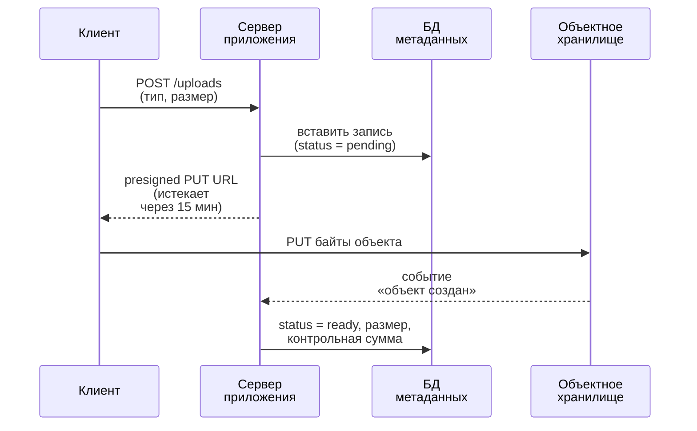
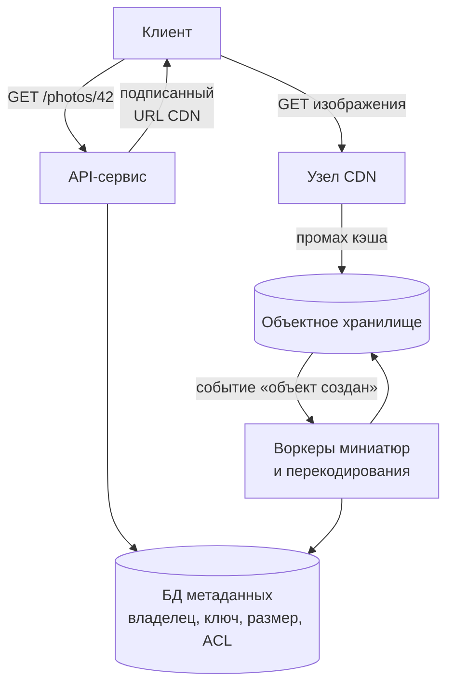

import { Aside } from '@astrojs/starlight/components';

Объектное хранилище — Amazon S3, Google Cloud Storage, Azure Blob Storage, Cloudflare R2 и их самостоятельно развёртываемые аналоги — место, где живёт большая часть байтов в мире: изображения, видео, резервные копии, логи, веса моделей и аналитические таблицы. Оно дешёвое, практически безграничное и исключительно надёжное, но это не файловая система и не база данных. Понимая его семантику, можно проектировать простые и дешёвые схемы загрузки, медиаконвейеры и озёра данных.

<Aside type="tip" title="Коротко">
- Объектное хранилище — плоское пространство имён из **неизменяемых объектов**, адресуемых ключом и доступных по HTTP. Объект заменяют целиком, а не редактируют на месте.
- Amazon S3 с декабря 2020 года бесплатно обеспечивает **строгую согласованность чтения после записи** (read-after-write) для записи, удаления и листинга объектов.
- **Долговечность** (сохранятся ли данные?) и **доступность** (можно ли прочитать их прямо сейчас?) — разные обещания: S3 Standard рассчитан на 11 девяток долговечности, но на 99,99% доступности.
- Стандартный шаблон: **метаданные в базе, двоичные данные в объектном хранилище, CDN перед ним**; клиенты загружают и скачивают напрямую по presigned URL.
- Озёра данных хранят колоночные файлы (Parquet) в объектном хранилище и используют открытый табличный формат (Apache Iceberg), чтобы получить таблицы с транзакциями и эволюцией схемы.
</Aside>

## Блочное, файловое и объектное хранение

| | Блочное | Файловое | Объектное |
|---|---|---|---|
| Единица | Блоки фиксированного размера на томе | Файлы в дереве каталогов | Объекты (байты + метаданные) по ключу |
| Интерфейс | Дисковое устройство (SCSI, NVMe); файловая система поверх | POSIX через NFS или SMB | HTTP API (`PUT`, `GET`, `DELETE`, `LIST`) |
| Обновления | На месте, любой диапазон байтов | На месте, с блокировками | Замена объекта целиком |
| Совместный доступ | Обычно один хост за раз | Много хостов | Любое число клиентов по сети |
| Задержка | Десятки мкс (локальный NVMe) — ~1 мс (сетевой том) | Около миллисекунды | ~10–200 мс до первого байта (медиана S3 — десятки мс) |
| Масштаб | До десятков ТиБ на том | До петабайтов на файловую систему | Фактически без ограничений |
| Типичная стоимость | Самая высокая | Средняя | Самая низкая за ГБ |
| Примеры | Amazon EBS, Persistent Disk, локальные NVMe | Amazon EFS, Filestore, Azure Files | S3, GCS, Azure Blob, R2, Ceph RGW |
| Для чего | Базы данных, загрузочные тома | Общие домашние каталоги, унаследованные приложения | Медиа, резервные копии, логи, озёра данных |

Базам данных нужно блочное хранилище: они обновляют страницы на месте и зависят от низкой задержки и `fsync`. Всему, что пишется один раз и читается много раз, место в объектном хранилище.

## Семантика объектов

- **Бакеты и ключи.** Бакет — контейнер с глобально или регионально уникальным именем; внутри пространство имён плоское. `photos/2026/10/cat.jpg` — это один ключ: слэши лишь выглядят как папки, а листинг по префиксу имитирует каталоги.
- **Неизменяемые объекты.** `PUT` записывает объект целиком, а следующий `PUT` в тот же ключ атомарно его заменяет: читатели видят старую или новую версию, но никогда не смесь. Частичного обновления нет; чтобы изменить один байт, объект перезаписывают. Узкое исключение — дописывание в конец: так умеют S3 Express One Zone (с конца 2024 года) и append-блобы Azure.
- **Метаданные.** У каждого объекта есть системные метаданные (размер, `Content-Type`, `ETag`, время изменения) и пользовательские пары «ключ-значение». Теги управляют правилами жизненного цикла и доступа.
- **Версионирование.** При включённом версионировании перезаписи и удаления сохраняют прежние версии — это защита от случайного удаления и вымогателей (для хранения в режиме WORM добавьте object lock).
- **Чтение диапазонов.** `GET` с заголовком `Range` получает часть объекта: так видеоплеер перематывает, а аналитический движок читает один столбец Parquet-файла.
- **Пропускная способность масштабируется по префиксам.** S3 обеспечивает не менее 3500 записей и 5500 чтений в секунду на партиционированный префикс ключа и наращивает ёмкость постепенно, возвращая `503 Slow Down`, пока масштабируется. Распределяйте горячий трафик по префиксам и повторяйте запросы с экспоненциальной задержкой (backoff).

### Согласованность

До конца 2020 года S3 давал лишь согласованность в конечном счёте для перезаписей и листинга, из-за чего платформам данных приходилось держать дополнительные сервисы метаданных. В **декабре 2020 года** AWS сделала S3 строго согласованным для всех приложений без доплаты: после успешного `PUT` или `DELETE` любой последующий `GET`, `HEAD` и `LIST` это отражает. Google Cloud Storage тоже строго согласован для чтения, записи и листинга объектов.

Чего объектное хранилище по-прежнему **не** даёт:

- **Нет транзакций над несколькими объектами.** Обновления идут по одному ключу; атомарно изменить два объекта нельзя.
- **По умолчанию нет координации конкурентных писателей.** Два одновременных `PUT` в один ключ — побеждает последний. С 2024 года S3 поддерживает **условную запись**: `If-None-Match: *` создаёт объект, только если его нет, а `If-Match: <etag>` работает как compare-and-swap. Это позволяет строить блокировки и оптимистичное управление параллельным доступом без отдельной базы.
- **Конфигурация бакета согласована в конечном счёте.** Например, AWS советует подождать около 15 минут после первого включения версионирования, прежде чем писать в бакет.

## Долговечность и доступность

**Долговечность** (durability) — вероятность того, что сохранённый объект не будет потерян за год. **Доступность** — доля времени, когда запросы успешны. Объектные хранилища вкладываются в первое гораздо больше: потерю данных не исправить, а несколько минут ошибок можно пережить повторными попытками.

| Класс хранения Amazon S3 | Расчётная долговечность | Расчётная доступность | Копии в | Минимальный срок хранения |
|---|---|---|---|---|
| S3 Standard | 99,999999999% | 99,99% | ≥ 3 зонах доступности | — |
| S3 Standard-IA | 99,999999999% | 99,9% | ≥ 3 зонах | 30 дней |
| S3 One Zone-IA | 99,999999999% | 99,5% | 1 зоне | 30 дней |
| S3 Express One Zone | 99,999999999% | 99,95% | 1 зоне | 1 час |
| S3 Glacier Instant Retrieval | 99,999999999% | 99,9% | ≥ 3 зонах | 90 дней |
| S3 Glacier Deep Archive | 99,999999999% | 99,99% | ≥ 3 зонах | 180 дней |

Чтобы девятки стали осязаемыми: при 11 девятках годовой долговечности и 10 млн хранимых объектов можно ожидать потери одного объекта примерно раз в 10 000 лет. Доступность намного ниже: 99,99% всё ещё допускает около 53 минут ошибок в год, а 99,9% — около 8,8 часа. Учтите, что цифры долговечности — расчётные цели, а однозонные классы хранят данные в одной зоне доступности, так что потеря зоны может означать потерю данных. Google Cloud Storage тоже рассчитан на 11 девяток; Azure заявляет 11 девяток для локально избыточного хранения, 12 — для зонально избыточного и 16 — для геоизбыточного.

Главный риск для долговечности — не железо, а люди и программы: ошибка или скомпрометированные учётные данные, удаляющие данные. Версионирование, object lock, межрегиональная репликация в отдельный аккаунт и минимальные права важнее лишних девяток.

## Работа с объектами

### Presigned URL

Presigned URL содержит подпись, разрешающую одну операцию над одним ключом в течение ограниченного времени. Сервер приложения не проксирует байты: он авторизует запрос и выдаёт клиенту URL, а клиент обращается к хранилищу напрямую.



```python title="presign.py"
import uuid

import boto3

s3 = boto3.client("s3", region_name="eu-central-1")


def create_upload(user_id: int, content_type: str) -> dict[str, str]:
    """Резервирует ключ и возвращает короткоживущий URL для прямого PUT с клиента."""
    key = f"uploads/{user_id}/{uuid.uuid4()}"
    url = s3.generate_presigned_url(
        "put_object",
        Params={"Bucket": "media-prod", "Key": key, "ContentType": content_type},
        ExpiresIn=900,  # 15 минут
    )
    # Здесь сохраняем (key, user_id, status="pending") в базе метаданных.
    return {"key": key, "upload_url": url}
```

Делайте срок жизни коротким (S3 ограничивает presigned URL с подписью SigV4 семью днями, а URL перестаёт работать раньше, если истекли подписавшие его учётные данные), генерируйте ключи на сервере, чтобы клиенты не могли перезаписать чужие объекты, и проверяйте загруженный объект (размер, тип, антивирус), прежде чем пометить его готовым.

### Multipart-загрузка

Большие объекты загружают частями, которые можно отправлять параллельно и повторять по отдельности, а затем склеивать финальным вызовом «complete». В S3 часть занимает от 5 МиБ до 5 ГиБ, в загрузке может быть до 10 000 частей, один `PUT` ограничен 5 ГБ, а объект может достигать 50 ТБ. AWS советует переходить на multipart примерно со 100 МБ. Незавершённые загрузки оплачиваются, пока их не прервут, поэтому добавьте правило жизненного цикла, которое прерывает их через несколько дней.

### Правила жизненного цикла и классы хранения

Классы хранения различаются соотношением цены хранения, стоимости извлечения, задержки и минимального срока хранения. Правила жизненного цикла автоматически переносят объекты между классами или удаляют их по возрасту, префиксу или тегу. Типичная политика для пользовательских загрузок:

| Возраст | Действие |
|---|---|
| 0–30 дней | S3 Standard (частые чтения, генерация миниатюр) |
| 30–90 дней | Standard-IA или Glacier Instant Retrieval |
| 1 год | Glacier Deep Archive или удаление, если хранение не требуется |
| 7 дней после начала | Прервать незавершённые multipart-загрузки |

Обращайте внимание на условия тарифов: из-за минимальных сроков хранения и платы за запросы «дешёвые» классы могут оказаться дороже для маленьких или короткоживущих объектов. Intelligent-Tiering переносит объекты автоматически, когда шаблон доступа неизвестен. Закладывайте и **исходящий трафик** (egress): передача данных из большинства облаков оплачивается за гигабайт и часто доминирует в счёте медиасервисов; CDN его сокращает, а некоторые провайдеры (например, Cloudflare R2) вовсе не берут плату за egress.

## Метаданные в базе, байты в объектном хранилище, CDN перед ним

Самая распространённая архитектура хранения пользовательского контента разделяет обязанности:



- **База данных** хранит то, по чему делают запросы и транзакции: владельца, права, подписи, ключ объекта, статус обработки.
- **Объектное хранилище** хранит неизменяемые байты под ключами, которые генерирует приложение.
- **CDN** отдаёт байты из кэшей на границе сети; источник видит только промахи. Подписанные URL или cookie CDN защищают приватный контент.
- **События** бакета запускают воркеры, которые делают миниатюры, перекодируют видео или извлекают текст.

Две детали делают шаблон надёжным. Во-первых, считайте объекты неизменяемыми и давайте каждой версии новый ключ (`photos/42/v3.jpg` или хеш содержимого): тогда кэш CDN не нужно чистить, и можно ставить долгий `Cache-Control`. Во-вторых, сверяйте два хранилища: периодическая задача удаляет объекты без записи в базе (сироты от неудачных загрузок) и помечает записи, у которых пропал объект.

## Озёра данных и открытые табличные форматы

**Озеро данных** (data lake) хранит сырые и обработанные данные файлами в объектном хранилище и позволяет многим движкам (Spark, Trino, Flink, DuckDB, движкам хранилищ данных) их запрашивать. На практике это возможно благодаря двум слоям:

- **Apache Parquet** — колоночный формат файлов со сжатием и статистикой по столбцам. Запрос, читающий 3 столбца из 100, забирает только их диапазоны байтов и пропускает группы строк, чьи min/max не подходят.
- **Apache Iceberg** — открытый **табличный формат**: файлы метаданных, перечисляющие, какие Parquet-файлы образуют каждый снимок таблицы. Коммит атомарно переключает один указатель на метаданные, что даёт сериализуемую изоляцию читателей и писателей, эволюцию схемы без перезаписи данных, скрытое партиционирование и «путешествие во времени» к прошлым снимкам. Вторая версия спецификации добавила построчные удаления, третья — типы вроде variant и геоданных, векторы удалений и отслеживание происхождения строк (row lineage). Delta Lake и Apache Hudi решают ту же задачу с другими компромиссами.

Управляемые сервисы теперь включают этот слой, например Amazon S3 Tables (хранилище S3 со встроенными таблицами Iceberg и их обслуживанием). Озёрам данных нужно уплотнение (compaction): тысячи мелких файлов — это тысячи запросов и медленные выборки, поэтому движки периодически переписывают мелкие файлы в крупные.

## Компромиссы

| Выбор | Выгода | Цена |
|---|---|---|
| Объектное хранилище вместо файловой системы | Неограниченный масштаб, 11 девяток долговечности, низкая цена | Нет правки на месте, выше задержка, нет POSIX-блокировок |
| Прямая загрузка по presigned URL | Серверы приложения не гоняют байты; масштабируется вместе с хранилищем | Нужно асинхронно проверять загрузки и убирать сирот |
| Более «холодные» классы хранения | Намного ниже цена за ГБ | Плата за извлечение, минимальные сроки, медленный доступ |
| Однозонные классы | Ниже цена или задержка | Потеря данных при потере зоны |
| Iceberg поверх объектного хранилища | Открытый формат, много движков, дешёвое хранение | Уплотнение, каталог, работа над раскладкой файлов |

<Aside type="note" title="На собеседовании">
- Если в дизайне есть медиа или файлы, скажите сразу: «метаданные в базе, байты в объектном хранилище, CDN перед ним, прямая загрузка по presigned URL». Затем обсудите проверку загрузок и их обработку.
- Будьте готовы отличить долговечность от доступности и объяснить, откуда берутся девятки (репликация по зонам, коды стирания, фоновое восстановление).
- Ждите вопросов про очень большие файлы (multipart, возобновляемая загрузка), горячие объекты (CDN, лимиты запросов на префикс) и удаление пользовательских данных (версии, резервные копии, жизненный цикл).
- Типичные ошибки: хранить большие бинарные данные в основной базе, прогонять загрузки через серверы приложения и забывать о стоимости egress.
</Aside>

## Что почитать

- [What is Amazon S3?](https://docs.aws.amazon.com/AmazonS3/latest/userguide/Welcome.html) (раздел о модели согласованности данных) и статья Вернера Фогельса [Diving Deep on S3 Consistency](https://www.allthingsdistributed.com/2021/04/s3-strong-consistency.html).
- [Amazon S3 storage classes](https://aws.amazon.com/s3/storage-classes/) — актуальные показатели долговечности, доступности и извлечения.
- [Uploading objects using multipart upload](https://docs.aws.amazon.com/AmazonS3/latest/userguide/mpuoverview.html) и [Managing the lifecycle of objects](https://docs.aws.amazon.com/AmazonS3/latest/userguide/object-lifecycle-mgmt.html).
- [Finding a Needle in Haystack: Facebook's Photo Storage](https://www.usenix.org/conference/osdi10/finding-needle-haystack-facebooks-photo-storage) — почему миллиардам мелких объектов нужно особое хранилище, OSDI 2010.
- [Спецификация таблиц Apache Iceberg](https://iceberg.apache.org/spec/) и [обзор Parquet](https://parquet.apache.org/docs/overview/).

## Связанные темы

- [Сети доставки контента (CDN)](/traffic/cdn/) — слой кэша перед объектным хранилищем.
- [SQL или NoSQL](/data/sql-or-nosql/) — выбор базы, в которой живут метаданные.
- [Уровни кэширования](/caching/caching-layers/) — HTTP-кэширование и ключи кэша для неизменяемых объектов.
- [Очереди и обратное давление](/async/queues-and-back-pressure/) — обработка событий «объект создан» воркерами.
- [Безопасность](/reliability/security/) — контроль доступа, шифрование хранимых данных и конвертное шифрование через KMS.
