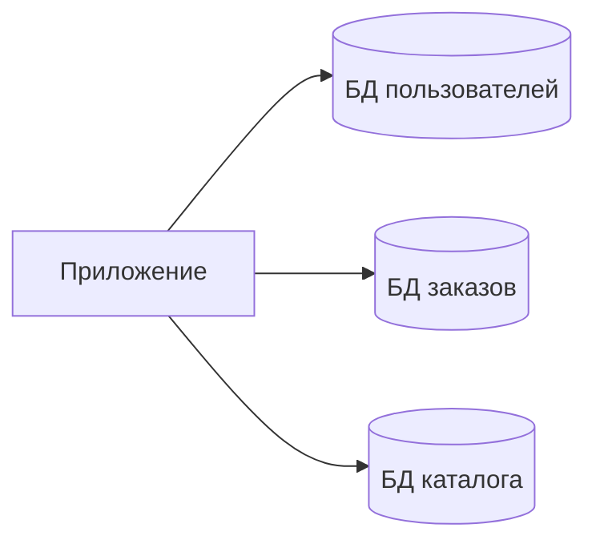
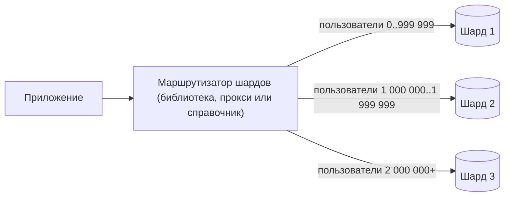
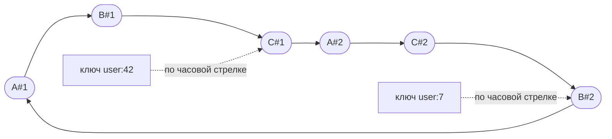

import { Aside } from '@astrojs/starlight/components';

Репликация копирует все данные на каждый узел, поэтому она бессильна, когда **запись** или **объём данных** перерастают одну машину. Партиционирование делит данные так, что каждый узел владеет только частью. Если сделать это хорошо, ёмкость растёт почти линейно с числом узлов. Если плохо — получаются горячие шарды, запросы «разослать всем и собрать» (scatter-gather) и межшардовые транзакции, которые медленнее и хрупче исходной единственной базы.

<Aside type="tip" title="Коротко">
- **Федерация** делит по функциям (пользователи, заказы, каталог). **Шардирование** делит один набор данных по ключу (пользователи 1–1 млн здесь, остальные там).
- **Ключ шардирования** — самое важное решение. Он должен равномерно распределять нагрузку и держать каждый частый запрос в пределах одного шарда.
- Шардирование по **хешу** распределяет нагрузку, но теряет диапазонные запросы. По **диапазону** — сохраняет их, но порождает горячие точки. По **справочнику** — гибко, но добавляет сервис поиска.
- **Консистентное хеширование** с виртуальными узлами при добавлении узла перемещает лишь около 1/(N+1) ключей. Простое `hash % N` перемещает большинство.
- Прежде чем строить своё, посмотрите на **Vitess** или **Citus** либо на распределённые SQL-базы (**CockroachDB**, **Spanner**, **YugabyteDB**). Они автоматизируют маршрутизацию, разделение и перебалансировку.
</Aside>

## Термины

На практике слова пересекаются, поэтому на этой странице они используются так:

- **Партиционирование** — общая идея разбиения данных. *Партиционирование таблицы* делит одну таблицу на части **на том же сервере** (см. [оптимизацию SQL](/data/denormalization-and-tuning/)).
- **Шардирование** — горизонтальное партиционирование **по разным серверам**: каждый шард — отдельная база со своими процессором, памятью и диском. Обычно каждый шард реплицируется ради доступности (см. [Репликация](/data/replication/)).
- **Федерация**, или функциональное партиционирование, размещает разные *таблицы или предметные области* на разных серверах.

## Федерация: деление по функциям

Вместо одной базы на всё каждая предметная область получает свою базу: `users`, `orders`, `catalog`. У каждой базы меньше трафика, меньший рабочий набор, который помещается в память, и свой лидер для записи, так что записи идут параллельно.



В 2026 году это обычно побочный эффект **владения данными сервисами**: каждый сервис владеет своей схемой, и больше никто к ней не подключается. Цена та же, что и в 2010-м:

- **Нет соединений между базами.** «Заказы с именем покупателя» превращаются в два запроса, объединённых в коде, или в денормализованную копию имени.
- **Нет транзакций между базами.** Используйте саги или паттерн outbox с идемпотентными потребителями.
- Федерация перестаёт помогать, когда **одна область** перерастает сервер. Тогда эту область надо шардировать.

## Стратегии шардирования



| Стратегия | Как ключ находит шард | Сильные стороны | Слабые стороны | Где встречается |
|---|---|---|---|---|
| **По диапазону** | Отсортированные диапазоны ключей: `A–F`, `G–M` или по дате | Эффективные диапазонные запросы и упорядоченное чтение. Диапазон легко разделить. | Последовательные ключи (метки времени, автоинкрементные ID) отправляют все новые записи в последний шард | Splits в Spanner, ranges в CockroachDB, HBase, Bigtable |
| **По хешу** | `hash(key)` отображается на шард или слот | Равномерное распределение, даже для последовательных ключей | Диапазонные запросы идут во все шарды. Наивное `hash % N` при смене N перетасовывает почти всё. | Cassandra, DynamoDB, Redis Cluster (16 384 слота), Citus, Vitess |
| **По справочнику (lookup)** | Таблица сопоставляет ключ или арендатора с шардом | Любое размещение. Переезд по одному арендатору. Изоляция крупных клиентов. | Сервис поиска должен быть быстрым, кэшируемым и высокодоступным | Мультиарендный SaaS, lookup vindex в Vitess |
| **Географическое** | Решает регион или страна пользователя | Низкая задержка для местных пользователей. Требования к размещению данных (GDPR и подобные). | Неравные по размеру регионы. Путешествующих и переезжающих пользователей надо мигрировать. | Мультирегиональный SaaS, размещение строк в Spanner и CockroachDB |

В продакшене стратегии часто совмещают. Распространённая схема: ключ хешируется в фиксированный набор **логических шардов** (корзин), а небольшой справочник сопоставляет корзины физическим серверам. Так сделали в Notion в 2021 году: 480 логических шардов на 32 физических базах PostgreSQL, по 15 на машину, ключ — ID рабочего пространства. Расширение парка тогда означает перенос целых логических шардов между машинами, а не перехеширование строк. В 2023 году Notion так и поступил: вырос с 32 до 96 машин, по 5 логических шардов на каждой.

## Выбор ключа шардирования

Хороший ключ шардирования:

1. **Имеет высокую кардинальность.** Миллионы различных значений, а не `status` с четырьмя.
2. **Равномерно распределяет нагрузку** — и по данным, и по трафику. «Пользователи» равномерны по количеству, но могут сильно различаться по активности.
3. **Соответствует основным запросам.** Если 95% запросов относятся к одному арендатору, `tenant_id` удержит их на одном шарде вместе с соединениями и транзакциями.
4. **Стабилен.** Смена ключа шардирования у строки означает переезд строки.

Типичный выбор — ID пользователя для потребительских приложений, ID арендатора или организации для B2B SaaS, ID устройства или сущности для телеметрии. Не используйте «голую» метку времени как весь ключ. Документация Citus советует вместо этого партиционировать по времени *внутри* каждого шарда.

<Aside type="caution" title="Последовательные ID и шардирование по диапазону">
Монотонные ключи — автоинкрементные ID, метки времени, UUIDv7 (в PostgreSQL 18 есть встроенная функция `uuidv7()`) — отлично ложатся в B-дерево одной базы. В кластере с партиционированием **по диапазону** они отправляют каждую вставку в последний диапазон. Документация Spanner рекомендует там UUIDv4, последовательности с обращёнными битами или хеш-префикс. В системе с шардированием **по хешу** они безвредны.
</Aside>

## Горячие точки и проблема знаменитостей

Даже при идеальном хеше **один ключ может быть горячим**. Посты знаменитости, вирусный товар или крупный арендатор могут направить в один шард больше трафика, чем тот способен выдержать. Варианты:

- **Разделить горячий ключ.** Добавить к ключу суффикс 0–9 (`post:123#7`), чтобы записи разошлись по десяти шардам: 50 000 записей в секунду превращаются примерно в 5000 на шард. Зато чтение теперь должно собрать все десять частей и объединить их. Делайте так только для ключей, о которых точно известно, что они горячие.
- **Кэшировать.** Трафик знаменитостей — это в основном чтение. Кэш или CDN перед шардом его поглощают.
- **Выделить отдельный шард.** Справочник позволяет поселить крупнейшего арендатора на выделенное железо.
- **Обрабатывать при чтении.** Ленты в стиле Twitter раскладывают большинство постов по лентам подписчиков при записи, а посты знаменитостей подмешивают при чтении. См. [разбор ленты Twitter](/practice/twitter-timeline/).

Управляемые системы делят горячие диапазоны автоматически. Spanner, например, добавляет границы разбиения между нагруженными строками. Но никакое автоматическое разбиение не поделит трафик одной строки.

## Решардинг

Рано или поздно шард становится слишком большим или слишком нагруженным, и данные нужно переносить. Онлайн-решардинг обычно идёт так:

1. **Скопировать** согласованный снимок данных в новые шарды.
2. **Транслировать** изменения, сделанные после снимка (CDC из WAL или binlog), пока новый шард почти не догонит.
3. **Проверить**, что совпадают число строк и контрольные суммы.
4. **Переключить.** Ненадолго заблокировать запись, дать цели догнать, переключить маршрутизацию и снять блокировку. Ровно это делает процесс `Reshard` в Vitess. Источник переходит в режим только для чтения, пока цель догоняет (ожидание по умолчанию ограничено 30 секундами), а прокси VTGate может буферизовать запросы в это окно, так что пользователи почти ничего не замечают.
5. **Оставить путь назад.** Обратная репликация позволяет отменить переключение, пока старый шард не удалён.

Два проектных решения сильно всё упрощают: **логических шардов намного больше, чем серверов** (переносим корзины, а не перехешируем строки), и **маршрутизация — это данные, а не код** (справочник или кольцо, которые меняются без деплоя).

## Консистентное хеширование

При `shard = hash(key) % N` добавление одного сервера меняет N, и почти каждый ключ переезжает. Переход с 4 серверов на 5 перемещает около 80% ключей. **Консистентное хеширование**, предложенное Каргером и соавторами в 1997 году для веб-кэшей, решает эту проблему.

Представим пространство хешей в виде кольца. Каждый сервер хешируется в позиции на кольце. Ключ принадлежит первой позиции сервера, встреченной при движении **по часовой стрелке** от хеша ключа. Новый сервер забирает только ключи между своими позициями и их предшественниками — около 1/N всех ключей. Когда сервер уходит, переезжают только его ключи, к соседям по часовой стрелке.

С одной позицией на сервер дуги получаются очень неравными. В нашем тесте с четырьмя серверами самый нагруженный в типичном прогоне получал примерно вдвое больше своей справедливой доли. Решение — **виртуальные узлы**: каждый физический сервер ставится во множество позиций, скажем от 100 до 256, и его суммарная доля усредняется примерно до 1/N. Виртуальные узлы также позволяют более мощной машине занять больше позиций, а нагрузку упавшего сервера распределить по всем оставшимся, а не по одному соседу.



На схеме три сервера (A, B, C), у каждого по два виртуальных узла. Стрелки идут по часовой стрелке вдоль кольца. Ключ хранится на первом виртуальном узле после позиции своего хеша.

```python title="consistent_hash.py"
import bisect
import hashlib
from collections import Counter
from dataclasses import dataclass, field


def stable_hash(key: str) -> int:
    """64-битный хеш, одинаковый во всех процессах (встроенный hash() рандомизирован)."""
    return int.from_bytes(hashlib.blake2b(key.encode(), digest_size=8).digest(), "big")


@dataclass
class HashRing:
    vnodes: int = 100                                    # позиций на кольце у каждого физического узла
    _points: list[int] = field(default_factory=list)     # отсортированные позиции на кольце
    _owner: dict[int, str] = field(default_factory=dict)  # позиция -> физический узел

    def add_node(self, node: str) -> None:
        for i in range(self.vnodes):
            point = stable_hash(f"{node}#{i}")
            bisect.insort(self._points, point)
            self._owner[point] = node

    def remove_node(self, node: str) -> None:
        for i in range(self.vnodes):
            point = stable_hash(f"{node}#{i}")
            self._points.remove(point)
            del self._owner[point]

    def node_for(self, key: str) -> str:
        # Идём по часовой стрелке до первой позиции после хеша ключа; в конце — по кругу.
        idx = bisect.bisect_right(self._points, stable_hash(key)) % len(self._points)
        return self._owner[self._points[idx]]


if __name__ == "__main__":
    ring = HashRing(vnodes=100)
    for name in ("db-a", "db-b", "db-c", "db-d"):
        ring.add_node(name)

    keys = [f"user:{i}" for i in range(100_000)]
    before = {k: ring.node_for(k) for k in keys}
    print("keys per node:", sorted(Counter(before.values()).items()))

    ring.add_node("db-e")
    moved = [k for k in keys if before[k] != ring.node_for(k)]
    assert all(ring.node_for(k) == "db-e" for k in moved)  # ключи переезжают только на новый узел
    print(f"ring, 4 -> 5 nodes: {len(moved) / len(keys):.1%} of keys move")

    naive = sum(stable_hash(k) % 4 != stable_hash(k) % 5 for k in keys)
    print(f"hash % N, 4 -> 5:   {naive / len(keys):.1%} of keys move")
```

Вывод (Python 3.13):

```text
keys per node: [('db-a', 24258), ('db-b', 25567), ('db-c', 24441), ('db-d', 25734)]
ring, 4 -> 5 nodes: 19.9% of keys move
hash % N, 4 -> 5:   80.2% of keys move
```

Где это встречается: хранилища в стиле Dynamo (Cassandra начиная с версии 4.0 по умолчанию ставит 16 токенов на узел вместо 256), распределённые кэши вроде клиентов memcached, балансировщики нагрузки с «липкой» маршрутизацией. Варианты меняют память на скорость. **Jump consistent hash** (Лэмпинг и Вич, 2014) обходится без кольца, но требует пронумерованных корзин. **Фиксированные хеш-слоты**, как в Redis Cluster, используют статическую таблицу из 16 384 слотов, которые переносятся по одному. **Rendezvous-хеширование** выбирает сервер с наибольшим значением `hash(key, server)`.

## Межшардовые запросы и транзакции

Шардирование дёшево только для запросов, содержащих ключ шардирования. Всё остальное обходится дороже:

- **Scatter-gather.** Запрос без ключа шардирования уходит во все шарды, а маршрутизатор объединяет результаты. Задержку определяет самый медленный шард. Если у каждого шарда 1% шанс медленного ответа, то при опросе 32 шардов хотя бы один медленный встретится в 27,5% случаев, а при 100 шардах — в 63%.
- **Вторичные поиски.** Чтобы найти пользователя по email при шардировании по ID пользователя, держите **глобальный индекс** (email → ID пользователя) как отдельную шардированную таблицу или lookup vindex в Vitess. Его обновление при каждой записи само по себе — межшардовая запись.
- **Совместное размещение.** Шардируйте связанные таблицы по одному ключу (заказы и позиции заказов — по ID клиента), чтобы их соединения оставались локальными. В Citus это называется co-location, в Spanner — interleaved tables, в Figma такие группы называют «colos».
- **Справочные таблицы.** Копируйте маленькие редко меняющиеся таблицы (страны, тарифы) в каждый шард.
- **Межшардовые транзакции.** Двухфазная фиксация (2PC) даёт атомарность, но блокируется, если координатор упадёт посреди протокола, и добавляет лишние RTT. Многие команды обходят её архитектурно: держат инварианты внутри одного шарда, а для процессов, охватывающих шарды, используют саги с компенсирующими действиями.

## Пусть это сделает база: распределённый SQL и промежуточный слой

Самописное шардирование означает, что маршрутизация, решардинг, межшардовые запросы и переключение на резерв — на вас. Зрелые решения делают это сами:

| Система | Что это | Как шардирует | Заметки (2026) |
|---|---|---|---|
| **Vitess** | Слой шардирования поверх MySQL. Создан в YouTube в 2010 году; «выпускник» CNCF. | Keyspace ID из «vindex» (хеш, lookup и другие); прокси VTGate маршрутизирует запросы | Apache 2.0. Онлайн-решардинг через VReplication. На нём построен PlanetScale. |
| **Citus** | Расширение PostgreSQL, а не форк | Таблицы, распределённые по хешу, плюс справочные таблицы; совместное размещение по столбцу распределения; шардирование по схемам | Открытый код (AGPL-3.0); развивается Microsoft. Координатор плюс рабочие узлы. |
| **CockroachDB** | Распределённый SQL, совместимый с протоколом PostgreSQL | Разбиение на диапазоны (по умолчанию диапазон делится при 512 МиБ), три Raft-реплики на диапазон, автоматическая перебалансировка | Serializable по умолчанию. С версии 24.3 (конец 2024 года) код доступен под корпоративной лицензией, бесплатной для небольших компаний. |
| **Google Spanner** | Управляемый глобально распределённый SQL | Диапазоны ключей («splits»), разбиение по нагрузке, interleaved tables | Внешняя согласованность через TrueTime; диалекты GoogleSQL и PostgreSQL |
| **YugabyteDB** | Распределённый SQL, переиспользующий слой запросов PostgreSQL | Хеш- или диапазонное шардирование на таблеты, Raft на таблет, хранилище DocDB на RocksDB | Apache 2.0. Есть также API, совместимый с Cassandra. |
| **TiDB** | Распределённый SQL, совместимый с MySQL | Диапазоны ключей, реплицируемые через Multi-Raft | Открытый код; строковое хранилище TiKV плюс колоночные реплики TiFlash для аналитики |
| **Aurora PostgreSQL Limitless** | Управляемое шардирование для Aurora PostgreSQL; общедоступно с октября 2024 года | Таблицы, шардированные по хешу ключа шарда, справочные таблицы, совместное размещение; маршрутизаторы перед шардами | Только в AWS. Маршрутизаторы координируют распределённые транзакции. |

Этим системам тоже нужен хорошо продуманный ключ. Монотонный первичный ключ создаёт горячий диапазон в Spanner или CockroachDB точно так же, как в самописной системе. Межрегиональные транзакции по-прежнему платят скоростью света.

## Компромиссы

| Подход | Выигрыш | Цена |
|---|---|---|
| Федерация | Просто, совпадает с границами сервисов | Нет соединений и транзакций между областями; одна большая область всё равно не поместится |
| Шардирование в приложении | Полный контроль, любая база | Маршрутизация, решардинг, глобальные индексы и инструменты — на вас |
| Промежуточный слой (Vitess, Citus) | Привычный движок, автоматическая маршрутизация и решардинг | Часть SQL ограничена между шардами; ещё один слой в эксплуатации |
| Распределённый SQL | Транзакции и SQL поверх узлов; автоматическое разбиение | Задержка запроса выше, чем на одном узле; вопросы лицензии и стоимости; ключ всё равно важен |

<Aside type="note" title="На собеседовании">
- Шардируйте только после расчёта: покажите, что запись или объём превышают возможности одного хорошо настроенного основного узла с репликами.
- Назовите ключ шардирования и обоснуйте его тремя главными запросами. Затем скажите, что будет с запросами, которые этого ключа не содержат.
- Ждите вопросов «один пользователь в 1000 раз больше остальных» (горячий ключ) и «нужно добавить шарды» (решардинг). Отвечайте логическими шардами, справочником и онлайн-миграцией с переключением.
- Объясните консистентное хеширование на цифрах: переезжает около 1/5 (20%) ключей против примерно 80% для `hash % N` при переходе с 4 узлов на 5, и почему виртуальные узлы выравнивают нагрузку.
- Частые ошибки: шардирование по метке времени; забытые глобальные вторичные индексы; обещание межшардового ACID без упоминания цены 2PC.
</Aside>

## Что почитать

- [Consistent Hashing and Random Trees](https://www.cs.princeton.edu/courses/archive/fall09/cos518/papers/chash.pdf) — Каргер и др. (1997). Исходная статья о консистентном хешировании.
- [A Fast, Minimal Memory, Consistent Hash Algorithm](https://arxiv.org/abs/1406.2294) — Лэмпинг и Вич (2014). Jump consistent hash.
- [Herding elephants: lessons learned from sharding Postgres at Notion](https://www.notion.com/blog/sharding-postgres-at-notion) — логические и физические шарды, миграция на практике.
- [How Figma's databases team lived to tell the scale](https://www.figma.com/blog/how-figmas-databases-team-lived-to-tell-the-scale/) — горизонтальное шардирование RDS PostgreSQL с прокси, разбирающим запросы.
- [Vitess: What is Vitess](https://vitess.io/docs/overview/whatisvitess/) — архитектура промежуточного слоя шардирования для MySQL.
- [Citus: choosing a distribution column](https://docs.citusdata.com/en/stable/sharding/data_modeling.html) — как выбирать ключ шардирования для мультиарендных и аналитических нагрузок.

## Связанные темы

- [Репликация](/data/replication/) — каждый шард обычно является реплицируемой группой.
- [Реляционные базы данных](/data/relational-databases/) — гарантии одного узла, от которых шардирование отказывается между шардами.
- [Денормализация и оптимизация SQL](/data/denormalization-and-tuning/) — как избежать соединений, пересекающих шарды, и партиционировать таблицы на одном сервере.
- [NoSQL-базы данных](/data/nosql/) — хранилища со встроенным партиционированием.
- [Уровни кэширования](/caching/caching-layers/) — поглощение горячих ключей до того, как они дойдут до шарда.
- [Разбор ленты Twitter](/practice/twitter-timeline/) — рассылка (fan-out) и проблема знаменитостей в полном дизайне.
