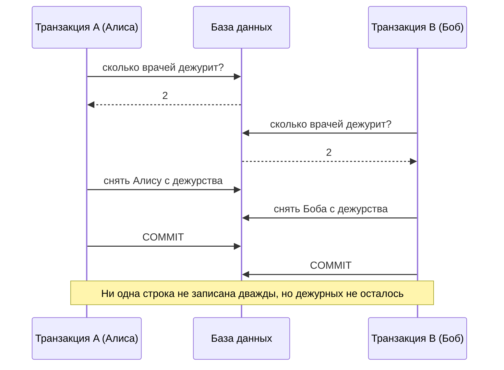
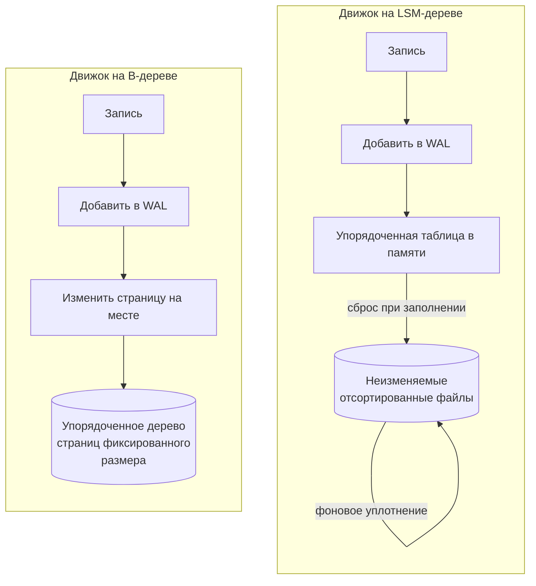
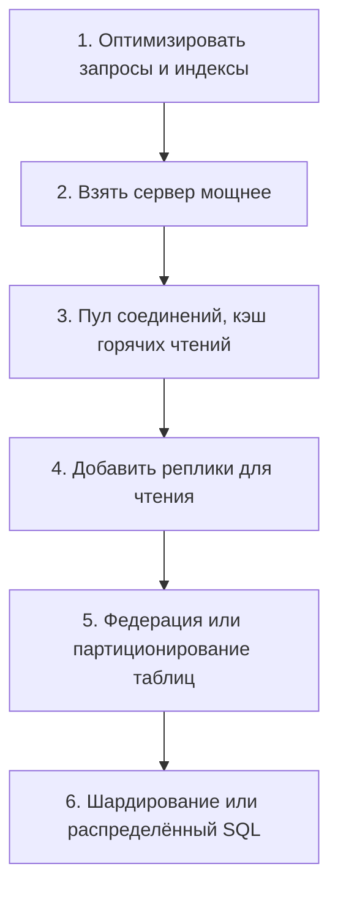

import { Aside } from '@astrojs/starlight/components';

Реляционная СУБД (РСУБД) хранит данные в таблицах из типизированных строк, следит за соблюдением правил и позволяет многим клиентам одновременно менять данные через транзакции. PostgreSQL, MySQL, SQL Server и Oracle по-прежнему хранят основные данные (system of record) большинства компаний. Проектируя систему вокруг такой базы, нужно знать три вещи: что на самом деле обещают её гарантии, где они незаметно заканчиваются и как далеко может увезти один узел.

<Aside type="tip" title="Коротко">
- **ACID**: транзакция применяет все свои изменения или ни одного (атомарность), сохраняет инварианты (согласованность), в выбранной степени защищена от параллельных транзакций (изоляция) и переживает сбой после фиксации (долговечность).
- **Изоляция — это меню, а не выключатель.** Уровни по умолчанию слабые: в PostgreSQL — *read committed*, в MySQL InnoDB — *repeatable read*. Ни один из них не защищает от искажения записи (write skew).
- Большинство движков используют **MVCC**: читатели видят снимок и не блокируют писателей. Цена — старые версии строк, которые нужно убирать.
- **B-деревья** (большинство РСУБД) хороши для чтения и диапазонных запросов. **LSM-деревья** (RocksDB, Cassandra, ряд распределённых SQL-движков) — для интенсивной записи.
- Масштабируйте по порядку: оптимизация запросов и индексов, более мощный сервер, пул соединений и кэш, реплики для чтения, затем партиционирование или шардирование.
</Aside>

## Реляционная модель за минуту

Данные лежат в **таблицах** (отношениях), состоящих из **строк** (кортежей) с типизированными **столбцами**. **Первичный ключ** идентифицирует строку. **Внешние ключи** связывают строки разных таблиц. **Нормализация** означает, что каждый факт хранится один раз: адрес клиента лежит в `customers`, и каждый заказ ссылается на него. Адрес не копируется в каждый заказ.

Два свойства держат модель на плаву уже 50 лет:

- **Декларативные запросы.** SQL описывает, *что* нужно получить. Оптимизатор выбирает, *как*: какой индекс, какой алгоритм соединения, в каком порядке. Когда данных становится больше, план может поменяться без изменений в коде приложения.
- **Ограничения в одном месте.** `NOT NULL`, `UNIQUE`, `CHECK` и внешние ключи база проверяет для всех клиентов. Ошибка в приложении не сможет их обойти.

Граница между реляционными и документными хранилищами размылась. В PostgreSQL можно индексировать столбцы `jsonb`, а многие документные базы теперь поддерживают транзакции над несколькими документами. Решают паттерны доступа и гарантии, а не ярлыки. См. [SQL или NoSQL](/data/sql-or-nosql/).

## ACID — точно

| Свойство | Что гарантирует | Как реализуют движки | Частая ошибка |
|---|---|---|---|
| Атомарность (atomicity) | Все записи транзакции применяются или не применяется ни одна: при сбое, откате или нарушении ограничения | Журнал упреждающей записи (WAL) и информация для отката | Ничего не говорит о параллельном доступе |
| Согласованность (consistency) | Каждая транзакция переводит данные из одного корректного состояния в другое | Ограничения, триггеры и *ваш* код | Это не «C» из CAP. Там имеется в виду линеаризуемость. |
| Изоляция (isolation) | Параллельные транзакции не видят незавершённую работу друг друга | Блокировки, снимки MVCC, обнаружение конфликтов | По умолчанию полная сериализуемость встречается редко |
| Долговечность (durability) | После возврата из `COMMIT` изменение переживёт падение процесса или ОС | WAL сбрасывается на диск до подтверждения | Один диск переживает сбой, но не потерю машины. Для этого нужна [репликация](/data/replication/). |

Два практических замечания. Во-первых, «C» в основном зависит от приложения: база гарантирует только те правила, которые вы объявили. Во-вторых, долговечность часто сознательно меняют на задержку. Примеры — `synchronous_commit = off` в PostgreSQL или асинхронные реплики, которые при переключении на резерв могут потерять последние транзакции.

## Транзакции на практике

- **Делайте их короткими.** Транзакция держит блокировки и не даёт удалить старые версии строк, пока не завершится. Никогда не ждите внутри неё пользователя, HTTP-вызов или очередь сообщений.
- **Предпочитайте атомарные операторы схеме «прочитать — изменить — записать».** `UPDATE accounts SET balance = balance - 10 WHERE id = 1 AND balance >= 10` не может потерять обновление. Прочитать баланс в приложение, вычесть там и записать обратно — может.
- **Блокируйте явно, когда это необходимо.** `SELECT ... FOR UPDATE` блокирует прочитанные строки, и параллельный писатель ждёт.
- **Для долгих правок используйте оптимистичную блокировку.** Добавьте столбец `version` и пишите `UPDATE ... SET version = version + 1 WHERE id = ? AND version = ?`. Если не изменилось ни одной строки, кто-то успел раньше: перечитайте и повторите.
- **Повторяйте транзакцию при ошибках сериализации и взаимоблокировках.** На строгих уровнях база прерывает транзакцию, чтобы не испортить данные (SQLSTATE `40001`). Транзакции должны быть безопасны для повторного запуска.

## Уровни изоляции и их аномалии

Уровни изоляции определяются тем, какие **аномалии** они допускают:

- **Грязное чтение (dirty read):** вы видите незафиксированную запись другой транзакции, которая потом может откатиться.
- **Неповторяющееся чтение (non-repeatable read):** вы дважды читаете строку и получаете разные значения, потому что между чтениями другая транзакция зафиксировала изменение.
- **Фантом (phantom):** вы повторяете диапазонный запрос (`WHERE room = 7 AND day = '2026-10-08'`), а строки появились или исчезли.
- **Потерянное обновление (lost update):** две транзакции читают одно значение, обе его меняют, и вторая запись молча затирает первую.
- **Искажение записи (write skew):** две транзакции читают одни и те же данные, принимают на их основе решение и пишут *разные* строки. По отдельности каждая запись корректна, вместе они нарушают инвариант.

Учебная матрица ниже следует критике Беренсона и соавторов 1995 года. Эта работа добавила к определениям ANSI потерянное обновление, искажение записи и изоляцию снимков:

| Уровень | Грязное чтение | Неповторяющееся чтение | Фантом | Потерянное обновление | Искажение записи |
|---|---|---|---|---|---|
| Read uncommitted | Возможно | Возможно | Возможен | Возможно | Возможно |
| Read committed | Исключено | Возможно | Возможен | Возможно | Возможно |
| Repeatable read (на блокировках) | Исключено | Исключено | Возможен | Исключено | Возможно через фантомы |
| Изоляция снимков (snapshot isolation) | Исключено | Исключено | Исключён при чтении | Исключено¹ | **Возможно** |
| Serializable | Исключено | Исключено | Исключён | Исключено | Исключено |

¹ Только если движок прерывает второго из двух параллельных писателей одной строки («побеждает первый зафиксировавший»). PostgreSQL так делает, repeatable read в MySQL — нет.

### Искажение записи по шагам

Классический пример — правило больницы: хотя бы один врач должен быть на дежурстве. Алиса и Боб оба дежурят, и оба одновременно просят снять их с дежурства.

Мы прогнали ровно этот сценарий на PostgreSQL 16. На уровнях read committed и repeatable read обе транзакции фиксируются, и дежурных не остаётся. На уровне serializable вторая фиксация падает с ошибкой `could not serialize access due to read/write dependencies among transactions`. Приложение повторяет транзакцию, видит одного дежурного и отклоняет запрос. Без сериализуемой изоляции надо заблокировать строки, на которых основано решение (`SELECT ... FOR UPDATE`), или превратить инвариант в ограничение.

### Что делают реальные движки

Названия уровней общие, поведение — нет:

| Движок | Уровень по умолчанию | Что на самом деле означают уровни |
|---|---|---|
| PostgreSQL | Read committed | Read uncommitted работает как read committed. Repeatable read — это изоляция снимков: параллельное обновление той же строки прерывается с ошибкой `could not serialize access due to concurrent update`. Serializable реализован как Serializable Snapshot Isolation (SSI). |
| MySQL (InnoDB) | Repeatable read | Обычные `SELECT` читают снимок. `UPDATE`, `DELETE` и блокирующие чтения видят последнюю зафиксированную версию и берут next-key-блокировки. Потерянные обновления в коде «прочитать — изменить — записать» *не* обнаруживаются. |
| Oracle | Read committed | Его «serializable» — это изоляция снимков, так что искажение записи возможно. |
| SQL Server | Read committed (на блокировках) | В Azure SQL Database по умолчанию включён read committed на версиях строк (RCSI). Есть и отдельный уровень `SNAPSHOT`. |
| CockroachDB, Spanner | Serializable | Более слабые уровни включаются явно (read committed в CockroachDB, repeatable read в Spanner). |
| Aurora DSQL | Repeatable read (не меняется) | Изоляция снимков с оптимистичным управлением конкурентным доступом: конфликты обнаруживаются при фиксации и возвращаются как SQLSTATE `40001`, поэтому клиент обязан повторять транзакцию. |

<Aside type="caution" title="Не верьте названиям уровней">
Одно и то же название в разных движках может означать разные гарантии. Открытый набор тестов Hermitage показывает, от чего на деле защищает каждый движок. Проверьте свой движок, прежде чем полагаться на уровень изоляции ради корректности.
</Aside>

## MVCC вкратце

**Многоверсионное управление параллелизмом** (multi-version concurrency control) хранит несколько версий строки. Запись создаёт новую версию с меткой своей транзакции. Читатель выбирает самую новую версию, зафиксированную до момента его снимка. Поэтому читатели никогда не блокируют писателей, а писатели — читателей. Два писателя одной строки по-прежнему конфликтуют.

Движки различаются тем, где хранят старые версии:

- **PostgreSQL** записывает каждую новую версию как новый кортеж прямо в таблицу. Старый кортеж остаётся, пока `VACUUM` не удалит его, когда он перестанет быть виден хоть одному снимку.
- **InnoDB** обновляет строку на месте, а предыдущую версию хранит в **журнале отмены** (undo log). Фоновая **очистка** (purge) удаляет записи, которые больше никому не нужны.

Эксплуатационная ловушка в обоих случаях одна. Транзакция, оставленная открытой на часы, удерживает все версии, созданные после её начала. В PostgreSQL раздуваются таблицы, в InnoDB растёт история отмены. Следите за возрастом самой старой открытой транзакции и завершайте забытые сессии.

## Движки хранения: B-дерево против LSM-дерева

| | B-дерево | LSM-дерево |
|---|---|---|
| Путь записи | Найти страницу, изменить, записать изменение в журнал | Дописать в журнал и буфер в памяти, сбросить отсортированные файлы, позже их слить |
| Точечное чтение | Один спуск по неглубокому дереву: предсказуемо | Может проверить буфер и несколько файлов. Фильтры Блума отсекают большинство. |
| Усиление записи | Небольшое изменение переписывает целую страницу | Уплотнение переписывает данные несколько раз, но последовательно |
| Место на диске | Свободное место внутри страниц | Устаревшие версии живут до уплотнения. Хорошо сжимается. |
| Типичное применение | OLTP с преобладанием чтения, диапазонные запросы | Интенсивная запись, большие объёмы на SSD |
| Примеры | PostgreSQL, InnoDB, SQL Server, Oracle | RocksDB, Cassandra, CockroachDB (Pebble), YugabyteDB (DocDB на базе RocksDB) |

Движок хранения редко выбирают напрямую. Выбирают базу данных, а её движок определяет, какие нагрузки обходятся дёшево. Система, принимающая миллионы мелких событий в секунду, — естественная нагрузка для LSM. Система, выполняющая сложные соединения над стабильным набором данных, — естественная нагрузка для B-дерева.

## Когда реляционная база — правильный выбор

Начинайте с РСУБД, когда:

- Данные — **основной источник истины**: деньги, заказы, остатки, учётные записи, права доступа.
- **Инварианты охватывают несколько строк или таблиц**: «место продаётся один раз», «дебет равен кредиту». Транзакции и ограничения обеспечивают их в одном месте.
- Нужны **произвольные запросы и соединения**, а все паттерны доступа заранее неизвестны.
- Рабочий набор данных **помещается на один основной узел**. Обычно так и есть. Один современный сервер с десятками ядер, сотнями гигабайт памяти и NVMe-дисками тянет значительную долю реальных продуктов, а управляемые сервисы берут на себя резервные копии, переключение на резерв и обновления.

Смотрите в другую сторону (или используйте рядом) для очень большого объёма обращений по ключу с простыми запросами ([NoSQL](/data/nosql/)), больших бинарных объектов ([объектное хранилище](/data/object-storage/)), тяжёлой аналитики по миллиардам строк (колоночное хранилище) или глубоких обходов графа.

## Масштабирование реляционной базы

Каждая ступень добавляет больше сложности, чем предыдущая, поэтому поднимайтесь, только когда измерения показывают, что текущая исчерпана:

- **Оптимизация запросов и схемы, денормализация:** нередко выигрыш в 10–1000 раз для отдельного запроса почти без архитектурной цены. См. [Денормализация и оптимизация SQL](/data/denormalization-and-tuning/).
- **Кэширование:** снимает повторяющиеся чтения с базы. См. [Уровни кэширования](/caching/caching-layers/).
- **Реплики для чтения:** масштабируют чтение и дают кандидатов для переключения на резерв, но приносят задержку репликации. См. [Репликация](/data/replication/).
- **Федерация и шардирование:** масштабируют запись и объём за пределы одного узла ценой межшардовых запросов и транзакций. См. [Партиционирование и шардирование](/data/partitioning-and-sharding/).

## Компромиссы

| Уровень изоляции | Цена | Для чего подходит |
|---|---|---|
| Read committed | Самый дешёвый, мало откатов | Большинство CRUD-операций, с атомарными `UPDATE` и явными блокировками там, где важны инварианты |
| Repeatable read / снимок | Согласованное представление на всю транзакцию. PostgreSQL может прерывать параллельных писателей. | Отчёты, выгрузки, многошаговые чтения, которые должны согласовываться между собой |
| Serializable | Больше откатов и повторов, некоторые накладные расходы на отслеживание | Инварианты между строками (бронирования, балансы, квоты), когда не хочется рассуждать о блокировках |

<Aside type="note" title="На собеседовании">
- Точно определите каждую букву ACID. Многие путают «C» с согласованностью из CAP.
- Ждите вопроса «что может пойти не так на read committed?». Отвечайте конкретным потерянным обновлением или искажением записи, затем исправлением: атомарный update, `SELECT ... FOR UPDATE`, ограничение или serializable с повторами.
- Знайте умолчания: PostgreSQL — read committed, MySQL InnoDB — repeatable read.
- Не начинайте с шардирования. Покажите лестницу масштабирования и цифры, оправдывающие каждую ступень.
- Частая ошибка — утверждать, что «SQL не масштабируется». Один узел тянет многое, а когда перестаёт, есть распределённый SQL.
</Aside>

## Что почитать

- [PostgreSQL: Transaction Isolation](https://www.postgresql.org/docs/current/transaction-iso.html) — таблица аномалий и точное поведение каждого уровня в PostgreSQL.
- [MySQL: InnoDB transaction isolation levels](https://dev.mysql.com/doc/refman/8.4/en/innodb-transaction-isolation-levels.html) — согласованные и блокирующие чтения, next-key-блокировки.
- [A Critique of ANSI SQL Isolation Levels](https://www.microsoft.com/en-us/research/publication/a-critique-of-ansi-sql-isolation-levels/) — Беренсон, Бернстайн, Грей и др. (1995). Работа, в которой определена изоляция снимков.
- [Hermitage](https://github.com/ept/hermitage) — тесты того, от каких аномалий реальные базы защищают на каждом уровне.
- [Architecture of a Database System](https://dsf.berkeley.edu/papers/fntdb07-architecture.pdf) — Хеллерстайн, Стоунбрейкер и Гамильтон (2007). Как РСУБД устроена изнутри.
- [Designing Data-Intensive Applications, 2nd edition](https://www.oreilly.com/library/view/designing-data-intensive-applications/9781098119058/) — Клеппман и Риккомини (2026). Главы о движках хранения и транзакциях.

## Связанные темы

- [Репликация](/data/replication/) — первый шаг за пределы одного узла, где долговечность встречается с доступностью.
- [Партиционирование и шардирование](/data/partitioning-and-sharding/) — горизонтальное масштабирование записи и объёма.
- [Денормализация и оптимизация SQL](/data/denormalization-and-tuning/) — как сначала выжать максимум из одной базы.
- [SQL или NoSQL](/data/sql-or-nosql/) — выбор модели данных под нагрузку.
- [Модели согласованности](/fundamentals/consistency-patterns/) — согласованность между репликами, в отличие от «C» в ACID.
- [Теорема CAP и PACELC](/fundamentals/cap-theorem/) — почему распределённые базы выбирают между согласованностью и доступностью.
