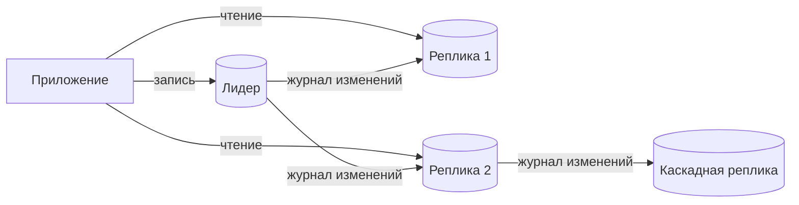
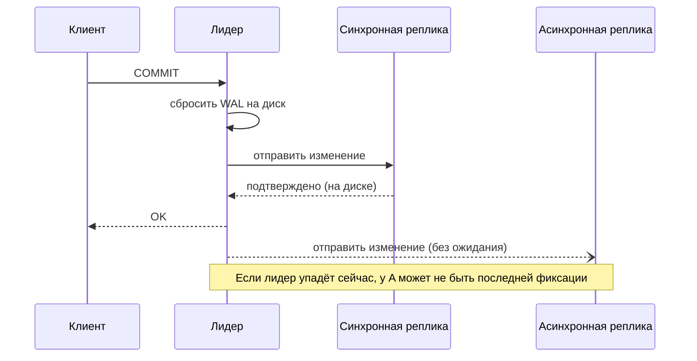
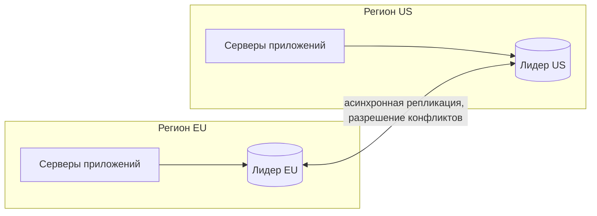
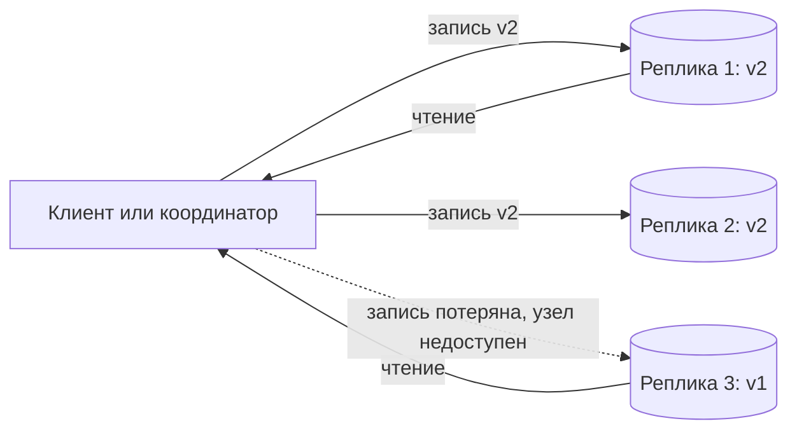

import { Aside } from '@astrojs/starlight/components';

Репликация хранит копию одних и тех же данных на нескольких машинах. У неё три цели: пережить потерю узла (доступность и долговечность), распределить чтение по большему числу серверов (пропускная способность чтения) и приблизить данные к пользователям (задержка). Любая схема репликации отвечает на два вопроса. Когда запись считается подтверждённой? И кому разрешено принимать записи?

<Aside type="tip" title="Коротко">
- **Лидер — фолловеры** (основной узел — реплики) — вариант по умолчанию: один узел принимает записи, остальные копируют его журнал и обслуживают чтение. Просто, но запись не масштабируется, а переключение на резерв требует аккуратности.
- **Асинхронная** репликация быстрая, но при переключении на резерв может потерять последние записи. **Синхронная** ничего не теряет, но каждая фиксация ждёт реплику. **Полусинхронная** или кворумная фиксация — обычная золотая середина.
- Задержка репликации ломает **чтение своих записей** и **монотонное чтение**. Это лечится правилами маршрутизации или ожиданием, пока реплика догонит известную позицию журнала.
- Схемы **с несколькими лидерами** и **без лидера** принимают записи в нескольких местах. Они выигрывают в доступности и локальности, но должны разрешать конфликты (LWW, слияние, CRDT).
- Кворумы без лидера: при `R + W > N` любое множество чтения пересекается с любым множеством записи. Это необходимо для свежих чтений, но не делает систему линеаризуемой.
</Aside>

## Репликация с лидером

Один узел, **лидер** (основной узел), принимает все записи. Каждое изменение он записывает в журнал: WAL в PostgreSQL, бинарный журнал (binlog) в MySQL. **Фолловеры** (реплики) получают этот журнал потоком и применяют изменения в том же порядке. Клиенты могут читать с любой реплики. В старой документации такая схема называется **master–slave**. Индустрия перешла на термины «лидер/фолловер» и «основной узел/реплика».

Типичные применения:

- **Масштабирование чтения.** Страницы товаров, ленты и отчёты уходят на реплики. Это работает, когда чтений намного больше, чем записей.
- **Высокая доступность.** Реплика — «тёплый» резерв, который можно повысить до лидера, если лидер упадёт.
- **Изоляция тяжёлой работы.** Аналитика, резервное копирование и выгрузки идут на реплике и не замедляют запись в production.
- **Локальность.** Реплика в другом регионе обслуживает местные чтения.

Реплики могут питать другие реплики (**каскадная** репликация). Это снимает нагрузку с лидера, но каждый шаг добавляет задержку.

Журнал бывает двух видов. **Физическая** репликация передаёт WAL на уровне байтов: копируется весь кластер, а реплика доступна только для чтения. **Логическая** репликация передаёт изменения строк: можно выбрать таблицы и даже использовать разные мажорные версии. На логической репликации построены инструменты захвата изменений (change data capture, CDC), которые транслируют изменения базы в Kafka и поисковые индексы.

## Синхронная, асинхронная, полусинхронная

| Режим | Фиксация возвращается, когда | Потеря данных при сбое лидера | Цена в задержке | Риск для доступности |
|---|---|---|---|---|
| Асинхронный | Лидер сбросил свой журнал | Последние транзакции могут потеряться | Нет | Реплики на него не влияют |
| Синхронный | Изменение есть у лидера **и** у выбранных реплик | Нет, если повысить синхронную реплику | Один круг до реплики на каждую фиксацию | Запись встаёт, если синхронная реплика недоступна |
| Полусинхронный / кворумный | Подтвердили как минимум *k* реплик | Нет, пока *k* реплик подтверждают | Круг до самых быстрых *k* | Переживает медленные или упавшие реплики, до определённого предела |

Как это сделано в крупных движках:

- **PostgreSQL** по умолчанию передаёт WAL асинхронно. Документация отмечает, что задержка видимости обычно меньше секунды. Параметр `synchronous_standby_names` заставляет фиксацию ждать: либо именованные резервные узлы в порядке приоритета (`FIRST 2 (s1, s2, s3)`), либо любой кворум (`ANY 2 (s1, s2, s3)`). Параметр `synchronous_commit` задаёт, насколько далеко должна продвинуться реплика: `remote_write` (в памяти ОС), `on` (на диске) или `remote_apply` (применено и видно читателям). Если ни одна синхронная реплика не отвечает, фиксации ждут бесконечно.
- **MySQL** в полусинхронном режиме ждёт, пока хотя бы одна реплика подтвердит, что транзакция записана в её relay log на диске. Если подтверждения нет за `rpl_semi_sync_source_timeout` (по умолчанию 10 секунд), источник **молча переходит на асинхронную репликацию** и возвращается к полусинхронной, когда реплика догонит. Следите за этим переключением: пока оно действует, гарантии отсутствия потерь нет.
- **Управляемые облачные базы** часто реплицируют на уровне хранилища. Amazon Aurora пишет шесть копий в трёх зонах доступности и считает запись долговечной, когда подтвердили четыре. Вычислительные реплики затем читают из этого общего хранилища.

Распространённая конфигурация в production — одна синхронная или кворумная реплика в другой зоне доступности ради отсутствия потерь, плюс асинхронные реплики для чтения и удалённых регионов.

## Задержка репликации и её аномалии

С асинхронными репликами фолловер всегда немного отстаёт. Обычно это миллисекунды. Отставание может вырасти до минут при тяжёлых пакетных записях, долгих запросах на реплике или проблемах в сети. Пользователь видит его как баги:

| Аномалия | Что видит пользователь | Как исправить |
|---|---|---|
| Нарушено **чтение своих записей** (read-your-writes) | Отредактировал профиль, обновил страницу — видит старый | Читать «свои» данные с лидера. Или читать с лидера несколько секунд после записи. Или запомнить позицию записи в журнале и читать только с реплики, которая её применила. |
| Нарушено **монотонное чтение** (monotonic reads) | Комментарий появился, а при следующем обновлении исчез (второе чтение попало на более отстающую реплику) | Закрепить пользователя или сессию за одной репликой (например, по хешу ID пользователя). Или передавать с клиента последнюю увиденную позицию. |
| Нарушен **согласованный префикс** (consistent prefix) | Видит ответ раньше вопроса, на который он отвечает | Держать причинно связанные записи на одном лидере или в одной партиции. Или отслеживать зависимости. |

Исправление через позицию журнала точное и дешёвое. После записи приложение запоминает позицию лидера: в PostgreSQL — LSN из `pg_current_wal_lsn()`, в MySQL — набор GTID. При следующем чтении оно выбирает реплику, у которой применённая позиция (`pg_last_wal_replay_lsn()`) не меньше этой. В MySQL можно ещё и подождать, пока реплика догонит, с помощью `WAIT_FOR_EXECUTED_GTID_SET()`. В PostgreSQL `synchronous_commit = remote_apply` даёт тот же эффект в момент фиксации ценой более медленных фиксаций.

Кроме того, публикуйте отставание как метрику и настройте на него оповещения. Выводите реплику из пула чтения, когда отставание превышает то, что допускает продукт.

## Переключение на резерв, повышение и split brain

Когда лидер падает, одного из фолловеров нужно повысить:

1. **Обнаружить** сбой. Обычно это пропущенные heartbeat-сигналы в течение нескольких секунд. Слишком короткий таймаут вызывает лишние переключения, слишком длинный — продлевает простой.
2. **Выбрать** нового лидера. Берите самую свежую реплику, чтобы потерять меньше записей. Синхронная реплика — идеальный вариант.
3. **Перенастроить.** Направить клиентов на нового лидера (DNS, виртуальный IP, прокси или обнаружение сервисов), а остальные реплики — на него же.
4. **Изолировать** старого лидера (fencing), чтобы он не мог принимать записи, если вернётся.

Инструменты вроде **Patroni** для PostgreSQL хранят аренду лидерства (lease) в согласованном хранилище (etcd, Consul, ZooKeeper или Kubernetes API). Быть основным узлом может только владелец аренды. Управляемые сервисы — RDS, Cloud SQL, Azure Database — выполняют этот цикл за вас.

**Split brain** («расщепление мозга») возникает, когда два узла одновременно считают себя лидером и оба принимают записи. Данные расходятся, а их слияние — ручное, мучительное и иногда невозможное. Защита:

- **Кворум большинства** при выборе лидера: узел, который не видит большинства, обязан сложить полномочия.
- **Токены изоляции** (fencing tokens): каждый новый лидер получает больший номер эпохи, а хранилище отвергает записи со старой эпохой.
- **STONITH** («пристрели другой узел»): выключить или изолировать старого лидера до повышения нового.

Реальный инцидент показывает, чем это грозит. В октябре 2018 года 43-секундное разделение сети в GitHub запустило автоматическое переключение основных узлов MySQL на другое побережье. В итоге на обеих площадках оказались записи, которых не было на другой. Их сверка оставила сайт в деградированном состоянии на 24 часа 11 минут.

## Репликация с несколькими лидерами (master–master)

Несколько узлов принимают записи и асинхронно реплицируют их друг другу. Обычная причина — **по лидеру на регион**: пользователи пишут локально с низкой задержкой, а регион может продолжать принимать записи, если другой отрезан. Крайний случай — приложения с офлайн-режимом: каждое устройство является лидером.

Цена — **конфликты записи**: два лидера одновременно меняют одну и ту же запись. Стратегии, от грубых к аккуратным:

- **Избегать конфликтов.** Направлять все записи данной сущности (пользователя, арендатора) на один «домашний» лидер. Самый распространённый и самый действенный подход.
- **Побеждает последний (last-writer-wins, LWW).** Оставить версию с наибольшей меткой времени. Просто, но проигравшие записи **молча теряются**, а «победителя» определяет расхождение часов. Так разрешают конфликты глобальные таблицы DynamoDB в режиме по умолчанию (согласованность в конечном счёте между регионами).
- **Слияние.** Хранить обе версии (siblings, с векторами версий) и дать приложению или пользователю их объединить — как корзину покупок, где товары объединяются.
- **CRDT.** Бесконфликтные реплицируемые типы данных (счётчики, множества, словари, текстовые последовательности) устроены так, что параллельные обновления всегда сливаются в один результат без координации. Их используют совместные редакторы, Active-Active-базы Redis Software и local-first-приложения.
- **Обнаружить и прервать.** MySQL Group Replication в режиме нескольких основных узлов сертифицирует каждую транзакцию относительно параллельных. Транзакция, упорядоченная первой, фиксируется везде, конфликтующая откатывается. Результат согласован, но при конкуренции бывают откаты.

Схемам с несколькими лидерами нужна ещё и защита от циклов, чтобы изменение не гуляло между лидерами бесконечно. Для этого в PostgreSQL 16 появились подписки с `origin = none`. Изменения схемы, автоинкрементные ключи (используйте UUID или диапазоны по узлам) и ограничения вроде уникальности становятся намного сложнее. Предпочитайте одного лидера, если локальность или автономность регионов действительно не требуют большего.

## Репликация без лидера (в стиле Dynamo)

Статья Amazon о Dynamo 2007 года популяризировала схему без лидера. Клиент или узел-координатор от его имени отправляет каждую запись **всем N репликам** ключа. Запись успешна, когда подтвердили **W** реплик. Чтение опрашивает реплики, ждёт **R** ответов и возвращает самую новую версию. По этой модели работают Cassandra, ScyllaDB и Riak.

На схеме N = 3, W = 2 и R = 2: запись попала на реплики 1 и 2. Чтение, получившее ответы от реплик 1 и 3, всё равно видит `v2`, потому что любые две из трёх реплик пересекаются. Это и есть **условие кворума**: `R + W > N`.

| N, W, R | Чтение видит последнюю запись? | Переживает упавших узлов при записи / чтении | Применение |
|---|---|---|---|
| 3, 2, 2 | Да (пересечение) | 1 / 1 | Сбалансированный вариант по умолчанию («QUORUM») |
| 3, 3, 1 | Да | 0 / 2 | Много чтений, редкие записи |
| 3, 1, 3 | Да | 2 / 0 | Быстрая запись, чтение должно дойти до всех |
| 3, 1, 1 | Нет гарантии | 2 / 2 | Минимальная задержка, согласованность в конечном счёте |

Cassandra позволяет выбирать это для каждого запроса через **уровни согласованности**: `ONE`, `QUORUM`, `LOCAL_QUORUM` (большинство в локальном дата-центре) и `ALL`.

Механизмы, которые сводят реплики к одному состоянию:

- **Исправление при чтении (read repair).** Если чтение видит устаревшую реплику, оно записывает на неё более новое значение.
- **Антиэнтропия (anti-entropy).** Фоновый процесс сравнивает реплики с помощью **деревьев Меркла** (хешей диапазонов ключей), и передаются только различающиеся диапазоны.
- **Отложенная передача (hinted handoff).** Если реплика недоступна, другой узел сохраняет запись с «подсказкой» и доставляет её, когда реплика вернётся. Cassandra по умолчанию хранит подсказки до трёх часов.
- **Нестрогие кворумы (sloppy quorums).** Если назначенные N узлов недоступны, запись принимают любые W работающих узлов. Запись остаётся доступной при разделении сети, но кворум чтения может с ней не пересечься, пока передача не завершится. Тогда `R + W > N` уже не гарантирует свежих чтений.

<Aside type="caution" title="Кворум — не линеаризуемость">
Даже при `R + W > N` читатели могут увидеть аномалии. Запись может пройти на меньшем числе узлов, чем W, завершиться ошибкой и не откатиться. Параллельные записи, разрешённые через LWW, могут терять данные. Расхождение часов может переставить обновления. Используйте хранилища без лидера ради доступности и пропускной способности записи. Когда нужна семантика compare-and-set, используйте системы на консенсусе.
</Aside>

Учтите, что управляемый сервис **Amazon DynamoDB** унаследовал от Dynamo имя, но не эту схему. В его статье на USENIX 2022 описан лидер Multi-Paxos в каждой партиции, который обслуживает записи и строго согласованные чтения.

## Недостатки репликации

- **Запись не масштабируется.** Каждая реплика применяет каждую запись. Новые реплики добавляют ёмкость чтения, но никогда — записи. Для этого см. [партиционирование и шардирование](/data/partitioning-and-sharding/).
- **Возможна потеря данных** при асинхронном переключении на резерв и **остановка записи** при синхронной репликации.
- **Отставание растёт с нагрузкой.** Реплика должна поспевать за темпом записи лидера и при этом обслуживать чтение. Долгие запросы на реплике могут задерживать применение журнала или конфликтовать с ним. PostgreSQL отменяет конфликтующие запросы на реплике по истечении `max_standby_streaming_delay`. Включённый `hot_standby_feedback` избавляет от большинства таких отмен, но тогда на основном узле копятся мёртвые строки. Помогает параллельное применение: реплики MySQL начиная с 8.0.27 по умолчанию используют четыре потока применения.
- **Реплики — не резервные копии.** Неудачная миграция или `DROP TABLE` реплицируются за миллисекунды. Держите ещё и резервные копии с восстановлением на момент времени, и отложенные реплики.
- **Больше движущихся частей.** Больше серверов, автоматика переключения, которую нужно регулярно проверять, маршрутизация соединений, мониторинг отставания и регламенты.

## Компромиссы

| | С лидером | С несколькими лидерами | Без лидера |
|---|---|---|---|
| Доступность записи | Лидер — единая точка отказа до переключения | Высокая: каждый лидер пишет независимо | Высокая: любые W узлов |
| Задержка записи | Один регион | Локальная в каждом регионе | Ожидание самых быстрых W |
| Согласованность | Строгая на лидере, устаревание на репликах | Конфликты нужно разрешать | Настраиваемая, по умолчанию в конечном счёте |
| Сложность | Минимальная | Максимальная (конфликты, циклы, схема) | Средняя (восстановление, надгробия, настройка) |
| Типичные системы | PostgreSQL, MySQL, SQL Server, наборы реплик MongoDB | Мультирегиональный active-active, совместные приложения | Cassandra, ScyllaDB, Riak |

<Aside type="note" title="На собеседовании">
- Явно опишите путь записи: кто её принимает, когда клиент получает «OK» и что потеряется, если этот узел упадёт сразу после.
- Ждите вопроса «пользователь обновил профиль и не видит изменений». Ответ: задержка репликации, затем чтение своих записей через чтение с лидера или отслеживание позиции журнала.
- Объясните переключение на резерв целиком: обнаружение, выбор самой свежей реплики, изоляция, перенаправление клиентов. Назовите split brain и то, как кворум большинства его предотвращает.
- Для кворумов проведите расчёт (N = 3, W = 2, R = 2) и объясните, почему нестрогие кворумы и LWW ослабляют гарантию.
- Частая ошибка — предлагать реплики для чтения, чтобы решить проблему узкого места на **записи**.
</Aside>

## Что почитать

- [PostgreSQL: Log-Shipping Standby Servers](https://www.postgresql.org/docs/current/warm-standby.html) — потоковая и синхронная репликация, кворумная фиксация.
- [MySQL: Semisynchronous Replication](https://dev.mysql.com/doc/refman/8.4/en/replication-semisync.html) — правила подтверждения и откат к асинхронной репликации.
- [Dynamo: Amazon's Highly Available Key-value Store](https://www.allthingsdistributed.com/2007/10/amazons_dynamo.html) — статья 2007 года, на которой основаны репликация без лидера, hinted handoff и восстановление по деревьям Меркла.
- [Amazon Aurora under the hood: quorums and correlated failure](https://aws.amazon.com/blogs/database/amazon-aurora-under-the-hood-quorum-and-correlated-failure/) — почему шесть копий и кворум записи из четырёх.
- [GitHub: October 21 post-incident analysis](https://github.blog/news-insights/company-news/oct21-post-incident-analysis/) — реальное межрегиональное переключение и его последствия.
- [CRDT.tech](https://crdt.tech/) — статьи и реализации бесконфликтных реплицируемых типов данных.

## Связанные темы

- [Реляционные базы данных](/data/relational-databases/) — гарантии одного узла, которые расширяет репликация.
- [Партиционирование и шардирование](/data/partitioning-and-sharding/) — масштабирование записи, обычно вместе с репликацией каждого шарда.
- [Модели согласованности](/fundamentals/consistency-patterns/) — чтение своих записей, монотонное чтение и линеаризуемость подробно.
- [Паттерны доступности](/fundamentals/availability-patterns/) — переключение active-passive и active-active в общем виде.
- [Теорема CAP и PACELC](/fundamentals/cap-theorem/) — компромисс между задержкой и согласованностью, стоящий за синхронной и асинхронной репликацией.
- [NoSQL-базы данных](/data/nosql/) — широкостолбцовые и key-value-хранилища на репликации без лидера.
