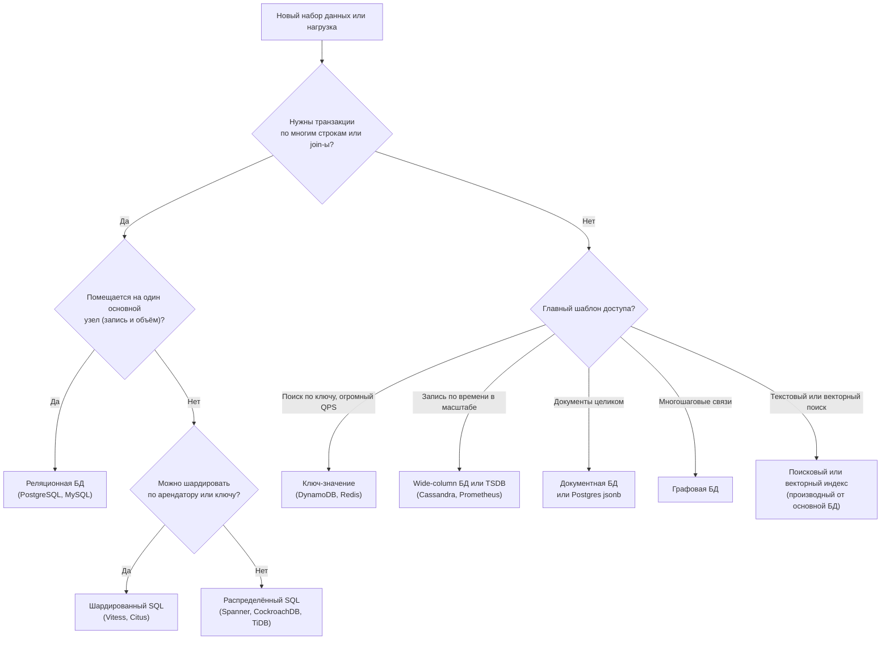
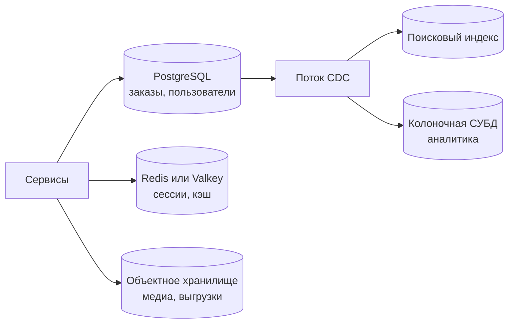

import { Aside } from '@astrojs/starlight/components';

Выбор базы данных — одно из немногих ранних решений, которые дорого отменять: данные живут дольше кода. На этой странице выбор сведён к короткой серии вопросов о данных и шаблонах доступа, а заодно объясняется, почему в 2026 году ответ по умолчанию для нового продукта обычно звучит так: «реляционная база, пока конкретная нагрузка не докажет обратное».

<Aside type="tip" title="Коротко">
- Начинайте с реляционной базы (обычно PostgreSQL), если только явное требование её не исключает: объём записи больше, чем выдержит один основной узел, задержка в единицы миллисекунд при огромном масштабе или модель данных, с которой она плохо справляется.
- NoSQL выбирают под **конкретную нагрузку** с известными шаблонами доступа: поиск по ключу при очень высоком QPS, упорядоченные по времени записи в масштабе, документы, читаемые целиком, обходы графа.
- PostgreSQL с `jsonb`, полнотекстовым поиском и расширениями вроде `pgvector` закрывает многие «NoSQL-задачи» на малых и средних объёмах.
- Распределённый SQL (Spanner, CockroachDB, YugabyteDB, TiDB, Aurora DSQL) даёт SQL и транзакции с горизонтальным масштабированием ценой большей задержки записи.
- Каждое дополнительное хранилище добавляет расходы на эксплуатацию, согласованность и дежурства. Добавляйте его, только когда оно окупается.
</Aside>

## Блок-схема решения



Блок-схема — отправная точка, а не алгоритм. На практике важны два уточнения:

- **Решайте для каждого набора данных, а не для компании целиком.** Заказы могут жить в PostgreSQL, сессии — в Redis, а события кликов — в колоночной СУБД, и всё это в одном продукте.
- **Посчитайте.** «Помещается на один основной узел» — это число. Один современный сервер PostgreSQL спокойно выдерживает тысячи пишущих транзакций в секунду и многие терабайты данных; реплики для чтения и кэш снимают с него чтения. Сделайте [прикидочный расчёт](/start/estimation/), прежде чем тянуться к распределённому хранилищу.

## Доводы за каждую сторону

| Почему SQL | Почему NoSQL |
|---|---|
| Данные реляционные, много связей «многие ко многим» | Данные — набор независимых агрегатов или пар «ключ-значение» |
| Инварианты охватывают несколько строк (балансы, остатки, уникальность) | Инварианты живут внутри одного элемента или партиции |
| Не все запросы известны заранее; нужна произвольная отчётность | Шаблонов доступа немного, они известны и стабильны |
| Нужны join-ы, агрегации, оконные функции | Преобладает поиск по ключу или диапазону ключей |
| Зрелые инструменты, ORM, миграции, рынок специалистов | Нужна предсказуемая задержка при очень высоком QPS |
| Схему обеспечивает база | Схема различается от записи к записи или часто меняется |
| Объём и скорость записи помещаются на один основной узел (плюс реплики) | Скорость записи или объём данных намного превышают возможности одной машины |
| Строгая согласованность по умолчанию | Запись в нескольких регионах (active-active) с настраиваемой согласованностью |

Полезная проверка: если запросы пока нельзя перечислить, нужна гибкость SQL. Если их можно перечислить, они простые, но объём огромный, — возможно, подойдёт NoSQL.

## Нагрузки, которым подходит NoSQL

- **Быстрый приём данных, которые только дописываются** — потоки кликов, логи, телеметрия IoT, метрики (wide-column-хранилища, базы временных рядов или лог вроде Kafka плюс колоночная СУБД).
- **Временное или быстро меняющееся состояние** — сессии, корзины, счётчики ограничения частоты запросов, статус «в сети» (ключ-значение, часто в памяти с TTL).
- **Таблицы лидеров и счётчики** — сортированные множества Redis или Valkey дают ранжированное чтение за логарифмическое время.
- **Горячие справочники** — флаги функций, настройки пользователей, соответствия URL, которые читают миллионы раз в секунду.
- **Каталоги и контент** — документы товаров или статей с разными атрибутами, читаемые целиком.
- **Запросы с обилием связей** — мошеннические схемы, рекомендации, графы прав доступа.
- **Поиск и сходство** — полнотекстовый, фасетный и векторный поиск в виде индексов, производных от источника истины.

## PostgreSQL умеет многое

Прежде чем добавлять новое хранилище, проверьте, не справится ли уже используемая база. PostgreSQL, в частности, закрывает несколько «NoSQL-ниш»:

| Потребность | Возможность PostgreSQL | Хватает, пока… |
|---|---|---|
| Гибкие документы | Тип `jsonb` с GIN-индексами и запросами JSON path | Документы большие и часто перезаписываются или записи перерастают один узел |
| Полнотекстовый поиск | `tsvector`, `tsquery`, GIN-индексы, ранжирование | Не нужны устойчивость к опечаткам, тонкая настройка релевантности, фасеты в масштабе |
| Векторный поиск | Расширение `pgvector`: индексы HNSW и IVFFlat, расстояния L2, скалярное произведение, косинусное | Сотни миллионов векторов или тяжёлая нагрузка фильтрованного ANN-поиска |
| Временные ряды | Декларативное партиционирование; расширение TimescaleDB | Очень высокая кардинальность или скорость приёма, требующая отдельной TSDB |
| Очереди | `SELECT … FOR UPDATE SKIP LOCKED` | Тысячи сообщений в секунду или раздача многим потребителям |
| Кэш «ключ-значение» | Нежурналируемые (unlogged) таблицы | Нужна субмиллисекундная задержка или очень высокий QPS (берите Redis или Valkey) |
| Геоданные | Расширение PostGIS | Для типичных продуктовых задач его редко перерастают |

Полуструктурированный каталог товаров в обычном PostgreSQL:

```sql title="catalog.sql"
CREATE TABLE products (
  id    bigint PRIMARY KEY,
  name  text NOT NULL,
  price numeric(10,2) NOT NULL,
  attrs jsonb NOT NULL DEFAULT '{}'
);
CREATE INDEX products_attrs_gin ON products USING gin (attrs jsonb_path_ops);

INSERT INTO products VALUES
  (1, 'Trail shoe', 129.00, '{"size": 42, "color": "red", "waterproof": true}'),
  (2, 'Rain jacket', 189.00, '{"color": "red", "sizes": ["S","M","L"]}');

-- Запрос на вхождение, который обслуживает GIN-индекс
SELECT id, name, price
FROM products
WHERE attrs @> '{"color": "red", "waterproof": true}';
```

В типизированных столбцах хранится то, что есть у каждой строки и по чему делают join-ы или задают ограничения; в `jsonb` — длинный хвост необязательных атрибутов. Аналогично `pgvector` добавляет тип столбца `vector(n)` и операторы поиска ближайших соседей (`<->` для L2, `<=>` для косинусного расстояния), так что эмбеддинг лежит рядом со строкой, которую описывает, и фильтруется обычным `WHERE` в той же транзакции.

Ограничения реальны: все записи идут через один основной узел, большие значения `jsonb` при каждом обновлении перезаписываются целиком, а vacuum, лимиты соединений и отставание реплик требуют внимания в масштабе. Но «один хорошо настроенный PostgreSQL плюс кэш» на удивление долго тянет многие продукты.

## NewSQL и распределённый SQL

Распределённые SQL-базы сохраняют реляционную модель и ACID-транзакции, но делят данные на диапазоны, которые реплицируются протоколом консенсуса (Raft или Paxos) и распределяются по узлам и регионам.

| Система | Совместимость | Примечания |
|---|---|---|
| Google Spanner | Диалекты GoogleSQL и PostgreSQL | Часы TrueTime дают внешнюю согласованность; статья 2012 года открыла категорию |
| CockroachDB | Протокол PostgreSQL | По умолчанию сериализуемость; source-available, бесплатный уровень для небольших компаний |
| YugabyteDB | PostgreSQL (использует его слой запросов) | Ядро под Apache 2.0 |
| TiDB | MySQL | Apache 2.0; строковое хранилище плюс колоночное TiFlash для аналитики |
| Amazon Aurora DSQL | PostgreSQL | Бессерверная, active-active между регионами, изоляция снимков; GA в мае 2025 года |

**Что вы получаете:** горизонтальное масштабирование записи, автоматическую перебалансировку, переживание отказа узла или зоны (а в многорегиональной конфигурации и региона) без ручного переключения на резерв, SQL с транзакциями.

**Чем платите:** каждый коммит требует раунда консенсуса, поэтому задержка записи — несколько миллисекунд внутри региона и десятки–сотни миллисекунд между регионами; транзакции между диапазонами дороже локальных; части возможностей и расширений PostgreSQL нет; стоимость выше, чем у одного узла. Конкуренция за горячие строки по-прежнему выстраивает транзакции в очередь. Распределённый SQL уместен, когда действительно нужны и реляционная семантика, и масштаб или географическое распределение: например, глобальный реестр платежей или многорегиональная управляющая плоскость SaaS.

Промежуточный вариант — **шардированный SQL**: Vitess (для MySQL) или Citus (для PostgreSQL) маршрутизируют запросы по ключу шарда, обычно ID арендатора. Запросы в пределах арендатора остаются быстрыми и полнофункциональными; запросы между шардами ограничены.

## Полиглотное хранение и его цена

**Полиглотное хранение** (polyglot persistence) — использование нескольких хранилищ, каждое для подходящей ему нагрузки. Типичный продукт в 2026 году может выглядеть так:



Каждое дополнительное хранилище умножает расходы, которые не видны в бенчмарках:

- **Эксплуатация:** резервные копии, учения по восстановлению, обновления, планирование ёмкости, патчи безопасности, мониторинг и экспертиза дежурных для каждого движка.
- **Согласованность:** данные, копируемые между хранилищами, согласованы лишь в конечном счёте. Нужны CDC или шаблон outbox, идемпотентные потребители и способ перестроить производное хранилище с нуля.
- **Двойная запись:** запись в два хранилища из кода приложения без транзакции рано или поздно приведёт к расхождению. Пишите один раз в источник истины, остальное выводите из него.
- **Безопасность и соответствие требованиям:** больше мест с персональными данными, больше политик доступа, больше путей удаления по запросам о конфиденциальности.
- **Когнитивная нагрузка:** больше языков запросов и режимов отказа, которые должна знать команда.

Управляемые сервисы уменьшают эксплуатационную часть, но не проблемы согласованности и требований регуляторов. Хорошее правило: у каждого фрагмента данных один **источник истины** (system of record), а все остальные копии — перестраиваемые кэши или индексы.

## Компромиссы

| Вариант | Что даёт | Чего стоит |
|---|---|---|
| Одна реляционная БД | Транзакции, join-ы, гибкие запросы, простая эксплуатация | Масштаб записи ограничен одним основным узлом |
| Реляционная БД + кэш + реплики | Масштаб чтения, низкая задержка для горячих данных | Инвалидация кэша, отставание реплик |
| Шардированный SQL | Масштаб записи для данных, разделяемых по арендаторам | Запросы между шардами, работа по решардингу |
| Распределённый SQL | SQL и ACID в масштабе, переживание отказа региона | Большая задержка записи, стоимость, неполная совместимость |
| Специализированная NoSQL | Лучшее решение для одного шаблона доступа в предельном масштабе | Жёсткая модель данных, join-ы в приложении, ещё одна система в эксплуатации |

<Aside type="note" title="На собеседовании">
- Обосновывайте выбор числами: QPS чтения и записи, объём данных, целевая задержка, требования к согласованности. «Мы выбрали Cassandra, потому что она web-scale» — тревожный сигнал.
- Часто спрашивают: «А почему не просто PostgreSQL?» Будьте готовы ответить, в какой предел вы упрётесь и когда.
- Если выбираете несколько хранилищ, назовите источник истины и объясните, как синхронизируются остальные (CDC, outbox, события) и насколько они могут отставать.
- Разберитесь хотя бы в одной распределённой SQL-системе настолько, чтобы объяснить стоимость консенсуса и почему запись между регионами медленная.
- Ошибка, которой стоит избегать: проектировать NoSQL-схему, не перечислив шаблоны доступа.
</Aside>

## Что почитать

- [Designing Data-Intensive Applications, 2nd edition](https://www.oreilly.com/library/view/designing-data-intensive-applications/9781098119058/) — Клеппман и Риккомини (O'Reilly, 2026), главы о моделях данных и хранении.
- [PostgreSQL: JSON types](https://www.postgresql.org/docs/current/datatype-json.html) — `json` и `jsonb`, операторы и GIN-индексы.
- [pgvector](https://github.com/pgvector/pgvector) — векторный поиск по сходству для PostgreSQL.
- [Spanner: Google's Globally-Distributed Database](https://research.google/pubs/spanner-googles-globally-distributed-database-2/) — статья, с которой начался распределённый SQL.
- [What is Amazon Aurora DSQL?](https://docs.aws.amazon.com/aurora-dsql/latest/userguide/what-is-aurora-dsql.html) — современный пример бессерверного распределённого SQL.
- [Polyglot Persistence](https://martinfowler.com/bliki/PolyglotPersistence.html) — исходная формулировка идеи от Мартина Фаулера.

## Связанные темы

- [NoSQL-базы данных](/data/nosql/) — семейства и модели данных, стоящие за колонкой NoSQL в этом руководстве.
- [Реляционные базы данных](/data/relational-databases/) — что даёт выбор по умолчанию.
- [Партиционирование и шардирование](/data/partitioning-and-sharding/) — к чему приводит «не помещается на один узел».
- [Уровни кэширования](/caching/caching-layers/) — часто самый дешёвый способ отложить смену базы.
- [Потоковая передача событий](/async/event-streaming/) — CDC и логи, поддерживающие синхронность полиглотных хранилищ.
