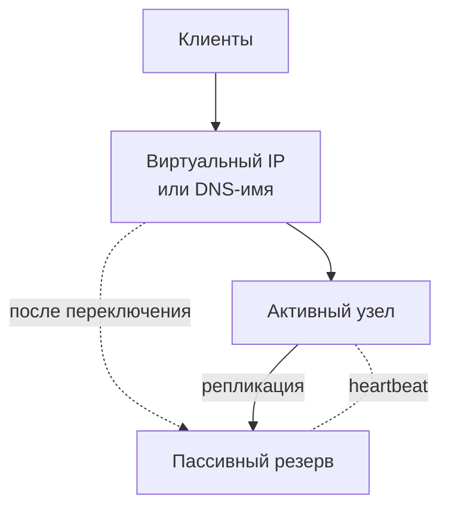
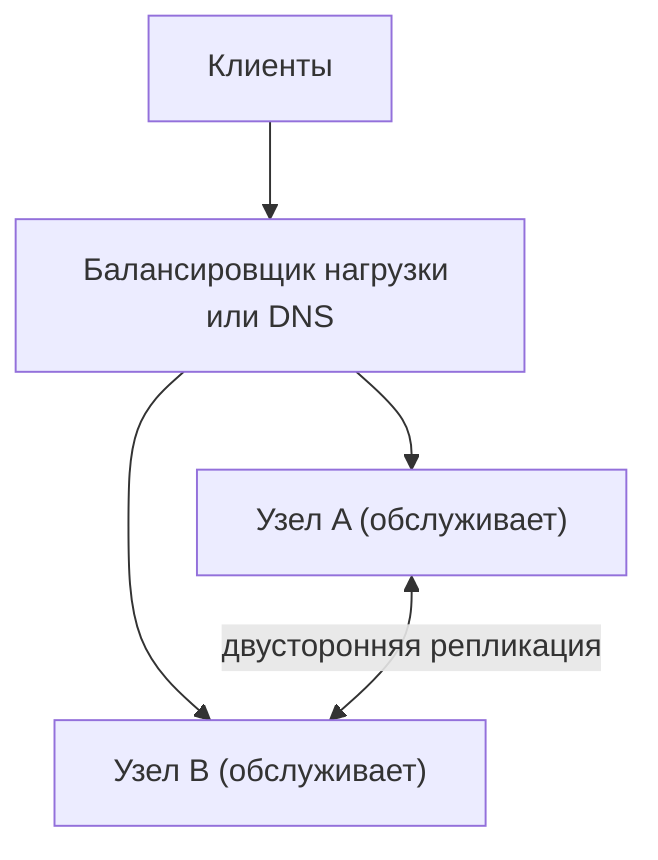

import { Aside } from '@astrojs/starlight/components';

Доступность (availability) — доля времени или запросов, в течение которой система делает свою работу. Рано или поздно отказывает любой компонент, поэтому высокая доступность складывается из **избыточности** и быстрого, надёжного способа **переключиться на резервную копию**. Затем результат сравнивают с целью, о которой договорились с бизнесом. На этой странице — паттерны, арифметика и эксплуатационные практики.

<Aside type="tip" title="Коротко">
- Два строительных блока: **переключение на резерв** (failover: резерв подхватывает работу, или все копии обслуживают одновременно) и **репликация** (держит данные резерва актуальными).
- У **последовательных** компонентов доступности перемножаются, так что каждая зависимость снижает итог. У **параллельных** резервных компонентов перемножаются вероятности *отказа*, что повышает итог, — но только если отказы независимы.
- Каждая новая девятка сокращает допустимый простой в десять раз: 99,9% — это около 8,8 часа в год, 99,99% — около 53 минут.
- Задайте **SLO**, считайте разрыв до 100% **бюджетом ошибок** и тратьте его на релизы. Кончился бюджет — останавливайтесь.
- По умолчанию распределяйтесь по **зонам доступности**. В несколько регионов выходите, только если требования оправдывают стоимость и компромиссы по согласованности.
</Aside>

## Переключение на резерв

### Active-passive

Трафик обслуживает один узел. Резервный получает реплицированные данные и следит за активным по heartbeat-сигналам или проверкам здоровья. Когда активный узел отказывает, резервный забирает его виртуальный IP, DNS-имя или роль лидера и начинает обслуживать запросы.



Как быстро резерв подхватит работу, зависит от того, насколько он «прогрет»:

| Резерв | Состояние в ожидании | Время восстановления (RTO) | Потеря данных (RPO) | Стоимость |
|---|---|---|---|---|
| Горячий | Запущен, полностью развёрнут, данные реплицируются непрерывно | От секунд до минуты | Ноль при синхронной репликации, секунды при асинхронной | Около 2× активного узла |
| Тёплый | Запущен в уменьшенном размере, данные реплицируются | Минуты (нужно масштабироваться) | Секунды | Средняя |
| Холодный | Не запущен; собирается из образов и бэкапов | Часы | Всё с момента последнего бэкапа | Минимальная |

**RTO** (recovery time objective) — сколько допустимо простаивать. **RPO** (recovery point objective) — сколько последних данных допустимо потерять. В рекомендациях AWS по аварийному восстановлению та же лестница называется *backup and restore*, *pilot light*, *warm standby* и *multi-site active/active*.

Управляемые базы данных в основном используют горячий вариант active-passive. Примеры — основной узел с синхронным резервом в другой зоне или группа Raft, выбирающая нового лидера.

### Active-active

Все узлы обслуживают трафик одновременно. Балансировщик нагрузки или DNS распределяют запросы между ними, а отказавший узел просто выводится из ротации.



Для stateless-слоёв active-active — вариант по умолчанию: реплицировать нечего. Для слоёв с состоянием это означает запись через несколько лидеров или без лидера, и нужно решить, как разрешать конкурентные записи одних и тех же данных. См. [модели согласованности](/fundamentals/consistency-patterns/).

### Недостатки переключения на резерв

- **Потерянные записи.** При асинхронной репликации записи, подтверждённые старым основным узлом, но ещё не скопированные, теряются или требуют последующей сверки.
- **Split brain («раздвоение мозга»).** Если резерв ошибочно решит, что активный узел умер, — например, при разделении сети, — записи могут принимать оба. Защита — кворум или узел-свидетель, решающий, кто лидер, истекающие аренды (leases) и **фенсинг** (fencing), отрезающий старому лидеру доступ к хранилищу.
- **Обнаружение отказа — компромисс.** Короткие тайм-ауты дают ложные переключения и «дребезг». Длинные — более долгие простои. Время обнаружения примерно равно интервалу проверки × порогу отказов: 10 с × 3 = 30 с ещё до начала переключения.
- **Клиенты должны переключиться следом.** Изменения DNS вступают в силу только после истечения закэшированных TTL, пулы соединений держат мёртвые соединения, а некоторые клиенты кэшируют IP-адреса навсегда.
- **Простаивающие или зарезервированные мощности.** Пассивный узел не делает полезной работы. Узлам active-active нужен запас: два узла должны работать каждый ниже 50%, чтобы один мог вынести всю нагрузку.
- **Пути переключения «ржавеют».** Путь, который используют раз в год, часто отказывает именно тогда, когда нужен. Регулярно его прогоняйте (game days, плановые переключения).

## Репликация

Переключение на резерв хорошо ровно настолько, насколько хороша копия данных у резерва. Репликация лидер–фолловер (основной узел – реплика), с несколькими лидерами и без лидера по-разному балансирует риск потери данных, задержку записи и сложность. В старых материалах встречаются устаревшие названия «master–slave» и «master–master». Подробности — на странице про [репликацию](/data/replication/).

## Доступность в цифрах

Доступность обычно выражают числом девяток. В таблице год — 365,25 дня, месяц — двенадцатая часть года.

| Доступность | В год | В месяц | В неделю | В день |
|---|---|---|---|---|
| 99% («две девятки») | 3 д 15 ч 40 мин | 7 ч 18 мин | 1 ч 41 мин | 14 мин 24 с |
| 99,9% («три девятки») | 8 ч 46 мин | 43 мин 50 с | 10 мин 5 с | 1 мин 26 с |
| 99,95% | 4 ч 23 мин | 21 мин 55 с | 5 мин 2 с | 43 с |
| 99,99% («четыре девятки») | 52 мин 36 с | 4 мин 23 с | 1 мин 0,5 с | 8,6 с |
| 99,999% («пять девяток») | 5 мин 16 с | 26 с | 6 с | 0,9 с |

При четырёх девятках одно переключение длиной две минуты съедает почти половину месячного бюджета. Человек не успеет получить вызов и отреагировать, уложившись в такой бюджет, поэтому высокие девятки требуют **автоматического** обнаружения и восстановления. [Калькулятор доступности](/reference/availability-numbers/) переводит цели в простой и обратно.

Доступность можно измерять по времени («минуты, когда сервис был здоров») или по запросам («успешные запросы ÷ корректные запросы»). Измерение по запросам отражает то, что реально испытали пользователи, и обычно используется для SLO.

## Последовательные и параллельные компоненты

**Последовательно**: запросу нужен каждый компонент, поэтому доступности перемножаются:

```text
A_total = A1 × A2 × … × An
```

- Балансировщик 99,99% → слой приложений 99,95% → база данных 99,95%: `0,9999 × 0,9995 × 0,9995 ≈ 99,89%`, около 9,6 часа простоя в год. Это хуже любой отдельной части.
- Десять критичных зависимостей по 99,99% дают `0,9999^10 ≈ 99,90%`. Десять сервисов с четырьмя девятками складываются в продукт с тремя.

**Параллельно**: запрос падает, только если отказали все резервные копии, поэтому перемножаются вероятности *отказа*:

```text
A_total = 1 − (1 − A1) × (1 − A2) × … × (1 − An)
```

- Два сервера приложений по 99,5%: `1 − 0,005² = 99,9975%`, около 13 минут в год.
- Поставим эту пару между балансировщиком на 99,99% и базой на 99,95%: `0,9999 × 0,999975 × 0,9995 ≈ 99,94%`. Теперь итог определяет нерезервированная база. Найдите самое слабое последовательное звено и зарезервируйте его.

Две оговорки:

- **Формула для параллельных компонентов предполагает независимые отказы.** Две реплики в одной стойке, за одним коммутатором, с одной и той же неудачной выкаткой или одним и тем же сломанным конфигом отказывают вместе. Коррелированные отказы — причина, по которой реальные системы редко достигают теоретических цифр. Разносите реплики по доменам отказа и выкатывайте изменения постепенно.
- **Правило дополнительной девятки.** Авторы из Google SRE советуют, чтобы каждая критичная зависимость была примерно в десять раз надёжнее зависящего от неё сервиса. Сервису на 99,99% нужны зависимости на 99,999% — или дизайн, переживающий их отказ.

## SLI, SLO, SLA и бюджет ошибок

- **SLI** (service level indicator, индикатор уровня сервиса): измеряемая величина. Примеры: доля успешных запросов, доля запросов, обслуженных быстрее 300 мс.
- **SLO** (service level objective, цель уровня сервиса): внутренняя цель для SLI на окне времени, например «99,9% запросов успешны, окно 30 дней».
- **SLA** (service level agreement, соглашение об уровне сервиса): договор с клиентами, где за невыполнение цели предусмотрены последствия, обычно компенсации (service credits). SLA задают мягче внутренних SLO, чтобы команда реагировала раньше, чем нарушится договор. Облачные SLA часто зависят от вашей архитектуры. Региональный SLA для EC2 на 99,99% распространяется только на нагрузки, развёрнутые минимум в двух зонах доступности; отдельный инстанс покрыт на 99,5%.

**Бюджет ошибок** (error budget) равен `1 − SLO`. При SLO 99,9% на 30 дней бюджет — 43,2 минуты полного простоя. В запросах это 100 000 неудачных из 100 млн. Бюджет превращает надёжность в общее решение:

- Пока бюджет есть — выпускайте функции, проводите эксперименты, рискуйте.
- Когда он исчерпан, действует согласованная **политика бюджета ошибок**: заморозить рискованные релизы и тратить время инженеров на надёжность, пока сервис не вернётся в рамки SLO.
- Алертите по **скорости сжигания** (burn rate), а не по единичным ошибкам. Сжечь 2% 30-дневного бюджета за час (скорость сжигания 14,4) — повод разбудить дежурного. Медленное сжигание — повод завести тикет.

100% — неправильная цель. Через свои сети и устройства пользователи не отличат 99,999% от 100%, а каждая следующая девятка стоит намного дороже предыдущей.

## Несколько зон и несколько регионов

**Зона доступности** (Availability Zone, AZ) — один или несколько дата-центров с независимым питанием, охлаждением и сетью, расположенных достаточно близко к соседним зонам для связи с низкой задержкой. **Регион** — группа зон в одном географическом районе.

| | Несколько зон (multi-AZ) | Несколько регионов (multi-Region) |
|---|---|---|
| Защищает от | Отказов дата-центра: питание, охлаждение, сеть, локальные бедствия | Отказов целого региона, крупных бедствий, части отказов control plane |
| Репликация | Синхронная практична (около 1 мс на круг) | Обычно асинхронная (десятки–сотни мс); синхронная стоит задержки записи |
| Типичные RPO / RTO | Ноль / от секунд до минут | Секунды и больше / минуты, если не спроектировано как active-active |
| Стоимость и сложность | Умеренные; большинство управляемых сервисов делают это за вас | Высокие: требования к размещению данных, обработка конфликтов, глобальная маршрутизация, тестирование |

Ключевая идея AWS — **статическая устойчивость** (static stability). Заранее держите столько мощности, чтобы потеря зоны **не** требовала экстренного масштабирования: control plane, к которому пришлось бы обращаться, может тоже пострадать. При трёх зонах каждая должна работать не выше примерно двух третей проверенной мощности. Тогда при потере одной зоны две оставшиеся выйдут на полную, но безопасную нагрузку. Это примерно 50% избыточной мощности. Сбой в us-east-1 в октябре 2025 года показал, зачем это нужно: из-за ошибки DNS в DynamoDB новые инстансы EC2 часами не запускались, а уже работающие продолжали работать.

## Проверки здоровья

Переключение на резерв и балансировка зависят от того, знаем ли мы, какие экземпляры здоровы.

- **Liveness** (живость): процесс запущен и отвечает? При отказе — перезапустить. В Kubernetes проваленная liveness-проба перезапускает контейнер.
- **Readiness** (готовность): может ли экземпляр прямо сейчас обслуживать трафик (прогрет, подключён к зависимостям)? При отказе — вывести из ротации, но не перезапускать. В Kubernetes проваленная readiness-проба убирает под из endpoints сервиса.
- **Поверхностные и глубокие проверки.** Проверка, которая заодно проверяет базу данных, ловит больше проблем. Но когда общая база кратковременно сбоит, проваливаются все экземпляры сразу, и балансировщик убирает весь парк. Делайте проверки для балансировщика в основном локальными. Многие балансировщики работают по принципу **fail open**: если все экземпляры сообщают о проблеме, трафик идёт на все, чтобы неудачная проверка не вызвала полный простой.
- Проверяйте и снаружи. Синтетические пробы из нескольких точек ловят сбои DNS, сертификатов и маршрутизации, которые внутренние проверки не видят.

## Плавная деградация

Доступность — не «всё или ничего». Система, потерявшая часть функций, должна продолжать обслуживать остальное:

- **Отдавайте устаревшие данные** из кэша, когда источник истины недоступен, и помечайте их как возможно неактуальные.
- **Отключайте некритичные функции** флагами: рекомендации, персонализацию, подсказки поиска. Оформление заказа и вход должны работать.
- **Сбрасывайте нагрузку** до того, как перегрузка распространится. Отклоняйте низкоприоритетные запросы рано, с `429` или `503`, чтобы высокоприоритетные проходили. См. [ограничение частоты запросов](/reliability/rate-limiting/).
- **Переходите в режим только для чтения**, когда записи невозможны, например во время переключения базы данных.
- **Ограничивайте каждую зависимость** тайм-аутами и предохранителями (circuit breaker), чтобы один медленный сервис не занял все потоки. См. [паттерны устойчивости](/reliability/resilience-patterns/).

## Компромиссы

| Паттерн | Что даёт | Чего стоит |
|---|---|---|
| Active-passive (горячий) | Простая модель, один писатель, быстрое переключение | Простаивающие мощности, риск split brain, потеря данных при асинхронной репликации |
| Active-passive (холодный) | Дешевле всего | Часы простоя, потеря данных с последнего бэкапа |
| Active-active | Нет шага переключения, используется вся мощность | Нужен запас; конфликты записи для данных с состоянием |
| Несколько зон | Переживает потерю дата-центра почти без роста задержки | Плата за межзонный трафик, около 50% лишней мощности ради статической устойчивости |
| Несколько регионов | Переживает потерю региона, ближе к пользователям | Стоимость, сложность, компромисс согласованности и задержки, сложнее тестировать |
| Плавная деградация | Частичное обслуживание вместо простоя | Продуктовые решения о том, что отключать, больше путей в коде для тестирования |

<Aside type="note" title="На собеседовании">
- Превращайте «высокодоступный» в цифры: спросите SLO, выведите из него бюджет простоя и оцените, успеет ли человек отреагировать.
- Пройдите по пути запроса и перемножьте доступности. Назовите самое слабое последовательное звено и зарезервируйте его.
- Добавляя резерв, назовите RPO и RTO и объясните, как предотвращается split brain (кворум, аренды, фенсинг).
- Ждите вопроса «что будет, если упадёт зона или регион?». Расскажите о запасе мощности (статическая устойчивость), переключении через DNS или глобальный балансировщик и об отставании репликации.
- Частые ошибки: считать отказы реплик независимыми, делать глубокие проверки здоровья, которые выводят из строя весь парк, и обещать пять девяток при ручном переключении.
</Aside>

## Что почитать

- [Embracing Risk](https://sre.google/sre-book/embracing-risk/) — глава книги Google SRE, вводящая бюджет ошибок.
- [Alerting on SLOs](https://sre.google/workbook/alerting-on-slos/) — руководство SRE workbook по алертам на скорость сжигания бюджета.
- [The Calculus of Service Availability](https://cacm.acm.org/practice/the-calculus-of-service-availability/) — как зависимости ограничивают доступность и правило «дополнительной девятки».
- [Static stability using Availability Zones](https://aws.amazon.com/builders-library/static-stability-using-availability-zones/) — Amazon Builders' Library о том, как пережить потерю зоны без реакции на неё.
- [Implementing health checks](https://builder.aws.com/content/3Ev53O39izHCtWLzp4XU6t8PC1O/implementing-health-checks) — проверки живости, локальные и проверки зависимостей; почему балансировщики работают по принципу fail open.
- [Disaster recovery options in the cloud](https://docs.aws.amazon.com/whitepapers/latest/disaster-recovery-workloads-on-aws/disaster-recovery-options-in-the-cloud.html) — сравнение backup and restore, pilot light, warm standby и active/active.

## Связанные темы

- [Доступность в цифрах](/reference/availability-numbers/) — калькулятор девяток, простоя и составной доступности.
- [Репликация](/data/replication/) — как данные резерва остаются актуальными.
- [Балансировщики нагрузки](/traffic/load-balancers/) — проверки здоровья и распределение трафика в active-active.
- [DNS](/traffic/dns/) — переключение через DNS и оговорка про TTL.
- [Паттерны устойчивости](/reliability/resilience-patterns/) — тайм-ауты, повторные попытки и предохранители, которые не дают частичным отказам стать полными.
- [Наблюдаемость](/reliability/observability/) — измерение SLI и алерты по скорости сжигания бюджета.
