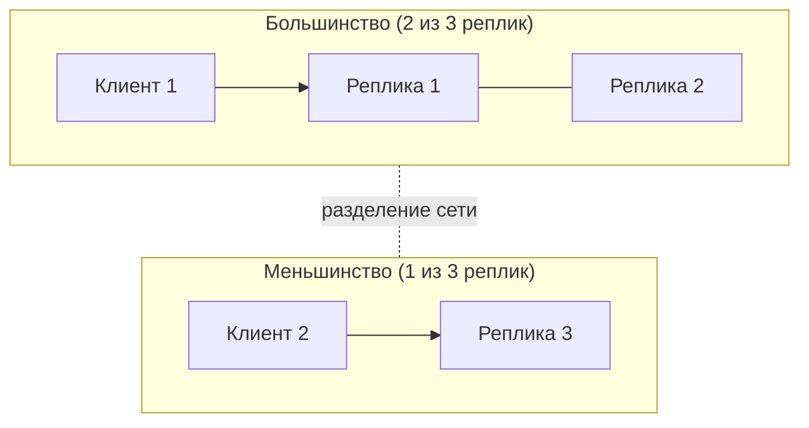

import { Aside } from '@astrojs/starlight/components';

Теорема CAP — самый цитируемый и самый искажаемый результат в распределённых системах. В точной формулировке она узкая: **когда сеть разделяется, реплицированная система должна либо отказывать части запросов, либо рисковать отдать устаревшие или конфликтующие данные.** PACELC добавляет компромисс, который важен всё остальное время: даже при здоровой сети более строгая согласованность стоит задержки.

<Aside type="tip" title="Коротко">
- CAP действует **только во время разделения сети**. Тогда каждая операция либо остаётся согласованной (часть запросов падает или уходит в тайм-аут), либо остаётся доступной (часть ответов может быть устаревшей или конфликтной).
- В распределённой системе разделения сети неизбежны, поэтому «выберите 2 из 3» вводит в заблуждение. Реальный выбор — **C или A, когда случилось P**, и он может различаться для разных операций.
- **CP-стиль**: etcd, CockroachDB, Spanner — меньшая сторона разделения перестаёт обслуживать согласованные запросы. **AP-стиль**: Cassandra на низких уровнях согласованности, глобальные таблицы DynamoDB в режиме по умолчанию — каждая сторона продолжает отвечать, а расхождения сводятся позже.
- **PACELC**: при разделении (**P**artition) выбираем доступность (**A**) или согласованность (**C**); иначе (**E**lse) — задержку (**L**atency) или согласованность (**C**). Именно вторая половина определяет повседневный дизайн.
- Кворумы с `R + W > N` гарантируют, что чтение пересекается с последней записью. Это обычный рычаг настройки между двумя полюсами.
</Aside>

## Что теорема утверждает на самом деле

Эрик Брюэр сформулировал CAP как гипотезу в 2000 году; Сет Гилберт и Нэнси Линч доказали формальную версию в 2002-м. Определения в ней строже бытовых слов:

- **Согласованность (C)** означает **линеаризуемость**: система ведёт себя так, будто у данных одна копия. Каждое чтение возвращает последнюю завершённую запись или что-то ещё более новое. Это *не* та C, что в ACID.
- **Доступность (A)** означает, что **каждый запрос к неотказавшему узлу рано или поздно получает ответ без ошибки**. «Большинство запросов проходит» — недостаточно.
- **Устойчивость к разделению сети (P)** означает, что система сохраняет свои гарантии, даже если сеть сколь угодно долго теряет или задерживает сообщения между группами узлов.

Теорема: в сети, которая может терять сообщения, никакая система не может обеспечить и C, и A для всех запросов. Доказательство короткое. Поставим две реплики по разные стороны разделения, отправим запись на одну и чтение на другую. Вторая реплика должна либо ответить, возможно устаревшими данными (теряем C), либо ждать или вернуть ошибку, пока разделение не исчезнет (теряем A).

Значит, компромисс **неизбежен только во время разделения**. Пока сеть здорова, система может быть одновременно согласованной и доступной.

## Поведение CP и AP

То, что сторона меньшинства делает с запросом Клиента 2, и есть выбор между CP и AP:

| | Поведение CP | Поведение AP |
|---|---|---|
| Запись на стороне меньшинства | Отклоняется или уходит в тайм-аут (нет кворума) | Принимается локально, реплицируется после восстановления |
| Чтение на стороне меньшинства | Ошибка или перенаправление к большинству | Ответ из локальных данных, возможно устаревших |
| После восстановления сети | Сводить нечего | Конфликтующие записи нужно слить: «последняя запись побеждает», слияние в приложении или CRDT |
| Где уместно | Блокировки, выбор лидера, конфигурация, движение денег, проверки уникальности | Корзины, лайки и счётчики, данные сессий, кэши, DNS |

### Примеры CP

- **etcd** работает на Raft и по умолчанию обслуживает **линеаризуемые** чтения и записи. Фиксировать изменения может только сторона с большинством. Клиент, отрезанный вместе с меньшинством, получает ошибки — если только явно не попросит *сериализуемое* (возможно, устаревшее) чтение. Поэтому Kubernetes хранит состояние кластера в etcd.
- **ZooKeeper** требует кворума для каждой записи. Чтения же обслуживает тот сервер, к которому подключён клиент, и они могут быть устаревшими. Чтобы догнать лидера, клиент сначала вызывает `sync()`, но и это не даёт строгой линеаризуемости: `sync` не является кворумной операцией. То есть ZooKeeper согласован для записей, но по умолчанию не даёт линеаризуемых чтений. Хороший пример того, почему ярлык CP слишком груб.
- **CockroachDB** сама называет себя CP-системой. Записи требуют большинства реплик, чтения обслуживает держатель аренды (leaseholder), а диапазон, потерявший большинство, становится недоступным, но не несогласованным.
- **Google Spanner** — CP: группа Paxos, которая не может собрать кворум, перестаёт принимать записи. Брюэр утверждает, что Spanner «фактически CA»: частная сеть Google делает разделения редкими, и он приводит внутреннюю доступность лучше пяти девяток.

### Примеры AP и настраиваемой согласованности

- **Apache Cassandra** (и исходный дизайн Dynamo, из которого она многое взяла) позволяет каждому запросу выбрать уровень согласованности. С `ONE` чтение или запись обслуживает любая доступная реплика, так что система остаётся доступной и может вернуть устаревшие данные. С `QUORUM` и на чтение, и на запись должно ответить большинство реплик, поэтому сторона меньшинства такой запрос обслужить не может.
- **Amazon DynamoDB** внутри одного региона реплицирует каждую партицию в три зоны доступности. Лидер, выбранный через Multi-Paxos, обслуживает записи и строго согласованные чтения, а запись требует двух из трёх реплик. Чтения по умолчанию согласованы в конечном счёте и могут идти с любой реплики. **Глобальные таблицы** (global tables) предлагают два режима. **Межрегиональная согласованность в конечном счёте** (по умолчанию) принимает записи в каждом регионе и разрешает конфликты по правилу «последняя запись побеждает» — это AP между регионами. **Межрегиональная строгая согласованность** (общедоступна с июня 2025 года) перед подтверждением синхронно реплицирует каждую запись в другой регион. Она работает ровно в трёх регионах: три реплики или две плюс «свидетель» (witness), которым управляет DynamoDB. Это CP между регионами.

## Частые заблуждения

- **«Выберите два из трёх».** Нельзя выбрать «CA» для системы, которая работает через сеть: отказаться от разделений нельзя. Система «CA» просто ломается непредсказуемым образом, когда разделение всё-таки происходит. По-настоящему CA только система из одного узла.
- **«Наша база — CP» (или AP).** Большинство систем делает разный выбор для разных операций, таблиц или настроек согласованности. Многие не подходят ни под один ярлык, как чтения ZooKeeper выше. Описывайте поведение конкретной операции.
- **«AP значит всегда работает».** Доступность в CAP касается разделений, а не падений, багов, перегрузки или неудачных выкаток. CP-система с кворумом на стороне большинства на практике *высокодоступна*: ошибки видят только клиенты, застрявшие на стороне меньшинства.
- **«Согласованность» — это согласованность из ACID.** В CAP это линеаризуемость отдельных операций. О транзакциях, инвариантах и уровнях изоляции она ничего не говорит.
- **«Разделения редки, значит CAP неважна».** Разделения — это и отказы коммутаторов, и неверно настроенные файрволы, и долгие паузы GC, и перегруженные каналы. На больших масштабах они случаются достаточно часто. Важнее другое: задержку на координацию платят *в каждом* запросе, а не только во время разделений. Это и описывает PACELC.

## PACELC: компромисс, когда ничего не сломано

**PACELC** Дэниела Абади расширяет CAP: *при разделении (Partition) выбираем доступность (Availability) или согласованность (Consistency); иначе (Else) — задержку (Latency) или согласованность (Consistency).* Чтобы держать реплики строго синхронными, приходится ждать кворума или удалённого региона на каждой записи, а иногда и на каждом чтении. Ответ с ближайшей реплики без ожидания быстрее, но может быть устаревшим.

| Система (конфигурация по умолчанию) | При разделении | Иначе | Примечания |
|---|---|---|---|
| Cassandra, Riak, исходный Dynamo | PA | EL | В Cassandra по умолчанию `ONE`/`LOCAL_ONE`; Riak и Dynamo используют нестрогие кворумы. Строгие кворумы сдвигают к C |
| DynamoDB, один регион | PC | EL | Записи требуют лидера и кворума; чтения по умолчанию согласованы в конечном счёте. Строго согласованные чтения → EC |
| Глобальные таблицы DynamoDB, режим eventual | PA | EL | Каждый регион принимает записи; «последняя запись побеждает» |
| Глобальные таблицы DynamoDB, режим strong | PC | EC | Запись ждёт второй регион |
| Google Spanner | PC | EC | По умолчанию внешняя согласованность; устаревшие чтения — путь EL по запросу |
| CockroachDB | PC | EC | По умолчанию сериализуемость; follower reads — путь EL по запросу |
| etcd | PC | EC | По умолчанию линеаризуемость; сериализуемые чтения — путь EL по запросу |
| HBase, Bigtable (один кластер) | PC | EC | Каждый диапазон ключей в каждый момент обслуживает один сервер. Репликация Bigtable между кластерами по умолчанию согласована в конечном счёте |

Закономерность в современных базах данных — **согласованность по умолчанию, низкая задержка по запросу**. Строгие гарантии действуют, пока вы явно не попросите устаревшее чтение с ближайшей реплики (stale reads в Spanner, follower reads в CockroachDB, eventually consistent reads в DynamoDB).

## Кворумы вкратце

При `N` репликах запись ждёт `W` подтверждений, а чтение опрашивает `R` реплик. Если `R + W > N`, любое множество чтения пересекается с любым множеством записи хотя бы в одной реплике, и чтение может увидеть последнюю подтверждённую запись.

| N | W | R | Пересечение? | Поведение |
|---|---|---|---|---|
| 3 | 2 | 2 | Да | Классический кворум большинства; переживает одну медленную или упавшую реплику |
| 3 | 3 | 1 | Да | Быстрые чтения; отказ любой реплики блокирует записи |
| 3 | 1 | 1 | Нет | Самый быстрый и доступный вариант; чтения могут быть устаревшими |
| 5 | 3 | 3 | Да | Переживает отказ двух реплик |

Одного пересечения недостаточно для полной линеаризуемости. Конкурентные записи, частично неудавшиеся записи и «нестрогие» кворумы (sloppy quorum — запись на подменные узлы во время отказов) всё ещё могут давать аномалии. Когда нужна строгая гарантия, системы добавляют синхронное восстановление при чтении (read repair), консенсус (Raft, Paxos) или операции сравнения с обменом (compare-and-set). Механика описана на странице про [репликацию](/data/replication/).

## Компромиссы

| | В пользу согласованности (CP / EC) | В пользу доступности и задержки (AP / EL) |
|---|---|---|
| Во время разделения | Сторона меньшинства возвращает ошибки | Все стороны продолжают обслуживать |
| Задержка в штатном режиме | Круги к кворуму или в другой регион на записях (часто и на чтениях) | Локальная реплика отвечает сразу |
| Сложность приложения | Простая: ведёт себя как одна копия | Нужно обрабатывать устаревшие чтения и сливать конфликты |
| Типичное применение | Учёт денег, резервирование остатков, блокировки, метаданные, уникальность | Ленты, корзины, счётчики, телеметрия, кэши |

<Aside type="note" title="На собеседовании">
- Не начинайте с «возьму AP». Спросите, каким операциям какая гарантия нужна. Например: «При оформлении заказа нельзя продать больше, чем есть, поэтому резервирование остатков — CP. Карточка товара может показывать слегка устаревший остаток».
- Ждите вопроса «что будет при разделении сети?». Опишите, что делает сторона меньшинства с чтениями и записями и как потом разрешаются конфликты.
- Упомяните PACELC, когда речь заходит о задержках между регионами: синхронная репликация между континентами добавляет к каждой записи от десятков до сотен миллисекунд.
- Частые ошибки: называть систему «CA», путать согласованность из CAP с ACID и считать, что CP значит «часто лежит».
</Aside>

## Что почитать

- [CAP Twelve Years Later: How the "Rules" Have Changed](https://www.infoq.com/articles/cap-twelve-years-later-how-the-rules-have-changed/) — Эрик Брюэр (2012) о том, почему «2 из 3» вводит в заблуждение.
- [Perspectives on the CAP Theorem](https://groups.csail.mit.edu/tds/papers/Gilbert/Brewer2.pdf) — Гилберт и Линч возвращаются к своему доказательству и его определениям.
- [Consistency Tradeoffs in Modern Distributed Database System Design](https://www.cs.umd.edu/~abadi/papers/abadi-pacelc.pdf) — статья Дэниела Абади о PACELC (IEEE Computer, 2012).
- [Please stop calling databases CP or AP](https://martin.kleppmann.com/2015/05/11/please-stop-calling-databases-cp-or-ap.html) — Мартин Клеппман о том, почему ярлыки скрывают главное.
- [Spanner, TrueTime and the CAP Theorem](https://research.google/pubs/spanner-truetime-and-the-cap-theorem/) — Брюэр (2017) о том, как CP-система может быть «фактически CA».
- [CAP FAQ](https://github.com/henryr/cap-faq) — короткие ответы на вопросы, которые действительно задают.

## Связанные темы

- [Модели согласованности](/fundamentals/consistency-patterns/) — модели между «в конечном счёте» и «линеаризуемостью».
- [Репликация](/data/replication/) — репликация с лидером, с несколькими лидерами и без лидера; как реализуются кворумы.
- [Паттерны доступности](/fundamentals/availability-patterns/) — переключение на резерв и избыточность, о которых CAP ничего не говорит.
- [NoSQL](/data/nosql/) — хранилища, сделавшие настраиваемую согласованность массовой.
- [SQL или NoSQL](/data/sql-or-nosql/) — выбор хранилища с учётом этих компромиссов.
- [Консенсус и координация](/fundamentals/consensus-and-coordination/) — как на деле договариваются CP-системы: кворумы большинства, Raft и что теряет меньшая часть при разделении.
