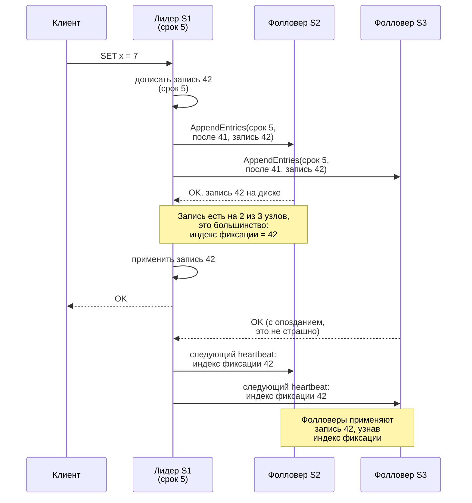
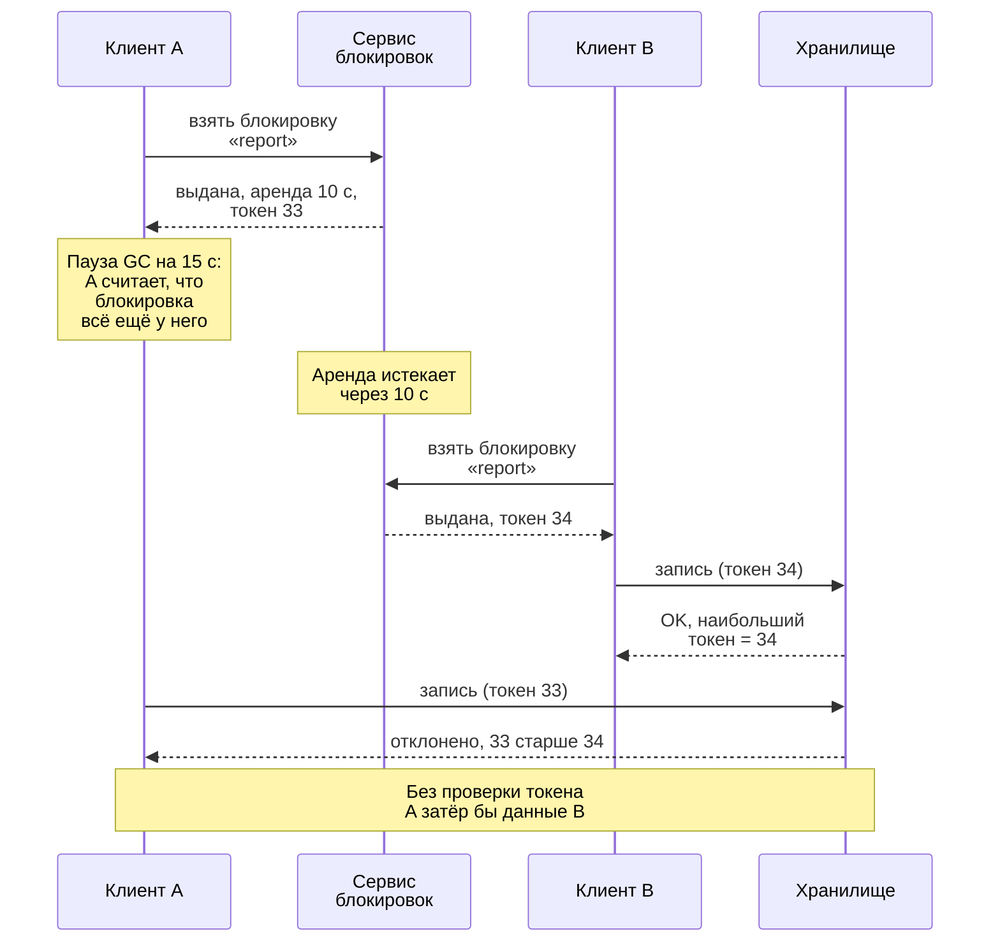

import { Aside } from '@astrojs/starlight/components';

Некоторые решения в распределённой системе нужно принять один раз и так, чтобы все узлы видели их одинаково: кто лидер, какие узлы входят в кластер, где живёт шард, кто держит блокировку. **Консенсус** позволяет группе ненадёжных машин договориться о таком решении и никогда от него не отказаться. Реализовывать его самим почти не приходится, но большинство архитектур где-то на него опираются, а его цену и режимы отказа любят разбирать на собеседованиях.

<Aside type="tip" title="Коротко">
- Консенсус позволяет узлам согласовать значение или упорядоченный журнал, даже когда часть из них падает. Для этого нужно **большинство**: `2f + 1` узлов переживают `f` отказов, то есть 3 узла переживают один отказ, а 5 — два.
- **Raft** (etcd, Consul, CockroachDB, KRaft в Kafka) и **Multi-Paxos** (Chubby, Spanner, DynamoDB) в штатном режиме работают одинаково: лидер дописывает запись в журнал и фиксирует её, когда она сохранена на большинстве.
- Каждая запись стоит минимум одной круговой задержки (RTT) до большинства: 1–2 мс внутри облачного региона и 80 мс и больше через океан.
- Блокировка с истечением срока (**аренда**, lease) не помешает «уснувшему» клиенту писать после того, как он её потерял. Ресурс должен сам проверять **токены изоляции** (fencing tokens) или принимать только условные записи.
- Большинству задач вида «ровно один раз» нужна **идемпотентность**, а не блокировка. Если согласие действительно нужно, берите базу данных или сервис координации, а не собственную реализацию.
</Aside>

## Зачем распределённым системам договариваться

- **Выбор лидера.** Принимать записи для шарда или выполнять задачу-одиночку должен ровно один узел. Два лидера — это **split brain** и разошедшиеся данные.
- **Состав кластера** (membership). Какие узлы входят в кластер и какие реплики синхронизированы и могут стать лидером.
- **Конфигурация и метаданные.** Размещение шардов, версии схемы, таблицы маршрутизации, флаги функций.
- **Блокировки и аренды.** Обрабатывать задачу или владеть ресурсом в каждый момент может только один исполнитель.

На одной машине всё это просто. На нескольких сообщения задерживаются и теряются, узлы падают и возвращаются, а медленный узел ничем не отличается от мёртвого.

## Задача консенсуса в одном абзаце

Узлы предлагают значения и должны **выбрать одно и то же** (согласие); это должно быть значение, которое кто-то действительно предложил (корректность); и каждый продолжающий работать узел должен рано или поздно принять решение (завершаемость). Повторите это для каждой позиции журнала — и получится **репликация конечного автомата** (state machine replication): реплики применяют одни и те же команды в одном порядке и приходят в одно состояние. **Результат FLP** (Фишер, Линч и Патерсон, 1985) доказывает, что в полностью асинхронной сети никакой детерминированный алгоритм не может гарантировать завершение, если может упасть хотя бы один процесс. Поэтому практические алгоритмы соблюдают **безопасность** (никогда не выбрать два разных значения) безусловно, а **живучесть** (рано или поздно выбрать) — только когда сеть достаточно долго ведёт себя прилично; для этого служат тайм-ауты и случайность. При тяжёлом разделении сети система на консенсусе останавливается, но не расходится — это выбор CP из [теоремы CAP и PACELC](/fundamentals/cap-theorem/).

## Кворумы и арифметика большинства

Решение считается принятым, когда его приняло **большинство** голосующих узлов. Любые два большинства пересекаются хотя бы в одном узле. Поэтому новый лидер всегда встретит узел, знающий о каждом зафиксированном решении, а два лидера никогда не смогут зафиксировать противоречащие записи.

| Голосующих узлов | Большинство | Переживает отказов | Подтверждений от фолловеров на запись | Типичное применение |
|---|---|---|---|---|
| 3 | 2 | 1 | 1 | Вариант по умолчанию: etcd, серверы Consul, контроллеры KRaft, диапазон CockroachDB |
| 5 | 3 | 2 | 2 | Переживает плановое обновление плюс один внезапный отказ; «типичный» размер из статьи о Raft |
| 7 | 4 | 3 | 3 | Практический потолок: FAQ etcd советует не больше семи участников |

- **Берите нечётные размеры.** Четырём узлам нужно 3 голоса, и они всё так же переживают лишь один отказ. Четвёртый узел добавляет стоимость и задержку, но не надёжность.
- **Больше голосующих — медленнее запись.** Каждая запись ждёт больше подтверждений. Чтобы масштабировать чтение, добавляйте **неголосующих участников**: learner-узлы etcd, наблюдателей (observers) ZooKeeper, реплики только для чтения в Spanner.
- **Разносите голосующих по доменам отказа.** Три узла в трёх зонах переживут потерю зоны; три узла в двух зонах — не обязательно.

## Raft простыми словами

Raft (Онгаро и Оустерхаут, 2014) проектировали так, чтобы его было легко понять. Он делит консенсус на выбор лидера, репликацию журнала и правила безопасности.

- **Сроки** (terms). Время делится на пронумерованные сроки; каждый начинается с выборов, и у него не больше одного лидера. Каждое сообщение несёт срок отправителя. Узел, увидевший больший срок, становится фолловером, а запросы со старым сроком отклоняются. Именно это делает смещённого лидера безвредным.
- **Выбор лидера.** Лидер рассылает heartbeat-сигналы. Фолловер, который ничего не слышал в течение **тайм-аута выборов** (election timeout), становится кандидатом: увеличивает срок, голосует за себя и просит голоса у остальных. Каждый узел голосует один раз за срок и только за кандидата, чей журнал не отстаёт от его собственного. Большинство голосов делает кандидата лидером. Тайм-ауты случайны (150–300 мс в примере из статьи), поэтому ничьи редки.
- **Репликация журнала.** Лидер дописывает каждую команду клиента в свой журнал и отправляет её фолловерам в `AppendEntries` вместе с индексом и сроком предыдущей записи. Фолловер, чей журнал расходится, отклоняет сообщение, и лидер откатывается назад и чинит его журнал.
- **Индекс фиксации** (commit index). Запись **зафиксирована**, когда она сохранена на большинстве. Лидер применяет её, отвечает клиенту и сообщает новый индекс фиксации, чтобы фолловеры тоже её применили. Записи прошлых сроков новый лидер фиксирует только косвенно — зафиксировав поверх них запись своего срока.



Три практические детали:

- **Чтения.** Лидер, отрезанный разделением сети, может не знать, что его уже сменили. Поэтому линеаризуемое чтение либо подтверждает лидерство раундом heartbeat-сигналов до большинства (*ReadIndex*), либо опирается на **аренду лидера**, основанную на времени (см. ниже). В etcd линеаризуемое чтение проходит через кворум, поэтому стоит минимум одного RTT между участниками.
- **Изменения состава** тоже проходят через журнал — по правилам, которые не дают старой и новой конфигурации образовать два отдельных большинства. Новый узел сначала добавляют как неголосующего (learner) и повышают, когда он догонит остальных.
- **Предварительное голосование** (pre-vote). Узел, вернувшийся после разделения сети, успел нарастить срок и спровоцировал бы ненужные выборы. С pre-vote кандидат сначала проверяет, может ли он вообще выиграть. В etcd это включено по умолчанию; в KRaft механизм появился в Kafka 4.0.

## Paxos и Multi-Paxos вкратце

**Paxos** Лэмпорта, изложенный простым языком в *Paxos Made Simple* (2001), согласует одно значение. **Предлагающие** (proposers), **принимающие** (acceptors) и **обучающиеся** (learners) проходят две фазы:

1. **Подготовка и обещание.** Предлагающий выбирает уникальный возрастающий номер и просит большинство принимающих игнорировать меньшие номера. В ответ они сообщают значение, которое уже приняли, если такое есть.
2. **Принятие.** Предлагающий просит большинство принять значение — причём обязан взять значение с наибольшим номером из ответов первой фазы, если оно было. Значение выбрано, когда его приняло большинство.

Безопасность сохраняется, сколько бы предлагающих ни соперничало; для продвижения нужен один выделенный предлагающий, то есть лидер. **Multi-Paxos** запускает по экземпляру на каждую позицию журнала, а стабильный лидер проходит первую фазу один раз сразу для всех будущих позиций. После этого каждая команда стоит один RTT до большинства — как в Raft. По сути Raft — это Multi-Paxos со строгими правилами (выигрывают только кандидаты с актуальным журналом, в журнале нет дыр), которые упрощают корректную реализацию. Близкие родственники — **Zab** в ZooKeeper и **Viewstamped Replication** (1988).

## Где консенсус живёт на практике

| Система | Протокол | О чём договаривается группа | Примечания |
|---|---|---|---|
| etcd (хранилище Kubernetes) | Raft | Все объекты API Kubernetes, включая Lease | Планировщик и менеджер контроллеров выбирают лидера через Lease. Не шардируется; рассчитан на метаданные объёмом до нескольких ГБ |
| ZooKeeper | Zab | Дерево небольших znode, сессии, наблюдения (watches) | Записи идут через лидера и кворум; zxid — это эпоха лидера плюс счётчик |
| Consul | Raft среди 3 или 5 серверов в датацентре | Каталог, хранилище ключ-значение, сессии | Клиентские агенты не голосуют; состав и отказы отслеживает gossip-протокол |
| Kafka (KRaft) | Вариант Raft с вытягиванием (KIP-595) | Метаданные кластера: топики, партиции, лидеры | 3 или 5 контроллеров; ZooKeeper удалён в Kafka 4.0 (март 2025) |
| Google Spanner | Группы Paxos поверх диапазонов ключей (splits) | Записи в эти диапазоны | Реплики-свидетели голосуют, но не хранят полную копию и не обслуживают чтение |
| CockroachDB | Raft на каждый диапазон, по умолчанию 3 реплики | Записи в этот диапазон | Держатель аренды (leaseholder) обслуживает чтение и обычно же является лидером Raft |
| TiKV (TiDB) | Raft на каждый регион (Multi-Raft) | Записи в этот регион (по умолчанию 256 МиБ) | Много маленьких групп вместо одной большой |

Сервисы координации держат **одну** группу над небольшим объёмом критичных данных. Распределённые SQL-базы держат **тысячи** маленьких групп, по одной на диапазон, поэтому пропускная способность записи растёт с числом диапазонов. Kafka показывает третий вариант: Raft для метаданных, а для данных партиций — синхронизированные реплики (ISR). Большинству нужно `2f + 1` копий, чтобы пережить `f` отказов, а ISR хватает `f + 1`, но каждая запись ждёт все синхронизированные реплики.

## Аренды и почему важны часы

**Аренда** (lease) — это блокировка с истечением срока: «ты лидер на 10 секунд, если не продлишь». Если владелец умер, аренда истекает и её забирает другой — без участия человека. **Аренда лидера** к тому же позволяет лидеру обслуживать линеаризуемые чтения локально, без раунда до кворума: пока аренда действует, другого лидера быть не может. В статье о Spanner 2012 года аренды лидеров Paxos длились 10 секунд; CockroachDB обслуживает чтения у держателя аренды.

Аренды зависят от времени, а время ненадёжно:

- **Дрейф и скачки часов.** Кварцевые часы дрейфуют, а NTP может перевести системные часы назад или вперёд. Измеряйте срок аренды по **монотонным** часам и оставляйте запас на расхождение между часами владельца и того, кто выдал аренду.
- **Паузы процесса.** Пауза сборки мусора или миграция виртуальной машины замораживает процесс на секунды. Проснувшись, он не знает, что аренда уже истекла. Никакие часы этого не исправят — защититься может только сам ресурс (следующий раздел).
- **Тайм-ауты задают время переключения.** По умолчанию в etcd heartbeat идёт каждые 100 мс, а тайм-аут выборов — 1 с; документация советует тайм-аут выборов не меньше десяти RTT. Планировщик и менеджер контроллеров Kubernetes используют аренды на 15 секунд, так что упавшего лидера заменят примерно за 15 секунд.

Системы, которым нужны глобально упорядоченные метки времени, учитывают неопределённость явно:

- **TrueTime** (Spanner) возвращает интервал `[earliest, latest]`; за ним стоят GPS-приёмники и атомные часы. Статья 2012 года приводит неопределённость примерно 1–7 мс. Транзакция пережидает её (**ожидание фиксации**, commit wait), прежде чем её метка времени станет видимой, — так порядок фиксаций совпадает с реальным временем.
- **Гибридные логические часы** (HLC, 2014) объединяют физическое время с логическим счётчиком: метки близки к настенному времени, но учитывают причинность. CockroachDB использует HLC с допустимым расхождением часов 500 мс по умолчанию; узел, чьи часы разошлись хотя бы с половиной остальных на 80% этого предела, сам себя останавливает.
- **Часы в облаках стали точнее.** На поддерживаемых инстансах EC2 Amazon Time Sync сообщает о границе ошибки обычно меньше 100 мкс через NTP и меньше 40 мкс от аппаратных часов PTP. Открытый демон ClockBound отдаёт эти границы в виде интервалов в духе TrueTime.

## Распределённые блокировки и токены изоляции

Клеппман различает два назначения распределённой блокировки. Блокировка **ради эффективности** избавляет от повторной работы: редкий двойной запуск лишь тратит деньги. Блокировка **ради корректности** не даёт конкурентным записям испортить данные. Для второго случая одной аренды мало:



**Токен изоляции** (fencing token) растёт при каждой выдаче блокировки. Клиент прикладывает его к каждой записи, а хранилище атомарно отклоняет любой токен меньше наибольшего уже принятого. Такие номера выдают сервисы координации: ревизия ключа в etcd, zxid или версия znode в ZooKeeper, *sequencer* в Chubby. Kafka по тому же принципу отсекает producer-«зомби» с помощью номера эпохи. Документация etcd прямо говорит, что его API блокировок сам по себе не обеспечивает взаимного исключения, а анализ Jepsen 2020 года для etcd 3.4.3 обнаружил одновременных владельцев блокировки даже в здоровом кластере и рекомендовал использовать ревизию ключа блокировки как токен изоляции.

### Спор о Redlock

**Redlock** захватывает блокировку на большинстве (3 из 5) независимых узлов Redis и считает её действительной на время TTL минус время захвата. В 2016 году Клеппман доказывал, что для корректности он небезопасен: алгоритм зависит от ограниченности пауз, сетевых задержек и поведения часов и не выдаёт монотонного токена изоляции. Создатель Redis Сальваторе Санфилиппо (antirez) [ответил](https://antirez.com/news/101), что Redlock предполагает лишь примерно одинаковую *скорость* хода часов, а не их синхронизацию; что пауза после захвата одинаково вредит любой блокировке на аренде; и что хранилище, умеющее проверять токены, может с тем же успехом проверять случайное уникальное значение через сравнение с обменом (compare-and-set).

Стороны согласны в большем, чем кажется по спору. Никакая блокировка на аренде — в Redis, etcd или где-то ещё — сама по себе не остановит «уснувшего» клиента. Нынешняя документация Redis тоже рекомендует токены изоляции и предупреждает, что истечение ключей в Redis не использует монотонные часы. Практический вывод: один узел Redis с `SET key value NX PX ttl` подходит для блокировок ради эффективности; ради корректности ресурс должен сам отклонять устаревших писателей.

## Часто нужна идемпотентность, а не блокировка

Многие задачи вида «это может делать только один исполнитель» на самом деле означают «это должно произойти один раз». Доставка *ровно один раз* по ненадёжной сети невозможна, а побочный эффект ровно один раз (exactly-once) вполне достижим. Доставляйте «хотя бы один раз» и делайте обработку идемпотентной:

- **Ключи идемпотентности с ограничением уникальности**, сохранённые в той же транзакции, что и эффект: повторы и дублирующие исполнители становятся безвредны (см. [паттерны устойчивости](/reliability/resilience-patterns/)).
- **Условные записи.** `UPDATE ... SET status = 'shipped', version = 8 WHERE id = 42 AND version = 7` срабатывает, только если строку никто не изменил раньше. Так же работают условные выражения DynamoDB, а Amazon S3 получил условные записи `If-None-Match` (август 2024) и `If-Match` (ноябрь 2024).
- **Потребители с дедупликацией**, которые записывают идентификаторы обработанных сообщений вместе с результатом. Транзакции Kafka покрывают только циклы, не выходящие за пределы Kafka (см. [потоковую передачу событий](/async/event-streaming/)).
- **Ключи идемпотентности, переданные дальше** — в платёжные и почтовые API: отправленное письмо не откатишь.

```sql
-- Можно выполнять сколько угодно раз: повторные запуски ничего не вставят.
INSERT INTO payments (idempotency_key, order_id, amount_cents)
VALUES ('9b2e4c1a', 1001, 4999)
ON CONFLICT (idempotency_key) DO NOTHING;
```

Эти приёмы опираются на согласованность, которая в базе данных уже есть, не добавляют движущихся частей и переживают паузы. Блокировка «по мере сил» может стоять перед ними, чтобы экономить работу.

## Сколько стоит консенсус

Для фиксации запись должна надёжно сохраниться на большинстве. При трёх голосующих это примерно **один RTT до ближайшего фолловера плюс один `fsync` журнала**; свою копию лидер пишет параллельно. Возьмём [задержки](/reference/latency-numbers/) с этого сайта и около 1 мс на надёжную запись на сетевой облачный том:

| Три голосующих узла размещены | Круг до ближайшего фолловера | Задержка фиксации | Зависимых фиксаций в секунду |
|---|---|---|---|
| В одной зоне доступности | ~0,2 мс | ≈ 1,2 мс | ≈ 830 |
| В трёх зонах одного региона | ~1 мс | ≈ 2 мс | ≈ 500 |
| В трёх регионах: лидер в Западной Европе, фолловеры на Востоке США и в Калифорнии | ~80 мс (Восток США) | ≈ 81 мс | ≈ 12 |
| То же, клиент в Калифорнии | +145 мс до лидера | ≈ 226 мс | ≈ 4 |

- **Между регионами всё решает расстояние.** Если Восток США откажет, ближайшим фолловером станет Калифорния, и фиксация замедлится примерно до 146 мс. Держите лидера и большинство рядом с теми, кто пишет; распределённые SQL-базы позволяют закрепить держателя аренды диапазона в его «домашнем» регионе.
- **Пропускная способность — не задержка.** Лидер собирает записи в пачки и отправляет их конвейером, по многу за один RTT, поэтому межрегиональный кластер в сумме фиксирует гораздо больше 12 записей в секунду. Но цепочка зависимых шагов (захватить блокировку, записать, освободить) платит полную задержку на каждом шаге.
- **Переключение занимает тайм-ауты.** Тайм-аут выборов длится несколько RTT, а между регионами это секунды.
- **Диски важны.** etcd предупреждает, что медленный `fsync` на лидере может стоить ему лидерства. Давайте сервисам координации быстрые выделенные диски.

## Когда не стоит делать свой консенсус

Корректная реализация Raft или Paxos занимает годы, а тестирование ещё сложнее. Предпочитайте, по порядку:

1. **Свою базу данных.** Ограничение уникальности, транзакция или условная запись в PostgreSQL, DynamoDB, Spanner или CockroachDB уже дают согласие в пределах строки. Большинству захватов задач и проверок «только один раз» место именно здесь.
2. **Свою платформу.** В Kubernetes используйте объекты Lease и библиотеку выбора лидера. Управляемый Kubernetes обслуживает etcd за вас, облачные базы данных — свои группы консенсуса.
3. **Сервис координации, который вы уже эксплуатируете** (etcd, ZooKeeper, Consul), с 3 или 5 голосующими узлами в разных зонах. Храните там только небольшие критичные метаданные и не ставьте его на горячий путь каждого запроса.
4. **Встраиваемую библиотеку Raft** (`raft` от etcd, `raft` от HashiCorp) — только если вы строите базу данных или инфраструктурный продукт, и с соответствующим тестированием через внедрение сбоев.

## Компромиссы

| Подход | Для чего хорош | Цена и риски |
|---|---|---|
| Условная запись или ограничение уникальности в своей базе | Однократные эффекты, остатки, захват задач | Привязка к одной базе; горячие строки выстраиваются в очередь |
| Сервис координации (etcd, ZooKeeper, Consul) | Выбор лидера, состав кластера, конфигурация, блокировки с токенами изоляции | Ещё одна критичная система; только небольшие данные; RTT до кворума на запись |
| Консенсус внутри хранилища (Spanner, CockroachDB, KRaft) | Строго согласованные данные и метаданные в масштабе | Задержка фиксации равна RTT до большинства; межрегиональные записи медленные |
| Блокировка в Redis (один узел или Redlock) | Блокировки ради эффективности, против повторной работы | Нет токена изоляции; допущения о времени; сама по себе небезопасна для корректности |
| Идемпотентность плюс доставка «хотя бы один раз» | Платежи, сообщения, повторы, побочные эффекты ровно один раз | Хранение и срок жизни ключей; участвовать должен каждый потребитель |

<Aside type="note" title="На собеседовании">
- Когда архитектуре нужен лидер, блокировка или общая конфигурация, назовите механизм: «планировщик выбирает лидера через аренду в etcd», а не «используем консенсус». Никогда не предлагайте реализовать Paxos самостоятельно.
- Считайте большинство вслух: пять голосующих переживают два отказа, четыре — один, а межрегиональная фиксация стоит одного RTT до ближайшего большинства.
- Ждите вопроса «а если владелец блокировки уснёт или окажется отрезан?». Ответ — токены изоляции или условные записи.
- При выборе лидера ждите вопросов про split brain и устаревшие чтения у смещённого лидера. Ответы — сроки (terms), чтения через кворум и аренды лидера.
- На «ровно один раз» отвечайте доставкой «хотя бы один раз» плюс идемпотентность, а не распределённой блокировкой.
- Частые ошибки: кворумы чётного размера, доверие настенным часам, блокировка в Redis как гарантия корректности и сервис координации на пути каждого запроса.
</Aside>

## Что почитать

- [In Search of an Understandable Consensus Algorithm](https://raft.github.io/raft.pdf) — расширенная статья о Raft, Онгаро и Оустерхаут. На [сайте Raft](https://raft.github.io/) есть интерактивная визуализация, доклады и диссертация.
- [Paxos Made Simple](https://lamport.azurewebsites.net/pubs/paxos-simple.pdf) — короткое объяснение Paxos и реплицируемых конечных автоматов от Лесли Лэмпорта.
- [How to do distributed locking](https://martin.kleppmann.com/2016/02/08/how-to-do-distributed-locking.html) — Мартин Клеппман об арендах, паузах, токенах изоляции и Redlock.
- [etcd: why etcd, and notes on lock and lease usage](https://etcd.io/docs/v3.7/learning/why/) — зачем нужен сервис координации и почему его блокировкам нужна проверка ревизии.
- [Jepsen: etcd 3.4.3](https://jepsen.io/analyses/etcd-3.4.3) — строго сериализуемые операции с ключами, небезопасные блокировки и исправление через токены изоляции.
- [Designing Data-Intensive Applications, 2nd edition](https://www.oreilly.com/library/view/designing-data-intensive-applications/9781098119058/) — Клеппман и Риккомини (2026); глава 9 — о часах и паузах, глава 10 — о согласованности и консенсусе.

## Связанные темы

- [Теорема CAP и PACELC](/fundamentals/cap-theorem/) — почему система на консенсусе останавливается на стороне меньшинства и платит задержкой в остальное время.
- [Модели согласованности](/fundamentals/consistency-patterns/) — линеаризуемость, которую даёт консенсус.
- [Репликация](/data/replication/) — переключение на резерв и split brain, которые консенсус делает безопасными.
- [Обнаружение сервисов и service mesh](/architecture/service-discovery-and-mesh/) — реестры на основе etcd, ZooKeeper и Consul.
- [Паттерны устойчивости](/reliability/resilience-patterns/) — ключи идемпотентности и повторы, практическая альтернатива блокировкам.
- [Ключевые статьи и системы](/real-world/foundational-papers/) — Paxos, Chubby, ZooKeeper, Spanner и Raft в контексте.
