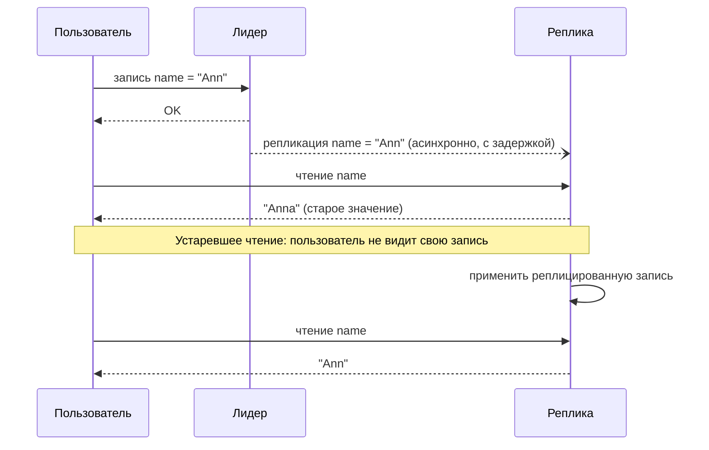

import { Aside } from '@astrojs/starlight/components';

Как только у данных появляется больше одной копии — реплики, кэши, регионы, телефон в офлайне, — копии могут какое-то время расходиться. **Модель согласованности** — это контракт о том, какие расхождения может увидеть читатель. Выбирая модель, мы выбираем задержку, доступность и то, с чем придётся справляться коду приложения.

<Aside type="tip" title="Коротко">
- Классическая тройка: **слабая** (чтение может так и не увидеть запись), **в конечном счёте** (увидит, когда записи прекратятся), **строгая** (увидит сразу).
- Между «в конечном счёте» и строгой есть полезная середина: **чтение своих записей**, **монотонное чтение**, **причинная согласованность** и **ограниченное устаревание**. Они устраняют большинство заметных пользователю аномалий за малую долю цены строгой согласованности.
- **Линеаризуемость** ведёт себя как единственная копия в реальном времени. Ей нужна синхронная координация (консенсус или кворумы), и на стороне меньшинства при разделении сети она недоступна.
- Сессионные гарантии дёшевы: «липкая» маршрутизация или токен версии, который клиент присылает с каждым запросом.
- Выбирайте для каждой операции отдельно. Баланс счёта и счётчику лайков нужны разные гарантии.
</Aside>

## Классическая тройка

### Слабая согласованность

После записи чтение может её вернуть, а может и нет. Никаких усилий по схождению копий не предпринимается.

- **Пример:** медиа в реальном времени и игры. Если видеозвонок две секунды теряет пакеты, никто не хочет потом переслушивать потерянный звук — поток идёт дальше. Похоже ведут себя кэши «по мере сил»: перезапущенный узел кэша стартует пустым и просто теряет то, что хранил.
- **Реализация:** обновления «отправил и забыл», потоки по UDP, кэши без гарантий инвалидации.

### Согласованность в конечном счёте

Если записи прекращаются, все реплики со временем сходятся к одному значению. А пока чтение может вернуть старое значение. В определении «со временем» не ограничено сверху. На практике в здоровой системе отставание — от миллисекунд до секунд, а во время сбоев — гораздо дольше.

- **Пример:** DNS, счётчики в соцсетях, каталоги товаров, чтения по умолчанию в DynamoDB, межрегиональные реплики.
- **Реализация:** асинхронная репликация от лидера или репликация без лидера с антиэнтропией (восстановление при чтении, фоновая синхронизация по деревьям Меркла). Для конкурентных записей нужно правило разрешения конфликтов: «последняя запись побеждает», векторы версий со слиянием в приложении или CRDT.

### Строгая согласованность

После завершения записи её видит каждое последующее чтение. Обычно имеется в виду **линеаризуемость** (см. ниже).

- **Пример:** балансы счетов, резервирование остатков, ограничения уникальности (имена пользователей), выбор лидера и блокировки.
- **Реализация:** единственный лидер, который обслуживает все чтения и записи по ключу, синхронная репликация на кворум или консенсус (Raft, Paxos).

## Устаревшее чтение при согласованности в конечном счёте

Запись прошла успешно, и ничего не сломано. Но пользователь видит, как его изменение «пропало», и это выглядит как баг. Большинство моделей ниже существуют ровно для того, чтобы убрать такие сюрпризы, не платя за полную строгую согласованность.

## Более широкий спектр

От самой сильной к самой слабой:

| Модель | Гарантия | Где важна | Типичная реализация |
|---|---|---|---|
| Строгая сериализуемость | Транзакции выглядят выполненными в одном порядке, согласованном с реальным временем | Перевод денег между несколькими строками, глобальная уникальность | Консенсус плюс синхронизированные часы (TrueTime в Spanner) или единый секвенсор |
| Линеаризуемость | Операции над одним объектом атомарны и упорядочены по реальному времени | Блокировки, выбор лидера, compare-and-set, конфигурация | Лидер с фиксацией на кворуме (Raft, Paxos), чтение через лидера или кворум |
| Последовательная | Все видят один порядок операций, а операции каждого клиента — в порядке их выдачи, но возможно с отставанием от реального времени | Реплицированные журналы, сервисы координации | Рассылка с полным порядком; чтение с отстающей, но упорядоченной реплики |
| Причинная | Если A могла повлиять на B, все видят A раньше B; несвязанные записи — в любом порядке | Комментарии и ответы, чаты, совместное редактирование | Отслеживание зависимостей векторными часами или причинными токенами |
| Ограниченное устаревание | Чтение отстаёт не более чем на K версий или T секунд | Дашборды, таблицы лидеров, чтения в гео-репликах | Реплика знает своё отставание; отвечает, только если укладывается в границу, иначе перенаправляет или ждёт |
| Чтение своих записей | Клиент всегда видит свои записи | Правка профиля, публикация комментария, настройки | «Липкая» маршрутизация, чтение с лидера после записи или ожидание, пока реплика догонит последнюю запись клиента |
| Монотонное чтение | Клиент никогда не видит, как данные «откатываются» назад | Пагинация, ленты, входящие | Закрепить клиента за репликой или передавать токен «читать версию не ниже V» |
| В конечном счёте | Реплики сходятся, если записи прекращаются | Счётчики, каталоги, DNS, кэши | Асинхронная репликация, антиэнтропия, разрешение конфликтов |

### Линеаризуемость

Система ведёт себя так, будто у каждого объекта одна копия, а каждая операция срабатывает в один момент между своим началом и концом. Как только какой-то клиент увидел новое значение, ни один клиент уже не увидит старое.

- **Почему важна:** логика «проверить, потом действовать» безопасна только на линеаризуемом хранилище. Примеры: взять блокировку, занять имя пользователя, списать остаток.
- **Как:** направлять все операции по ключу через лидера, который фиксирует их на большинстве (etcd, Spanner, CockroachDB). Чтения тоже должны быть линеаризуемыми: они идут через лидера с действующей арендой или подтверждаются кворумом. Иначе смещённый лидер может отдать устаревшие данные.
- **Цена:** минимум один круг до кворума на каждую запись. Сторона меньшинства при [разделении сети](/fundamentals/cap-theorem/) не может обслуживать запросы.

Не путайте её с **сериализуемостью** — уровнем изоляции транзакций. Сериализуемость говорит, что транзакции выглядят выполненными в *каком-то* последовательном порядке, не обязательно в порядке реального времени. **Строгая сериализуемость** объединяет обе гарантии. «Внешняя согласованность» (external consistency) Spanner — именно это сочетание.

### Последовательная согласованность

Все клиенты наблюдают один и тот же порядок операций, а операции каждого клиента идут в том порядке, в котором он их выдал. В отличие от линеаризуемости, этот порядок может отставать от реального времени. Клиент может прочитать значение, которое где-то уже перезаписано, — лишь бы потом все увидели перезапись в одной и той же позиции общего порядка. ZooKeeper близок к этой модели. Записи проходят через лидера в едином глобальном порядке, а обновления каждого клиента применяются в порядке отправки. Фолловер может отдать чуть отстающее чтение; `sync()` заставляет его сначала догнать лидера.

### Причинная согласованность

Причинно связанные записи все видят в одном порядке. Ответ никогда не появляется раньше поста, на который он отвечает. Конкурентные, несвязанные записи могут появляться в разном порядке на разных репликах.

- **Почему важна:** она исключает аномалии, которые люди замечают: ответ раньше вопроса, «доступ отозван», а следом фото, которое должно было скрыться.
- **Как:** каждая запись несёт свои зависимости — векторные часы или токен с версиями, которые видел автор. Реплика не показывает запись, пока не видны её зависимости. Причинно согласованные сессии MongoDB делают это с помощью токенов кластерного времени. Для полного набора гарантий им нужны read и write concern уровня majority.
- **Цена:** метаданные на каждую запись и иногда ожидание зависимостей. Причинная согласованность — практически самая сильная модель, которая может оставаться доступной при разделении сети, если каждый клиент продолжает работать с одними и теми же репликами.

### Сессионные гарантии: чтение своих записей и монотонное чтение

Это гарантии для **сессии одного клиента**, и они дёшевы.

- **Чтение своих записей** (read-your-writes): опубликовав комментарий, вы его видите, даже если другие пользователи увидят его секундой позже. Реализации:
  - направлять чтения пользователя на лидера в течение короткого окна после его записи;
  - закрепить сессию за одной репликой («липкая» маршрутизация);
  - вернуть клиенту позицию записи в журнале (LSN или версию) и требовать, чтобы реплика перед ответом догнала эту позицию.
- **Монотонное чтение** (monotonic reads): если вы видели версию 5, то потом не увидите версию 4. Обновление страницы не должно «стирать» новое сообщение. Обычное решение — держать клиента на одной реплике или отправлять с каждым чтением токен «версия не ниже V».
- Родственные гарантии: **монотонная запись** (записи клиента применяются по порядку) и **запись после чтения** (writes-follow-reads: запись упорядочена после данных, на основе которых она сделана). Уровень **Session**, используемый по умолчанию в Azure Cosmos DB, объединяет их для клиента.

### Ограниченное устаревание

Чтения могут быть устаревшими, но не больше заданной границы: K версий или T секунд. Примеры: уровень *bounded staleness* в Cosmos DB, чтения с ограниченным устареванием в Spanner, follower reads с `with_max_staleness()` в CockroachDB.

- **Почему важна:** она превращает «в конечном счёте» в число, о котором можно рассуждать и которое можно записать в SLO. Таблица лидеров, отстающая не больше чем на 5 с, — нормально. Таблица, которая верна «в конечном счёте», во время инцидента может отставать на часы.
- **Как:** реплики отслеживают своё отставание (метки времени репликации, закрытые метки времени). Реплика за пределами границы перенаправляет чтение на более свежую реплику или блокирует его. Cosmos DB вместо этого притормаживает записи, когда регион отстаёт слишком сильно.

## Схождение без координации: CRDT

Когда несколько реплик принимают записи независимо (несколько лидеров, приложения offline-first, межрегиональный active-active), конкурентные обновления нужно сливать. **«Последняя запись побеждает»** — просто, но молча теряет одну из записей. **Векторы версий** обнаруживают конкурентные версии и отдают их приложению на слияние; так работала корзина в исходном Dynamo от Amazon. **CRDT** (бесконфликтные реплицируемые типы данных) — структуры данных, слияние которых математически гарантированно сходится при любом порядке доставки. Примеры — счётчики только на увеличение, множества с удалением наблюдаемых элементов (observed-remove set) и последовательности для совместного редактирования текста. Они дают строгую согласованность в конечном счёте без координации. Цена — ограниченный набор операций и накладные расходы на метаданные.

## Компромиссы

| Модель | Цена в задержке | Доступна при разделении? | Нагрузка на приложение |
|---|---|---|---|
| Линеаризуемость / строгая сериализуемость | Круг до кворума на каждую запись (часто и чтение); межрегиональный, если реплики в разных регионах | Нет, на стороне меньшинства | Минимальная: ведёт себя как одна копия |
| Последовательная | Кворум на записях; локальные чтения | Нет, для записей | Низкая; чтения могут отставать |
| Причинная | Немного метаданных; иногда ожидание зависимостей | Да, если клиент держится своих реплик | Средняя: конкурентные записи всё равно конфликтуют |
| Сессионные гарантии | Почти нулевая (маршрутизация или токены) | Да, пока реплика сессии доступна | Низкая для собственного представления пользователя |
| Ограниченное устаревание | Локальные чтения, пока в пределах границы | При выходе за границу — блокировка или перенаправление | Нужно смириться с отставанием на K версий или T секунд |
| В конечном счёте | Минимальная | Да | Максимальная: устаревшие чтения, разрешение конфликтов |

<Aside type="note" title="На собеседовании">
- Называйте модель для каждой функции: «Платежи строго согласованы; лента согласована в конечном счёте, а автор читает свои записи».
- Когда добавляете реплики для чтения или кэш, ждите вопроса «пользователь обновил профиль и перезагрузил страницу — что он увидит?». Отвечайте конкретным механизмом чтения своих записей.
- Знайте разницу между линеаризуемостью и сериализуемостью. По ней интервьюеры отличают заученные ответы от настоящего понимания.
- Для межрегионального active-active скажите, как разрешаются конфликты («последняя запись побеждает», слияние, CRDT) и какие данные могут потеряться.
- Частая ошибка — заявить «строгую согласованность» и не объяснить, как чтения обходят устаревшие реплики.
</Aside>

## Что почитать

- [Consistency Models](https://jepsen.io/consistency/models) — карта моделей от Jepsen с точными определениями и указанием, какие из них могут оставаться доступными.
- [Replicated Data Consistency Explained Through Baseball](https://www.microsoft.com/en-us/research/publication/replicated-data-consistency-explained-through-baseball/) — шесть гарантий Дуга Терри на примере одного бейсбольного матча.
- [Eventually Consistent — Revisited](https://www.allthingsdistributed.com/2008/12/eventually_consistent.html) — Вернер Фогельс о клиентских вариантах согласованности и кворумах N/W/R.
- [Causal consistency and read and write concerns](https://www.mongodb.com/docs/manual/core/causal-consistency-read-write-concerns/) — как промышленная СУБД предоставляет сессионные гарантии.
- [Consistency levels in Azure Cosmos DB](https://learn.microsoft.com/en-us/azure/cosmos-db/consistency-levels) — пять уровней от строгого до eventual с ясными определениями bounded staleness и session.
- [About CRDTs](https://crdt.tech/) — сайт сообщества о бесконфликтных реплицируемых типах данных.

## Связанные темы

- [Теорема CAP и PACELC](/fundamentals/cap-theorem/) — почему строгие модели стоят доступности и задержки.
- [Репликация](/data/replication/) — схемы репликации, которые дают каждую из моделей.
- [Стратегии кэширования](/caching/cache-strategies/) — кэши тоже реплики, со своим устареванием.
- [Потоковая обработка событий](/async/event-streaming/) — упорядоченные журналы как способ получить согласованные производные представления.
- [Паттерны доступности](/fundamentals/availability-patterns/) — какая согласованность сохраняется при переключении на резерв.
