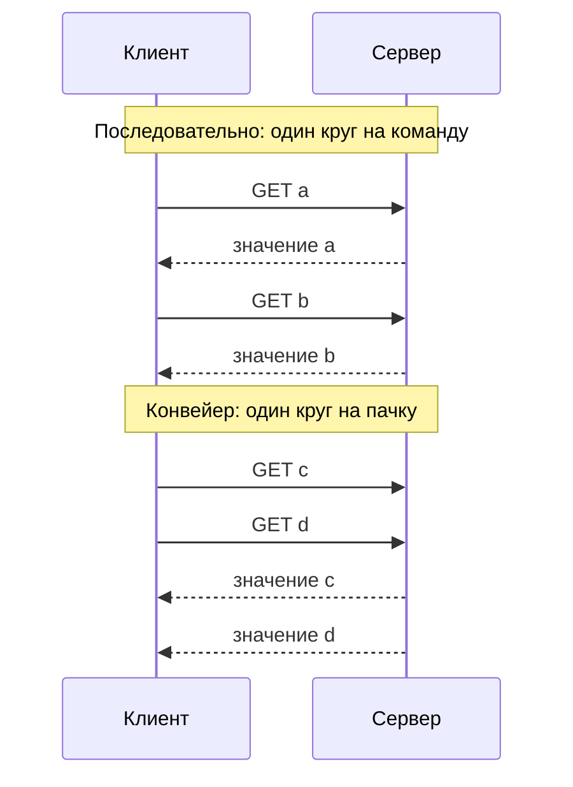

import { Aside } from '@astrojs/starlight/components';

**Задержка** (latency) — сколько длится одна операция. **Пропускная способность** (throughput) — сколько операций завершается за единицу времени. Их связывают очереди. Когда пропускная способность приближается к пределу, запросы начинают ждать друг друга, и задержка растёт — сначала медленно, потом очень круто. Большинство целей по производительности сводится к тому, чтобы получить максимум пропускной способности в рамках допустимой задержки.

<Aside type="tip" title="Коротко">
- Задержку описывают **перцентилями** (p50, p99, p99.9), а не средним. Среднее прячет именно те запросы, на которые жалуются пользователи.
- **Fan-out усиливает хвост**: если в каждый момент 1% серверов тормозит, запрос к 100 серверам в 63% случаев попадёт хотя бы на один медленный.
- **Закон Литтла**: число запросов в обработке = интенсивность потока × время в системе (`L = λW`). По нему считают пулы потоков, пулы соединений и очереди.
- Задержка взрывается, когда **загрузка приближается к 100%**. Одна очередь при загрузке 90% даёт время ответа в 10 раз больше, чем простаивающая. Закладывайте запас.
- **Батчинг и конвейерная обработка** повышают пропускную способность, оплачивая постоянные издержки один раз на пачку. Батчинг может добавить задержку, конвейер обычно её снижает.
</Aside>

## Определения

- **Задержка** — время от отправки запроса до получения ответа, измеренное там, где его ощущает пользователь. Сюда входят сеть, ожидание в очередях и сама работа. **Время обслуживания** (service time) — только работа, без ожидания.
- **Пропускная способность** — число завершённых операций в секунду (запросов/с, сообщений/с, МБ/с).
- **Полоса пропускания** (bandwidth) — максимальная скорость, которую выдерживает канал или устройство. Пропускная способность — то, чего вы реально достигли; полоса — потолок.

Обычная метафора — водопровод: задержка — сколько капля идёт по трубе, пропускная способность — сколько литров в секунду. Длинная широкая труба даёт и большую задержку, *и* большую пропускную способность. Грузовик с дисками, отправленный через всю страну, перевозит петабайты в сутки при задержке в несколько дней. Типичные цены операций с памятью, диском и сетью — на странице [Цифры задержек](/reference/latency-numbers/).

## Перцентили, а не средние

Распределение задержек скошено: большинство запросов быстрые, а немногие — очень медленные из-за пауз сборщика мусора, промахов кэша, повторных попыток, шумных соседей или ожидания блокировок. Среднее смешивает эти группы в число, которое не описывает ни один реальный запрос.

Возьмём 1000 запросов: 940 выполняются за 20 мс, 45 — за 80 мс, 10 — за 400 мс и 5 — за 2,5 с.

| Статистика | Значение | Что она говорит |
|---|---|---|
| Среднее | 38,9 мс | Почти вдвое больше типичного запроса; не описывает никого |
| p50 (медиана) | 20 мс | Типичный опыт |
| p95 | 80 мс | Каждый 20-й запрос не быстрее этого |
| p99 | 400 мс | Каждый сотый: пользователь, делающий 100 вызовов за сессию, видит его в большинстве сессий (63%) |
| p99.9 | 2500 мс | Хвост, под который настраивают тайм-ауты и повторные попытки |

Практические правила:

- Ставьте цели на перцентили: «p99 меньше 300 мс в 99,9% минут» можно проверить.
- **Не усредняйте перцентили** по серверам или интервалам. Среднее из p99 десяти серверов — не p99 всего парка. Храните гистограммы (HDR-гистограммы, гистограммы Prometheus, t-digest) и считайте перцентили по объединённым данным.
- Самые активные пользователи чаще всех попадают в хвост: они делают больше всего запросов и у них больше всего данных.
- Генераторы нагрузки, которые ждут ответа перед отправкой следующего запроса, занижают хвост. Когда сервер зависает, они перестают слать запросы, и зависание почти не попадает в результаты. Это называется **координированным пропуском** (coordinated omission). Используйте генераторы с открытой моделью, которые держат фиксированную интенсивность запросов.

## Усиление хвостовой задержки при fan-out

Страница часто параллельно обращается ко многим бэкендам — например, поиск опрашивает 100 шардов индекса. Ответ готов только тогда, когда ответил **самый медленный** шард. Если каждый сервер независимо тормозит с вероятностью `p`, то запрос к `N` серверам встретит хотя бы один медленный с вероятностью `1 − (1 − p)^N`.

| Затронуто серверов (N) | p = 1% медленных | p = 0,1% медленных |
|---|---|---|
| 1 | 1,0% | 0,1% |
| 10 | 9,6% | 1,0% |
| 100 | 63,4% | 9,5% |

Так p99 бэкенда превращается в *медиану* фронтенда уже при fan-out около 70. В статье Дина и Баррозу *The Tail at Scale* описано, как с этим справляется Google:

- **Страхующие запросы** (hedged requests): отправить запрос второй реплике, если первая не ответила, скажем, за время p95. Это добавляет лишь несколько процентов нагрузки и резко срезает хвост.
- **Связанные запросы** (tied requests): поставить запрос в очередь двум серверам; тот, кто начнёт первым, отменяет копию у другого.
- **Меньше и мельче переходов**: сократить fan-out, отдавать частичные результаты («достаточно хороший» поиск), убрать медленную фоновую работу с обслуживающих машин.
- **Бюджет на каждый переход**: каждому вызову вниз по цепочке давать дедлайн, выведенный из сквозной цели, и передавать его дальше.

## Закон Литтла

Для любой устойчивой системы, если усреднять по достаточно длинному интервалу:

```text
L = λ × W
L = среднее число запросов в системе (в обработке)
λ = средняя интенсивность поступления (= пропускная способность, если система успевает)
W = среднее время пребывания запроса в системе (задержка)
```

Закон верен при любом характере потока и любой дисциплине обслуживания, поэтому это самая полезная формула в планировании мощностей.

**Пример.** API получает 2000 запросов/с, и каждый запрос в среднем проводит в сервисе 150 мс. Тогда в каждый момент в обработке находится `L = 2000 × 0,15 = 300` запросов.

- Пул из 200 потоков (один запрос на поток) при такой задержке выдержит не больше `200 / 0,15 ≈ 1333` запросов/с. Чтобы обслужить 2000/с, нужно не меньше 300 потоков плюс запас — или меньше времени на запрос.
- Если каждый запрос держит соединение с БД 5 мс, пул из 40 соединений ограничит сервис `40 / 0,005 = 8000` запросами/с.
- Читайте закон в обратную сторону во время инцидента: если число запросов в обработке выросло с 300 до 3000 при неизменном трафике, где-то ниже по цепочке задержка выросла примерно вдесятеро.

## Очереди: почему задержка взрывается около 100% загрузки

**Загрузка** `ρ` — доля времени, когда сервер занят: интенсивность потока × время обслуживания. Классическая модель с одним обработчиком (M/M/1: случайные поступления, случайное время обслуживания, один обработчик) даёт среднее время ответа `W = S / (1 − ρ)`, где `S` — время обслуживания. При `S` = 10 мс:

| Загрузка ρ | Среднее время ответа | × время обслуживания | Запросов в системе (в среднем) | p99 (прибл.) |
|---|---|---|---|---|
| 50% | 20 мс | 2× | 1 | 92 мс |
| 80% | 50 мс | 5× | 4 | 230 мс |
| 90% | 100 мс | 10× | 9 | 461 мс |
| 95% | 200 мс | 20× | 19 | 921 мс |
| 99% | 1000 мс | 100× | 99 | 4,6 с |

Кривая похожа на хоккейную клюшку. Рост загрузки с 50% до 80% стоит 30 мс в среднем, с 95% до 99% — 800 мс. Реальные системы — не в точности M/M/1, но форма кривой сохраняется. Пул из многих обработчиков с общей очередью дольше остаётся пологим: при 10 обработчиках среднее при загрузке 90% всё ещё около 17 мс. Но и он резко загибается около 100%.

Выводы для проектирования:

- **Держите запас.** Сервисы, чувствительные к задержке, должны работать при умеренной средней загрузке, чтобы пики, переключения на резерв и шумные соседи не загоняли их на крутой участок кривой.
- **Разброс вредит не меньше нагрузки.** Всплески трафика и смесь крошечных и огромных запросов удлиняют очереди. Выносите дорогие типы запросов в отдельные пулы.
- **Ограничивайте каждую очередь.** Неограниченная очередь превращает перегрузку в минуты задержки и исчерпание памяти. Лучше отказывать или сбрасывать нагрузку раньше. См. [очереди и обратное давление](/async/queues-and-back-pressure/).
- **Рост p99 — ранний сигнал.** Хвостовая задержка растёт раньше средних, поэтому алертить стоит на неё.

## Батчинг и конвейерная обработка

Оба приёма повышают пропускную способность, распределяя постоянные издержки операции — сетевой круг, сброс на диск, системный вызов — на много элементов.

**Батчинг** объединяет много элементов в одну операцию. Если сброс на диск стоит 2 мс, то сброс после каждого сообщения ограничивает писателя 500 сообщениями/с. Сброс пачками по 100 даёт 50 000 сообщений/с на том же диске. Цена — задержка: элемент может ждать, пока наполнится пачка или сработает таймер. Продюсеры Kafka выносят этот компромисс в настройки `linger.ms` (сколько ждать новых записей) и `batch.size`. В Kafka 4.0 значение `linger.ms` по умолчанию подняли с 0 до 5 мс: несколько миллисекунд ожидания обычно дают гораздо более крупные и дешёвые пачки.

**Конвейерная обработка** (pipelining) — отправка следующего запроса, не дожидаясь ответа на предыдущий. При круге в 1 мс 1000 последовательных команд занимают не меньше 1 с. В конвейере они стоят примерно один круг плюс время сервера. Это снижает задержку *и* повышает пропускную способность, если запросы не зависят от ответов на предыдущие. На этой идее построены конвейер в Redis, мультиплексирование в HTTP/2 и HTTP/3 и конвейерный режим протоколов баз данных.



## Компромиссы

| Рычаг | Пропускная способность | Задержка | На что смотреть |
|---|---|---|---|
| Пачки крупнее | Растёт | Растёт (ожидание наполнения) | Память, отказ «всё или ничего» |
| Конвейер / мультиплексирование | Растёт | Падает | Блокировка начала очереди, предположения о порядке |
| Более высокая загрузка | Растёт (на доллар) | Резко растёт около 100% | Нет запаса на пики и переключение на резерв |
| Параллельный fan-out | Растёт (работа делится) | Хвост усиливается | Темп задаёт самый медленный шард |
| Страхующие запросы | Чуть падает | Хвост снижается | Дополнительная нагрузка; запросы должны быть идемпотентными |
| Кэширование | Растёт | Падает при попадании | Устаревание, промахи при холодном старте |

<Aside type="note" title="На собеседовании">
- Формулируйте цели по задержке в перцентилях («p99 меньше 200 мс») и говорите, где именно их измеряют.
- Добавляя fan-out (scatter-gather в поиске, сборка ленты), упомяните усиление хвоста и один способ борьбы: страхующие запросы, частичные результаты или дедлайны на каждый переход.
- Используйте закон Литтла, чтобы считать пулы и вслух проверять оценки. Шаг «в обработке = интенсивность × задержка» интервьюеры любят.
- На предложение «гонять серверы при 90% ради экономии» объясните кривую очередей и необходимость запаса на переключение.
- Частая ошибка — считать пропускную способность и задержку независимыми параметрами. Они связаны через очереди.
</Aside>

## Что почитать

- [The Tail at Scale](https://cacm.acm.org/research/the-tail-at-scale/) — Дин и Баррозу (CACM, 2013) о fan-out, страхующих и связанных запросах.
- [Service Level Objectives](https://sre.google/sre-book/service-level-objectives/) — глава книги Google SRE о выборе индикаторов задержки и о том, почему перцентили лучше средних.
- [Latency Sneaks Up On You](https://brooker.co.za/blog/2021/08/05/utilization.html) — Марк Брукер о загрузке, очередях и высоких перцентилях вроде p99.9 как раннем сигнале перегрузки.
- [Tail Latency Might Matter More Than You Think](https://brooker.co.za/blog/2021/04/19/latency.html) — как цепочки и fan-out делают редкие медленные ответы частыми.
- [Redis pipelining](https://redis.io/docs/latest/develop/using-commands/pipelining/) — конкретный пример с измерениями того, как конвейер экономит сетевые круги.

## Связанные темы

- [Цифры задержек](/reference/latency-numbers/) — порядки величин, которые стоит держать в голове.
- [Производительность и масштабируемость](/fundamentals/performance-vs-scalability/) — почему новые серверы перестают помогать.
- [Очереди и обратное давление](/async/queues-and-back-pressure/) — ограничение очередей и сброс нагрузки.
- [Паттерны устойчивости](/reliability/resilience-patterns/) — тайм-ауты, повторные попытки и страхующие запросы на практике.
- [Наблюдаемость](/reliability/observability/) — гистограммы, перцентили и алерты по SLO.
