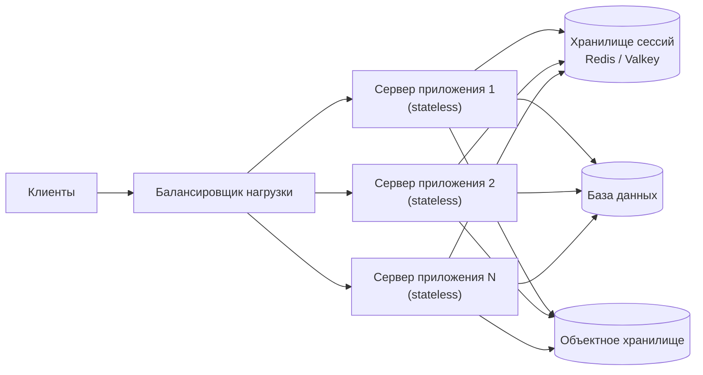

import { Aside } from '@astrojs/starlight/components';

Производительность и масштабируемость связаны, но отвечают на разные вопросы. **Производительность** — насколько быстро система обрабатывает одну единицу работы. **Масштабируемость** (scalability) — что происходит с этой скоростью и со счётом за инфраструктуру, когда работы становится больше. Почти все обсуждения архитектуры на деле касаются второго вопроса, поэтому полезно с первой минуты различать эти понятия.

<Aside type="tip" title="Коротко">
- **Проблема производительности** видна уже при одном пользователе: медленный каждый запрос. **Проблема масштабируемости** проявляется под нагрузкой: одному пользователю всё быстро, десяти тысячам — нет.
- Система хорошо масштабируется, если добавленные ресурсы дают пропорциональный прирост мощности, а стоимость одного запроса не растёт или падает.
- Сначала **масштабируйтесь вертикально** (машина побольше), пока это дёшево. **Горизонтально** (больше машин) — когда упёрлись в потолок или нужна избыточность. Горизонтально масштабируются только **stateless**-слои и данные, которые можно разделить.
- **Закон Амдала**: последовательная часть работы ограничивает ускорение. **Универсальный закон масштабируемости** (USL) добавляет стоимость координации, из-за которой пропускная способность может *падать* с ростом числа узлов.
- Классический путь: клонировать stateless-серверы приложений, масштабировать базу данных, добавить кэш, вынести медленную работу в очереди.
</Aside>

## Два вида «медленно»

Простая диагностика помогает отличить одну проблему от другой:

| Симптом | Вероятная проблема | Типичные решения |
|---|---|---|
| Один запрос на простаивающей системе идёт 2 с | Производительность | Профилирование, исправить N+1-запросы, добавить индекс, взять алгоритм получше |
| p99 нормальный при 100 RPS и ужасный при 5000 RPS | Масштабируемость | Добавить мощности, убрать общее узкое место, кэшировать, партиционировать |
| Пропускная способность перестаёт расти при добавлении серверов | Масштабируемость (конкуренция) | Найти общий ресурс: блокировку, основную БД, «горячий» ключ |
| Пропускная способность *падает* при добавлении серверов | Масштабируемость (стоимость когерентности) | Сократить переговоры между узлами, партиционировать данные, избегать глобальных блокировок |

Система хорошо масштабируется, если добавленные ресурсы пропорционально увеличивают её мощность. Мощность может означать больше запросов в секунду, больше данных или больше арендаторов. Добавление резервных копий тоже не должно её замедлять. Работа над производительностью и над масштабируемостью подпитывают друг друга. Запрос, которому нужно вдвое меньше процессорного времени, вдвое сокращает и число нужных серверов.

## Вертикальное и горизонтальное масштабирование

**Вертикальное масштабирование** (scale up) — это более мощная машина: больше ядер, памяти, быстрее диски. **Горизонтальное** (scale out) — больше машин за [балансировщиком нагрузки](/traffic/load-balancers/).

| | Вертикальное | Горизонтальное |
|---|---|---|
| Изменения в коде | Не нужны | Сервис должен быть stateless, а данные — разделены на партиции |
| Потолок | Самая большая машина, которую можно купить или арендовать | Очень высокий, ограничен координацией и общими зависимостями |
| Отказ | Одна машина — единая точка отказа | Потеря узла отнимает `1/N` мощности |
| Кривая стоимости | Круто растёт на верхних конфигурациях | Почти линейная плюс стоимость слоя координации |
| Эксплуатация | Простая | Деплой, обнаружение и мониторинг множества узлов |

В 2026 году вертикальный потолок намного выше, чем во времена оригинального праймера. Облака сдают в аренду отдельные машины с сотнями ядер и терабайтами памяти; самые крупные high-memory-инстансы AWS дают 896 vCPU и 32 ТиБ. Один хорошо настроенный основной узел PostgreSQL с репликами вытягивает многие продукты дольше, чем принято думать. Разумная стратегия по умолчанию — масштабироваться вертикально, пока это не станет дорого или рискованно, и закладывать горизонтальное масштабирование там, где оно точно понадобится. Механика горизонтального масштабирования описана на странице про [балансировщики нагрузки](/traffic/load-balancers/).

## Stateless-сервисы: условие для клонирования

Сервис **не хранит состояния** (stateless), если любой его экземпляр может обработать любой запрос: ничего нужного запросу не лежит только в памяти или на локальном диске одного экземпляра. Состояние никуда не исчезает — оно просто живёт в общем месте:

- Сессии и краткоживущие данные пользователя — в общем кэше (Redis или Valkey) или в подписанном токене, который носит клиент.
- Загруженные файлы — в [объектном хранилище](/data/object-storage/), а не на локальном диске.
- Долговечные данные остаются в базе данных, незавершённая работа — в [очереди](/async/queues-and-back-pressure/).



Когда слой приложений stateless, экземпляры можно свободно добавлять и убирать, включать автомасштабирование и выкатывать новые версии заменой экземпляров из одного образа. Сложная часть масштабирования переезжает в слой с состоянием — поэтому большая часть этого сайта посвящена данным.

## Почему новые машины перестают помогать

### Закон Амдала

Если доля `p` работы распараллеливается, а остальное выполняется последовательно, наилучшее ускорение на `N` исполнителях равно `1 / ((1 − p) + p / N)`. Последовательная часть задаёт жёсткий предел `1 / (1 − p)`, сколько машин ни добавляй.

| Параллельная доля | 8 исполнителей | 32 исполнителя | 128 исполнителей | Предел |
|---|---|---|---|---|
| 95% | 5,9× | 12,5× | 17,4× | 20× |
| 99% | 7,5× | 24,4× | 56,4× | 100× |

В веб-системе «последовательная часть» — это всё, через что запросы проходят по одному: единственная основная БД, глобальная блокировка, генератор последовательностей, «горячая» строка.

### Универсальный закон масштабируемости

**Универсальный закон масштабируемости** (Universal Scalability Law, USL) Нила Гюнтера добавляет второй штраф. Помимо **конкуренции** (ожидание общего ресурса, слагаемое Амдала) узлы платят за **когерентность** — за синхронизацию данных друг с другом. Эта стоимость растёт с числом пар узлов, то есть примерно как `N²`. Относительная мощность:

```text
C(N) = N / (1 + α(N − 1) + βN(N − 1))
α = конкуренция (очереди к общим ресурсам)
β = когерентность (координация между узлами)
```

При α = 0,05 и β = 0,001 мощность на 8 узлах — 5,7×, а пик около 9× достигается примерно на 31 узле. Дальше она падает: 7,8× на 64 узлах и 5,4× на 128. Новые серверы делают систему *медленнее*. Практические выводы:

- Измерьте пропускную способность на кластерах разного размера и постройте кривую до покупки железа.
- Уменьшайте α, убирая общие узкие места: партиционируйте данные, избегайте глобальных блокировок.
- Уменьшайте β, избегая общения «все со всеми»: gossip-протоколы, многословная инвалидация кэшей и транзакции на весь кластер увеличивают этот коэффициент.

## Четыре классических шага

Серия статей *Scalability for Dummies* (см. «Что почитать») описывает путь, по которому проходит большинство веб-продуктов. Кратко, со ссылками на подробные страницы:

1. **Клоны.** Сделайте слой приложений stateless и запустите одинаковые экземпляры за балансировщиком. Собирайте все экземпляры из одного образа, чтобы конфигурации не расходились. См. [балансировщики нагрузки](/traffic/load-balancers/) и [монолит и микросервисы](/architecture/monolith-and-microservices/).
2. **База данных.** Следующее узкое место — единственная БД. Варианты: реплики для чтения, [партиционирование и шардирование](/data/partitioning-and-sharding/), денормализация горячих путей ([денормализация и тюнинг](/data/denormalization-and-tuning/)) или хранилище, изначально рассчитанное на горизонтальное масштабирование ([SQL или NoSQL](/data/sql-or-nosql/)). См. также [репликацию](/data/replication/).
3. **Кэш.** Держите горячие и дорогие в вычислении объекты в памяти, чтобы большинство чтений не доходило до базы. Кэшируйте готовые объекты, а не сырые результаты запросов, — так инвалидация остаётся простой. См. [уровни кэширования](/caching/caching-layers/) и [стратегии кэширования](/caching/cache-strategies/).
4. **Асинхронность.** Делайте медленную работу заранее (пре-рендеринг, предвычисление) или после ответа (поставить в очередь и уведомить позже). Так задержка запроса остаётся ровной, даже когда общий объём работы растёт. См. [очереди и обратное давление](/async/queues-and-back-pressure/) и [потоковую обработку событий](/async/event-streaming/).

В 2026 году порядок шагов тот же. Изменилось другое: значительную часть каждого шага теперь берут на себя управляемые сервисы — балансировщики, базы данных с репликами, кэши и очереди.

## Стоимость — тоже измерение масштабируемости

Система, которая выдерживает десятикратную нагрузку за сорокакратную цену, не масштабируется ни в каком полезном смысле. Следите за **стоимостью единицы работы** — запроса, активного пользователя, гигабайта хранения — и за тем, как она меняется с ростом нагрузки.

- **Цель — сублинейный рост.** Кэши, пакетная обработка и эффект масштаба должны делать тысячного клиента дешевле первого.
- **Простаивающие мощности стоят денег.** Автомасштабирование, serverless-функции и базы с масштабированием до нуля меняют немного задержки холодного старта на оплату только фактического использования. Резерв, который держат ради доступности, — осознанная статья расходов; задавайте его размер намеренно.
- **Распределённое не значит эффективное.** Макшерри, Айсард и Мюррей обнаружили, что многим опубликованным системам обработки больших данных нужны сотни ядер, чтобы сравняться с одной хорошо написанной однопоточной программой, а некоторые не догоняют её вовсе. Их метрика **COST** — конфигурация железа, на которой платформа впервые обгоняет этот один поток. Простой дизайн на одной большой машине часто оказывается и быстрее, и дешевле.
- **Люди тоже стоят денег.** Каждая новая движущаяся часть требует дежурств, обновлений и экспертизы. Учитывайте это, прежде чем делить сервис или добавлять ещё одно хранилище.

## Компромиссы

| Выбор | Что получаем | Чем платим |
|---|---|---|
| Вертикальное масштабирование | Без изменений кода, строгая согласованность «бесплатно», простая эксплуатация | Жёсткий потолок, высокая цена на верхних конфигурациях, единая точка отказа |
| Горизонтальное (stateless-слой) | Почти линейный рост мощности, поэтапные выкатки, избыточность | Общее состояние нужно вынести из процесса; больше инфраструктуры |
| Горизонтальное (слой данных) | Мощность больше одной машины | Запросы через несколько партиций, ребалансировка, более слабые гарантии или дорогая координация |
| Кэш | Дешёвая большая мощность на чтение | Устаревшие данные, ошибки инвалидации, лавины при холодном старте |
| Асинхронная обработка | Ровная задержка запросов, сглаживание пиков | Результат «в конечном счёте», повторные попытки, идемпотентность, более сложная отладка |

<Aside type="note" title="На собеседовании">
- От вас ждут вопросов о масштабе до начала проектирования: запросы в секунду, объём данных, рост. Затем — где появится первое узкое место. Обычный инструмент — [прикидочный расчёт](/start/estimation/).
- Не прыгайте к шардированию или микросервисам при нагрузке, которую тянет одна база. Фраза «одного основного узла с репликами хватит примерно до X записей в секунду» ценится выше переусложнения.
- Ждите вопроса «что будет при десятикратном трафике?». Пройдите классический порядок: stateless-слой приложений, затем чтения из БД, затем записи, кэш, очереди.
- Частая ошибка — заявить горизонтальное масштабирование, но оставить сессии или файлы на локальных дисках.
- Говорите о стоимости и нагрузке на эксплуатацию, а не только о пропускной способности.
</Aside>

## Что почитать

- [CS75 Lecture 9: Scalability (Гарвард, Дэвид Малан)](https://www.youtube.com/watch?v=-W9F__D3oY4) — классическая часовая лекция: вертикальное и горизонтальное масштабирование, кэширование, балансировка, репликация, партиционирование.
- *Scalability for Dummies* (блог Le Cloud, архив): [часть 1 — клоны](https://web.archive.org/web/20260519095753/http://www.lecloud.net/post/7295452622/scalability-for-dummies-part-1-clones), [часть 2 — база данных](https://web.archive.org/web/20260817152952/http://www.lecloud.net/post/7994751381/scalability-for-dummies-part-2-database), [часть 3 — кэш](https://web.archive.org/web/20260213033902/http://www.lecloud.net/post/9246290032/scalability-for-dummies-part-3-cache), [часть 4 — асинхронность](https://web.archive.org/web/20260208184538/http://www.lecloud.net/post/9699762917/scalability-for-dummies-part-4-asynchronism).
- [A Word on Scalability](https://www.allthingsdistributed.com/2006/03/a_word_on_scalability.html) — короткое определение масштабируемости от Вернера Фогельса.
- [How to Quantify Scalability](https://www.perfdynamics.com/Manifesto/USLscalability.html) — Нил Гюнтер об универсальном законе масштабируемости: формула и вывод.
- [Scalability! But at what COST?](https://www.usenix.org/conference/hotos15/workshop-program/presentation/mcsherry) — Макшерри, Айсард и Мюррей (HotOS 2015) о сравнении с однопоточной реализацией.

## Связанные темы

- [Задержка и пропускная способность](/fundamentals/latency-vs-throughput/) — как измерять «быстро» и почему очереди делают нагрузку болезненной.
- [Балансировщики нагрузки](/traffic/load-balancers/) — механика горизонтального масштабирования.
- [Партиционирование и шардирование](/data/partitioning-and-sharding/) — масштабирование слоя с состоянием.
- [Уровни кэширования](/caching/caching-layers/) — самая дешёвая мощность для систем с преобладанием чтения.
- [Масштабирование до миллионов пользователей](/practice/scaling-to-millions/) — классические шаги на практике.
