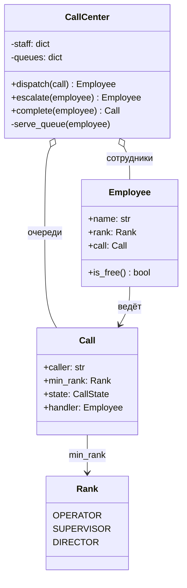

import { Aside } from '@astrojs/starlight/components';

В колл-центре три уровня сотрудников. Входящий звонок достаётся самому младшему свободному сотруднику, которому его можно доверить. Если свободных нет, звонок ждёт в очереди, а сотрудник, который не может решить вопрос, передаёт звонок на уровень выше. Задача проверяет, как вы моделируете иерархию, где размещаете логику маршрутизации и учитываете ли момент, когда сотрудник освобождается.

<Aside type="tip" title="Коротко">
- У `Employee` есть `Rank` (`OPERATOR < SUPERVISOR < DIRECTOR`) и не больше одного активного `Call`. `Call` хранит **минимальный ранг**, которому его можно отдать.
- Маршрутизацией занимается только `CallCenter`. Сотрудники ничего не знают друг о друге и об очередях.
- Главная идея: **эскалация лишь повышает минимальный ранг звонка и заново его распределяет**. Один и тот же код маршрутизации обслуживает новые, эскалированные и ожидающие звонки.
- На каждый ранг — своя FIFO-очередь. Освободившийся сотрудник берёт ожидающий звонок **самого высокого доступного ему ранга**, чтобы старшие сотрудники не тратили время на звонки, с которыми справится оператор.
</Aside>

## Задача и ограничения

Нужно спроектировать классы колл-центра, который распределяет входящие звонки, эскалирует их и ставит в очередь. Что уточнить:

- **Какие есть уровни?** Оператор, супервайзер, директор. Директор справляется с любым звонком.
- **Кому достаётся новый звонок?** Свободному оператору, если такой есть, иначе супервайзеру, иначе директору.
- **Что такое эскалация?** Сотрудник, который не может решить вопрос, передаёт звонок на следующий уровень и освобождается. Звонок распределяется заново, но уже только между старшими рангами.
- **Что, если все заняты?** Звонок ставится в очередь по порядку поступления (FIFO). Приоритетных VIP-клиентов в базовой версии нет.
- **Может ли сотрудник вести несколько звонков?** Нет, только один.

## Дизайн

- **`Rank`** — `IntEnum`, поэтому ранги можно сравнивать (`rank >= call.min_rank`).
- **`Call`** — звонящий, минимальный ранг, состояние (`QUEUED`, `IN_PROGRESS`, `COMPLETE`) и текущий обработчик.
- **`Employee`** — имя, ранг, текущий звонок. Хватает одного класса: три роли отличаются данными, а не поведением. Если бы поведение различалось (скажем, только директор может оформить возврат), подклассы или набор полномочий были бы оправданы.
- **`CallCenter`** — сотрудники, сгруппированные по рангам, очереди по рангам и операции `dispatch`, `escalate` и `complete`.



Маршрутизация в `CallCenter` — сознательное решение. В некоторых вариантах сотрудник сам вызывает колл-центр (`employee.escalate()` → `center.notify_escalated()`). Это создаёт цикл между классами и размазывает логику очередей. Здесь сотрудники — просто данные, а любое изменение состояния проходит через один объект, который видит всех сотрудников и все очереди.

## Реализация

```python title="call_center.py"
from collections import deque
from dataclasses import dataclass, field
from enum import Enum, IntEnum, auto
from itertools import count


class Rank(IntEnum):
    OPERATOR = 0
    SUPERVISOR = 1
    DIRECTOR = 2


class CallState(Enum):
    QUEUED = auto()
    IN_PROGRESS = auto()
    COMPLETE = auto()


_call_ids = count(1)


@dataclass(eq=False)
class Call:
    caller: str
    min_rank: Rank = Rank.OPERATOR  # минимальный ранг, которому можно взять звонок
    call_id: int = field(default_factory=lambda: next(_call_ids))
    state: CallState = CallState.QUEUED
    handler: "Employee | None" = None


@dataclass(eq=False)
class Employee:
    name: str
    rank: Rank
    call: Call | None = None

    @property
    def is_free(self) -> bool:
        return self.call is None


class CallCenter:
    def __init__(self, employees: list[Employee]) -> None:
        if not any(e.rank is Rank.DIRECTOR for e in employees):
            raise ValueError("at least one director is required: directors handle any call")
        self._staff: dict[Rank, list[Employee]] = {rank: [] for rank in Rank}
        for employee in employees:
            self._staff[employee.rank].append(employee)
        # Своя FIFO-очередь на каждый ранг: звонок ждёт сотрудника не ниже этого ранга.
        self._queues: dict[Rank, deque[Call]] = {rank: deque() for rank in Rank}

    def dispatch(self, call: Call) -> Employee | None:
        """Отдать звонок самому младшему свободному сотруднику с подходящим рангом или поставить в очередь."""
        for rank in Rank:
            if rank < call.min_rank:
                continue
            for employee in self._staff[rank]:
                if employee.is_free:
                    self._assign(call, employee)
                    return employee
        call.state = CallState.QUEUED
        self._queues[call.min_rank].append(call)
        return None

    def escalate(self, employee: Employee) -> Employee | None:
        """Сотрудник не может решить вопрос: передаём звонок на ранг выше."""
        if employee.rank is Rank.DIRECTOR:
            raise RuntimeError("directors resolve every call; nobody to escalate to")
        call = self._release(employee)
        call.min_rank = Rank(employee.rank + 1)
        handler = self.dispatch(call)
        self._serve_queue(employee)
        return handler

    def complete(self, employee: Employee) -> Call:
        call = self._release(employee)
        call.state = CallState.COMPLETE
        self._serve_queue(employee)
        return call

    def queued(self) -> int:
        return sum(len(q) for q in self._queues.values())

    def _assign(self, call: Call, employee: Employee) -> None:
        employee.call, call.handler, call.state = call, employee, CallState.IN_PROGRESS

    def _release(self, employee: Employee) -> Call:
        if employee.call is None:
            raise ValueError(f"{employee.name} has no active call")
        call, employee.call = employee.call, None
        call.handler = None
        return call

    def _serve_queue(self, employee: Employee) -> None:
        """Освободившийся сотрудник берёт ожидающий звонок самого высокого доступного ему ранга."""
        for rank in sorted(Rank, reverse=True):
            if rank <= employee.rank and self._queues[rank]:
                self._assign(self._queues[rank].popleft(), employee)
                return


if __name__ == "__main__":
    ann, bob = Employee("Ann", Rank.OPERATOR), Employee("Bob", Rank.SUPERVISOR)
    dee = Employee("Dee", Rank.DIRECTOR)
    center = CallCenter([ann, bob, dee])

    c1, c2, c3, c4 = (Call(f"caller-{i}") for i in range(1, 5))
    assert center.dispatch(c1) is ann
    assert center.dispatch(c2) is bob          # свободных операторов нет: на ранг выше
    assert center.dispatch(c3) is dee
    assert center.dispatch(c4) is None and center.queued() == 1

    center.escalate(ann)                       # c1 нужен супервайзер или выше, все заняты -> в очередь
    assert c1.state is CallState.QUEUED and ann.call is c4  # Ann взяла ожидавший c4
    center.complete(bob)                       # Bob освободился и взял эскалированный c1
    assert bob.call is c1 and c2.state is CallState.COMPLETE
    assert center.queued() == 0
    print("ok")
```

## Сложность и компромиссы

Для `E` сотрудников и `R` рангов (здесь 3):

| Операция | Время | Комментарий |
|---|---|---|
| `dispatch` | `O(E)` | Линейный поиск свободного сотрудника |
| `escalate`, `complete` | `O(E + R)` | Освободить, перераспределить, взять звонок из очереди |
| `queued` | `O(R)` | Сумма длин очередей |

- **Перебор или списки свободных.** Для десятков сотрудников перебор нормален. Для тысяч держат множество (или deque) свободных сотрудников на каждый ранг. Тогда `dispatch` работает за `O(R)`, а правило «первым берёт тот, кто дольше всех свободен» получается само из порядка в deque.
- **Кто разбирает очередь.** Освободившийся оператор берёт только звонки операторского уровня. Освободившийся директор сначала берёт самый «старший» ожидающий звонок. Так эскалированные звонки не застревают за новыми, но поток эскалаций может надолго отвлечь директоров от очереди операторов. В реальной системе добавляют лимиты на время ожидания.
- **Без вытеснения.** Занятого директора не прерывают ради эскалированного звонка — звонок ждёт. Это проще и соответствует тому, как работает телефония.

## Возможные расширения

1. **VIP и приоритетные клиенты.** Заменить каждую FIFO-очередь на кучу с ключом `(priority, arrival_time)`. Время поступления сохраняет порядок для клиентов с равным приоритетом.
2. **Маршрутизация по навыкам** (skills-based routing). Настоящие контакт-центры распределяют звонки по языку, продукту и навыкам, а не только по рангу. У сотрудника — набор навыков, у звонка — набор требуемых, подбор по вхождению множеств. Здесь окупается интерфейс-стратегия для маршрутизации.
3. **Конкурентный доступ.** Звонки приходят из многих потоков. Состояние `CallCenter` защищают одной блокировкой или выносят маршрутизацию в единственный цикл событий, читающий очередь сообщений. Один писатель гарантирует, что два сотрудника не схватят один звонок.
4. **Хранение и метрики.** Каждое изменение состояния записывают как событие (`queued`, `assigned`, `escalated`, `completed`) с временем. Время ожидания, время обработки и доля брошенных звонков считаются по журналу событий, а маршрутизатор можно восстановить после сбоя.
5. **Распределённый колл-центр.** Несколько площадок обслуживают общую очередь. Очередь переезжает в надёжный брокер, и сотрудники сами забирают работу (pull), а не получают её (push). См. [очереди и обратное давление](/async/queues-and-back-pressure/).

<Aside type="note" title="На собеседовании">
- Прежде чем рисовать классы, уточните правило эскалации и что происходит, когда свободных нет.
- Интервьюеру важно, что вы обрабатываете **момент освобождения сотрудника**: в исходном решении это был пустой метод.
- Ждите вопросов «как добавить VIP-звонки?» и «а если сотрудников 10 000?». Ответ — очередь с приоритетом и списки свободных по рангам.
- Типичные ошибки: подкласс на каждую роль со скопированным кодом эскалации, эскалация без освобождения сотрудника и директор, которому «есть куда» эскалировать.
</Aside>

## Связанные темы

- [Очереди и обратное давление](/async/queues-and-back-pressure/): ограниченные очереди и сброс нагрузки, когда звонящих больше, чем сотрудников.
- [Проектируем парковку](/ood/parking-lot/): ещё одна задача «найти свободный ресурс подходящего размера».
- [Задержка и пропускная способность](/fundamentals/latency-vs-throughput/): почему время ожидания взрывается, когда загрузка сотрудников приближается к 100%.
