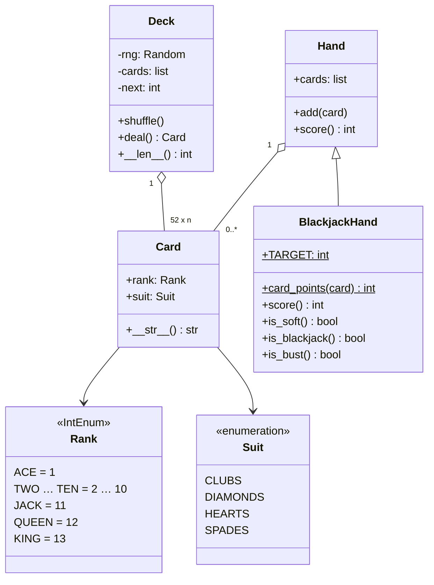

import { Aside } from '@astrojs/starlight/components';

«Спроектируйте колоду карт, а затем используйте её для блэкджека» — задача прежде всего на одно умение: отделить общее (карты, масти, раздачу) от того, что относится к конкретной игре (подсчёт очков в руке). При удачном дизайне покер добавляется новым подклассом `Hand`, и больше ничего менять не нужно.

<Aside type="tip" title="Коротко">
- `Card` — **неизменяемое значение** (`rank`, `suit`), а не объект с игровой логикой. `Suit` и `Rank` — перечисления.
- `Deck` создаёт 52 карты (или «башмак» из нескольких колод), тасует и раздаёт. Правил игр она не знает.
- `Hand` хранит карты и умеет `score()`. `BlackjackHand` переопределяет только подсчёт очков.
- Главная идея подсчёта: считать каждого туза за 1, а потом **один раз** добавить 10, если это не даёт перебора. Два туза по 11 — это уже 22, поэтому «дорогим» может быть максимум один туз.
</Aside>

## Задача и ограничения

Нужно спроектировать универсальную колоду и показать, как на ней строится игра вроде блэкджека. Что уточнить:

- **Какая колода?** Стандартная французская на 52 карты: 13 достоинств × 4 масти, без джокеров. В казино блэкджек раздают из «башмака» (shoe) на 6–8 колод, поэтому колод может быть несколько.
- **Кто отвечает за правила игры?** Точно не колода. Стоимость карт зависит от игры: в покере туз старший, в блэкджеке он стоит 1 или 11.
- **Насколько случайным должно быть тасование?** Равномерным. Для тестов генератор случайных чисел должен подставляться снаружи.
- **Что, если карты кончились?** Бросить исключение. Перетасовка — решение игры.

## Дизайн

- **`Suit`, `Rank`** — перечисления. `Rank` — это `IntEnum`, где туз = 1, король = 13, так что картинки — это `rank > 10`.
- **`Card`** — замороженный dataclass. Неизменяемую и хешируемую карту можно класть в множества, и две колоды не могут случайно разделить один изменяемый объект карты.
- **`Deck`** — список карт и индекс «следующей карты». `deal()` сдвигает индекс, `shuffle()` собирает все карты и перемешивает их на месте.
- **`Hand`** — список карт и подсчёт по умолчанию `score()` (сумма достоинств).
- **`BlackjackHand`** — очки карт по правилам блэкджека, правило туза и вспомогательные `is_soft`, `is_blackjack`, `is_bust`.



Специфика игры живёт в подклассах `Hand`, а не в подклассах `Card`. «Карта для блэкджека» вносила бы игровую логику в то, что по сути является значением, и одной и той же физической карте понадобился бы свой класс для каждой игры.

## Реализация

```python title="deck_of_cards.py"
import random
from dataclasses import dataclass, field
from enum import Enum, IntEnum


class Suit(Enum):
    CLUBS = "♣"
    DIAMONDS = "♦"
    HEARTS = "♥"
    SPADES = "♠"


class Rank(IntEnum):
    ACE = 1
    TWO = 2
    THREE = 3
    FOUR = 4
    FIVE = 5
    SIX = 6
    SEVEN = 7
    EIGHT = 8
    NINE = 9
    TEN = 10
    JACK = 11
    QUEEN = 12
    KING = 13


@dataclass(frozen=True, slots=True)
class Card:
    rank: Rank
    suit: Suit

    def __str__(self) -> str:
        return f"{self.rank.name.title()}{self.suit.value}"


class Deck:
    """Одна или несколько стандартных колод по 52 карты. Правила игры живут в других классах."""

    def __init__(self, num_decks: int = 1, rng: random.Random | None = None) -> None:
        self._rng = rng or random.Random()
        self._cards = [Card(r, s) for _ in range(num_decks) for s in Suit for r in Rank]
        self._next = 0  # карты до этого индекса уже розданы

    def __len__(self) -> int:
        return len(self._cards) - self._next

    def shuffle(self) -> None:
        """Собрать все карты и перемешать (внутри random.shuffle — алгоритм Фишера — Йетса)."""
        self._rng.shuffle(self._cards)
        self._next = 0

    def deal(self) -> Card:
        if self._next == len(self._cards):
            raise IndexError("the deck is empty")
        card = self._cards[self._next]
        self._next += 1
        return card


@dataclass
class Hand:
    cards: list[Card] = field(default_factory=list)

    def add(self, card: Card) -> None:
        self.cards.append(card)

    def score(self) -> int:
        return sum(card.rank for card in self.cards)


class BlackjackHand(Hand):
    TARGET = 21

    @staticmethod
    def card_points(card: Card) -> int:
        return min(card.rank, 10)  # J, Q, K стоят 10; туз здесь считается за 1

    def score(self) -> int:
        """Лучшая сумма не больше 21 или наименьший перебор, если перебор неизбежен."""
        total = sum(self.card_points(c) for c in self.cards)
        has_ace = any(c.rank is Rank.ACE for c in self.cards)
        # За 11 может идти не больше одного туза: два дали бы +20 и гарантированный перебор.
        if has_ace and total + 10 <= self.TARGET:
            total += 10
        return total

    def is_soft(self) -> bool:
        """True, если туз сейчас считается за 11."""
        hard = sum(self.card_points(c) for c in self.cards)
        return self.score() != hard

    def is_blackjack(self) -> bool:
        return len(self.cards) == 2 and self.score() == self.TARGET

    def is_bust(self) -> bool:
        return self.score() > self.TARGET


if __name__ == "__main__":
    deck = Deck(rng=random.Random(42))
    assert len({deck.deal() for _ in range(52)}) == 52     # 52 разные карты
    deck.shuffle()                                          # собрать и перемешать заново
    hand = BlackjackHand()
    hand.add(deck.deal())
    hand.add(deck.deal())
    assert len(deck) == 50
    print(", ".join(map(str, hand.cards)), "->", hand.score())

    ace, king, five = Card(Rank.ACE, Suit.SPADES), Card(Rank.KING, Suit.HEARTS), Card(Rank.FIVE, Suit.CLUBS)
    assert BlackjackHand([ace, king]).is_blackjack()
    assert BlackjackHand([ace, ace]).score() == 12              # 11 + 1
    assert BlackjackHand([ace, five]).is_soft()                 # «мягкие» 16
    assert BlackjackHand([ace, five, king]).score() == 16       # туз снова считается за 1
    assert BlackjackHand([king, king, five]).is_bust()
    print("ok")
```

## Сложность и компромиссы

| Операция | Время | Комментарий |
|---|---|---|
| Создать колоду | `O(52 · d)` | `d` колод в «башмаке» |
| `shuffle` | `O(n)` | Фишер — Йетс, равномерно при хорошем ГСЧ |
| `deal` | `O(1)` | Сдвиг индекса без копирования списка |
| `BlackjackHand.score` | `O(k)` | `k` карт в руке, обычно 2–5 |

- **Индекс или pop.** Раздача по индексу сохраняет всю колоду для перетасовки и делает `len()` тривиальным. `cards.pop()` тоже работает за `O(1)`, но тогда розданные карты придётся собирать обратно из рук.
- **Случайность.** Модуля `random` (вихрь Мерсенна) достаточно для игры и для тестов с фиксированным зерном. Казино на реальные деньги обязано использовать сертифицированный генератор. В Python это `random.SystemRandom` или модуль `secrets`: состояние вихря Мерсенна можно восстановить по его выходу.
- **Правила в руке.** Подсчёт очков в `BlackjackHand` оставляет `Card` переиспользуемой. Полной игре нужны ещё правила дилера, ставки и сплиты. Им место в отдельном классе `BlackjackGame`, а не в руке.

## Возможные расширения

1. **Другие игры.** Для покера добавляется `PokerHand`, ранжирующая пятикарточные комбинации. Джокеры — это `Rank.JOKER` или отдельный тип карты `Joker`. Колода принимает фабрику карт, чтобы игра могла выбрать свой набор.
2. **Полная игра в блэкджек.** У `BlackjackGame` есть «башмак», рука дилера и руки игроков. Там же правило дилера (брать карту при сумме меньше 17 и решить, берёт ли он на «мягких» 17) и раунд как конечный автомат: ставки → раздача → ходы игроков → ход дилера → расчёт.
3. **Момент перетасовки.** В казино в «башмак» вставляют отсекающую карту и перетасовывают, когда роздано примерно от двух третей до трёх четвертей карт. Моделируется порогом, который игра проверяет между раундами.
4. **Онлайн-мультиплеер.** Состояние игры переезжает на сервер, клиенты присылают только действия. Тасовать должен только сервер, чтобы клиенты не могли ни предсказать, ни выбрать карты.

<Aside type="note" title="На собеседовании">
- Сначала спросите, нужна ли универсальная колода. Обычно интервьюер хочет увидеть разделение общего и специфичного.
- Реализуйте правило туза без перебора всех комбинаций. В исходном решении `possible_scores` остался пустым, а `sys.MAXSIZE` не существует, поэтому `score()` падал.
- Ждите вопроса «а как добавить покер?». Ответ — новый подкласс `Hand` без изменений в `Card` и `Deck`.
- Типичные ошибки: игровая логика внутри `Card`, изменяемый флаг `is_available` у каждой карты вместо состояния колоды и `shuffle()`, оставленный заглушкой.
</Aside>

## Связанные темы

- [Проектируем колл-центр](/ood/call-center/): ещё одна небольшая иерархия классов с явным владельцем состояния.
- [Проектируем парковку](/ood/parking-lot/): перечисления и наследование для размеров и типов транспорта.
