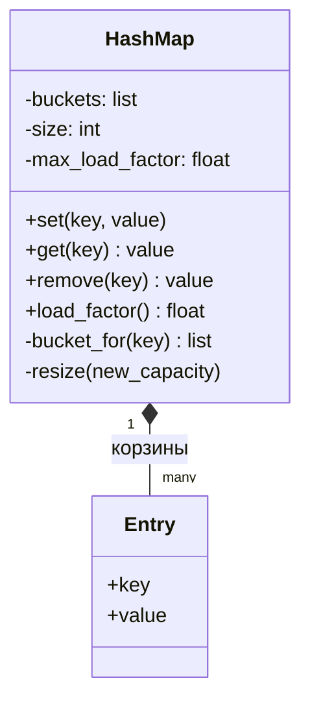

import { Aside } from '@astrojs/starlight/components';

Написать хеш-таблицу (hash map) с нуля — частая разминка на собеседовании. Код укладывается в 20 минут, а по нему сразу видно, понимает ли кандидат хеширование, коллизии и амортизированную стоимость. Те же идеи возвращаются в масштабе системы — в [партиционировании и шардировании](/data/partitioning-and-sharding/) и в любом кэше.

<Aside type="tip" title="Коротко">
- `HashMap` хранит массив **корзин** (buckets). Каждая корзина — короткий список пар `Entry(key, value)`: это **метод цепочек** (separate chaining).
- Номер корзины — `hash(key) % capacity`. У равных ключей хеши обязаны совпадать.
- Главная идея: держать **коэффициент заполнения** (load factor, `size / capacity`) ниже порога (здесь 0,75). Как только порог превышен, массив корзин **удваивается**, а все записи перехешируются.
- Благодаря удвоению каждая запись в среднем переезжает константное число раз, поэтому вставка остаётся амортизированной `O(1)`.
</Aside>

## Задача и ограничения

Нужно реализовать словарь с операциями `set(key, value)`, `get(key)` и `remove(key)`. Прежде чем писать код, уточняем:

- **Какого типа ключи?** В исходной версии — только целые числа. Мы принимаем любой хешируемый ключ и берём встроенный `hash()`.
- **Как разрешать коллизии?** Цепочками (список в каждой корзине) или открытой адресацией (ищем следующую свободную ячейку). Цепочки проще написать без ошибок у доски.
- **Следим ли за коэффициентом заполнения?** В оригинале — нет, таблица фиксированного размера. Это главный пробел: при 10 корзинах и миллионе ключей каждый поиск просматривает список из 100 000 записей. Мы добавляем расширение.
- **Что делать с отсутствующим ключом?** Бросать `KeyError`, как `dict`, а не возвращать `None`: `None` может оказаться и сохранённым значением.
- **Конкурентный доступ, хранение на диске?** Нет: один поток, всё в памяти.

## Дизайн

- **`Entry`** хранит один ключ и его значение. Значение изменяемое, поэтому `set` для существующего ключа обновляет запись на месте.
- **`HashMap`** владеет корзинами, счётчиком записей и порогом заполнения. Публичный интерфейс — `set`, `get`, `remove`, `len`, `in` и `items`. Основную работу делают два приватных метода: `_bucket_for` находит корзину ключа, `_resize` создаёт массив побольше и перехеширует в него записи.



Таблица **владеет** записями (композиция): вне её они не существуют. Номер корзины зависит от ёмкости, поэтому при расширении нельзя просто скопировать старые корзины в длинный список. Каждую запись нужно заново захешировать на новое место.

Почему цепочки? Удаление — обычное удаление из списка, без «надгробий» (tombstones), а при коэффициенте заполнения выше 1 таблица продолжает работать, просто медленнее. Открытая адресация (open addressing) хранит записи прямо в массиве и лучше дружит с кэшем процессора. Поэтому её используют `dict` в CPython, `HashMap` в Rust и, начиная с Go 1.24, map в Go (Swiss tables). `HashMap` в Java построен на цепочках и превращает слишком длинные цепочки в сбалансированные деревья.

## Реализация

```python title="hash_map.py"
from collections.abc import Hashable, Iterator
from dataclasses import dataclass


@dataclass(slots=True)
class Entry[K, V]:
    key: K
    value: V


class HashMap[K: Hashable, V]:
    """Хеш-таблица с цепочками, которая растёт, когда заполняется."""

    def __init__(self, capacity: int = 8, max_load_factor: float = 0.75) -> None:
        if capacity < 1 or max_load_factor <= 0:
            raise ValueError("capacity and max_load_factor must be positive")
        self._buckets: list[list[Entry[K, V]]] = [[] for _ in range(capacity)]
        self._size = 0
        self._max_load_factor = max_load_factor

    def __len__(self) -> int:
        return self._size

    def __contains__(self, key: K) -> bool:
        return any(entry.key == key for entry in self._bucket_for(key))

    @property
    def capacity(self) -> int:
        return len(self._buckets)

    @property
    def load_factor(self) -> float:
        return self._size / self.capacity

    def set(self, key: K, value: V) -> None:
        bucket = self._bucket_for(key)
        for entry in bucket:
            if entry.key == key:  # ключ уже есть: перезаписываем на месте
                entry.value = value
                return
        bucket.append(Entry(key, value))
        self._size += 1
        if self.load_factor > self._max_load_factor:
            self._resize(self.capacity * 2)

    def get(self, key: K) -> V:
        for entry in self._bucket_for(key):
            if entry.key == key:
                return entry.value
        raise KeyError(key)

    def remove(self, key: K) -> V:
        bucket = self._bucket_for(key)
        for i, entry in enumerate(bucket):
            if entry.key == key:
                del bucket[i]
                self._size -= 1
                return entry.value
        raise KeyError(key)

    def items(self) -> Iterator[tuple[K, V]]:
        for bucket in self._buckets:
            for entry in bucket:
                yield entry.key, entry.value

    def _bucket_for(self, key: K) -> list[Entry[K, V]]:
        # hash() работает для любого хешируемого ключа; % держит индекс в границах (и для отрицательных хешей).
        return self._buckets[hash(key) % self.capacity]

    def _resize(self, new_capacity: int) -> None:
        old_buckets = self._buckets
        self._buckets = [[] for _ in range(new_capacity)]
        for bucket in old_buckets:
            for entry in bucket:  # перехеширование: индекс зависит от ёмкости
                self._buckets[hash(entry.key) % new_capacity].append(entry)


if __name__ == "__main__":
    m: HashMap[str, int] = HashMap(capacity=4)
    for i, word in enumerate("abcdef"):
        m.set(word, i)
    m.set("a", 100)                       # перезапись, размер не меняется
    assert m.get("a") == 100 and len(m) == 6
    assert m.capacity == 8                # выросла с 4 до 8 на четвёртом ключе
    assert m.remove("c") == 2 and "c" not in m and len(m) == 5
    print(sorted(m.items()))
```

## Сложность и компромиссы

| Операция | В среднем | В худшем случае |
|---|---|---|
| `get`, `set`, `remove` | `O(1)` | `O(n)`: все ключи в одной корзине |
| Расширение | `O(n)` для этой вставки | Амортизированно `O(1)` на вставку |
| Память | `O(n + capacity)` | — |

Средняя оценка предполагает, что хеш равномерно распределяет ключи. Тогда ожидаемая длина цепочки равна коэффициенту заполнения, то есть меньше 0,75. Это предположение ломается в двух случаях:

- **Слабый хеш плюс остаток от деления.** В Python хеш небольшого целого числа равен самому числу, поэтому ключи `0, 8, 16, …` в таблице из 8 корзин попадут в корзину 0. Промышленные реализации перемешивают биты хеша перед вычислением индекса или берут простую ёмкость.
- **Хеш-флуд (hash flooding).** Атакующий, зная хеш-функцию, присылает тысячи ключей с одинаковым хешем, и каждый запрос превращается в просмотр за `O(n)`. Python защищается рандомизированным хешем с ключом для `str` и `bytes` (SipHash), Java — превращением длинных цепочек в деревья.

| | Метод цепочек | Открытая адресация |
|---|---|---|
| Удаление | Простое удаление из списка | Нужны «надгробия» или сдвиг |
| Заполнение выше 1 | Работает, но медленнее | Невозможно; расширять до ~0,9 |
| Кэш процессора | Переходы по указателям | Последовательные пробы, быстрее |
| Риск ошибок | Низкий | Последовательность проб, кластеризация |

## Возможные расширения

1. **Сжатие.** Уменьшать ёмкость вдвое, когда заполнение падает ниже 0,25. Пороги роста и сжатия должны отстоять друг от друга, иначе таблица на границе будет перестраиваться на каждом вызове.
2. **Всплески задержки при расширении.** Перестройка 10 млн записей блокирует одну невезучую вставку. Redis решает это *инкрементальным перехешированием*: держит старую и новую таблицы одновременно и переносит по нескольку корзин на каждой операции.
3. **Потокобезопасность.** Проще всего — одна блокировка на всю таблицу. *Разделение блокировок* (lock striping, своя блокировка на группу корзин) позволяет параллельно писать в разные корзины. `ConcurrentHashMap` в Java идёт дальше: compare-and-swap для пустых ячеек и блокировка на отдельную ячейку в остальных случаях.
4. **Порядок обхода.** Если нужен порядок вставки, записи хранят в отдельном массиве, а в корзинах — только индексы. Так устроен `dict` в CPython начиная с 3.6.
5. **За пределами одной машины.** Выбор сервера для ключа — та же задача `hash % n`. Добавление сервера сдвинет почти все ключи, поэтому распределённые кэши используют [консистентное хеширование](/data/partitioning-and-sharding/).

<Aside type="note" title="На собеседовании">
- До начала кода назовите способ разрешения коллизий и поведение для отсутствующего ключа.
- Почти всегда спрашивают: «А что будет, когда таблица заполнится?» Держите наготове коэффициент заполнения, удвоение и довод про амортизированную стоимость.
- Типичные ошибки: при расширении копируют корзины по порядку, не перехешируя; при `set` существующего ключа добавляют дубликат; забывают поправить `size` при перезаписи или удалении.
- Знайте худший случай и то, как от него защищаются реальные реализации: рандомизированный хеш или деревья в корзинах.
</Aside>

## Связанные темы

- [Проектируем LRU-кэш](/ood/lru-cache/): хеш-таблица плюс связный список.
- [Партиционирование и шардирование](/data/partitioning-and-sharding/): хеширование ключей по машинам и консистентное хеширование.
- [Стратегии кэширования](/caching/cache-strategies/): какое место словари в памяти занимают в реальной системе.
