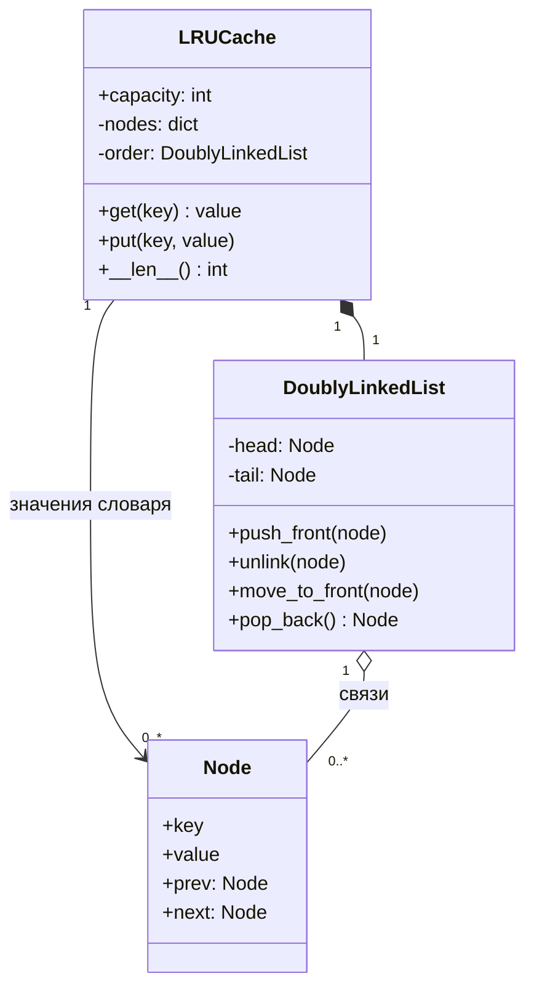

import { Aside } from '@astrojs/starlight/components';

LRU-кэш (least recently used) хранит фиксированное число записей. Когда места не остаётся, он вытесняет запись, к которой дольше всех не обращались ни на чтение, ни на запись. Задача проверяет, умеете ли вы совместить две структуры данных так, чтобы каждая операция выполнялась за `O(1)`. По сути это внутрипроцессная версия [кэша поисковых запросов](/practice/search-query-cache/).

<Aside type="tip" title="Коротко">
- `LRUCache` совмещает **словарь** (ключ → узел) для поиска за `O(1)` и **двусвязный список**, упорядоченный по свежести обращений.
- `get` и `put` переносят затронутый узел в **голову** списка. Вытесняется узел из **хвоста**.
- Главная идея: узел хранит **свой ключ**, поэтому после отцепления хвоста его можно за `O(1)` удалить из словаря.
- **Узлы-ограничители** (sentinels) в голове и хвосте убирают все особые случаи пустого списка.
- В рабочем коде на Python берите `OrderedDict` или `functools.lru_cache`. Список пишите руками, когда об этом просит интервьюер.
</Aside>

## Задача и ограничения

Нужен кэш результатов веб-поиска: по запросу вернуть закэшированный результат или ничего, сохранить новый результат, никогда не превышать `capacity` записей. Что уточнить:

- **Что считается «обращением»?** И чтение, и запись освежают запись. Промах — нет.
- **Что возвращает промах?** Здесь `None`. Если `None` может быть законным значением, нужен специальный маркер или исключение.
- **Ограничение по числу записей или по памяти?** Пока по числу. Бюджет в байтах — естественный дополнительный вопрос.
- **Устаревают ли записи?** В базовой версии TTL нет.
- **Потоки?** Сначала однопоточный вариант. Конкурентный доступ — классический дополнительный вопрос.

## Дизайн

- **`Node`**: ключ, значение и указатели `prev`/`next`.
- **`DoublyLinkedList`**: порядок по свежести. `push_front`, `unlink`, `move_to_front` и `pop_back` — это несколько присваиваний указателей, то есть `O(1)`.
- **`LRUCache`**: владеет словарём и списком, следит за ёмкостью и решает, когда вытеснять.



Зачем обе структуры? Словарь находит ключ за `O(1)`, но не знает, какой ключ самый старый, без полного просмотра. Список хранит порядок, но ищет ключ за `O(n)`. Словарь указывает прямо на узлы списка, поэтому узел можно отцепить из середины, не проходя список. Список нужен именно двусвязный: чтобы отцепить узел, нужен и предыдущий узел.

## Реализация

```python title="lru_cache.py"
from collections.abc import Hashable
from dataclasses import dataclass, field
from typing import Any


@dataclass(eq=False, slots=True)
class Node[K, V]:
    key: K  # храним ключ в узле, чтобы при вытеснении удалить запись из словаря
    value: V
    prev: "Node[K, V] | None" = field(default=None, repr=False)
    next: "Node[K, V] | None" = field(default=None, repr=False)


class DoublyLinkedList[K, V]:
    """В голове — самый свежий элемент, в хвосте — давно не использованный.

    Два узла-ограничителя убирают все проверки «а не пуст ли список?».
    """

    def __init__(self) -> None:
        self._head: Node[Any, Any] = Node(None, None)
        self._tail: Node[Any, Any] = Node(None, None)
        self._head.next, self._tail.prev = self._tail, self._head

    def push_front(self, node: Node[K, V]) -> None:
        first = self._head.next
        assert first is not None  # хвостовой ограничитель есть всегда
        node.prev, node.next = self._head, first
        self._head.next = first.prev = node

    def unlink(self, node: Node[K, V]) -> None:
        assert node.prev is not None and node.next is not None  # узел должен быть в списке
        node.prev.next, node.next.prev = node.next, node.prev
        node.prev = node.next = None

    def move_to_front(self, node: Node[K, V]) -> None:
        self.unlink(node)
        self.push_front(node)

    def pop_back(self) -> Node[K, V]:
        last = self._tail.prev
        if last is None or last is self._head:
            raise IndexError("pop from empty list")
        self.unlink(last)
        return last


class LRUCache[K: Hashable, V]:
    def __init__(self, capacity: int) -> None:
        if capacity < 1:
            raise ValueError("capacity must be at least 1")
        self.capacity = capacity
        self._nodes: dict[K, Node[K, V]] = {}
        self._order: DoublyLinkedList[K, V] = DoublyLinkedList()

    def __len__(self) -> int:
        return len(self._nodes)

    def get(self, key: K) -> V | None:
        node = self._nodes.get(key)
        if node is None:
            return None  # промах кэша
        self._order.move_to_front(node)  # чтение тоже считается использованием
        return node.value

    def put(self, key: K, value: V) -> None:
        node = self._nodes.get(key)
        if node is not None:
            node.value = value
            self._order.move_to_front(node)
            return
        if len(self._nodes) == self.capacity:
            evicted = self._order.pop_back()
            del self._nodes[evicted.key]
        node = Node(key, value)
        self._order.push_front(node)
        self._nodes[key] = node


if __name__ == "__main__":
    cache: LRUCache[str, str] = LRUCache(capacity=2)
    cache.put("q:python", "results-1")
    cache.put("q:rust", "results-2")
    assert cache.get("q:python") == "results-1"  # теперь python — самый свежий
    cache.put("q:go", "results-3")               # вытесняет rust — давно не использованный
    assert cache.get("q:rust") is None
    cache.put("q:python", "results-1b")          # обновление не меняет размер
    assert len(cache) == 2 and cache.get("q:python") == "results-1b"
    assert cache.get("q:go") == "results-3"
    print("ok")
```

### Через стандартную библиотеку

`OrderedDict` в Python сам по себе — словарь плюс двусвязный список. `move_to_end` и `popitem(last=False)` дают те же операции в несколько строк. Для мемоизации чистой функции есть `functools.lru_cache`: его внутренняя структура остаётся целостной при работе из нескольких потоков (хотя два потока всё равно могут одновременно вычислять одно и то же отсутствующее значение), а попадания и промахи он показывает через `cache_info()`.

```python title="lru_stdlib.py"
from collections import OrderedDict
from functools import lru_cache


class OrderedDictLRU[K, V]:
    def __init__(self, capacity: int) -> None:
        self.capacity = capacity
        self._data: OrderedDict[K, V] = OrderedDict()

    def get(self, key: K) -> V | None:
        if key not in self._data:
            return None
        self._data.move_to_end(key)  # самый свежий — в конце
        return self._data[key]

    def put(self, key: K, value: V) -> None:
        self._data[key] = value
        self._data.move_to_end(key)
        if len(self._data) > self.capacity:
            self._data.popitem(last=False)  # выбрасываем самый старый


@lru_cache(maxsize=1024)  # мемоизация чистой функции
def search(query: str) -> tuple[str, ...]:
    return (f"result for {query}",)
```

## Сложность и компромиссы

| Операция | Время | Комментарий |
|---|---|---|
| `get` (попадание или промах) | `O(1)` | Поиск в словаре и перестановка указателей |
| `put` (новая, обновление, вытеснение) | `O(1)` | Не больше одного вытеснения на вставку |
| Память | `O(capacity)` | Два указателя и вторая ссылка на ключ на запись |

- **Накладные расходы на запись.** Каждый узел — это два указателя и вторая ссылка на ключ. Для маленьких значений служебные данные могут оказаться больше самих данных.
- **LRU не всегда лучшая политика.** Один большой проход (пакетная задача, читающая каждый ключ по разу) вымывает всё горячее множество. LFU, 2Q, ARC или W-TinyLFU (её использует Caffeine) устойчивее к таким проходам. Подробнее — в [стратегиях кэширования](/caching/cache-strategies/).
- **Точный или приближённый LRU.** Redis не держит глобальный LRU-список. Он берёт случайную выборку ключей (`maxmemory-samples`, по умолчанию 5) и вытесняет самый старый из них. Это экономит память на каждом ключе и убирает конкуренцию за общий список, но иногда вытесняет не самый старый ключ.

## Возможные расширения

1. **Потокобезопасность.** Обернуть `get` и `put` в один `threading.Lock`. Блокировка нужна и в `get`, потому что он меняет список. При высокой конкуренции кэш **шардируют**: N независимых LRU, выбор по `hash(key) % N`, у каждого своя блокировка.
2. **TTL.** Хранить в узле время истечения. В `get` просроченную запись считать промахом и удалять. Дополнительно можно периодически чистить кэш в фоне или держать кучу по времени истечения.
3. **Бюджет памяти вместо числа записей.** Хранить `size_bytes` каждой записи и вытеснять из хвоста, пока новая запись не поместится. Одна большая вставка может вытеснить много мелких.
4. **Распределённый кэш.** Поставить LRU перед поисковым сервисом на многих узлах или вынести его в Redis или Valkey с `maxmemory-policy allkeys-lru`. Партиционирование и инвалидация рассмотрены в [разборе кэша поисковых запросов](/practice/search-query-cache/).
5. **Защита от лавины промахов** (cache stampede). Когда истекает горячий ключ, множество клиентов одновременно получают промах и бьют в бэкенд. Пересчитывать значение должен один клиент (блокировка на ключ или «single flight»), а остальные ждут или получают устаревшее значение.

<Aside type="note" title="На собеседовании">
- В первую же минуту скажите «хеш-таблица плюс двусвязный список» и объясните, зачем нужна каждая часть.
- Нарисуйте список с ограничителями и пройдите `put` в заполненный кэш: отцепить хвост → удалить из словаря → вставить новый узел в голову.
- Типичные ошибки: ключ не хранится в узле (при вытеснении нечем почистить словарь), забыли, что `get` меняет порядок, обновили существующий ключ без переноса в голову, ошиблись на единицу при проверке ёмкости.
- Если используете `OrderedDict`, скажите об этом сразу и предложите написать список вручную.
</Aside>

## Связанные темы

- [Проектируем хеш-таблицу](/ood/hash-map/): половина этого дизайна, отвечающая за поиск.
- [Стратегии кэширования](/caching/cache-strategies/): политики вытеснения, стратегии записи и инвалидация.
- [Уровни кэширования](/caching/caching-layers/): место внутрипроцессного кэша рядом с CDN, Redis и кэшем БД.
- [Кэш поисковых запросов](/practice/search-query-cache/): та же идея в масштабе многих машин.
