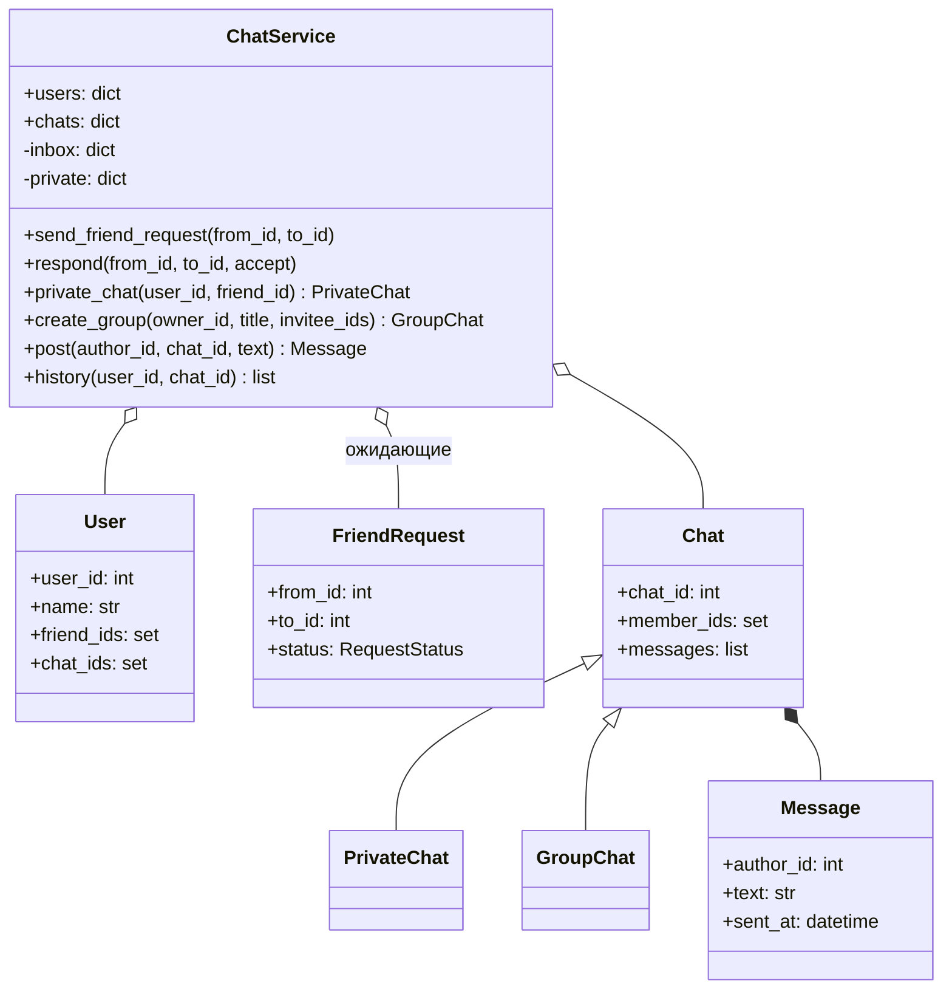

import { Aside } from '@astrojs/starlight/components';

«Спроектируйте онлайн-чат» может означать два совсем разных вопроса. На секции **объектно-ориентированного** дизайна интервьюер ждёт аккуратных классов для пользователей, дружбы, чатов и сообщений, где каждое правило проверяется в правильном месте. На секции **системного дизайна** те же слова означают WebSocket, рассылку (fan-out), хранилище и гарантии доставки для миллионов пользователей. Эта страница отвечает на первый вопрос и показывает, где начинается второй.

<Aside type="tip" title="Коротко">
- Сущности: `User`, `FriendRequest`, базовый `Chat` с наследниками `PrivateChat` и `GroupChat` и неизменяемое `Message`.
- Всеми ими владеет один `ChatService`. Он проверяет правила между пользователями: кто с кем может дружить, переписываться и кого куда приглашать.
- Главная идея, которая держит модель согласованной: сущности ссылаются друг на друга по **id**, а не по объекту. Дружба или членство меняются в одном месте, а модель потом напрямую ложится на таблицы базы данных.
- Личный чат ищется по **неупорядоченной паре** пользователей (`frozenset`), поэтому A→B и B→A всегда находят один и тот же чат.
</Aside>

## Задача и ограничения

Нужно спроектировать классы для текстового чата. Сценарии использования в рамках задачи:

- Добавлять пользователей; отправлять, принимать и отклонять заявки в друзья; удалять из друзей.
- Открывать личный чат 1:1 с другом; отправлять сообщения.
- Создавать групповой чат, приглашать друзей, выходить из группы; читать историю.

Что уточнить:

- **Обязаны ли собеседники в личном чате быть друзьями?** Здесь — да. В группу тоже можно пригласить только своего друга.
- **Что, если оба отправили заявки друг другу?** Вторая заявка считается принятием первой.
- **Один личный чат на пару или несколько?** Один. Повторное открытие возвращает существующий чат.
- **Медиа, отметки о прочтении, индикатор набора текста, статус «в сети»?** Вне рамок задачи. Только текст.
- **Масштаб?** Один процесс, всё в памяти. Масштабирование — отдельный вопрос (см. ниже).

## Дизайн

- **`User`** — id, имя, множества id друзей и id чатов. Никаких методов, лезущих в других пользователей.
- **`FriendRequest`** — отправитель, получатель, статус (`PENDING`, `ACCEPTED`, `REJECTED`), время.
- **`Chat`** — id, id участников, список сообщений. У **`PrivateChat`** ровно два постоянных участника. **`GroupChat`** добавляет название и владельца, и состав участников может меняться.
- **`Message`** — замороженный объект: id, id чата, id автора, текст, время. Отправленное сообщение не меняется (правки были бы новыми событиями).
- **`ChatService`** — реестр пользователей и чатов, «входящие» заявки в друзья и индекс личных чатов. Через него проходит любая операция, затрагивающая двух пользователей или проверку членства.



В исходном дизайне методы вроде `message_user` и `approve_friend_request` были и у `User`, и у `UserService`, а каждый пользователь хранил объекты других `User`. Логика дублировалась, и принятие заявки означало правку двух объектов изнутри одного из них. С id и единым сервисом каждое правило живёт в одном методе, а проверка доступа (`_chat_of_member`) общая для всех операций.

## Реализация

```python title="online_chat.py"
from collections import defaultdict
from dataclasses import dataclass, field
from datetime import UTC, datetime
from enum import Enum, auto
from itertools import count


def _now() -> datetime:
    return datetime.now(UTC)


class RequestStatus(Enum):
    PENDING = auto()
    ACCEPTED = auto()
    REJECTED = auto()


@dataclass(eq=False)
class User:
    user_id: int
    name: str
    friend_ids: set[int] = field(default_factory=set)
    chat_ids: set[int] = field(default_factory=set)


@dataclass
class FriendRequest:
    from_id: int
    to_id: int
    status: RequestStatus = RequestStatus.PENDING
    created_at: datetime = field(default_factory=_now)


@dataclass(frozen=True)
class Message:
    message_id: int
    chat_id: int
    author_id: int
    text: str
    sent_at: datetime = field(default_factory=_now)


@dataclass(eq=False)
class Chat:
    chat_id: int
    member_ids: set[int]
    messages: list[Message] = field(default_factory=list)


class PrivateChat(Chat):
    """Ровно два участника, состав не меняется."""


@dataclass(eq=False)
class GroupChat(Chat):
    title: str = ""
    owner_id: int = 0


class ChatService:
    """Владеет пользователями, заявками и чатами, поэтому правила между пользователями — в одном месте."""

    def __init__(self) -> None:
        self._ids = count(1)
        self.users: dict[int, User] = {}
        self.chats: dict[int, Chat] = {}
        # Ожидающие заявки: сначала по получателю, затем по отправителю — «входящие» за O(1).
        self._inbox: defaultdict[int, dict[int, FriendRequest]] = defaultdict(dict)
        self._private: dict[frozenset[int], PrivateChat] = {}  # пара пользователей -> чат

    # --- пользователи и друзья ----------------------------------------------
    def add_user(self, name: str) -> User:
        user = User(next(self._ids), name)
        self.users[user.user_id] = user
        return user

    def send_friend_request(self, from_id: int, to_id: int) -> FriendRequest:
        if from_id == to_id or to_id in self.users[from_id].friend_ids:
            raise ValueError("cannot befriend yourself or an existing friend")
        if to_id in self._inbox[from_id]:  # встречная заявка уже есть: принимаем
            return self.respond(to_id, from_id, accept=True)
        return self._inbox[to_id].setdefault(from_id, FriendRequest(from_id, to_id))

    def pending_requests(self, user_id: int) -> list[FriendRequest]:
        return list(self._inbox[user_id].values())

    def respond(self, from_id: int, to_id: int, *, accept: bool) -> FriendRequest:
        request = self._inbox[to_id].pop(from_id)  # KeyError, если заявки нет
        request.status = RequestStatus.ACCEPTED if accept else RequestStatus.REJECTED
        if accept:
            self.users[from_id].friend_ids.add(to_id)
            self.users[to_id].friend_ids.add(from_id)
        return request

    def remove_friend(self, user_id: int, friend_id: int) -> None:
        self.users[user_id].friend_ids.discard(friend_id)
        self.users[friend_id].friend_ids.discard(user_id)

    # --- чаты ----------------------------------------------------------------
    def private_chat(self, user_id: int, friend_id: int) -> PrivateChat:
        """Вернуть единственный личный чат двух друзей, создав его при первом обращении."""
        if friend_id not in self.users[user_id].friend_ids:
            raise PermissionError("private chats are between friends only")
        pair = frozenset((user_id, friend_id))
        if pair not in self._private:
            chat = PrivateChat(next(self._ids), set(pair))
            self._register(chat)
            self._private[pair] = chat
        return self._private[pair]

    def create_group(self, owner_id: int, title: str, invitee_ids: set[int]) -> GroupChat:
        chat = GroupChat(next(self._ids), {owner_id}, title=title, owner_id=owner_id)
        self._register(chat)
        for invitee in invitee_ids:
            self.invite(owner_id, chat.chat_id, invitee)
        return chat

    def invite(self, inviter_id: int, chat_id: int, invitee_id: int) -> None:
        chat = self._chat_of_member(chat_id, inviter_id)
        if not isinstance(chat, GroupChat):
            raise ValueError("members can only be added to group chats")
        if invitee_id not in self.users[inviter_id].friend_ids:
            raise PermissionError("you can only invite your friends")
        chat.member_ids.add(invitee_id)
        self.users[invitee_id].chat_ids.add(chat_id)

    def leave_group(self, user_id: int, chat_id: int) -> None:
        chat = self._chat_of_member(chat_id, user_id)
        if not isinstance(chat, GroupChat):
            raise ValueError("cannot leave a private chat")
        chat.member_ids.discard(user_id)
        self.users[user_id].chat_ids.discard(chat_id)

    def post(self, author_id: int, chat_id: int, text: str) -> Message:
        chat = self._chat_of_member(chat_id, author_id)
        message = Message(next(self._ids), chat_id, author_id, text)
        chat.messages.append(message)
        return message

    def history(self, user_id: int, chat_id: int, limit: int = 50) -> list[Message]:
        return self._chat_of_member(chat_id, user_id).messages[-limit:]

    def _register(self, chat: Chat) -> None:
        self.chats[chat.chat_id] = chat
        for member in chat.member_ids:
            self.users[member].chat_ids.add(chat.chat_id)

    def _chat_of_member(self, chat_id: int, user_id: int) -> Chat:
        chat = self.chats[chat_id]
        if user_id not in chat.member_ids:
            raise PermissionError(f"user {user_id} is not in chat {chat_id}")
        return chat


if __name__ == "__main__":
    svc = ChatService()
    ann, bob, cat = (svc.add_user(n) for n in ("Ann", "Bob", "Cat"))
    svc.send_friend_request(ann.user_id, bob.user_id)
    assert svc.pending_requests(bob.user_id)[0].from_id == ann.user_id
    svc.respond(ann.user_id, bob.user_id, accept=True)
    svc.send_friend_request(cat.user_id, ann.user_id)
    svc.send_friend_request(ann.user_id, cat.user_id)  # встречная заявка = дружба
    assert cat.user_id in ann.friend_ids

    dm = svc.private_chat(ann.user_id, bob.user_id)
    assert svc.private_chat(bob.user_id, ann.user_id) is dm  # один и тот же чат с обеих сторон
    svc.post(bob.user_id, dm.chat_id, "hi Ann")

    group = svc.create_group(ann.user_id, "Trip", {bob.user_id, cat.user_id})
    svc.post(cat.user_id, group.chat_id, "I'm in")
    try:
        svc.private_chat(bob.user_id, cat.user_id)  # Bob и Cat не друзья
    except PermissionError:
        pass
    else:
        raise AssertionError("expected PermissionError")
    svc.leave_group(cat.user_id, group.chat_id)
    assert [m.text for m in svc.history(ann.user_id, group.chat_id)] == ["I'm in"]
    print("ok")
```

## Сложность и компромиссы

| Операция | Время | Комментарий |
|---|---|---|
| Отправить, принять, отклонить заявку | `O(1)` | Словарь «входящих» на получателя |
| Открыть личный чат | `O(1)` | Индекс по паре `frozenset` |
| Отправить сообщение | `O(1)` | Добавление в список чата |
| История, последние `k` сообщений | `O(k)` | Срез с конца |
| Пригласить в группу | `O(1)` | Вставка в множество |

- **Id вместо ссылок на объекты.** Id добавляют поиск в словаре, но модель остаётся без циклов, легко сериализуется и потом ложится на таблицы: `users`, `friendships`, `chat_members`, `messages`.
- **Сообщения внутри объекта чата.** Просто и быстро в памяти, но история растёт без ограничений. Любая реальная версия читает историю постранично из хранилища и держит «горячими» только свежие сообщения.
- **Глобальный счётчик id.** Годится для одного процесса. Распределённой системе нужны id, уникальные без координации и примерно упорядоченные по времени, например в стиле Snowflake или UUIDv7.

## Возможные расширения

1. **Доставка пользователям в сети.** Добавить наблюдателя: `ChatService.post` сообщает `Notifier` список участников, а тот отправляет сообщение в открытое соединение каждого пользователя. Доменная модель ничего не знает о транспорте.
2. **Отметки о прочтении и счётчики непрочитанного.** Хранить «id последнего прочитанного сообщения» для пары (пользователь, чат). Непрочитанные — сообщения после этого id. Флаги на каждом сообщении не нужны.
3. **Блокировка и приватность.** Добавить пользователю множество `blocked_ids` и проверять его в `send_friend_request`, `private_chat` и `invite`. Все три уже проходят через сервис, так что правило ложится в одну вспомогательную функцию.
4. **Потокобезопасность.** Сообщения приходят из многих соединений одновременно. Нужна блокировка на чат для добавления сообщений и блокировка на уровне сервиса для изменений дружбы — или все команды одного чата обрабатывает один исполнитель (в стиле акторов). Второй вариант позволяет крупным чат-системам избегать конкуренции за блокировки.
5. **Переход к реальной системе.** Это уже версия вопроса для [системного дизайна](/practice/more-questions/). Клиенты держат постоянные соединения WebSocket (или HTTP/3) с серверами-шлюзами; сервис присутствия знает, к какому шлюзу подключён каждый пользователь; сообщения пишутся в партиционированный журнал или колоночное (wide-column) хранилище с ключом по id чата; большие группы рассылаются через [очередь сообщений](/async/queues-and-back-pressure/). Доставка «как минимум один раз» (at-least-once), поэтому клиенты убирают дубликаты по id сообщения. Классы с этой страницы становятся доменным слоем за этим API.

### ООП-вопрос и вопрос системного дизайна

| | Эта страница (ООП) | Распределённый чат (системный дизайн) |
|---|---|---|
| Фокус | Классы, ответственность, инварианты | Соединения, хранение, рассылка, доставка |
| Состояние | Словари в памяти | Партиционированная БД или журнал, кэши, хранилище присутствия |
| Сложность | Кто проверяет «только друзья» | Порядок, доставка офлайн, миллионы сокетов |
| Типичный доп. вопрос | Отметки о прочтении, блокировка | Группа на 100 000, синхронизация устройств, сквозное шифрование |

<Aside type="note" title="На собеседовании">
- Уточните, какой это вопрос про чат. Если ООП — скажите, что сеть опускаете, а масштаб оставляете на конец.
- Сначала перечислите сценарии и нарисуйте диаграмму классов, потом пишите код. Интервьюер проверяет, что каждое правило живёт ровно в одном месте.
- Ждите вопросов: «что, если оба отправили заявку?», «как найти личный чат двух пользователей?» и «куда добавить уведомления?».
- Типичные ошибки: пользователи хранят ссылки на других пользователей (циклы, дублирование состояния), личный чат хранится дважды (A→B и B→A), нет проверки членства перед отправкой сообщения.
</Aside>

## Связанные темы

- [Социальный граф](/practice/social-graph/): дружба и запросы к графу в масштабе.
- [Потоковая обработка событий](/async/event-streaming/): журналы для истории чата и рассылки.
- [Стили API](/communication/api-styles/): WebSocket, SSE и long polling для доставки сообщений.
- [Ещё задачи для практики](/practice/more-questions/): вопрос о распределённой системе чата.
