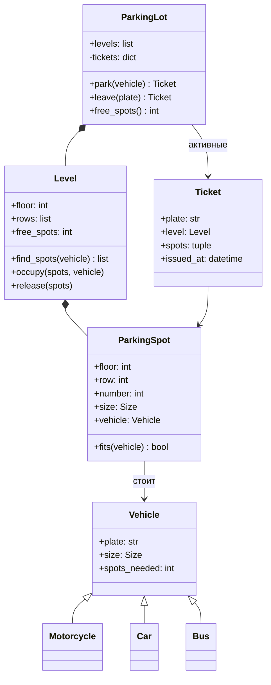

import { Aside } from '@astrojs/starlight/components';

Парковка — пожалуй, самая популярная задача на объектно-ориентированный дизайн. Она достаточно мала, чтобы успеть её закончить, но в ней есть настоящие решения: как моделировать размеры, кто решает, помещается ли машина, как искать место и как его потом освобождать. В исходном решении поиск места остался пустым, здесь он реализован.

<Aside type="tip" title="Коротко">
- `ParkingLot` → `Level` → ряды `ParkingSpot`. Подклассы `Vehicle` (`Motorcycle`, `Car`, `Bus`) несут только **размер** и **число мест**, которое им нужно.
- `Size` — **упорядоченное** перечисление. Тогда «помещается ли?» — одно сравнение `spot.size >= vehicle.size`, и ни одному классу транспорта не нужна своя логика.
- Транспорт на одно место занимает **самое маленькое** подходящее место (best fit) — так большие места остаются автобусам. Автобусу нужно **5 соседних** больших мест в одном ряду.
- `park` возвращает `Ticket`, который помнит этаж и места. `leave(plate)` по нему освобождает их за `O(spots)`.
</Aside>

## Задача и ограничения

Нужно спроектировать парковку, на которую можно ставить и с которой можно забирать транспорт. Что уточнить:

- **Какой транспорт?** Мотоцикл, легковой автомобиль, автобус.
- **Какие размеры мест?** Для мотоцикла, компактное, большое. Мотоцикл встаёт куда угодно, автомобиль — на компактное или большое, автобусу нужны пять больших мест подряд.
- **Несколько этажей?** Да. Сначала заполняется нижний.
- **Нужны ли оплата, шлагбаумы, табло?** В базовой версии — нет, но талон со временем въезда оставляет задел для оплаты.
- **Как опознать машину на выезде?** По номеру (или по талону).

## Дизайн

- **`Size`** — `IntEnum` `MOTORCYCLE < COMPACT < LARGE`. Он общий для мест и транспорта.
- **`Vehicle`** и подклассы — номер плюс атрибуты класса `size` и `spots_needed`. Грузовик добавляется классом из трёх строк.
- **`ParkingSpot`** — этаж, ряд, номер, размер и стоящая машина, если есть. `fits(vehicle)` проверяет, что место свободно и достаточно велико.
- **`Level`** — ряды мест, счётчик свободных и поиск (`find_spots`). Он же занимает и освобождает места, поэтому счётчик всегда верен.
- **`Ticket`** — номер машины, этаж, занятые места, время въезда.
- **`ParkingLot`** — этажи и индекс `номер → Ticket`. Отправляет `park` на первый этаж со свободными местами, а `leave` — сразу на нужный этаж.



Важнее всего два решения. Во-первых, правило «помещается ли» живёт в **одном месте** (`ParkingSpot.fits`) и задаётся данными, а не абстрактным `can_fit_in_spot`, повторённым в каждом подклассе транспорта. Во-вторых, связь машины с её местами хранит **талон**. Объект машины остаётся простым значением и не держит указатели во внутренности парковки.

## Реализация

```python title="parking_lot.py"
from dataclasses import dataclass, field
from datetime import UTC, datetime
from enum import IntEnum
from typing import ClassVar


class Size(IntEnum):
    """Размеры упорядочены: машина встаёт на любое место не меньше себя."""

    MOTORCYCLE = 1
    COMPACT = 2
    LARGE = 3


@dataclass(frozen=True)
class Vehicle:
    plate: str
    size: ClassVar[Size]
    spots_needed: ClassVar[int] = 1


class Motorcycle(Vehicle):
    size = Size.MOTORCYCLE


class Car(Vehicle):
    size = Size.COMPACT


class Bus(Vehicle):
    size = Size.LARGE
    spots_needed = 5  # пять соседних больших мест в одном ряду


@dataclass(eq=False)
class ParkingSpot:
    floor: int
    row: int
    number: int
    size: Size
    vehicle: Vehicle | None = None

    def fits(self, vehicle: Vehicle) -> bool:
        return self.vehicle is None and self.size >= vehicle.size


class Level:
    CODES: ClassVar[dict[str, Size]] = {"M": Size.MOTORCYCLE, "C": Size.COMPACT, "L": Size.LARGE}

    def __init__(self, floor: int, layout: list[str]) -> None:
        """layout: по строке на ряд, например "MMCCCLLLLL"."""
        self.floor = floor
        self.rows = [
            [ParkingSpot(floor, r, n, self.CODES[code]) for n, code in enumerate(row)]
            for r, row in enumerate(layout)
        ]
        self.free_spots = sum(len(row) for row in self.rows)

    def find_spots(self, vehicle: Vehicle) -> list[ParkingSpot] | None:
        if vehicle.spots_needed == 1:
            # Наилучшее совпадение: самое маленькое подходящее место бережёт большие для автобусов.
            candidates = (s for row in self.rows for s in row if s.fits(vehicle))
            best = min(candidates, key=lambda s: s.size, default=None)
            return [best] if best else None
        for row in self.rows:  # многоместным машинам нужен ряд соседних мест
            run: list[ParkingSpot] = []
            for spot in row:
                if not spot.fits(vehicle):
                    run = []
                    continue
                run.append(spot)
                if len(run) == vehicle.spots_needed:
                    return run
        return None

    def occupy(self, spots: list[ParkingSpot], vehicle: Vehicle) -> None:
        for spot in spots:
            spot.vehicle = vehicle
        self.free_spots -= len(spots)

    def release(self, spots: tuple[ParkingSpot, ...]) -> None:
        for spot in spots:
            spot.vehicle = None
        self.free_spots += len(spots)


@dataclass(frozen=True)
class Ticket:
    plate: str
    level: Level
    spots: tuple[ParkingSpot, ...]
    issued_at: datetime = field(default_factory=lambda: datetime.now(UTC))


class ParkingLot:
    def __init__(self, levels: list[Level]) -> None:
        self.levels = levels
        self._tickets: dict[str, Ticket] = {}  # номер -> активный талон

    def park(self, vehicle: Vehicle) -> Ticket | None:
        if vehicle.plate in self._tickets:
            raise ValueError(f"{vehicle.plate} is already parked")
        for level in self.levels:
            if level.free_spots < vehicle.spots_needed:
                continue  # дёшево пропускаем заполненные этажи
            spots = level.find_spots(vehicle)
            if spots:
                level.occupy(spots, vehicle)
                ticket = Ticket(vehicle.plate, level, tuple(spots))
                self._tickets[vehicle.plate] = ticket
                return ticket
        return None  # для машины такого размера мест нет

    def leave(self, plate: str) -> Ticket:
        ticket = self._tickets.pop(plate)  # KeyError, если машины здесь нет
        ticket.level.release(ticket.spots)
        return ticket

    def free_spots(self) -> int:
        return sum(level.free_spots for level in self.levels)


if __name__ == "__main__":
    lot = ParkingLot([Level(0, ["MCCLLLLL"]), Level(1, ["CCLLLLLL"])])
    t_car = lot.park(Car("CAR-1"))
    assert t_car and t_car.spots[0].size is Size.COMPACT        # наилучшее совпадение, а не большое место
    t_bus = lot.park(Bus("BUS-1"))
    assert t_bus and [s.number for s in t_bus.spots] == [3, 4, 5, 6, 7]
    assert lot.park(Bus("BUS-2")).level.floor == 1              # на этаже 0 не осталось пяти мест подряд
    assert lot.park(Bus("BUS-3")) is None
    lot.park(Motorcycle("MOTO-1"))
    lot.leave("BUS-1")
    assert lot.park(Bus("BUS-3")) is not None                     # освобождённый ряд снова занят
    assert lot.free_spots() == 16 - 1 - 5 - 5 - 1
    print("ok")
```

## Сложность и компромиссы

Для `L` этажей и `S` мест на этаже:

| Операция | Время | Комментарий |
|---|---|---|
| `park` | `O(L · S)` в худшем случае | Заполненные этажи пропускаются по счётчику |
| `leave` | `O(k)` | `k` мест этой машины, через талон |
| `free_spots` | `O(L)` | Счётчики по этажам |

- **Перебор или списки свободных мест.** Перебрать несколько сотен мест на этаже — мгновенно. Для гаража на 10 000 мест держат множество свободных мест для каждого размера на каждом этаже, и парковка на одно место становится `O(1)`. Автобусу всё равно нужен непрерывный участок: его проще всего искать перебором рядов больших мест (или хранить свободные участки в структуре интервалов).
- **Наилучшее или первое подходящее.** Best fit бережёт большие места, но просматривает весь этаж. First fit быстрее, но может оставить автобус без места. Автобусу нужен целый ряд больших мест, поэтому здесь best fit стоит своих затрат.
- **Сначала нижний этаж** — простое правило. Реальный гараж может предпочитать этаж поближе к въезду или распределять машины равномерно, чтобы не было очередей на пандусах. Если интервьюер туда клонит, сделайте это стратегией.

## Возможные расширения

1. **Оплата.** `Ticket.issued_at` и тариф `Rate` для каждого размера дают сумму на выезде. Оплату лучше сделать отдельным сервисом, который принимает закрытые талоны.
2. **Шлагбаумы и табло.** Шлагбаумы вызывают `park`/`leave`. Табло читают число свободных мест по этажам и размерам. Счётчики по размерам избавляют табло от перебора.
3. **Конкурентный доступ.** Через несколько въездов машины паркуются одновременно. Нужна блокировка на этаж, и «найти + занять» должно выполняться под одной блокировкой, иначе двум машинам выдадут одно место. В версии с базой данных это транзакция с `SELECT … FOR UPDATE SKIP LOCKED`.
4. **Бронирование и зарядка электромобилей.** Добавить атрибут места (`reserved_for`, `has_charger`) и учитывать его в `fits`. Если правил станет много, вынести их в отдельный объект-политику.
5. **Городское приложение для парковки.** Много парковок, свободные места в реальном времени и бронирование превращают задачу в вопрос системного дизайна: парковки публикуют события о занятости, центральный сервис их агрегирует, а бронирование требует [идемпотентных](/reliability/resilience-patterns/) API.

<Aside type="note" title="На собеседовании">
- Сначала уточните типы транспорта, размеры мест и правило для автобуса. Запишите их маленькой таблицей.
- Покажите приём с упорядоченным перечислением: он заменяет страницу условий `if` и упрощает добавление новых размеров.
- Обычно спрашивают: «Как быстро найти место в большом гараже?», «Две машины приехали одновременно?» и «Как добавить оплату?».
- Типичные ошибки: при выезде не освобождают места и не обновляют счётчики, автобус занимает пять больших мест, которые не стоят рядом.
</Aside>

## Связанные темы

- [Проектируем колл-центр](/ood/call-center/): распределение работы по подходящим свободным ресурсам.
- [Проектируем хеш-таблицу](/ood/hash-map/): индекс «номер → талон» — это поиск в хеш-таблице.
- [Паттерны отказоустойчивости](/reliability/resilience-patterns/): идемпотентность и повторные попытки, когда парковка становится сетевым сервисом.
