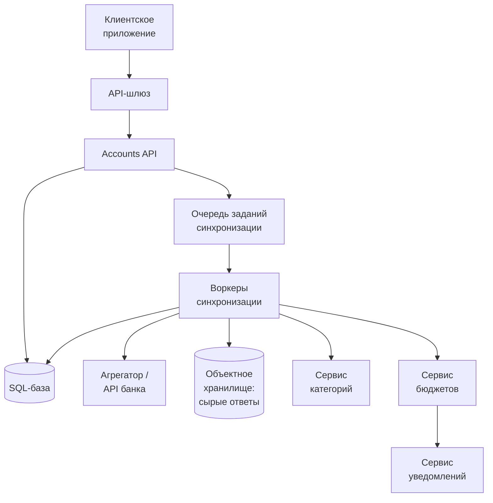
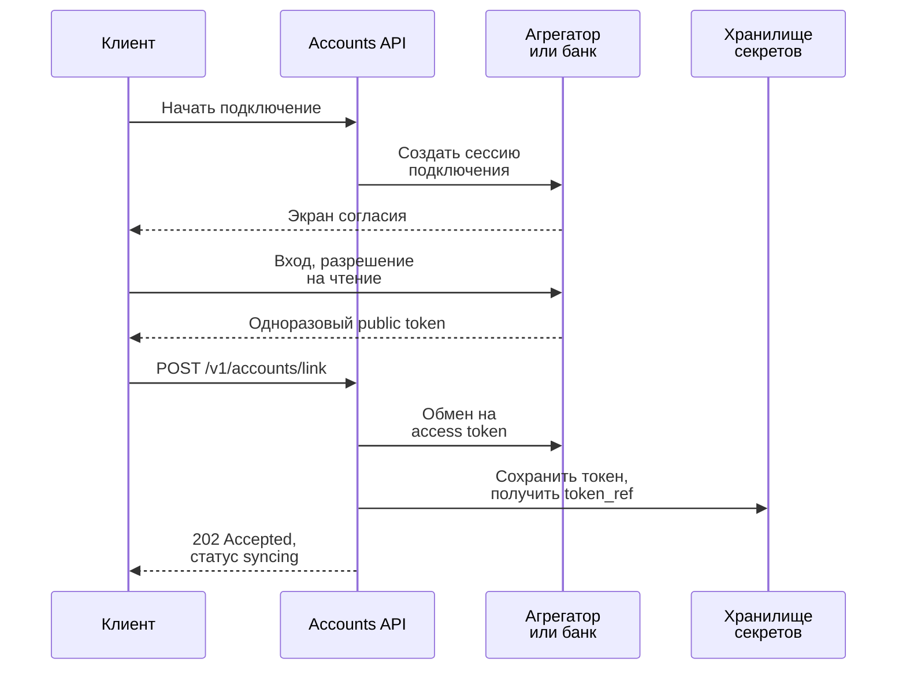
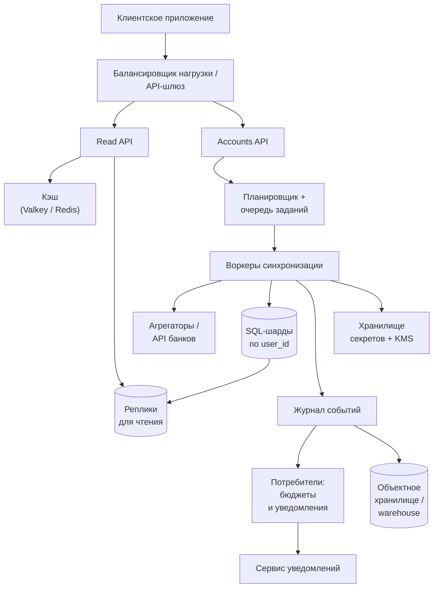

import { Aside } from '@astrojs/starlight/components';

Трекер личных финансов собирает транзакции со всех банковских, карточных и брокерских счетов
пользователя, раскладывает их по категориям и предупреждает, что бюджет заканчивается. Самый
известный пример — Mint.com. Intuit закрыл его в марте 2024 года и перевёл пользователей в
Credit Karma, но та же задача теперь решается внутри приложений для учёта бюджета и банковских
приложений. На собеседованиях её любят, потому что почти все данные приходят из систем, которые
мы не контролируем. Сложности здесь в асинхронной загрузке, идемпотентности, категоризации и
изоляции финансовых данных одного пользователя от всех остальных.

<Aside type="tip" title="Коротко">
- Пользователь подключает счёт через агрегатор или open banking API банка с OAuth-согласием. Мы храним **ссылку на токен в хранилище секретов**, а пароль от банка не храним никогда.
- Загрузка транзакций — **асинхронный конвейер**. Планировщик и вебхуки провайдера кладут задания в очередь. Воркеры синхронизации забирают изменения по курсору и идемпотентно делают upsert.
- Категоризация идёт по цепочке **правило пользователя → справочник продавцов → MCC → ML-модель**. Бюджеты — это накопительные агрегаты, уведомление уходит только при пересечении порога.
- Оперативные данные лежат в **SQL, шардированном по `user_id`**, с защитой на уровне строк (row-level security) как страховкой. Сырые ответы провайдеров и история уходят в объектное хранилище и хранилище данных (warehouse), дашборды читаются через кэш.
</Aside>

## Шаг 1 — Требования и ограничения

### Сценарии использования

В рамках задачи:

- **Пользователь** подключает финансовый счёт (банк, кредитная карта, брокер) через экран согласия провайдера.
- **Сервис** загружает транзакции в трёх случаях: при подключении (с историей за прошлые месяцы), по запросу пользователя и раз в сутки для тех, кто заходил за последние 30 дней.
- **Сервис** присваивает каждой транзакции категорию. Пользователь может её изменить, и сервис никогда не перекатегоризирует такую транзакцию сам.
- **Сервис** считает траты по категориям за месяц.
- **Сервис** предлагает бюджет. Пользователь может задать свой, и сервис уведомляет его о приближении к лимиту или превышении. Мгновенность не требуется.
- **Пользователь** смотрит дашборды и последние транзакции.

Вне рамок: переводы денег, оплата счетов, кредитный рейтинг, инвестиционные советы, продуктовая аналитика.

### Нефункциональные требования

- **Доступность:** дашборды читаются, даже когда банк или агрегатор недоступен. Загрузка может отставать на минуты или часы.
- **Корректность:** транзакции не дублируются и не теряются. Деньги хранятся целыми числами в минимальных единицах (центах, копейках), никогда не во float.
- **Безопасность и приватность:** данные регулируемые. Токены защищены, арендаторы (tenants) строго изолированы, доступ журналируется.
- **Устойчивость к внешним системам:** провайдеры ограничивают частоту запросов, падают, задним числом меняют данные и просят пользователя заново дать согласие.

### Допущения

- 10 млн пользователей, 30 млн подключённых счетов.
- 5 млрд транзакций в месяц. Это 500 на пользователя в месяц — с запасом, поэтому считаем цифру стрессовой.
- 500 млн запросов на чтение в месяц, то есть записей в 10 раз больше, чем чтений. Тратят деньги каждый день, а в приложение заходят редко.
- Нагрузка неравномерная. Счета добавляют и удаляют редко.
- 10 категорий бюджета на пользователя (100 млн статей бюджета) и 50 000 известных продавцов для начального справочника.

### Прикидочный расчёт («на салфетке»)

| Величина | Расчёт | Результат |
|---|---|---|
| Запись транзакций | 5 млрд ÷ 2,592 млн с в месяце | ≈ 1 930/с в среднем, в пике закладываем ≈ 10 000/с |
| Чтения | 500 млн ÷ 2,592 млн с | ≈ 190/с в среднем, ≈ 1 000/с в пике |
| Фоновые синхронизации | 30 млн счетов × ~50 % активных | 15 млн/сутки ≈ 175/с, или ≈ 700/с в 6-часовом окне |
| Строка транзакции | id, сумма, валюта, продавец, категория, флаги | ≈ 175 Б, ≈ 350 Б с индексами |
| Новые данные | 5 млрд × 350 Б | ≈ 1,75 ТБ/мес, ≈ 63 ТБ за 3 года |
| Месячные агрегаты | 10 млн × 10 категорий | ≤ 100 млн строк/мес (≈ 5 ГБ при ~50 Б на строку) |
| Справочник продавцов | 50 000 × 255 Б | ≈ 12,8 МБ, помещается в память каждого воркера |

<Aside type="note" title="О классических цифрах">
Часто цитируемые «2 000 записей в секунду» получаются, если округлить месяц до 2,5 млн секунд.
Для 30-дневного месяца выходит около 1 930/с, разница несущественна. Важнее размер строки.
50 байт (250 ГБ в месяц, 9 ТБ за три года) не учитывают id, валюту, категорию и индексы.
Реалистичная строка с индексами примерно в 7 раз больше, и от этого зависит, сколько истории
можно держать в «горячей» базе.
</Aside>

## Шаг 2 — Высокоуровневый дизайн



1. **Accounts API** отвечает за подключение. Он сохраняет метаданные счёта и ссылку на токен доступа, затем ставит в очередь задание на загрузку истории.
2. **Воркеры синхронизации** берут задания из очереди и запрашивают у провайдера новые, изменённые и удалённые транзакции. Каждый сырой ответ сохраняется в **объектное хранилище** для повторной обработки и аудита.
3. Каждая транзакция получает категорию от **сервиса категорий** и записывается в **SQL-базу** через upsert.
4. **Сервис бюджетов** обновляет месячные суммы. При пересечении порога **сервис уведомлений** отправляет уведомление — через очередь и пачками, а не синхронно.

Загрузка асинхронная, потому что одна синхронизация может занять от секунд до минут. Банки
медленные, отдают данные множеством страниц и иногда не отвечают. Пользователь получает
`202 Accepted` и видит, как данные появляются по мере поступления.

## Шаг 3 — Ключевые компоненты

### Подключение счёта

Пароль от банка мы не собираем. Пользователь входит на странице банка или агрегатора и
разрешает доступ на чтение. Наш бэкенд получает короткоживущий одноразовый токен и обменивает
его на долгоживущий токен доступа.



```http title="Запрос на подключение"
POST /v1/accounts/link
Content-Type: application/json

{"public_token": "public-7f3c...", "institution_id": "ins_1042"}
```

```json title="Ответ: 202 Accepted"
{"accounts": [{"account_id": "acc_9f2", "mask": "4821", "status": "syncing"}]}
```

### Модель данных

Ключ оперативных таблиц начинается с пользователя: любой запрос пользователя касается только его данных.

```sql title="schema.sql"
CREATE TABLE linked_accounts (
  account_id      bigint PRIMARY KEY,
  user_id         bigint NOT NULL REFERENCES users(user_id),
  provider        text   NOT NULL,          -- агрегатор или API банка
  provider_item   text   NOT NULL,          -- id подключения у провайдера
  token_ref       text   NOT NULL,          -- ссылка в хранилище секретов, не сам токен
  sync_cursor     text,                     -- последний курсор от провайдера
  status          text   NOT NULL,          -- active | reauth_required | revoked
  consent_expires timestamptz,
  last_synced_at  timestamptz
);

CREATE TABLE transactions (
  user_id         bigint  NOT NULL,
  txn_id          bigint  NOT NULL,
  account_id      bigint  NOT NULL,
  provider_txn_id text    NOT NULL,
  posted_on       date    NOT NULL,
  amount_minor    bigint  NOT NULL,         -- центы; деньги никогда не во float
  currency        char(3) NOT NULL,
  merchant_raw    text    NOT NULL,
  merchant_id     bigint,
  category        text    NOT NULL,
  category_source text    NOT NULL,         -- user | rule | mcc | model
  pending         boolean NOT NULL,
  PRIMARY KEY (user_id, txn_id),
  UNIQUE (account_id, provider_txn_id)      -- повторная загрузка идемпотентна
);
CREATE INDEX ON transactions (user_id, posted_on DESC);

CREATE TABLE monthly_spending (
  user_id      bigint NOT NULL,
  month        date   NOT NULL,             -- первое число месяца
  category     text   NOT NULL,
  amount_minor bigint NOT NULL,
  PRIMARY KEY (user_id, month, category)
);
```

В старых решениях хранили логин от банка и хеш пароля. Но по хешу в банк не войти, а пароль в
открытом виде — именно то, что согласие в open banking и должно заменить. У нас в базе есть
только `token_ref`.

### Конвейер загрузки

Задание на синхронизацию появляется в четырёх случаях: новое подключение (загрузка истории,
часто до 24 месяцев), ручное обновление, ежедневный планировщик и вебхук провайдера о новых
данных. Дальше воркер:

1. **Убирает дубли.** Для одного счёта одновременно идёт только одна синхронизация — это обеспечивает аренда (lease) по `account_id`. Лишние запуски сливаются с уже идущим.
2. **Берёт токен** из хранилища секретов. Расшифровать его могут только воркеры синхронизации.
3. **Забирает изменения инкрементально** по сохранённому курсору. Современные API агрегаторов отдают страницы *добавленных*, *изменённых* и *удалённых* транзакций и следующий курсор, поэтому историю заново не качаем.
4. **Сохраняет сырую страницу** в объектное хранилище. Если в парсере найдут ошибку, данные можно переобработать.
5. **Нормализует и категоризирует.** Чистит строку продавца и сопоставляет её с `merchant_id`.
6. **Делает upsert** по `(account_id, provider_txn_id)`, **в той же транзакции** сохраняет новый курсор и пишет событие `TransactionChanged` в таблицу outbox. Позже ретранслятор публикует его в журнал событий.

От двух деталей зависит корректность:

- **Pending → posted.** Карточная операция обычно появляется как *ожидающая* (pending) и проводится через несколько дней. Некоторые провайдеры при этом удаляют pending-запись и добавляют новую, проведённую. Поэтому бюджеты должны быть обратимыми: удаление вычитает то, что прибавило добавление.
- **Повторные попытки.** Внешние системы сбоят часто. Нужны экспоненциальная задержка (backoff) со случайным разбросом (jitter), предохранитель (circuit breaker) на каждый банк и лимит параллельных запросов к нему. Если согласие истекло, счёт помечается `reauth_required` и пользователя просят переподключиться — повторы тут не помогут.

### Категоризация

Сначала пробуем самые дешёвые и надёжные сигналы:

1. **Правило пользователя.** «Costco для меня — продукты» побеждает всегда.
2. **Справочник продавцов.** Изначально в нём топ-50 000 продавцов, дальше он пополняется из исправлений пользователей. Если не меньше 70 % из 50+ разных пользователей одинаково поменяли категорию продавца, исправление попадает в справочник.
3. **MCC.** Код категории продавца из карточной сети, если провайдер его передаёт.
4. **ML-модель.** Классификатор по строке продавца, сумме и MCC. Ниже порога уверенности транзакция остаётся «Без категории», и мы спрашиваем пользователя.

```python title="categorize.py"
from dataclasses import dataclass
from decimal import Decimal
from enum import StrEnum
from typing import Protocol


class Category(StrEnum):
    HOUSING = "housing"
    GROCERIES = "groceries"
    FUEL = "fuel"
    SHOPPING = "shopping"
    UNCATEGORIZED = "uncategorized"


@dataclass(frozen=True)
class Transaction:
    user_id: int
    merchant: str          # нормализованное имя продавца, например "shell"
    mcc: str | None        # код категории продавца (MCC), если есть
    amount: Decimal        # положительное значение = расход


class Model(Protocol):
    def predict(self, txn: Transaction) -> tuple[Category, float]: ...


class Categorizer:
    """Порядок: правило пользователя > справочник > MCC > ML-модель."""

    def __init__(self, user_rules: dict[tuple[int, str], Category],
                 merchants: dict[str, Category], mcc_map: dict[str, Category],
                 model: Model, min_confidence: float = 0.7) -> None:
        self.user_rules = user_rules
        self.merchants = merchants
        self.mcc_map = mcc_map
        self.model = model
        self.min_confidence = min_confidence

    def categorize(self, txn: Transaction) -> Category:
        if (rule := self.user_rules.get((txn.user_id, txn.merchant))) is not None:
            return rule
        if (cat := self.merchants.get(txn.merchant)) is not None:
            return cat
        if txn.mcc and (cat := self.mcc_map.get(txn.mcc)) is not None:
            return cat
        cat, confidence = self.model.predict(txn)
        return cat if confidence >= self.min_confidence else Category.UNCATEGORIZED
```

Многие агрегаторы сейчас сами возвращают категорию с уровнем уверенности. Это ещё один сигнал в
цепочке, а не окончательный ответ.

### Бюджеты и уведомления

Бюджет по умолчанию — шаблон: доли дохода по категориям. Храним только те категории, которые
пользователь изменил, а не все 100 млн статей бюджета. Месячные траты считаются
**инкрементально**. Каждое событие `TransactionChanged` прибавляет свою сумму к
`monthly_spending` или вычитает её, а ночная задача пересчитывает итоги по `transactions` и
исправляет расхождения. Это та же классическая идея «MapReduce по журналам транзакций»,
разделённая на потоковую и пакетную части.

```python title="budget.py"
from collections import defaultdict
from dataclasses import dataclass
from decimal import Decimal
from enum import StrEnum


class Alert(StrEnum):
    NEARING = "nearing"
    EXCEEDED = "exceeded"


@dataclass(frozen=True)
class Spend:
    user_id: int
    month: str        # "2026-10"
    category: str
    amount: Decimal


def monthly_totals(events: list[Spend]) -> dict[tuple[int, str, str], Decimal]:
    """Шаг reduce: сумма трат по (пользователь, месяц, категория)."""
    totals: dict[tuple[int, str, str], Decimal] = defaultdict(Decimal)
    for e in events:
        totals[(e.user_id, e.month, e.category)] += e.amount
    return totals


def check_budget(before: Decimal, after: Decimal, limit: Decimal,
                 threshold: Decimal = Decimal("0.8")) -> Alert | None:
    """Срабатывает только при пересечении порога — уведомление уходит один раз."""
    if before <= limit < after:
        return Alert.EXCEEDED
    if before < limit * threshold <= after <= limit:
        return Alert.NEARING
    return None
```

У каждого уведомления есть ключ идемпотентности `(user, category, month, level)`, поэтому
повторно обработанное событие не отправит его дважды. Уведомления идут через очередь и могут
собираться в ежедневную сводку.

### Безопасность и изоляция арендаторов

- **Токены:** хранятся в хранилище секретов с конвертным шифрованием (envelope encryption). Ключ в KMS шифрует ключи данных каждой записи. Расшифровать может только сервисная учётная запись воркеров, и каждая расшифровка журналируется.
- **Изоляция арендаторов:** уровень доступа к данным добавляет `user_id` в каждый запрос. Защита на уровне строк в PostgreSQL (`CREATE POLICY ... USING (user_id = current_setting('app.user_id')::bigint)`) ловит запрос, где фильтр забыли.
- **Минимум данных:** номера карт и учётные данные банка не храним вовсе. Строки продавцов и суммы шифруем на диске. При отключении счёта или удалении аккаунта удаляем всё, включая сырые ответы.
- **Вебхуки:** проверяем подпись провайдера. Вебхук — лишь повод синхронизироваться, а не данные, которым можно верить.
- **Вход пользователя:** passkeys или MFA, короткие сессии и повторная аутентификация (step-up) перед подключением новых счетов.

## Шаг 4 — Масштабирование

Сначала нагрузочное тестирование, потом устраняем узкие места по одному.

1. **Чтение дашбордов (≈ 1 000/с в пике).** Месячные агрегаты и последнюю страницу транзакций кладём в кэш, например Valkey или Redis, с ключом по пользователю (cache-aside). Инвалидация — по событию `TransactionChanged`. Промахи кэша берут на себя реплики для чтения.
2. **Запись транзакций (≈ 10 000 строк/с в пике плюс обновление индексов).** Одному основному узлу с комфортным запасом это не по силам. Шардируем по `user_id`, чтобы счета, транзакции и агрегаты пользователя жили на одном шарде и каждый запрос оставался в пределах одного шарда. Внутри шарда разбиение `transactions` на партиции по месяцам позволяет дёшево отсоединять старые месяцы. В PostgreSQL месяц тогда должен входить в первичный и уникальный ключи, поэтому партиционируем по дате, которая у транзакции никогда не меняется (например, по дню, когда мы её впервые увидели), иначе смена даты при переходе pending → posted может обойти ключ дедупликации.
3. **Рост объёма (≈ 63 ТБ за 3 года).** «Горячими» в OLTP держим примерно 13 месяцев — около 23 ТБ на все шарды. Старые месяцы выгружаем в Parquet в объектное хранилище и запрашиваем через хранилище данных. Сырые ответы по правилу жизненного цикла переезжают в более холодные классы хранения.
4. **Ограничения провайдеров — настоящее узкое место.** Провайдеры ограничивают частоту запросов по клиенту и по банку. Планировщик равномерно распределяет ежедневные синхронизации по суткам по хешу `user_id`, держит token bucket на каждый банк и предпочитает вебхуки опросу.
5. **Агрегация.** Вместо ночного MapReduce по файлам журналов — поток. Журнал событий за секунды доставляет изменения потребителям бюджетов, а пакетная задача в хранилище данных занимается сверкой и аналитикой.



| Добавленный компонент | Что даёт | Чего стоит |
|---|---|---|
| Кэш | Быстрые дашборды, сглаживает пики | Логика инвалидации, кратковременная устарелость |
| Шардирование по `user_id` | Линейный рост записи, малый радиус поражения | Решардинг, нет дешёвых запросов по многим пользователям |
| Журнал событий + потребители | Бюджеты почти в реальном времени, слабая связность | Доставка «хотя бы раз» — нужны идемпотентные потребители |
| Хранилище данных / lakehouse | Дешёвая история, аналитика вне OLTP | Ещё одна копия чувствительных данных, которую надо защищать |
| Планировщик с лимитами по банкам | Укладываемся в лимиты провайдеров | Больше логики планирования, которую надо писать и поддерживать |

## Что изменилось к 2026 году

- **API вместо скрейпинга.** Агрегаторы эпохи Mint заходили на сайт банка с сохранённым паролем пользователя. Теперь доступ к счетам всё чаще идёт через API на основе согласия:
  - **ЕС:** PSD2 сделала банковские API обязательными. По пакету PSD3 и Payment Services Regulation в ноябре 2025 года достигнуто предварительное соглашение, а в мае 2026 года его одобрил комитет ECON Европарламента. В последних найденных сводках (конец августа 2026 года) голосование на пленарной сессии и формальное принятие всё ещё значились как предстоящие; большинство норм начнёт применяться примерно через 21 месяц после вступления в силу.
  - **Великобритания:** режим open banking переходит на законодательную основу в рамках Data (Use and Access) Act 2025.
  - **США:** отраслевой стандарт API FDX. Правило CFPB по Section 1033 утвердили в октябре 2024 года, затем отправили на пересмотр, а в конце 2025 года суд запретил его применять. 4 августа 2026 года OIRA получило на проверку новый проект, и в середине октября проверка ещё шла, так что его содержание пока не опубликовано.

  Проектируем с учётом **повторного согласия**, **истечения согласия** и **платы за вызовы**: JPMorgan Chase по соглашениям осени 2025 года начал брать с крупных агрегаторов плату за доступ к данным.
- **Подключения покупают.** Мало кто сам интегрируется с тысячами банков. Берут одного-двух агрегаторов за внутренним интерфейсом провайдера, чтобы переключаться между ними при сбое или смене поставщика.
- **Курсорная синхронизация и вебхуки** заменили «каждую ночь скачать последние 30 дней». Провайдер сообщает о добавлениях, изменениях и удалениях, поэтому переход pending → posted виден явно.
- **Потоки плюс lakehouse** вместо ночного MapReduce. Типичный набор: Kafka или управляемый журнал, простые потребители или Flink, таблицы Iceberg или Delta, запросы из BigQuery, Snowflake или Redshift.
- **Управляемый или распределённый SQL.** Aurora, AlloyDB, Citus, CockroachDB или Spanner берут на себя шардирование и переключение на резерв (failover), которые раньше писали вручную.
- **Модели категоризации** на горячем пути — небольшие классификаторы или модели эмбеддингов. Большие языковые модели помогают офлайн: размечают «длинный хвост» продавцов и предлагают записи в справочник, но для каждой транзакции они слишком медленные и дорогие.
- **Базовый уровень безопасности:** FAPI 2.0 Security Profile (финальная версия 2025 года) требует PAR, PKCE и привязанные к отправителю токены. Лучшие практики безопасности OAuth опубликованы как RFC 9700.
- **Что не изменилось:** асинхронная загрузка через очередь, разбиение данных по пользователю, идемпотентный upsert, заранее посчитанные месячные таблицы и чтение по схеме cache-aside.

<Aside type="note" title="На собеседовании">
- **Как избежать дублей транзакций?** Уникальный ключ по id транзакции провайдера в пределах счёта, upsert и сохранение курсора в той же транзакции БД.
- **Банк лежит 6 часов. Что будет?** Для этого банка срабатывает предохранитель, задания откладываются. Дашборды показывают «обновлено в …», остальное не затронуто.
- **Пользователь сменил категорию транзакции.** Записываем правило пользователя, правим обе затронутые месячные суммы и при необходимости заново проверяем уведомления. Выбор пользователя никогда не перезаписываем автоматически.
- **Почему не считать бюджеты только ночным пакетом?** Уведомления приходили бы на сутки позже. Поток делает их своевременными, а пакет по-прежнему исправляет расхождения.
- **Где хранятся учётные данные?** Нигде. Есть только токены согласия, зашифрованные в хранилище секретов, и расшифровать их может один сервис.
- **Типичные ошибки:** float для денег, полный просмотр транзакций при каждом открытии страницы, синхронные вызовы банка внутри запроса пользователя, доверие к содержимому вебхуков.
</Aside>

## Что почитать

- [FAPI 2.0 Security Profile](https://openid.net/specs/fapi-security-profile-2_0-final.html) — профиль безопасности современных open banking API.
- [RFC 9700: Best Current Practice for OAuth 2.0 Security](https://www.rfc-editor.org/rfc/rfc9700.html)
- [CFPB: Personal financial data rights (Section 1033)](https://www.consumerfinance.gov/personal-financial-data-rights/)
- [Financial Data Exchange (FDX)](https://financialdataexchange.org/) — отраслевой стандарт API в США.
- [Plaid: вебхуки и синхронизация транзакций](https://plaid.com/docs/transactions/webhooks/) — конкретный пример инкрементальной синхронизации по курсору.
- [PostgreSQL: row security policies](https://www.postgresql.org/docs/current/ddl-rowsecurity.html)

## Связанные темы

- [Очереди и обратное давление](/async/queues-and-back-pressure/) — очередь заданий синхронизации и повторные попытки.
- [Потоковая передача событий](/async/event-streaming/) — журнал событий о транзакциях, который питает бюджеты.
- [Партиционирование и шардирование](/data/partitioning-and-sharding/) — шардирование по `user_id`.
- [Стратегии кэширования](/caching/cache-strategies/) — cache-aside для дашбордов и инвалидация.
- [Безопасность](/reliability/security/) — секреты, шифрование, изоляция арендаторов.
- [Паттерны устойчивости](/reliability/resilience-patterns/) — backoff и предохранители для каждого банка.
