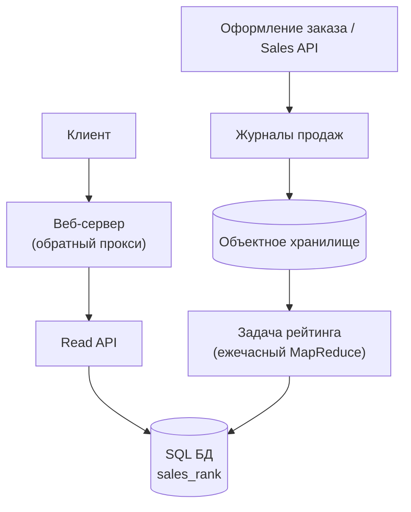
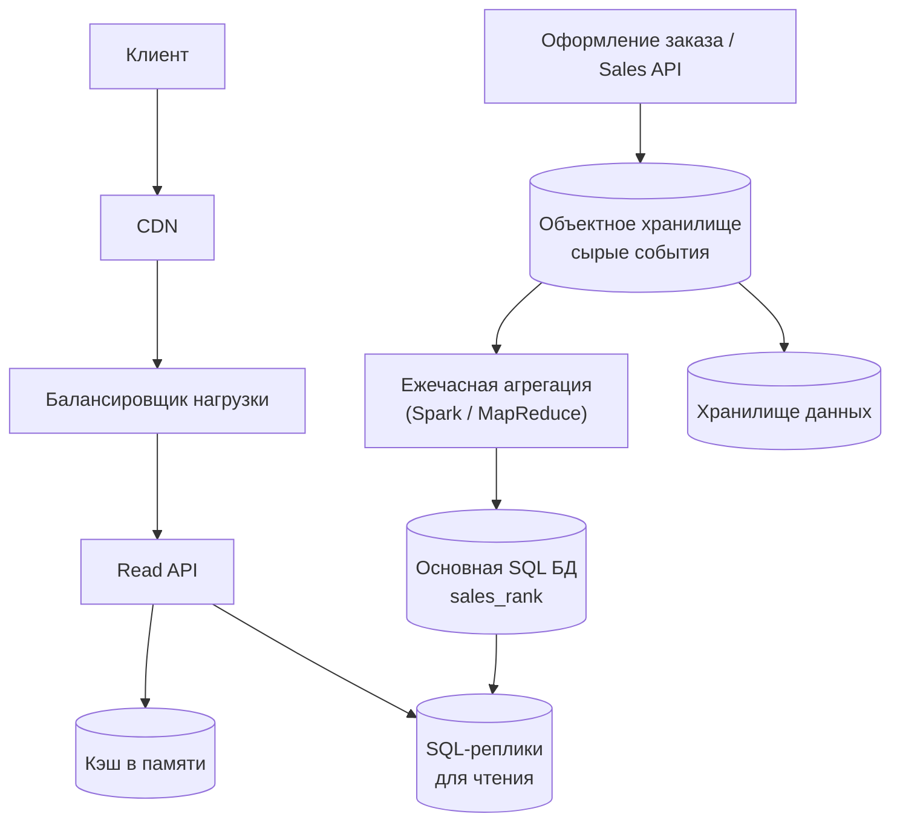
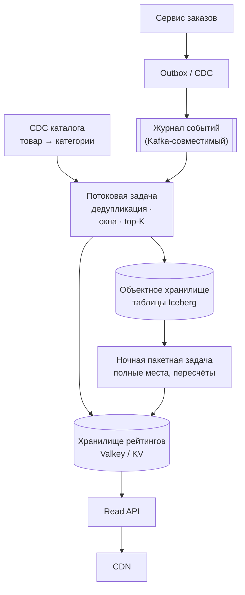

import { Aside } from '@astrojs/starlight/components';

Список «Бестселлеры в разделе „Книги“» выглядит как обычный `ORDER BY units DESC LIMIT 100`. В масштабах маркетплейса это две разные системы, склеенные вместе: **конвейер агрегации с большим потоком записей**, который превращает миллиард строк заказов в месяц в счётчики по категориям, и **слой чтения**, отвечающий на сотни тысяч запросов в секунду по набору данных размером в пару мегабайт. Сначала построим классическую пакетную версию, затем покажем, как ту же задачу решают потоковой обработкой в 2026 году.

<Aside type="tip" title="Коротко">
- События продаж попадают в надёжный журнал и в объектное хранилище; оформление заказа ничего не ждёт от рейтинга.
- Задача агрегации считает проданные единицы по паре `(категория, товар)` в скользящем 7-дневном окне: в классическом варианте — ежечасная пакетная задача (MapReduce/Spark), сегодня — потоковая задача (Flink, Kafka Streams) с часовыми панелями.
- Top-N по категории — это ограниченная куча на ключ, а не глобальная сортировка. Приближённые скетчи (Count-Min, Space-Saving) нужны для неограниченного пространства ключей, а не для 25 млн пар «товар — категория».
- Сторона чтения крошечная (top-100 × 1000 категорий ≈ 1,6 МБ): публикуем версионированные снимки в key-value-хранилище и кэшируем их в памяти и на CDN.
</Aside>

## Шаг 1 — Требования и ограничения

### Сценарии использования

**Входит в задачу**

- Сервис вычисляет **самые продаваемые товары каждой категории за последнюю неделю** по числу проданных единиц.
- Пользователь смотрит список бестселлеров категории (постранично, top-100).
- Карточка товара показывает его место в каждой из его категорий («#1 234 в разделе „Кухня“»).
- Сервис высокодоступен: устаревший список допустим, страница с ошибкой — нет.

**Не входит**

- Остальной магазин: каталог, корзина, платежи, поиск.
- Персональные рейтинги и рекомендации.

### Нефункциональные требования

- **Свежесть:** списки обновляются минимум раз в час; верх популярных категорий — желательно за минуты.
- **Задержка (latency) чтения:** p99 меньше 50 мс на API, большинство запросов обслуживают кэш или CDN.
- **Корректность:** дубли и повторно воспроизведённые события не должны завышать счётчики; отмены и возвраты вычитаются.
- **Доступность:** чтение работает, даже когда конвейер агрегации лежит, — данные просто стареют.

### Допущения

- 10 млн товаров, 1000 плоских категорий (в базовой постановке без подкатегорий).
- Товар может состоять в нескольких категориях (в среднем 2,5) и не меняет их.
- 1 млрд строк заказов в месяц; 100 млрд чтений рейтинга в месяц (чтений в 100 раз больше, чем записей).
- Нагрузка неравномерна: пиковая = 5 × средней (праздничные распродажи, акции вроде Prime Day).

### Прикидочный расчёт («на салфетке»)

Одно событие строки заказа: id строки (16 Б), время (8 Б), id товара, продавца и покупателя (по 8 Б), количество (4 Б), цена в центах (8 Б), валюта (4 Б) — **64 байта** без сжатия. В месяце 30 × 86 400 = 2 592 000 секунд.

| Величина | Расчёт | Результат |
|---|---|---|
| Строк заказов в секунду | 10⁹ / 2,592 млн с | ≈ 386 в среднем, ≈ 1900 в пике |
| Чтений рейтинга в секунду | 10¹¹ / 2,592 млн с | ≈ 38 600 в среднем, ≈ 193 000 в пике |
| Новых сырых событий в месяц | 10⁹ × 64 Б | 64 ГБ |
| Сырых событий за 3 года | 64 ГБ × 36 | ≈ 2,3 ТБ |
| Событий в 7-дневном окне | 10⁹ × 7 / 30 | ≈ 233 млн |
| Пересчёт всей недели каждый час | 233 млн × 64 Б | ≈ 15 ГБ за запуск, ≈ 358 ГБ в сутки |
| Точные счётчики для всех пар | 10 млн × 2,5 × 24 Б | ≈ 600 МБ |
| Опубликованные списки top-100 | 1000 × 100 × 16 Б | ≈ 1,6 МБ |

Два вывода определяют архитектуру. Во-первых, **точный подсчёт помещается в память**: 600 МБ счётчиков — пустяк для современного потокового движка, так что приближённые методы здесь опция, а не необходимость. Во-вторых, **читаемый набор крошечный, а частота чтения огромная** — хрестоматийный случай для кэша и CDN.

<Aside type="note" title="Исправления арифметики оригинала">
В оригинальном primer размеры полей в сумме дают 42 байта, а итог назван «~40 байт»; правило «2,5 млн секунд в месяце» округляет 386 записей/с до 400 и 38 580 чтений/с до 40 000. Для собеседования такое округление нормально — просто проговорите, в какую сторону округлили.
</Aside>

## Шаг 2 — Высокоуровневый дизайн



- **Sales API** пишет каждую строку заказа в журнал. Журналы отгружаются в **объектное хранилище** (S3, GCS, Azure Blob) по часовым папкам и хранятся годами за небольшие деньги.
- Каждый час **задача рейтинга** читает журналы за последние 7 дней, суммирует единицы по `(категория, товар)`, оставляет top-N каждой категории плюс полные места и записывает новый снимок в **таблицу `sales_rank`**.
- **Read API** отвечает на запросы списков и мест товара из этой таблицы. Оформление заказа никак не зависит от конвейера рейтинга.

## Шаг 3 — Ключевые компоненты

### Read API

```http
GET /v1/categories/1234/best-sellers?limit=3
```

```json
{
  "category_id": 1234,
  "snapshot_id": 88231,
  "window": {"start": "2026-10-01T12:00:00Z", "end": "2026-10-08T12:00:00Z"},
  "items": [
    {"rank": 1, "product_id": 50,  "units_sold": 100000, "rank_change": 0},
    {"rank": 2, "product_id": 200, "units_sold": 90000,  "rank_change": 3},
    {"rank": 3, "product_id": 3,   "units_sold": 80000,  "rank_change": -1}
  ],
  "next_cursor": "eyJyYW5rIjozfQ"
}
```

```http
GET /v1/products/50/sales-rank
→ {"snapshot_id": 88231, "ranks": [{"category_id": 1234, "rank": 1}, {"category_id": 77, "rank": 412}]}
```

Ответы содержат `snapshot_id`, поэтому их можно кэшировать с `Cache-Control: max-age=60, stale-while-revalidate=300`. Внутренние сервисы вызывают те же операции по gRPC.

### Модель данных

Источником истины служат часовые агрегаты, а рейтинги публикуются **неизменяемыми снимками**, чтобы читатель никогда не увидел наполовину записанный список:

```sql
CREATE TABLE sales_hourly (            -- одна строка на товар, категорию и час
  hour_start   TIMESTAMP NOT NULL,
  category_id  INTEGER   NOT NULL,
  product_id   BIGINT    NOT NULL,
  units        INTEGER   NOT NULL,     -- за вычетом отмен и возвратов
  PRIMARY KEY (hour_start, category_id, product_id)
);

CREATE TABLE rank_snapshot (
  snapshot_id  BIGINT PRIMARY KEY,
  window_start TIMESTAMP NOT NULL,
  window_end   TIMESTAMP NOT NULL,
  published_at TIMESTAMP              -- NULL, пока снимок не готов
);

CREATE TABLE sales_rank (
  snapshot_id  BIGINT  NOT NULL REFERENCES rank_snapshot (snapshot_id),
  category_id  INTEGER NOT NULL,
  rank         INTEGER NOT NULL,
  product_id   BIGINT  NOT NULL,
  units_sold   INTEGER NOT NULL,
  PRIMARY KEY (snapshot_id, category_id, rank)
);
CREATE INDEX sales_rank_by_product ON sales_rank (snapshot_id, product_id);
```

Недельный рейтинг — один запрос с оконной функцией поверх часовой таблицы:

```sql
SELECT category_id, product_id, units, rnk
FROM (
  SELECT category_id, product_id, SUM(units) AS units,
         ROW_NUMBER() OVER (PARTITION BY category_id
                            ORDER BY SUM(units) DESC, product_id) AS rnk
  FROM sales_hourly
  WHERE hour_start >= :window_start AND hour_start < :window_end
  GROUP BY category_id, product_id
) AS ranked
WHERE rnk <= :top_n;
```

Публикация — это переключение указателя: записать все строки нового `snapshot_id`, затем проставить `published_at`. Читатели всегда берут последний опубликованный снимок, а неудачный запуск откатывается снятием публикации.

### Пакетная задача

Оригинальное решение использовало двухшаговый MapReduce: map превращает строку журнала в `((категория, товар), количество)`, reduce суммирует, затем ключ меняется на `(категория, количество)`, чтобы распределённая сортировка фреймворка упорядочила результат. Две детали стоит улучшить:

- Глобальная сортировка — лишняя работа: нужен только top-N каждой категории, а его даёт **ограниченная куча на категорию** за `O(n log N)`.
- Журналы доставляются **хотя бы один раз** (at least once), поэтому задача сначала отбрасывает дубли строк заказа, а товар из нескольких категорий учитывается в каждой из них.

Версия ниже работает на крошечной выборке на чистом Python; функции дедупликации, map и reduce — ровно то, что Spark или Beam распределили бы по воркерам.

```python title="sales_rank_batch.py"
from collections import defaultdict
from collections.abc import Iterable, Iterator
from dataclasses import dataclass
from datetime import datetime, timedelta
import heapq

# order_line_id, время, product_id, количество (через табуляцию, как в сыром журнале)
SAMPLE = """\
ol-1\t2026-10-06T09:12:00\tp1\t2
ol-2\t2026-10-06T10:40:00\tp2\t3
ol-3\t2026-10-07T11:05:00\tp1\t1
ol-3\t2026-10-07T11:05:00\tp1\t1
ol-4\t2026-10-07T15:00:00\tp3\t7
ol-5\t2026-10-08T08:45:00\tp4\t1
ol-6\t2026-09-20T08:00:00\tp4\t50"""  # ol-3 пришла дважды; ol-6 старше недели

CATALOG: dict[str, tuple[str, ...]] = {  # товар -> его категории (может быть несколько)
    "p1": ("books", "gifts"), "p2": ("books",), "p3": ("toys", "gifts"), "p4": ("books",),
}


@dataclass(frozen=True)
class Sale:
    line_id: str
    ts: datetime
    product: str
    qty: int


def parse(lines: Iterable[str]) -> Iterator[Sale]:
    for line in lines:
        line_id, ts, product, qty = line.split("\t")
        yield Sale(line_id, datetime.fromisoformat(ts), product, int(qty))


def distinct(sales: Iterable[Sale]) -> Iterator[Sale]:
    """Этап 0: журналы at-least-once, поэтому убираем повторы строк заказа."""
    seen: set[str] = set()
    for sale in sales:
        if sale.line_id not in seen:
            seen.add(sale.line_id)
            yield sale


def map_sales(sales: Iterable[Sale], since: datetime) -> Iterator[tuple[tuple[str, str], int]]:
    """Map: оставляем продажи за неделю, размножаем по всем категориям товара."""
    for sale in sales:
        if sale.ts >= since:
            for category in CATALOG.get(sale.product, ()):
                yield (category, sale.product), sale.qty


def shuffle[K, V](pairs: Iterable[tuple[K, V]]) -> dict[K, list[V]]:
    """То, что фреймворк делает между map и reduce: группировка значений по ключу."""
    groups: dict[K, list[V]] = defaultdict(list)
    for key, value in pairs:
        groups[key].append(value)
    return groups


def reduce_sum(groups: dict[tuple[str, str], list[int]]) -> Iterator[tuple[str, tuple[int, str]]]:
    """Reduce 1: единицы по (категория, товар), новый ключ — категория."""
    for (category, product), quantities in groups.items():
        yield category, (sum(quantities), product)


def reduce_top_n(groups: dict[str, list[tuple[int, str]]], n: int) -> dict[str, list[tuple[int, str]]]:
    """Reduce 2: ограниченная куча на категорию вместо глобальной сортировки."""
    return {category: heapq.nlargest(n, items) for category, items in groups.items()}


if __name__ == "__main__":
    week_ago = datetime(2026, 10, 8, 12, 0) - timedelta(days=7)
    pairs = map_sales(distinct(parse(SAMPLE.splitlines())), since=week_ago)
    ranking = reduce_top_n(shuffle(reduce_sum(shuffle(pairs))), n=2)
    for category, top in sorted(ranking.items()):
        print(category, top)
    # books [(3, 'p2'), (3, 'p1')]
    # gifts [(7, 'p3'), (3, 'p1')]
    # toys [(7, 'p3')]
```

Обратите внимание на ничью в `books`: два товара продали по три единицы. Нужен детерминированный способ разрешения ничьих (сначала выручка, потом id товара), иначе список будет «мигать» между запусками.

Пересчёт всей недели каждый час читает около 15 ГБ за запуск. Дешевле агрегировать **по одному часу** в таблицу `sales_hourly` и считать неделю как сумму последних 168 часовых строк — та же идея, которую потоковые движки называют *панелями* (panes).

## Шаг 4 — Масштабирование

Нагрузочный тест, поиск узкого места, исправление, повтор. В порядке появления:

1. **Чтение (≈ 193 000/с в пике).** Рабочий набор — первые страницы нескольких сотен популярных категорий. Кладём списки в кэш в памяти (Redis/Valkey или локальный кэш в процессе, обновляемый при каждом снимке) и кэшируем ответы API на **CDN**. При доле попаданий 99 % до источника доходит около 1900 запросов в секунду. Места товара читаются вместе с карточкой и могут быть встроены в документ товара.
2. **База рейтинга.** С кэшем она в основном обслуживает промахи и публикующую задачу. Добавляем реплики для чтения: они обслуживают промахи и нужны для переключения на резерв (failover). Записи — это ежечасная пакетная загрузка, а не поток мелких обновлений.
3. **Рост сырых данных (2,3 ТБ за 3 года).** В SQL-базе держим только свежие часовые агрегаты; сырые события остаются в объектном хранилище в сжатых колоночных файлах (Parquet), а для анализа и пересчётов их читает хранилище данных (BigQuery, Redshift, Snowflake).
4. **Время работы задачи.** Инкрементальная часовая агрегация убирает пересчёт 358 ГБ в сутки. Если задача всё равно работает медленно, причина обычно в перекосе — нескольких гигантских категориях: предагрегируйте по `(категория, товар)` до группировки по категории (*combiner*), считайте кучи по партициям, потом сливайте.
5. **Путь записи.** 1900 событий/с в пике — мало для журнала; риск в связанности. Оформление заказа пишет событие (таблица outbox или захват изменений, CDC) и никогда не вызывает сервис рейтинга синхронно.



| Компонент | Что даёт | Чего стоит |
|---|---|---|
| CDN + кэш в памяти | Поглощает > 99 % чтений, переживает всплески | До минуты дополнительной устарелости, инвалидация на каждый снимок |
| Реплики для чтения | Failover, мощность для промахов кэша | Задержка репликации, больше машин |
| Часовые агрегаты | Стоимость задачи пропорциональна часу, а не неделе | Ещё одна таблица, обработка опоздавших данных |
| Объектное хранилище + DWH | Дешёвое хранение, ad-hoc анализ, пересчёты | Вторая копия данных, которой надо управлять |

## Что изменилось к 2026 году

Пакетная схема по-прежнему работает, и о ней легко рассуждать. Изменилось другое: **потоковая обработка стала стандартом для задачи «top-N в скользящем окне»**. Каждое крупное облако продаёт управляемый Kafka-совместимый журнал, а управляемый Flink есть у AWS и у нескольких Flink-вендоров, поэтому требование «обновлять раз в час» превращается в «обновлять раз в минуту» без расширения команды.



### Окна во времени события

Потоковая задача работает во **времени события** (event time — когда продажа случилась), а не во времени обработки, и по **водяным знакам** (watermarks) решает, что час завершён. Скользящее 7-дневное окно с шагом в час при наивной реализации положило бы каждое событие в 168 пересекающихся окон. Оконная агрегация во Flink SQL этого избегает: делит скользящие окна на общие срезы (slices). А окна DataStream API во Flink и скользящие окна (hopping windows) в Kafka Streams по-прежнему обновляют каждое пересекающееся окно. Переносимое решение — самим хранить **часовые панели** и комбинировать их: недельная сумма равна сумме 168 панелей и обновляется добавлением новой панели и вычитанием самой старой.

```python title="sliding_topk.py"
from collections import Counter, defaultdict
from dataclasses import dataclass, field
import heapq

PANES = 7 * 24  # 7-дневное окно из 168 часовых панелей


@dataclass
class CategoryWindow:
    """Скользящие 7-дневные суммы одной категории, собранные из часовых панелей."""
    panes: dict[int, Counter[str]] = field(default_factory=dict)  # час -> единицы по товарам
    totals: Counter[str] = field(default_factory=Counter)         # сумма живых панелей

    def add(self, hour: int, product: str, qty: int) -> None:
        self.panes.setdefault(hour, Counter())[product] += qty     # опоздавшее событие идёт в свой час
        self.totals[product] += qty

    def advance(self, now_hour: int) -> None:
        """На каждом шаге watermark вычитаем целые панели, выехавшие из окна."""
        for hour in [h for h in self.panes if h <= now_hour - PANES]:
            self.totals.subtract(self.panes.pop(hour))
        self.totals = +self.totals                                  # убираем товары с нулём

    def top(self, n: int) -> list[tuple[str, int]]:
        return heapq.nlargest(n, self.totals.items(), key=lambda kv: kv[1])


windows: defaultdict[str, CategoryWindow] = defaultdict(CategoryWindow)
events = [(0, "books", "p1", 5), (1, "books", "p2", 3),      # (час события, категория, товар, кол-во)
          (100, "books", "p2", 4), (169, "books", "p3", 1)]
for hour, category, product, qty in events:
    windows[category].add(hour, product, qty)
windows["books"].advance(now_hour=169)                        # часы 0 и 1 покидают окно
print(windows["books"].top(2))                                # [('p2', 4), ('p3', 1)]
```

Отмены и возвраты приходят в том же потоке с отрицательным количеством, поэтому счётчики остаются «чистыми». Опоздавшие события в пределах допустимого опоздания обновляют свою панель; всё, что опоздало сильнее, уходит в путь исправлений (ночную пакетную задачу).

### Top-K по категориям в масштабе

- **Точно, с партиционированием.** Партиционируем поток по `product_id`, держим точные суммы, каждая партиция выдаёт свой локальный top-N по категориям. Поскольку каждый товар живёт ровно в одной партиции, глобальный top-N содержится в объединении локальных top-N, и небольшой шаг слияния даёт точный ответ. Заодно это обезвреживает «горячие» категории: «Книги» размазаны по всем партициям, а не сидят в одной.
- **Приближённо, с ограниченной памятью.** Когда пространство ключей не ограничено — поисковые запросы, URL, хештеги или «каждый товар × каждый регион × каждое окно», — точные счётчики перестают помещаться. **Count-Min Sketch** оценивает частоту любого элемента с односторонней ошибкой не больше `ε × N` (N — общий счёт) с вероятностью не ниже `1 − δ`, используя `⌈e/ε⌉ × ⌈ln(1/δ)⌉` счётчиков. В паре с небольшой кучей кандидатов он находит **самые частые элементы** (heavy hitters). Скетчи с одинаковыми шириной, глубиной и хеш-функциями сливаются сложением ячеек, так что скетчи разных партиций легко объединить. **Space-Saving** решает ту же задачу детерминированно примерно на `1/ε` счётчиках, а в Apache DataSketches есть готовый к продакшену скетч частых элементов.

```python title="cms_topk.py"
import hashlib
import heapq
import math
import random


class CountMinTopK:
    """Count-Min Sketch для частот плюс небольшой набор кандидатов в top-k."""

    def __init__(self, epsilon: float, delta: float, k: int) -> None:
        self.width = math.ceil(math.e / epsilon)     # переоценка <= epsilon * total ...
        self.depth = math.ceil(math.log(1 / delta))  # ... с вероятностью >= 1 - delta
        self.rows = [[0] * self.width for _ in range(self.depth)]
        self.k = k
        self.candidates: dict[str, int] = {}         # не больше k элементов с оценками

    def _cells(self, item: str) -> list[int]:
        digest = hashlib.blake2b(item.encode(), digest_size=16).digest()
        h1, h2 = int.from_bytes(digest[:8]), int.from_bytes(digest[8:])
        return [(h1 + i * h2) % self.width for i in range(self.depth)]  # двойное хеширование

    def add(self, item: str, count: int = 1) -> None:
        estimate = math.inf
        for row, col in zip(self.rows, self._cells(item)):
            row[col] += count
            estimate = min(estimate, row[col])       # ячейка с наименьшими коллизиями — лучшая оценка
        self.candidates[item] = int(estimate)
        if len(self.candidates) > self.k:            # вытесняем самого слабого кандидата
            del self.candidates[min(self.candidates, key=self.candidates.__getitem__)]

    def top(self) -> list[tuple[str, int]]:
        return heapq.nlargest(self.k, self.candidates.items(), key=lambda kv: kv[1])


random.seed(7)
sketch = CountMinTopK(epsilon=0.001, delta=0.01, k=3)
products = [f"p{i}" for i in range(5_000)]
popularity = [1 / (rank + 1) for rank in range(len(products))]  # спрос по закону Ципфа
for product in random.choices(products, popularity, k=200_000):
    sketch.add(product)
print(sketch.width, sketch.depth, sketch.top())
# 2719 5 [('p0', 21958), ('p1', 11208), ('p2', 7338)]
```

При `ε = 0.001` и `δ = 0.01` скетч содержит 2719 × 5 = 13 595 счётчиков — около 54 КБ на категорию. На этой перекошенной выборке оценки для первой тройки совпадают с точными значениями; гарантия же лишь в том, что с вероятностью 99 % оценка превышает истину не больше чем на 0,1 % всех продаж. Важны два ограничения: обычный скетч не умеет аккуратно вычитать истёкшие окна (держите по скетчу на панель), а его ошибка считается относительно *общего* объёма — он точен для бестселлеров и бесполезен для длинного хвоста.

### Отдача рейтингов

- Потоковая задача записывает top-100 каждой категории одним небольшим документом с ключом `rank:{category}:{snapshot}` и переключает указатель `rank:{category}:latest`. Читатель получает согласованный список одним обращением по ключу.
- **Сортированное множество** Redis/Valkey на категорию (`ZINCRBY` на каждую продажу, `ZRANGE key 0 99 REV` для чтения) соблазнительно для живого лидерборда. Оно подходит для рейтинга «за всё время» или для неперекрывающихся окон; скользящему окну нужно по множеству на час и `ZUNIONSTORE` по 168 ключам — тот же приём с панелями, только менее эффективный.
- **Полные места для каждого товара** («#48 210 в „Книгах“») — это длинный хвост, которого потоковый top-K не даёт. Их считает ночная или ежечасная пакетная задача по таблицам lakehouse и записывает в модель чтения товара. Получается **гибрид**: поток — для свежей верхушки, пакетная обработка — для полного хвоста и исправлений.

### Что осталось в силе

- Отвязывайте оформление заказа от рейтинга надёжным журналом; при изменении логики пересчитывайте по сырым событиям.
- Вычисляйте ответ заранее и отдавайте из памяти; путь чтения ничего не агрегирует.
- Накрутка рейтинга — реальная угроза. Учитывайте только оплаченные и не возвращённые заказы, ограничивайте вклад одного покупателя, передавайте в задачу сигналы антифрода.

<Aside type="note" title="На собеседовании">
- Начните с вопроса, **что значит «популярный»**: единицы или выручка, с возвратами или без, жёсткое 7-дневное окно или затухающий счёт (`score × e^(−λ·age)` — один счётчик на товар, свежие продажи весят больше).
- Проделайте расчёт, показывающий, что читаемый набор крошечный: он одним предложением обосновывает схему «CDN + снимки».
- Ждите вопросов про **опоздавшие и повторные события**, **горячие категории**, **товары в нескольких категориях**, **подкатегории** (суммировать вверх по дереву категорий или ранжировать только листья) и **как карточка товара узнаёт своё место**, если товар не входит ни в чей top-100.
- Типичные ошибки: глобальная сортировка там, где хватает кучи на ключ; Count-Min Sketch при том, что точные счётчики помещаются в 600 МБ; вычисление рейтинга на пути чтения.
</Aside>

## Что почитать

- [MapReduce: Simplified Data Processing on Large Clusters](https://static.googleusercontent.com/media/research.google.com/en//archive/mapreduce-osdi04.pdf) — Dean и Ghemawat, OSDI 2004: модель, на которой построена пакетная задача.
- [The Dataflow Model](https://research.google/pubs/the-dataflow-model-a-practical-approach-to-balancing-correctness-latency-and-cost-in-massive-scale-unbounded-out-of-order-data-processing/) — Akidau и соавторы, VLDB 2015: время события, окна, watermarks и триггеры.
- [Streaming 101: The world beyond batch](https://www.oreilly.com/radar/the-world-beyond-batch-streaming-101/) — доступное введение Тайлера Акидау в те же идеи.
- [An Improved Data Stream Summary: The Count-Min Sketch and its Applications](https://dsf.berkeley.edu/cs286/papers/countmin-latin2004.pdf) — Cormode и Muthukrishnan, исходная статья.
- [Efficient Computation of Frequent and Top-k Elements in Data Streams](https://www.cs.ucsb.edu/sites/default/files/documents/2005-23.pdf) — Metwally, Agrawal и El Abbadi: алгоритм Space-Saving.
- [Apache DataSketches: frequency sketches](https://datasketches.apache.org/docs/Frequency/FrequencySketches.html) — промышленные скетчи для поиска самых частых элементов.

## Связанные темы

- [Потоковая передача событий](/async/event-streaming/) — журналы, партиции и потоковые обработчики из схемы 2026 года.
- [Очереди и обратное давление](/async/queues-and-back-pressure/) — как оформление заказа не зависит от медленных потребителей.
- [Уровни кэширования](/caching/caching-layers/) — CDN, кэш в процессе и распределённый кэш на пути чтения.
- [Объектное хранилище](/data/object-storage/) — дешёвое хранение сырых событий и таблиц lakehouse.
- [Партиционирование и шардирование](/data/partitioning-and-sharding/) — ключ по товару, чтобы размазать горячие категории.
- [Прикидочные расчёты](/start/estimation/) — метод, по которому составлена таблица в шаге 1.
