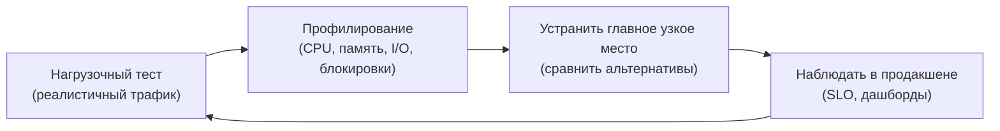
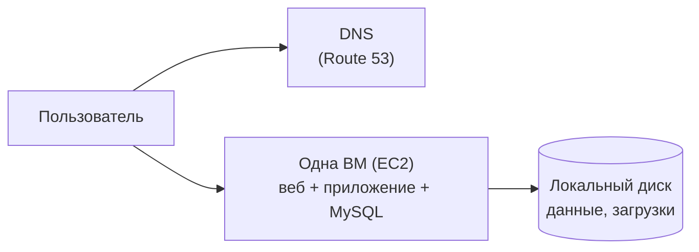
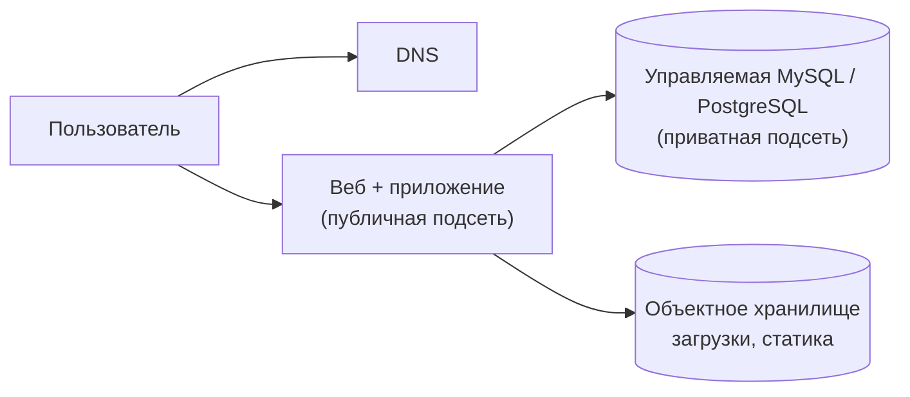
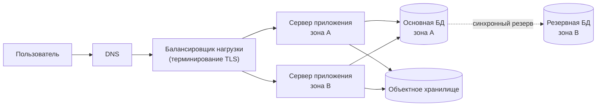
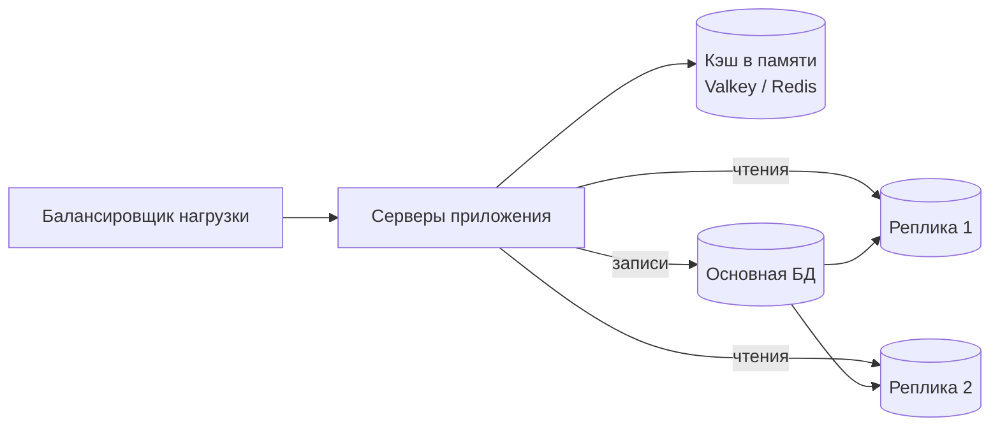
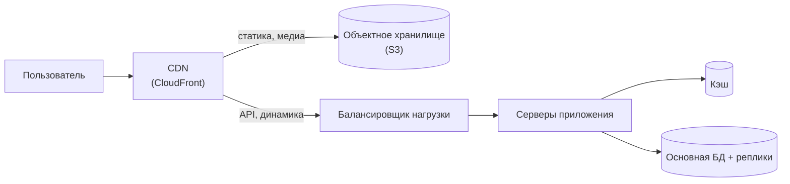
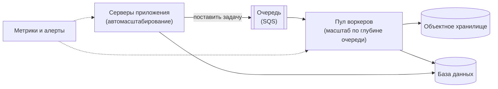
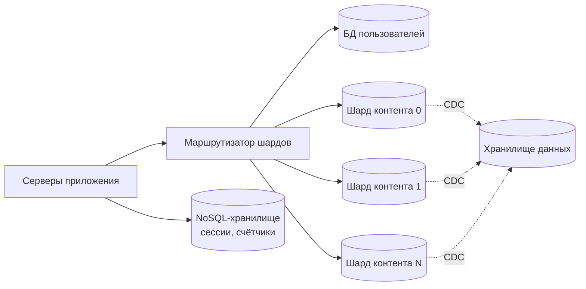
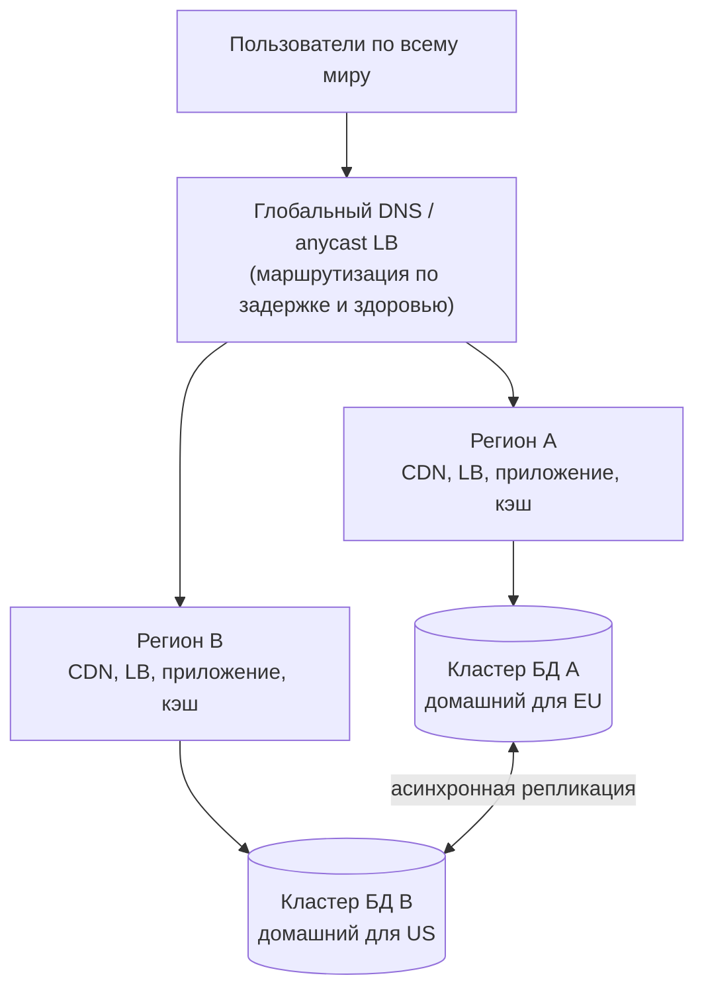

import { Aside } from '@astrojs/starlight/components';

Мало какие системы проектируют под десять миллионов пользователей с первого дня, а те, что пытаются, обычно запускаются с опозданием. Здесь разобран более жизненный сценарий: начинаем с одного сервера, измеряем, находим компонент, который ломается первым, чиним ровно его и повторяем. Для каждого этапа названо **узкое место, которое его запускает**, само изменение и его цена. В примерах — названия сервисов AWS, как в оригинальном primer, но у каждого строительного блока есть аналог в других облаках и на собственном железе (см. таблицу в шаге 3).

<Aside type="tip" title="Коротко">
- Масштабирование — это цикл: **нагрузочный тест → профилирование → устранение главного узкого места → повтор.** Никогда не прыгайте сразу к финальной схеме.
- Обычный порядок: вынести базу данных, сделать слой приложения stateless и поставить его за балансировщик нагрузки, добавить кэш и реплики для чтения, отдать статику объектному хранилищу и CDN, увести медленную работу в очереди — и только потом разделять данные и выходить в несколько регионов.
- Каждый шаг даёт мощность или доступность и стоит согласованности, денег или операционной сложности. Называйте и то и другое.
- В 2026 году управляемые базы, контейнеры и serverless отодвигают тяжёлые шаги (шардирование, мультирегион) гораздо дальше, чем в 2016-м, но не отменяют их.
</Aside>

## Шаг 1 — Требования и ограничения

### Сценарии использования

**Входит в задачу**

- Пользователь делает запрос на чтение или запись; сервис его обрабатывает, сохраняет данные пользователя и возвращает результат.
- Сервис растёт от горстки пользователей до десятков миллионов; по ходу обсуждаем общие приёмы масштабирования.
- По мере роста сервис должен стать высокодоступным.

**Не входит**

- Бизнес-логика продукта; приёмы ниже применимы к большинству CRUD-бэкендов для веба и мобильных приложений.

### Нефункциональные требования

- Нагрузка с преобладанием чтения (100 чтений на запись), сосредоточенная в несколько пиковых часов.
- Реляционные данные с транзакциями (аккаунты, заказы, публикации).
- p99 задержки (latency) чтения через API — до ~200 мс на основном рынке.
- Доступность растёт вместе с бизнесом: сначала один регион с несколькими зонами, потом несколько регионов.

### Допущения (в конце пути)

- 10 млн пользователей.
- 1 млрд записей и 100 млрд чтений в месяц.
- 1 КБ нового контента на запись; большинство записей создают контент, а не обновляют его.
- Пиковая нагрузка примерно в 3 раза выше средней.

### Прикидочный расчёт («на салфетке»)

В месяце 30 × 86 400 = 2 592 000 секунд.

| Величина | Расчёт | Результат |
|---|---|---|
| Записей в секунду | 10⁹ / 2,592 млн с | ≈ 386 в среднем, ≈ 1160 в пик |
| Чтений в секунду | 10¹¹ / 2,592 млн с | ≈ 38 600 в среднем, ≈ 116 000 в пик |
| Нового контента в месяц | 10⁹ × 1 КБ | ≈ 1 ТБ |
| Нового контента за 3 года | 1 ТБ × 36 | ≈ 36 ТБ |
| На пользователя в сутки | 10⁹ / 30 / 10⁷ записей; 10¹¹ / 30 / 10⁷ чтений | ≈ 3 записи, ≈ 333 чтения |
| Чтений из БД в пик при 90 % попаданий в кэш | 0,1 × 116 000 | ≈ 11 600/с |
| Чтений из БД в пик при 99 % попаданий в кэш | 0,01 × 116 000 | ≈ 1160/с |

Цифры показывают, откуда придёт давление: **чтения** определяют частоту запросов, **доля попаданий в кэш** решает, каким большим должен быть слой БД, а **36 ТБ** данных за три года в итоге подталкивают к разделению данных. Около 1200 записей в секунду в пик, напротив, вполне по силам одному современному основному узлу реляционной БД.

<Aside type="note" title="Об арифметике">
В оригинальном primer использовалось «2,5 млн секунд в месяце», что округляет 386 записей/с до 400 и 38 580 чтений/с до 40 000. Округление допустимо; реальный месяц — 2,592 млн секунд.
</Aside>

## Шаг 2 — Высокоуровневый дизайн

### Цикл масштабирования



Каждый этап ниже — один оборот этого цикла. Порядок типичный, но не обязательный: что делать дальше, решает профилировщик.

### Этап 1 — Один сервер



- **Конфигурация.** Одна виртуальная машина держит веб-сервер, приложение и базу данных. Статический публичный адрес (Elastic IP в AWS) не меняется при перезагрузке, DNS связывает с ним домен.
- **Базовая безопасность.** Наружу открыт только 443 (и 80 — для редиректа на HTTPS); SSH — только из списка разрешённых адресов, а лучше через менеджер сессий облака совсем без открытого порта. Исходящий трафик ограничен тем, что нужно приложению.
- **Мониторинг с первого дня.** CPU, память, диск, сеть, задержка запросов и доля ошибок. Без цифр не понять, какой этап следующий.
- **Масштабирование.** Вертикальное: берём инстанс побольше. Быстро и без изменений кода, но цена круто растёт на верхних конфигурациях, а сервер остаётся единой точкой отказа.

## Шаг 3 — Ключевые компоненты

### Stateless-сервер приложения

Большинство этапов опирается на одно свойство: **любой сервер приложения может обработать любой запрос.** Значит, ничто не живёт только в памяти или на диске одного сервера:

- Сессии — в подписанной cookie или в общем хранилище (сначала в БД, потом в кэше в памяти).
- Загруженные файлы — в объектном хранилище, никогда не на локальном диске.
- Конфигурация — из окружения; при деплое серверы заменяются, а не латаются.

### Маршрутизация чтения и записи

Когда появляются реплики для чтения (этап 4), слой доступа к данным должен отправлять записи на основной узел, а большинство чтений — на реплики, не показывая при этом пользователю устаревшую копию того, что он только что записал:

```python title="db_router.py"
import random
import time
from dataclasses import dataclass


@dataclass(frozen=True)
class DbRouter:
    """Записи идут на основной узел; чтения — на реплики, если пользователь не писал только что."""
    primary: str
    replicas: tuple[str, ...]
    stickiness_s: float = 5.0  # с запасом больше обычной задержки репликации

    def for_write(self) -> str:
        return self.primary

    def for_read(self, last_write_at: float | None, now: float | None = None) -> str:
        # last_write_at берётся из сессии пользователя, а не из памяти сервера:
        # слой приложения stateless, и любой экземпляр должен выбрать одинаково.
        now = time.time() if now is None else now
        if last_write_at is not None and now - last_write_at < self.stickiness_s:
            return self.primary  # read-your-writes в течение нескольких секунд
        return random.choice(self.replicas)


router = DbRouter(primary="db-primary", replicas=("db-replica-1", "db-replica-2"))
assert router.for_read(last_write_at=100.0, now=102.0) == "db-primary"
assert router.for_read(last_write_at=100.0, now=110.0).startswith("db-replica")
assert router.for_read(last_write_at=None).startswith("db-replica")
```

Следите за отставанием реплик и выводите реплику из ротации, если она слишком отстала.

### Строительные блоки в разных облаках

Архитектура не привязана к облаку. Названия сервисов на октябрь 2026 года:

| Компонент | AWS | Google Cloud | Azure | Своё железо |
|---|---|---|---|---|
| Виртуальные машины | EC2 | Compute Engine | Virtual Machines | KVM, Proxmox, bare metal |
| DNS | Route 53 | Cloud DNS | Azure DNS | PowerDNS, BIND |
| Балансировщик нагрузки | Elastic Load Balancing (ALB, NLB) | Cloud Load Balancing | Load Balancer, Application Gateway | HAProxy, NGINX, Envoy |
| Реляционная БД | RDS, Aurora | Cloud SQL, AlloyDB | Azure Database for PostgreSQL / MySQL | PostgreSQL + Patroni, MySQL |
| Кэш в памяти | ElastiCache (Valkey, Redis OSS, Memcached) | Memorystore (Valkey, Redis) | Azure Managed Redis | Valkey, Redis, Memcached |
| Объектное хранилище | S3 | Cloud Storage | Blob Storage | Ceph RGW, SeaweedFS |
| CDN | CloudFront | Cloud CDN | Front Door | Varnish, кэш NGINX |
| Очередь | SQS | Pub/Sub | Service Bus | RabbitMQ |
| Журнал событий | Kinesis Data Streams, MSK | Pub/Sub, Managed Service for Apache Kafka | Event Hubs | Apache Kafka, Redpanda |
| Контейнеры | ECS, EKS, Fargate | GKE, Cloud Run | AKS, Container Apps | Kubernetes, Nomad |
| Функции | Lambda | Cloud Run functions | Azure Functions | Knative, OpenFaaS |
| NoSQL key-value | DynamoDB | Bigtable, Firestore | Cosmos DB | Cassandra, ScyllaDB |
| Распределённый SQL, шардирование | Aurora DSQL | Spanner | Elastic clusters (Citus) в Azure Database for PostgreSQL | CockroachDB, YugabyteDB, Vitess |
| Хранилище данных | Redshift | BigQuery | Microsoft Fabric, Synapse | ClickHouse, Trino поверх Iceberg |
| Метрики и логи | CloudWatch | Cloud Monitoring, Cloud Logging | Azure Monitor | Prometheus, Grafana, OpenTelemetry |

Названия дрейфуют: Google в 2024 году переименовал Cloud Functions в Cloud Run functions; Azure выводит из эксплуатации Azure Cache for Redis (к сентябрю 2028 года) в пользу Azure Managed Redis и классический Azure CDN (к сентябрю 2027 года) в пользу Front Door; Microsoft вкладывает новые силы в аналитике в Fabric, но Synapse не выводит; а AWS в апреле 2026 года закрыл App Runner для новых клиентов и предлагает им ECS Express Mode. Проектируйте на уровне обобщённого компонента, продукт выбирайте потом.

## Шаг 4 — Масштабирование

### Этап 2 — Отдельная база данных

**Триггер.** База и веб-сервер борются за память и CPU на одной машине; загрузки забивают диск; масштабируя сервер ради одного слоя, платим за оба.



- Переносим базу в **управляемый сервис** (RDS, Cloud SQL, Azure Database for PostgreSQL): автоматические бэкапы, обновления, шифрование на диске и резервный узел в другой зоне доступности одной настройкой.
- Загрузки пользователей и статику переносим в **объектное хранилище**. Веб-сервер теперь можно выбросить и пересоздать.
- Всё помещаем в приватную сеть (VPC). В публичной подсети только веб-слой; база принимает соединения только от группы безопасности приложения. Шифруем трафик и данные на диске.

**Цена.** Больше движущихся частей, сетевые переходы между слоями и счёт за управляемый сервис, который стоит сравнить с часами, потраченными на самостоятельное администрирование БД.

### Этап 3 — Горизонтальный слой приложения за балансировщиком

**Триггер.** Единственный веб-сервер упирается в потолок в часы пик, задержка скачет, а любой деплой или сбой означает простой.



- Делаем приложение **stateless** (шаг 3) и запускаем несколько копий в разных **зонах доступности** за управляемым **балансировщиком нагрузки** с проверками здоровья. TLS терминируем на балансировщике — так проще управлять сертификатами.
- База работает как основной узел плюс синхронный резерв в другой зоне с автоматическим **переключением на резерв (failover)**.
- По желанию отделяем **веб-серверы** (обратные прокси, отдающие статические ответы и буферизующие медленных клиентов) от **серверов приложений** и разводим пулы API чтения и записи, чтобы масштабировать их независимо.

**Цена.** Счёт за балансировщик, больше серверов и деплой, который должен переживать смесь версий во время поэтапного обновления.

### Этап 4 — Кэш и реплики для чтения

**Триггер.** Профилирование показывает, что CPU базы в основном уходит на чтения (100:1), причём одни и те же строки читаются снова и снова.



- Сначала настраиваем саму базу: индексы, планы запросов, размер буферного пула. Затем добавляем **кэш в памяти** по схеме cache-aside для горячих объектов (готовых объектов, а не сырых результатов запросов; см. [уровни кэширования](/caching/caching-layers/)) и переносим туда сессии. Попадание в кэш избавляет от запроса и чтения с диска, но удалённый кэш всё равно стоит сетевого круга (около 0,25 мс внутри зоны), поэтому главный выигрыш — разгрузка базы, а не сама задержка (см. [цифры задержек](/reference/latency-numbers/)).
- Добавляем **реплики для чтения** под трафик, промахнувшийся мимо кэша. В пик при 90 % попаданий на слой БД приходится около 11 600 чтений в секунду, при 99 % — около 1160. Эта разница отделяет «несколько реплик» от «ни одной».
- Маршрутизируем чтения и записи в слое доступа к данным (см. `db_router.py`) с гарантией read-your-writes для пользователя, который только что писал.

**Цена.** Ошибки инвалидации кэша, устаревшие чтения с отстающих реплик и новые режимы отказа: холодный или сброшенный кэш может обрушить на базу «стадо» запросов (thundering herd).

### Этап 5 — Объектное хранилище и CDN

**Триггер.** Серверы приложения тратят канал и CPU на картинки, скрипты и видео; пользователи далеко от региона видят медленную загрузку страниц.



- Всю статику и медиа пользователей отдаём **из объектного хранилища через CDN**. Имена файлов версионируем (`app.3f9c2.js`), чтобы кэшировать их на год.
- Клиенты загружают файлы прямо в объектное хранилище по короткоживущим **подписанным URL** (pre-signed URL); сервер приложения записывает только метаданные.
- Часть динамических ответов кэшируем на периферии на несколько секунд (публичные ленты, страницы товаров).

**Цена.** Логика сброса кэша, плата за исходящий трафик и ещё один поставщик на пути запроса.

### Этап 6 — Асинхронные воркеры и автомасштабирование

**Триггер.** Часть запросов выполняет медленную работу прямо в обработчике (миниатюры, письма, отчёты, вызовы сторонних API) и занимает серверы приложения. Трафик следует рабочему дню, поэтому фиксированной мощности либо не хватает в полдень, либо она простаивает ночью.



- Отвечаем клиенту, как только завершена надёжная часть, остальное отправляем в **очередь**. Пример: клиент загружает фото, приложение записывает его и ставит задачу; воркер делает миниатюры, кладёт их в объектное хранилище и обновляет базу.
- Задачи делаем **идемпотентными**, а повторные попытки — безопасными: очереди доставляют хотя бы один раз. «Ядовитые» сообщения уходят в очередь недоставленных (dead-letter queue).
- **Автомасштабируем** серверы приложения по CPU, задержке или числу запросов, а воркеры — по глубине очереди или возрасту самого старого сообщения. Держим минимум экземпляров в нескольких зонах и наращиваем мощность быстрее, чем сокращаем.
- Мониторинг вырастает в **наблюдаемость**: агрегируем метрики, логи и трассировки, алертим по SLO, сохраняем сбор ошибок и дежурства.

**Цена.** Согласованность в конечном счёте (eventual consistency), заметная пользователю («видео обрабатывается»), больше компонентов под наблюдением и запаздывание масштабирования при резких всплесках.

### Этап 7 — Федерация, шардирование и подходящее хранилище для каждой задачи

**Триггер.** Пределом становится основная база: данные приближаются к десяткам терабайт, записи и обслуживание (vacuum, построение индексов, бэкапы, восстановление) занимают слишком много времени, а одно переключение на резерв задевает слишком многое.



- **Архивирование.** Холодные данные переносим в хранилище данных или в колоночные файлы в объектном хранилище; часто горячая часть — лишь доля от 36 ТБ.
- **Федерация** (функциональное разделение): у каждого домена своя база — пользователи, контент, биллинг. Просто, но соединения между доменами переезжают в приложение.
- **Шардирование**: самые большие таблицы делим по ключу, например `user_id`. Заранее создаём много **логических шардов** и раскладываем их по меньшему числу физических баз — при росте переезжают целые шарды, а строки не перехешируются:

```python title="shard_router.py"
import hashlib
from dataclasses import dataclass

LOGICAL_SHARDS = 480  # фиксировано навсегда: пространство хешей режется один раз


@dataclass(frozen=True)
class ShardMap:
    """Много логических шардов живут на меньшем числе физических баз; карту можно менять."""
    hosts: tuple[str, ...]

    def logical_shard(self, user_id: int) -> int:
        digest = hashlib.sha256(user_id.to_bytes(8, "big")).digest()
        return int.from_bytes(digest[:8]) % LOGICAL_SHARDS

    def host_for(self, user_id: int) -> str:
        per_host = LOGICAL_SHARDS // len(self.hosts)  # 480 / 32 = 15 логических шардов на хост
        return self.hosts[self.logical_shard(user_id) // per_host]


shards = ShardMap(hosts=tuple(f"pg-{i:02d}" for i in range(32)))
print(shards.logical_shard(42), shards.host_for(42))   # 458 pg-30
# При росте до 48 хостов переезжают целые логические шарды (по 10 на хост); строки не перехешируются.
bigger = ShardMap(hosts=tuple(f"pg-{i:02d}" for i in range(48)))
print(bigger.logical_shard(42), bigger.host_for(42))   # 458 pg-45
```

- **Денормализуем и оптимизируем** запросы, которые теперь пересекают шарды. Данные, которым не нужны связи и транзакции, — сессии, счётчики, ленты активности — переносим в **NoSQL**-хранилище вроде DynamoDB.
- Или покупаем разделение готовым: распределённый SQL (Spanner, Aurora DSQL, CockroachDB, YugabyteDB) или слой шардирования (Vitess, Citus, Aurora PostgreSQL Limitless Database).

**Цена.** Запросы и транзакции между шардами становятся сложными или невозможными, уникальным ID нужна схема без центрального счётчика, перебалансировка превращается в проект, а изменения схемы выполняются N раз.

### Этап 8 — Несколько регионов

**Триггер.** Пользователи на других континентах видят круговую задержку 80–300 мс; бизнес больше не может пережить полный отказ региона; законы о локализации данных требуют хранить данные части пользователей в их регионе.



- **Active-passive**: записи принимает один регион, второй держит асинхронную реплику и прогретые мощности. Просто; при переключении теряются последние секунды записей (RPO больше нуля), а само переключение занимает минуты.
- **Active-active с домашним регионом**: данные каждого пользователя живут в одном регионе (*ячейке*, cell), и запросы направляются туда. Чтения можно обслуживать локально с реплик, записи идут «домой».
- **Active-active с глобальной базой**: Spanner, Aurora DSQL или CockroachDB дают строго согласованные записи в нескольких регионах ценой межрегиональной задержки на каждом коммите. Если достаточно согласованности в конечном счёте, альтернатива — репликация с несколькими лидерами и разрешением конфликтов.
- Регулярно отрабатывайте переключение; непроверенный runbook не считается.

**Цена.** Примерно вдвое больше инфраструктуры, плата за межрегиональный трафик и самые трудные вопросы согласованности во всей архитектуре.

### Сводка

| Этап | Узкое место, запускающее этап | Главное изменение |
|---|---|---|
| 1 | — | Одна ВМ, DNS, мониторинг |
| 2 | БД и веб делят один сервер | Управляемая БД, объектное хранилище, приватная сеть |
| 3 | Один веб-сервер упёрся в потолок; нет резерва | Stateless-слой приложения, балансировщик, БД в нескольких зонах |
| 4 | CPU базы уходит на повторные чтения | Кэш, реплики для чтения, маршрутизация чтения и записи |
| 5 | Статика и расстояние до пользователя | CDN перед объектным хранилищем |
| 6 | Медленная работа в запросе, суточные колебания | Очереди, воркеры, автомасштабирование, наблюдаемость |
| 7 | Размер основной БД, нагрузка записи и обслуживания | Архив, федерация, шардирование, NoSQL или распределённый SQL |
| 8 | Глобальная задержка, отказ региона, локализация данных | Несколько регионов с домашними регионами или глобальной БД |

## Что изменилось к 2026 году

**Контейнеры и Kubernetes.** Единица развёртывания — образ контейнера, а не настроенная руками ВМ; системы управления конфигурацией (Chef, Puppet, Ansible) во многом уступили место неизменяемым образам, инфраструктуре как коду (Terraform/OpenTofu, Pulumi) и GitOps. Команды, которым нужен полный контроль, используют Kubernetes (EKS, GKE, AKS); остальные — более простые контейнерные платформы вроде ECS на Fargate, Cloud Run или Azure Container Apps. Автомасштабирование из этапа 6 превращается в Horizontal Pod Autoscaler для сервисов, **KEDA** для масштабирования воркеров по глубине очереди (вплоть до нуля) и Cluster Autoscaler или **Karpenter** для узлов.

**Управляемые базы отодвигают этап 7.** Инстансы с сотнями ядер и терабайтами памяти, хранилище, которое растёт само (кластеры Aurora MySQL и PostgreSQL с 2025 года вмещают до 256 ТиБ), serverless-мощности и пулеры соединений позволяют одному основному узлу с репликами выдерживать гораздо больше, чем в 2016 году. А когда вы его всё же перерастёте, разделение данных можно купить: Aurora PostgreSQL Limitless Database (GA в 2024 году), Aurora DSQL (GA в 2025 году), Spanner, Vitess, Citus. Истории Figma и Notion показывают, что к шардированию команды по-прежнему подходят осторожно, с планом и поздно.

**Serverless.** Функции (Lambda, Cloud Run functions, Azure Functions) и serverless-контейнеры хорошо подходят для воркеров этапа 6, заданий по расписанию и API с редкой или всплесковой нагрузкой: они масштабируются до нуля и избавляют от планирования мощностей. Следите за холодными стартами, лимитами времени выполнения, ценой за запрос при постоянной высокой нагрузке и лавинами соединений к реляционной базе (ставьте перед ней прокси вроде RDS Proxy или PgBouncer).

**Что осталось в силе.** Сначала измеряйте, потом меняйте. Держите слой приложения stateless. Кэшируйте чтения, уводите медленную работу в очереди и разделяйте данные, только когда этого требует конкретное узкое место. Управляемые сервисы перекладывают операционную нагрузку, но не архитектурные решения.

<Aside type="note" title="На собеседовании">
- Не рисуйте сразу схему этапа 8. Пройдите этапы и для каждого скажите, **какая метрика подсказала шаг** и чего стоит изменение.
- Называйте цифры: около 400 записей и 40 000 чтений в секунду в среднем, ×3 в пик; доля попаданий в кэш определяет размер слоя БД.
- Вероятные вопросы: как работают сессии на нескольких серверах, read-your-writes с репликами, лавина запросов при промахах кэша (cache stampede), как выбрать ключ шардирования и перешардировать потом, миграции схемы без простоя, что происходит при отказе зоны доступности или целого региона.
- Типичные ошибки: шардирование до кэша и реплик; забыть, что автомасштабированию нужен stateless-слой; считать мультирегион сетевой задачей, хотя это в первую очередь задача о данных.
</Aside>

## Что почитать

- [AWS Well-Architected Framework](https://docs.aws.amazon.com/wellarchitected/latest/framework/welcome.html) — чек-лист AWS для надёжных, безопасных, эффективных и экономных систем.
- [Scaling to your first 10 million users (заметки с re:Invent 2016)](https://blog.scottlowe.org/2016/11/29/scaling-first-10mil-users/) — пересказ доклада AWS, на котором основано это упражнение.
- [The Twelve-Factor App](https://12factor.net/) — модель stateless-процессов, на которую опирается горизонтальное масштабирование.
- [Scaling Memcache at Facebook](https://www.usenix.org/conference/nsdi13/technical-sessions/presentation/nishtala) — NSDI 2013: кэширование в экстремальном масштабе, включая лавины запросов и межрегиональную инвалидацию.
- [How Figma's databases team lived to tell the scale](https://www.figma.com/blog/how-figmas-databases-team-lived-to-tell-the-scale/) — сначала вертикальное разделение, затем горизонтальное шардирование PostgreSQL.
- [Herding elephants: sharding Postgres at Notion](https://www.notion.com/blog/sharding-postgres-at-notion) — 480 логических шардов на 32 физических базах и что заставило на это пойти.

## Связанные темы

- [Производительность и масштабируемость](/fundamentals/performance-vs-scalability/) — вертикальное и горизонтальное масштабирование и почему важен stateless.
- [Балансировщики нагрузки](/traffic/load-balancers/) — этап 3 подробно.
- [Репликация](/data/replication/) — реплики, failover и задержка репликации из этапов 3–4.
- [Уровни кэширования](/caching/caching-layers/) — где кэшировать на этапах 4 и 5.
- [CDN](/traffic/cdn/) — push- и pull-CDN, инвалидация кэша.
- [Очереди и обратное давление](/async/queues-and-back-pressure/) — асинхронные воркеры этапа 6.
- [Партиционирование и шардирование](/data/partitioning-and-sharding/) — ключи шардирования и перебалансировка для этапа 7.
- [Паттерны доступности](/fundamentals/availability-patterns/) — active-passive и active-active для этапа 8.
