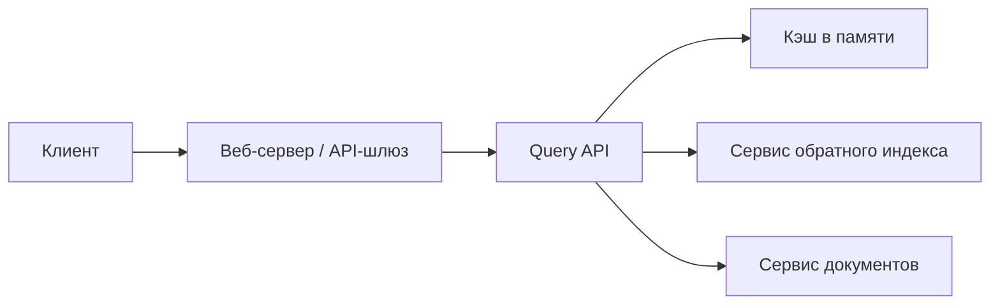
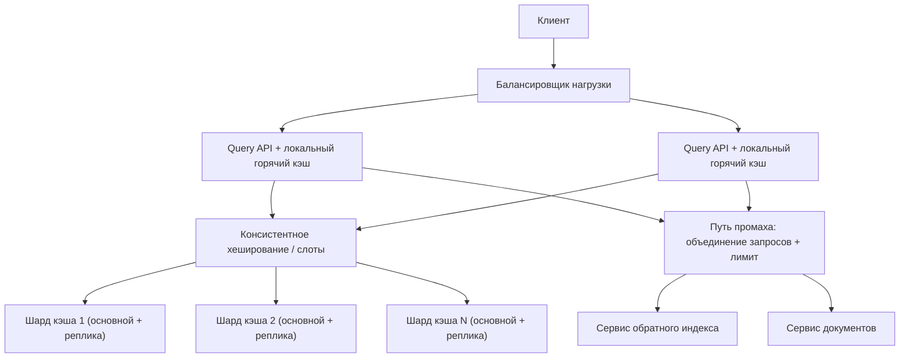

import { Aside } from '@astrojs/starlight/components';

Поисковый трафик сильно перекошен. Небольшой набор запросов («погода», «новости», название
вчерашнего громкого события) даёт огромную долю всех обращений. Прогонять каждый из них через
полный конвейер индекса и ранжирования — значит тратить тысячи миллисекунд процессорного
времени каждую секунду. Кэш результатов перед поисковым бэкендом отдаёт популярные запросы из
памяти примерно за миллисекунду. Спроектируем такой кэш: структуру данных, размер, распределение
по машинам и поддержание свежести.

<Aside type="tip" title="Коротко">
- Ключ — **нормализованный запрос и всё, что влияет на страницу выдачи** (локаль, безопасный поиск, номер страницы, версия индекса). Значение — сериализованные top-N результатов.
- Каждый узел — **LRU-кэш**: хеш-таблица плюс двусвязный список, `get`/`put` за `O(1)`. На практике берут кэш-сервер с приближённым LRU или LFU.
- Ключи **шардируются** по узлам **консистентным хешированием** (или слотами хешей). Реплики дают доступность, а небольшой локальный кэш в каждом API-сервере держит самые горячие запросы.
- Свежесть обеспечивают **TTL и версия в ключе**: новый снимок индекса даёт новые ключи, а старые записи вытесняются со временем. **Объединение запросов** (request coalescing) и раннее обновление защищают горячие ключи от лавины промахов.
</Aside>

## Шаг 1 — Требования и ограничения

### Сценарии использования

В рамках задачи:

- **Пользователь** отправляет запрос, и происходит **попадание в кэш** — возвращаем закэшированные результаты.
- **Пользователь** отправляет запрос, и происходит **промах кэша** — выполняем поиск, возвращаем результаты, заполняем кэш.
- **Сервис** обладает высокой доступностью.

Вне рамок: построение индекса, ранжирование, понимание запроса сверх базовой нормализации и
персонализированная выдача. Персонализированные страницы обычно не кэшируют целиком —
см. раздел о 2026 годе.

### Нефункциональные требования

- Попадания должны быть быстрыми: около 1 мс внутри дата-центра, несколько миллисекунд от начала до конца.
- Популярные запросы почти всегда должны попадать в кэш.
- Память ограничена, поэтому нужна ясная политика: что хранить, что вытеснять.
- Результаты не должны долго оставаться устаревшими после изменения индекса.
- Кэш — оптимизация. Если он пропадёт, поиск должен работать дальше: медленнее, но без обвала.

### Допущения

- 10 млн пользователей, 10 млрд запросов в месяц.
- Нагрузка неравномерная, примерно по закону Ципфа: популярность запроса обратно пропорциональна его рангу.
- Заметная доля запросов каждый день новая. Google давно говорит, что около 15 % ежедневных запросов система раньше не видела, а такие запросы могут быть только промахами.
- Машины в одном дата-центре общаются с низкой задержкой, около 0,5 мс.

### Прикидочный расчёт («на салфетке»)

| Величина | Расчёт | Результат |
|---|---|---|
| Частота запросов | 10 млрд ÷ 2,592 млн с в месяце | ≈ 3860/с в среднем (≈ 4000 по правилу 2,5 млн с), в пике закладываем ≈ 12 000/с |
| Запись: ключ | нормализованный запрос | ≈ 50 Б |
| Запись: значение | 10 результатов × (URL 60 Б + заголовок 60 Б + сниппет 160 Б) | ≈ 2800 Б |
| Запись: накладные расходы | слот хеш-таблицы, указатели LRU, аллокатор | ≈ 80 Б, итого ≈ 2,9 КБ на запись |
| Кэшировать все запросы месяца | 10 млрд × 2,9 КБ | ≈ 29 ТБ — не вариант |
| Горячий набор из 100 млн разных запросов | 100 млн × 2,9 КБ | ≈ 290 ГБ без сжатия, ≈ 106 ГБ при сжатии значений примерно в 3 раза |
| Исходящий трафик кэша | 3860/с × 2,9 КБ | ≈ 11 МБ/с — пренебрежимо |

<Aside type="note" title="Поправка к классической оценке">
В исходном расчёте запись занимала 270 байт: запрос 50 байт, заголовок 20 байт, сниппет
200 байт. Это **один** результат. На странице выдачи их около десяти, так что запись ближе к
3 КБ, а «все запросы за месяц» — около 29 ТБ, а не 2,7 ТБ. Вывод не меняется: закэшировать
всё нельзя, придётся выбирать.
</Aside>

Насколько большим должен быть горячий набор? При распределении Ципфа и примерно 1 млрд разных
запросов идеальный кэш с топ-1 млн запросов ловит около 68 % обращений, с топ-10 млн — около
78 %, с топ-100 млн — около 89 %. Каждое десятикратное увеличение памяти добавляет лишь около
10 процентных пунктов, поэтому **100 млн записей (примерно 110–140 ГБ со сжатием и накладными
расходами) — разумная цель.** Настоящий LRU работает хуже идеала. Приближение Че (Che),
сверенное с симуляцией, даёт потерю около 4–8 процентных пунктов, и с ростом кэша разрыв
сокращается: разовые запросы постоянно вытесняют полезные записи.

## Шаг 2 — Высокоуровневый дизайн



1. **Query API** нормализует запрос и строит ключ кэша.
2. При **попадании** возвращает закэшированные результаты.
3. При **промахе** вызывает **сервис обратного индекса**, который находит и ранжирует подходящие документы. **Сервис документов** отдаёт заголовки и сниппеты. Затем API кладёт страницу в кэш (схема **cache-aside**) и возвращает её.

## Шаг 3 — Ключевые компоненты

### Нормализация запроса и ключ кэша

Разные написания одного запроса должны давать один ключ, иначе доля попаданий рухнет. Всё, что
меняет страницу выдачи, должно входить в ключ, иначе пользователи получат чужие результаты.

```python title="query_api.py"
import hashlib
import re
import unicodedata
from collections.abc import Callable
from dataclasses import dataclass

INDEX_VERSION = "idx-2026-10-08T06"     # меняется, когда в работу выходит новый снимок индекса


@dataclass(frozen=True)
class Result:
    url: str
    title: str
    snippet: str


def normalize(raw: str) -> str:
    """Приводит эквивалентные запросы к одному ключу."""
    text = unicodedata.normalize("NFKC", raw).casefold()
    text = re.sub(r"<[^>]+>", " ", text)          # убираем разметку
    terms = re.findall(r"\w+", text)
    return " ".join(terms)


def cache_key(query: str, locale: str, safe_search: bool, page: int) -> str:
    """Всё, что меняет страницу выдачи, должно входить в ключ."""
    raw = f"{INDEX_VERSION}|{locale}|{int(safe_search)}|{page}|{query}"
    return hashlib.blake2b(raw.encode(), digest_size=16).hexdigest()


class QueryApi:
    def __init__(self, cache_get: Callable[[str], list[Result] | None],
                 cache_put: Callable[[str, list[Result]], None],
                 search: Callable[[str], list[Result]]) -> None:
        self.cache_get, self.cache_put, self.search = cache_get, cache_put, search

    def handle(self, raw: str, locale: str = "ru-RU", safe: bool = True,
               page: int = 1) -> list[Result]:
        query = normalize(raw)
        key = cache_key(query, locale, safe, page)
        if (hit := self.cache_get(key)) is not None:
            return hit
        results = self.search(query)             # сервисы индекса и документов
        self.cache_put(key, results)              # заполнение по схеме cache-aside
        return results
```

Хеширование даёт ключ фиксированного размера (16-байтный дайджест, 32 шестнадцатеричных символа, вместо 50 байт в среднем) и равномерно
распределяет ключи по шардам. Цена — для отладки нужен журнал соответствия ключа и запроса.
Реальные системы нормализуют гораздо больше, чем этот пример: исправляют опечатки, учитывают
синонимы, приводят слова к основе (стемминг). Каждое правило сливает больше написаний в один
ключ и повышает долю попаданий, но только если выдача при этом остаётся той же.

### LRU-кэш

LRU-кэш объединяет **хеш-таблицу** (ключ → узел) и **двусвязный список**, упорядоченный по
давности использования. При попадании узел переносится в начало. При вставке в заполненный кэш
вытесняется узел из конца. Обе операции — `O(1)`.

```python title="lru_cache.py"
import time
from dataclasses import dataclass, field
from typing import Any


@dataclass(eq=False)
class _Node[K, V]:
    key: K
    value: V
    expires_at: float
    prev: "_Node[K, V] | None" = field(default=None, repr=False)
    next: "_Node[K, V] | None" = field(default=None, repr=False)


class LRUCache[K, V]:
    """Хеш-таблица + двусвязный список. get/put за O(1).

    Самые свежие записи стоят сразу после головного ограничителя;
    кандидат на вытеснение всегда прямо перед хвостовым.
    """

    def __init__(self, capacity: int, ttl_seconds: float) -> None:
        if capacity <= 0:
            raise ValueError("capacity must be positive")
        self.capacity = capacity
        self.ttl = ttl_seconds
        self._map: dict[K, _Node[K, V]] = {}
        self._head: _Node[Any, Any] = _Node(None, None, 0.0)  # ограничители
        self._tail: _Node[Any, Any] = _Node(None, None, 0.0)
        self._head.next, self._tail.prev = self._tail, self._head

    def get(self, key: K) -> V | None:
        node = self._map.get(key)
        if node is None:
            return None
        if node.expires_at <= time.monotonic():      # ленивое истечение TTL
            self._unlink(node)
            del self._map[key]
            return None
        self._unlink(node)
        self._push_front(node)
        return node.value

    def put(self, key: K, value: V) -> None:
        expires = time.monotonic() + self.ttl
        node = self._map.get(key)
        if node is not None:
            node.value, node.expires_at = value, expires
            self._unlink(node)
            self._push_front(node)
            return
        if len(self._map) >= self.capacity:
            victim = self._tail.prev
            assert victim is not None and victim is not self._head
            self._unlink(victim)
            del self._map[victim.key]
        node = _Node(key, value, expires)
        self._map[key] = node
        self._push_front(node)

    def invalidate(self, key: K) -> None:
        if (node := self._map.pop(key, None)) is not None:
            self._unlink(node)

    def __len__(self) -> int:
        return len(self._map)

    def _push_front(self, node: _Node[K, V]) -> None:
        first = self._head.next
        node.prev, node.next = self._head, first
        self._head.next = node
        assert first is not None
        first.prev = node

    @staticmethod
    def _unlink(node: _Node[K, V]) -> None:
        assert node.prev is not None and node.next is not None
        node.prev.next, node.next.prev = node.next, node.prev
        node.prev = node.next = None


if __name__ == "__main__":
    cache: LRUCache[str, list[str]] = LRUCache(capacity=2, ttl_seconds=60)
    cache.put("python lru", ["docs.python.org/..."])
    cache.put("rust traits", ["doc.rust-lang.org/..."])
    cache.get("python lru")                  # обращение: теперь самая свежая
    cache.put("go generics", ["go.dev/..."])  # вытесняет "rust traits"
    print(cache.get("rust traits"))          # None
    print(cache.get("python lru"))           # ['docs.python.org/...']
```

Ограничители (sentinel) в голове и хвосте убирают все особые случаи вида «а не пуст ли список».
Код проверен против `collections.OrderedDict` на случайных операциях. В продакшене такое сами
не пишут. Внутри процесса хватает `functools.lru_cache` в Python, а Valkey, Redis или Memcached
реализуют вытеснение на C. Redis приближает LRU выборкой нескольких ключей (по умолчанию 5)
вместо глобального списка — это экономит память и блокировки.

### Свежесть результатов

Закэшированная выдача устаревает, когда меняется содержимое страницы, когда страницы
добавляются или удаляются, когда меняется ранжирование. Отслеживать каждый документ кэш не
может. Три дешёвых инструмента вместе поддерживают его свежим:

1. **TTL у каждой записи.** Минуты для новостных запросов, часы для стабильных. Добавляем случайный разброс ±10 %, чтобы записи, сделанные одновременно, не истекали одновременно.
2. **Версия индекса в ключе.** Когда поисковый слой переключается на новый снимок индекса, новые запросы используют новые ключи. Старые записи больше никто не читает, и их удаляет LRU или TTL. Переключение раскатываем постепенно, иначе доля попаданий разом упадёт до нуля.
3. **Точечная инвалидация** для редких срочных случаев, например удаления по требованию закона: фильтр по «чёрному списку» URL на выходе проще и надёжнее, чем поиск всех закэшированных страниц с этим URL.

## Шаг 4 — Масштабирование

1. **Памяти и запросов больше, чем выдержит один узел.** Есть три варианта:
   - У каждого API-сервера свой кэш. Просто, но доля попаданий низкая, а в памяти N копий.
   - На каждом узле полная копия. Память тратится впустую, и каждая запись идёт на все узлы.
   - **Ключи шардируются по кластеру кэша.** Это обычный выбор: память всех узлов складывается, и каждый ключ живёт в одном месте.
2. **Какой узел владеет ключом?** При `hash(key) % N` добавление одного узла к десяти перемещает около 90 % ключей. При **консистентном хешировании** (кольцо виртуальных узлов) перемещается лишь около 1/(N+1), примерно 9 %, поэтому доля попаданий переживает масштабирование и отказы узлов. Redis и Valkey Cluster используют вариант этой идеи: 16 384 слота хешей, которые переносятся между узлами явно.
3. **Отказ узла.** У каждого шарда есть реплика. Упавший основной узел заменяется репликой за секунды. Без реплик мёртвый узел превращает свою долю трафика в промахи и отправляет их все в поисковый бэкенд.
4. **Горячие ключи.** Один вирусный запрос может перегрузить узел, которому он принадлежит. В каждом сервере Query API держим небольшой **LRU-кэш в процессе** (несколько тысяч записей, TTL в несколько секунд), чтобы самые горячие ключи вообще не ходили по сети. В крайних случаях копируем ключ на несколько узлов с суффиксами `key#1..k`.
5. **Лавина промахов (stampede).** Когда истекает горячая запись, тысячи запросов промахиваются разом. Помогает **объединение запросов**: пересчитывает один запрос, остальные ждут; реализуется короткой блокировкой или арендами (leases) в стиле Memcached. Помогает и **вероятностное раннее обновление**: каждый читатель может обновить запись чуть раньше TTL, и вероятность растёт по мере приближения к истечению.
6. **Защита бэкенда.** Если кластер кэша деградировал, ограничиваем поток промахов к индексу (ограничение частоты запросов, сброс нагрузки), а не позволяем сбою кэша уронить и поиск.

```python title="hash_ring.py"
import bisect
import hashlib


def _h(key: str) -> int:
    return int.from_bytes(hashlib.blake2b(key.encode(), digest_size=8).digest())


class HashRing:
    """Консистентное хеширование с виртуальными узлами."""

    def __init__(self, nodes: list[str], vnodes: int = 200) -> None:
        self.vnodes = vnodes
        self._ring: list[tuple[int, str]] = []
        for n in nodes:
            self.add(n)

    def add(self, node: str) -> None:
        for i in range(self.vnodes):
            bisect.insort(self._ring, (_h(f"{node}#{i}"), node))

    def remove(self, node: str) -> None:
        self._ring = [(h, n) for h, n in self._ring if n != node]

    def node_for(self, key: str) -> str:
        i = bisect.bisect(self._ring, (_h(key), "")) % len(self._ring)
        return self._ring[i][1]


if __name__ == "__main__":
    keys = [f"query:{i}" for i in range(100_000)]
    ring = HashRing([f"cache-{i}" for i in range(10)])
    before = {k: ring.node_for(k) for k in keys}
    ring.add("cache-10")
    moved = sum(before[k] != ring.node_for(k) for k in keys)
    print(f"перемещено после добавления 1 узла к 10: {moved / len(keys):.1%}")  # ~9%
    naive = sum(_h(k) % 10 != _h(k) % 11 for k in keys)
    print(f"перемещено при hash % N:                 {naive / len(keys):.1%}")  # ~91%
```



Размеры: около 140 ГБ горячих записей (100 млн записей со сжатием плюс около 30 % запаса на
фрагментацию и буферы репликации) помещаются на 6 основных узлах примерно по 24 ГБ или на 12
по 12 ГБ, плюс по одной реплике на каждый. Пропускная способность — не проблема: даже
12 000/с в пике — небольшая нагрузка для одного современного кэш-узла. Шардируем ради памяти и
изоляции отказов.

| Вариант | Плюсы | Минусы |
|---|---|---|
| Частный кэш на каждом сервере | Нет сетевого шага | Низкая доля попаданий, N копий |
| Полностью реплицированный кэш | Ответит любой узел | Память × N, запись на все узлы |
| Шардирование + консистентное хеширование | Память складывается, минимум перемещений | Лишний сетевой шаг, риск горячих ключей |
| Два уровня (локальный + общий) | Горячие ключи локально, общий уровень для «длинного хвоста» | Два TTL, кратковременная несогласованность |

## Что изменилось к 2026 году

- **Кэш-серверы:** выбор по умолчанию — Valkey (форк Redis под эгидой Linux Foundation, лицензия BSD) и Redis 8 (с 2025 года снова open source, AGPLv3 — один из вариантов лицензии). Оба доступны как управляемые сервисы. Memcached по-прежнему хорош для чистого многопоточного key-value-кэширования. Очень большие парки используют гибридные кэши «память + флеш», например CacheLib от Meta: на каждый доллар они вмещают гораздо больше записей.
- **Вытеснение сложнее LRU:** допуск в стиле LFU (W-TinyLFU в Caffeine) и новые простые алгоритмы S3-FIFO (SOSP 2023) и SIEVE (NSDI 2024) обыгрывают LRU на веб-трассах, в основном за счёт быстрого выбрасывания ключей, которые встречаются один раз. В поиске таких много, так что эффект здесь реальный.
- **Двухуровневый кэш стал стандартом:** кэш в процессе перед общим кэшем, часто с клиентским кэшированием, при котором сервер сообщает клиенту, когда выбросить ключ.
- **Кэшируют уже другое.** Страницы выдачи персонализированы и собираются из частей, поэтому поисковики кэшируют **компоненты**, а не страницы целиком: списки документов-кандидатов для запроса, сниппеты документов, признаки ранжирования. Финальное ранжирование и персонализация применяются на каждый запрос.
- **Периферия и ИИ:** CDN кэширует анонимные ответы и подсказки автодополнения ближе к пользователям. Сгенерированные большими языковыми моделями (LLM) ответы дороги, поэтому некоторые команды добавляют **семантический кэш** по эмбеддингам. Ему нужны строгие пороги похожести, а вопросы корректности и свежести остаются открытыми.
- **Что не изменилось:** cache-aside, вытеснение в духе LRU с TTL, шардирование консистентным хешированием, защита от лавин промахов и правило «кэш должен быть необязательным».

<Aside type="note" title="На собеседовании">
- **Реализуйте LRU.** Хеш-таблица и двусвязный список, обе операции за `O(1)`. Будьте готовы объяснить ограничители и порядок вытеснения.
- **Какого размера должен быть кэш?** Покажите размер записи, затем рассуждайте от неравномерности популярности (убывающая отдача), а не пытайтесь «закэшировать всё».
- **Как поддерживать свежесть?** TTL с разбросом, версия индекса в ключе, «чёрный список» для срочных удалений.
- **Что будет при отказе узла?** Реплики, консистентное хеширование и защита бэкенда от всплеска промахов.
- **Горячие ключи и лавины промахов:** локальный уровень, объединение запросов или аренды, раннее обновление.
- **Типичные ошибки:** локаль или безопасный поиск не входят в ключ, шардирование через `hash % N`, отсутствие TTL, бэкенд падает при каждом холодном кэше.
</Aside>

## Что почитать

- [Redis: key eviction](https://redis.io/docs/latest/develop/reference/eviction/) — приближённые LRU и LFU на практике.
- [Redis Cluster specification](https://redis.io/docs/latest/operate/oss_and_stack/reference/cluster-spec/) — слоты хешей и hash tags.
- [Scaling Memcache at Facebook (NSDI 2013)](https://www.usenix.org/conference/nsdi13/technical-sessions/presentation/nishtala) — аренды, лавины промахов, региональные пулы.
- [Optimal probabilistic cache stampede prevention (VLDB 2015)](https://www.vldb.org/pvldb/vol8/p886-vattani.pdf)
- [SIEVE is simpler than LRU (NSDI 2024)](https://www.usenix.org/conference/nsdi24/presentation/zhang-yazhuo)
- [Consistent hashing and random trees (Karger et al., 1997)](https://www.cs.princeton.edu/courses/archive/fall09/cos518/papers/chash.pdf)

## Связанные темы

- [Партиционирование и шардирование](/data/partitioning-and-sharding/) — консистентное хеширование и слоты хешей подробно.
- [Уровни кэширования](/caching/caching-layers/) — кэши клиента, CDN, приложения и базы данных.
- [Стратегии кэширования](/caching/cache-strategies/) — cache-aside, write-through и refresh-ahead.
- [LRU-кэш (ООП)](/ood/lru-cache/) — объектно-ориентированная версия той же структуры данных.
- [Ограничение частоты запросов](/reliability/rate-limiting/) — защита бэкенда при промахах кэша.
