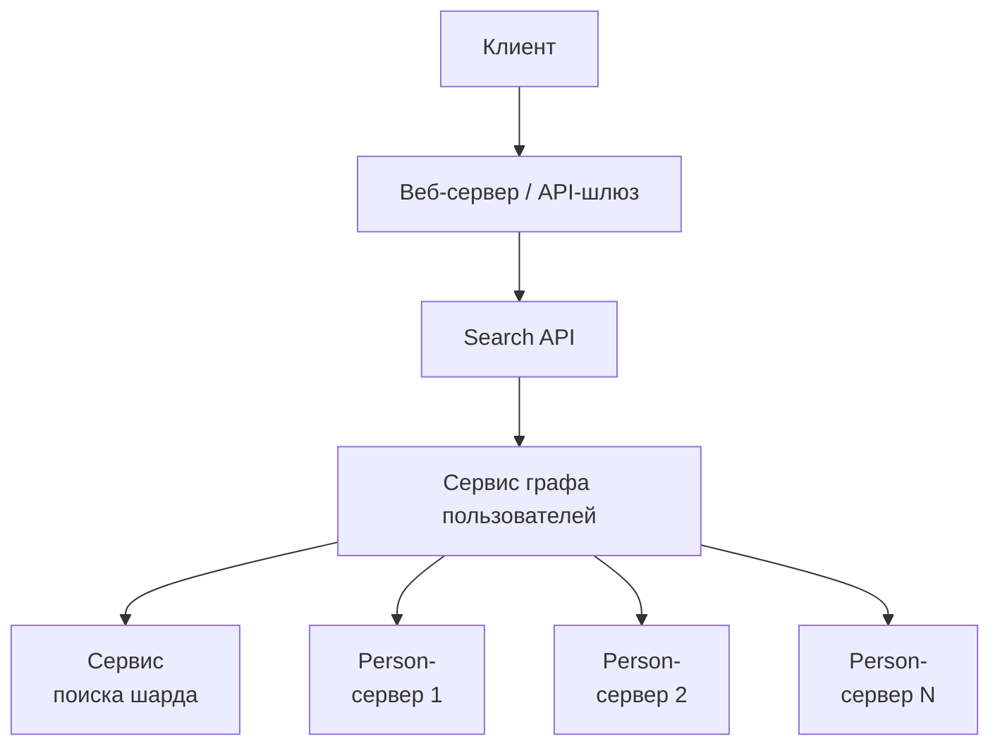
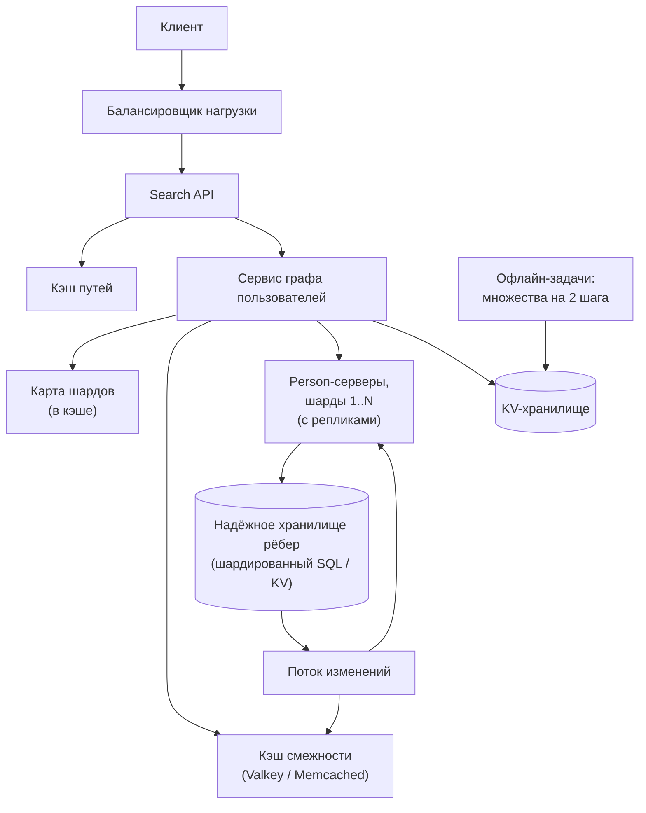

import { Aside } from '@astrojs/starlight/components';

Вопрос «как я связан с этим человеком?» звучит как учебная задача на графы. Но когда в графе
миллиарды рёбер на сотнях машин, это уже задача распределённых систем. Каждый шаг поиска в
ширину превращается в сетевые вызовы, а неаккуратный обход ради одного запроса заденет миллионы
вершин. Разберём, как хранить граф, как по нему искать и как реальные социальные сети отвечают
на такие запросы быстро.

<Aside type="tip" title="Коротко">
- Граф храним как **списки смежности** (id пользователя → id друзей) в памяти **person-серверов**, шардированных по id пользователя. **Сервис поиска шарда** (lookup service) сопоставляет id с шардом.
- Путь ищем **двунаправленным BFS**, каждый раз расширяя меньший фронт. Для пути длины 4 при 50 друзьях это около 5 000 вершин вместо 6 млн.
- Каждый уровень BFS загружаем **одним пакетным вызовом на шард**, параллельно. Сетевых обменов на поиск — несколько, а не по одному на каждого друга.
- **Кэшируем** горячие списки смежности и готовые результаты, ограничиваем глубину и время поиска. В большом масштабе шардированное реляционное или key-value-хранилище с графовым API и кэшем перед ним, как TAO у Facebook, выигрывает у универсальной графовой БД.
</Aside>

## Шаг 1 — Требования и ограничения

### Сценарии использования

В рамках задачи:

- **Пользователь** ищет другого человека и видит кратчайшую цепочку друзей между ними, например «Вы → Аня → Борис → Кирилл».
- **Сервис** обладает высокой доступностью.

Вне рамок: рекомендации друзей, лента, правила приватности о том, какие связи кому видны (упомянуть, но не проектировать), взвешенные и направленные рёбра вроде подписок.

### Нефункциональные требования

- Интерактивная задержка (latency). Цель — p99 в пределах нескольких сотен миллисекунд, либо ответ «пути не найдено в пределах N шагов».
- Граф не помещается на одну машину. Это явное условие задачи.
- Чтений гораздо больше, чем записей. Дружеские связи меняются редко по сравнению с тем, как часто их читают.
- Нагрузка неравномерная. Некоторых людей (знаменитостей, «хабов») ищут намного чаще остальных.

### Допущения

- 100 млн пользователей, в среднем 50 друзей у каждого. Рёбра ненаправленные и невзвешенные.
- 1 млрд поисков в месяц.
- В основном дизайне используем обычные хранилища и сервисы, без графовой БД. Графовые БД обсудим в конце.

### Прикидочный расчёт («на салфетке»)

| Величина | Расчёт | Результат |
|---|---|---|
| Записей смежности | 100 млн × 50 друзей | 5 млрд (2,5 млрд дружеских связей, каждая хранится дважды) |
| Поиски | 1 млрд ÷ 2,592 млн с в месяце | ≈ 390/с в среднем (≈ 400 по правилу 2,5 млн с), в пике закладываем ≈ 2 000/с |
| Списки смежности в памяти | 5 млрд × 8-байтовые id | ≈ 40 ГБ (≈ 17 ГБ с дельта- и varint-кодированием) |
| Для сравнения — матрица смежности | (10⁸)² бит | ≈ 1,25 ПБ, поэтому матрица не вариант |
| Однонаправленный BFS, путь длины 4 | 50⁴ вершин на последнем уровне | ≈ 6,25 млн вершин |
| Двунаправленный BFS, 2 + 2 уровня | 2 × 50² | ≈ 5 000 вершин, примерно в 1 250 раз меньше |
| Чтение списков друзей | 400/с × ~100 раскрытий × 50 id | ≈ 2 млн id/с ≈ 16 МБ/с — немного |

Шардировать нас заставляет не объём: 40 ГБ поместятся в память одного крупного сервера. Мы
шардируем ради **запаса по мощности, доступности и роста**, а ещё потому, что настоящая запись
профиля (имя, ссылка на фото, настройки приватности) гораздо больше списка id. Сети с
1 млрд пользователей и 200 друзьями у каждого нужно около 1,6 ТБ на одни списки смежности.

## Шаг 2 — Высокоуровневый дизайн



1. **Search API** принимает id `source` и `target` и проверяет права доступа.
2. **Сервис графа пользователей** выполняет поиск. Чтобы раскрыть вершину, ему нужен её список друзей.
3. **Сервис поиска шарда** сообщает, какой **person-сервер** хранит нужный id. Person-серверы держат записи пользователей и списки смежности для своего шарда.
4. Поиск возвращает список id, и API превращает их в имена и ссылки на профили.

## Шаг 3 — Ключевые компоненты

### API

```http title="Запрос"
GET /v1/connections/path?source=1234&target=98765&max_hops=6
```

```json title="Ответ: 200 OK"
{
  "hops": 3,
  "path": [
    {"user_id": 1234, "name": "Вы"},
    {"user_id": 53, "name": "Аня", "url": "https://social.example/anya"},
    {"user_id": 7710, "name": "Борис", "url": "https://social.example/boris"},
    {"user_id": 98765, "name": "Кирилл", "url": "https://social.example/kirill"}
  ]
}
```

Если в пределах лимита ничего не нашлось, возвращаем `200` с `"path": null` и
`"reason": "not_within_max_hops"`. Это нормальный результат, а не ошибка сервера. Внутри
сервисы общаются по gRPC.

### Как представить граф

| Представление | Объём для нашего графа | Хорошо для | Плохо для |
|---|---|---|---|
| Матрица смежности | ≈ 1,25 ПБ | Плотных графов, проверки «дружат ли A и B» за `O(1)` | Разреженных соцграфов: почти одни нули |
| Список смежности на пользователя | ≈ 40 ГБ | Получения всех друзей — это и нужно BFS | Проверка ребра за `O(degree)`, или `O(log degree)`, если список отсортирован |
| Таблица рёбер `(user_id, friend_id)` в SQL | Сотни ГБ с индексами | Надёжного источника истины, простых изменений | Обхода: каждый шаг — запрос, без кэша медленно |

Используем оба варианта: **таблицу рёбер** в надёжном шардированном хранилище как источник
истины и **списки смежности в памяти** person-серверов (или в кэше) для обхода. Каждую дружбу
храним в обе стороны — на шарде A и на шарде B, — чтобы список друзей любого из них читался
с одного шарда.

### Кратчайший путь: BFS

Граф невзвешенный, поэтому поиск в ширину (BFS) находит кратчайший путь, алгоритм Дейкстры не
нужен. Однонаправленный BFS работает, но его фронт растёт как `degree^depth`. При 50 друзьях
на четвёртом уровне уже около 6 млн вершин.

**Двунаправленный BFS** ищет с обоих концов сразу и останавливается, когда поиски встречаются.
Каждой стороне нужно пройти лишь около половины глубины, поэтому работа падает примерно с
`b^d` до `2·b^(d/2)`. Расширение меньшего фронта помогает и тогда, когда на одном из концов
знаменитость с миллионами друзей.

```python title="bidirectional_bfs.py"
from collections.abc import Callable, Iterable

Neighbors = Callable[[int], Iterable[int]]


def bidirectional_path(source: int, target: int, neighbors: Neighbors,
                       max_hops: int = 6) -> list[int] | None:
    """Кратчайший путь в ненаправленном невзвешенном графе.

    Наращивает BFS по одному уровню с каждого конца, всегда расширяя
    меньший фронт, и останавливается, когда два поиска встречаются.
    """
    if source == target:
        return [source]
    parent_s: dict[int, int | None] = {source: None}
    parent_t: dict[int, int | None] = {target: None}
    frontier_s, frontier_t = [source], [target]
    hops = 0
    while frontier_s and frontier_t and hops < max_hops:
        # Расширяем более дешёвую сторону; меняем роли, чтобы код ниже был односторонним.
        swapped = len(frontier_s) > len(frontier_t)
        if swapped:
            frontier_s, frontier_t = frontier_t, frontier_s
            parent_s, parent_t = parent_t, parent_s
        next_frontier: list[int] = []
        meet: int | None = None
        for node in frontier_s:
            for friend in neighbors(node):
                if friend in parent_s:
                    continue
                parent_s[friend] = node
                if friend in parent_t:
                    meet = friend
                    break
                next_frontier.append(friend)
            if meet is not None:
                break
        frontier_s = next_frontier
        hops += 1
        if swapped:  # возвращаем исходную ориентацию
            frontier_s, frontier_t = frontier_t, frontier_s
            parent_s, parent_t = parent_t, parent_s
        if meet is not None:
            return _join(meet, parent_s, parent_t)
    return None


def _join(meet: int, parent_s: dict[int, int | None],
          parent_t: dict[int, int | None]) -> list[int]:
    left: list[int] = []
    node: int | None = meet
    while node is not None:
        left.append(node)
        node = parent_s[node]
    right: list[int] = []
    node = parent_t[meet]
    while node is not None:
        right.append(node)
        node = parent_t[node]
    return left[::-1] + right


if __name__ == "__main__":
    friends: dict[int, list[int]] = {
        1: [2, 3], 2: [1, 4], 3: [1, 5], 4: [2, 6],
        5: [3, 6], 6: [4, 5, 7], 7: [6], 8: [],
    }
    print(bidirectional_path(1, 7, lambda u: friends[u]))  # [1, 2, 4, 6, 7]
    print(bidirectional_path(1, 8, lambda u: friends[u]))  # None
```

Поиск останавливается на первой же вершине, которую уже видела другая сторона, и это всё равно
кратчайший путь. Проверка пересечения выполняется при первом обнаружении каждой вершины, так что
поиски не могли встретиться раньше на меньшей суммарной глубине. Мы сверили результат с обычным
BFS на 20 000 случайных графов. На случайном графе из 200 000 вершин с 20 друзьями у каждой
двунаправленная версия сделала примерно в 190 раз меньше запросов соседей.

### Распределённый обход: person-серверы и пакетные запросы

В примере `neighbors()` — локальная функция. В продакшене это сетевой вызов к person-серверу,
который хранит этот id. В исходном наброске сервис поиска шарда и person-сервер вызываются
**на каждого друга отдельно**. Тогда четырёхшаговый однонаправленный поиск делает не меньше
127 000 последовательных сетевых обменов (по одному на каждую раскрытую вершину) — это слишком
медленно.

Решение — **раскрывать уровень целиком**: сгруппировать id фронта по шардам и отправить один
пакетный вызов на шард, все параллельно. Тогда число сетевых обменов равно глубине поиска
(около 4), а не числу вершин.

```python title="batched_lookup.py"
from collections import defaultdict
from dataclasses import dataclass, field


@dataclass
class PersonServer:
    """Один шард: id пользователя -> id друзей, в памяти."""
    friends: dict[int, list[int]] = field(default_factory=dict)
    calls: int = 0

    def get_friends(self, ids: list[int]) -> dict[int, list[int]]:
        self.calls += 1                        # один RPC, много id
        return {i: self.friends.get(i, []) for i in ids}


class LookupService:
    """Сопоставляет id пользователя с шардом. Здесь — фиксированный хеш;
    на практике — справочник (диапазон id или виртуальный бакет -> сервер),
    закэшированный у клиентов."""

    def __init__(self, num_shards: int) -> None:
        self.num_shards = num_shards

    def shard_of(self, user_id: int) -> int:
        return user_id % self.num_shards


def expand_level(frontier: list[int], lookup: LookupService,
                 servers: list[PersonServer]) -> dict[int, list[int]]:
    """Загружает списки друзей для целого уровня BFS: один пакетный вызов на шард."""
    by_shard: dict[int, list[int]] = defaultdict(list)
    for uid in frontier:
        by_shard[lookup.shard_of(uid)].append(uid)
    result: dict[int, list[int]] = {}
    for shard, ids in by_shard.items():        # эти вызовы делаем параллельно
        result.update(servers[shard].get_friends(ids))
    return result
```

**Сервис поиска шарда** не должен быть отдельным сетевым шагом при каждом вызове. Это
небольшой справочник (диапазон id или виртуальный бакет → сервер). Клиенты кэшируют его и
обновляют при изменениях. `user_id % N` в примере — только иллюстрация. В реальной системе на
сервер приходится много виртуальных бакетов, чтобы шард можно было перенести, не
перехешируя всех.

## Шаг 4 — Масштабирование

1. **Повторные и популярные поиски.** Записи пользователей и списки смежности кэшируем в Valkey, Redis или Memcached. Готовые пути кэшируем по ключу `(source, target)` с коротким TTL. Списки друзей «хабов» читаются постоянно, поэтому держим их ещё и в небольшом локальном кэше каждого экземпляра сервиса графа.
2. **Слишком много сетевых шагов.** Пакетируем каждый уровень по шардам, как показано выше. Размещаем друзей рядом: инструменты разбиения графа, например Social Hash у Facebook, раскладывают пользователей так, чтобы большинство списков друзей оставались на немногих шардах, и это сокращает обращения к множеству шардов. Разбиение по регионам — более дешёвое приближение, ведь друзья обычно живут недалеко друг от друга.
3. **Долгие или неудачные поиски.** Ограничиваем число шагов (6 хватает) и время. Лучше ответить «не найдено в пределах N шагов», чем обойти полграфа. Расширение меньшего фронта не даёт знаменитости на любом из концов раздуть поиск.
4. **Предвычисления.** Для частого вопроса «этот человек в пределах 2 шагов от меня?» храним множество друзей друзей каждого пользователя (или его компактный скетч) в key-value-хранилище и обновляем офлайн. Полное множество — около 2 500 id на пользователя, примерно 2 ТБ на 100 млн человек, поэтому часто его считают только для активных пользователей или держат вместо него фильтр Блума.
5. **Доступность.** Каждый шард person-серверов реплицируем (лидер с фолловерами или три реплики). Изменения рёбер сначала пишутся в надёжное хранилище, а затем доходят до копий в памяти через поток изменений (change stream).



| Оптимизация | Выигрыш | Цена |
|---|---|---|
| Двунаправленный BFS | На порядки меньше вершин | Нужны оба конца; код чуть сложнее |
| Пакетирование по шардам | Число обменов равно глубине, а не числу вершин | Сообщения крупнее; задержку уровня задаёт самый медленный шард |
| Шардирование с учётом близости | Меньше шардов на уровень | Работа по перебалансировке; «горячие» регионы |
| Кэши путей и смежности | Низкая задержка повторных поисков | Устаревание после удаления из друзей — короткий TTL и инвалидация |
| Предвычисленные множества на 2 шага | Проверка «в пределах 2 шагов» за `O(1)` | Терабайты данных; офлайн-конвейер |

## Что изменилось к 2026 году

- **TAO по-прежнему эталонный дизайн.** Facebook обслуживает социальный граф через TAO (статья USENIX ATC 2013). TAO хранит *объекты* и типизированные *ассоциации* в шардированном MySQL, перед ним стоит двухуровневый кэш со сквозной записью (write-through), а доля чтений — 99,8 %. Дружба хранится как два направленных ребра на двух шардах, а асинхронная задача чинит пары, записанные наполовину. Урок актуален и сегодня: в очень большом масштабе простой графовый API поверх шардированного реляционного или key-value-хранилища с агрессивным кэшированием выигрывает у универсальной графовой БД.
- **Специализированные графовые сервисы в памяти** есть у крупнейших компаний. Например, LIquid в LinkedIn обслуживает «экономический граф» примерно из 270 млрд рёбер при нагрузке около 2 млн запросов в секунду (данные LinkedIn за 2023 год).
- **Графовые БД зрелые для графов среднего размера.** Neo4j, Amazon Neptune, TigerGraph, Memgraph и другие хорошо работают, когда граф помещается в кластер, который мы готовы эксплуатировать, а запросы — сложные многошаговые шаблоны: антифрод, графы знаний, рекомендации. Планировщик кратчайших путей в Neo4j сам использует двунаправленный BFS. Языки запросов стандартизируются: **GQL** стал стандартом ISO/IEC 39075 в 2024 году, а **SQL/PGQ** добавляет запросы к графу свойств прямо в SQL.
- **Пакетная аналитика графа** (степени разделения, сообщества, эмбеддинги) выполняется офлайн на Spark GraphFrames или похожих движках, а не на пути обслуживания запросов. Известные «3,57 степени разделения» у Facebook (2016) — оценка, посчитанная офлайн, а не живой BFS.
- **Что не изменилось:** списки смежности, BFS для невзвешенных кратчайших путей, двунаправленный приём, шардирование по id пользователя с закэшированным справочником и пакетирование по шардам.

<Aside type="note" title="На собеседовании">
- **Почему не Дейкстра?** Рёбра невзвешенные, BFS и так находит кратчайший путь, причём с меньшими накладными расходами.
- **Сколько сетевых вызовов делает один поиск?** Расскажите про вызовы на каждую вершину против пакетных вызовов на уровень и про роль закэшированной карты шардов.
- **Что, если у пользователя 5 млн подписчиков?** Расширяем меньший фронт, ограничиваем ветвление, обрабатываем «хабы» особо: кэшируем их списки или не раскрываем их в запросах пути.
- **Что происходит при удалении из друзей?** Сначала обновляется надёжное хранилище, затем поток изменений инвалидирует кэши. Закэшированные пути могут недолго быть устаревшими, поэтому TTL у них короткий.
- **Приватность:** рёбра, которые запрашивающему пользователю видеть нельзя, не должны попасть в возвращаемый путь. Фильтруем на сервере.
- **Типичные ошибки:** матрица смежности, обращение к сервису поиска шарда на каждого друга, отсутствие лимита по глубине и времени, утверждение, что графовая БД избавляет от шардирования.
</Aside>

## Что почитать

- [TAO: Facebook's Distributed Data Store for the Social Graph (USENIX ATC 2013)](https://www.usenix.org/conference/atc13/technical-sessions/presentation/bronson)
- [TAO: The power of the graph (Engineering at Meta)](https://engineering.fb.com/2013/06/25/core-infra/tao-the-power-of-the-graph/)
- [Social Hash: размещение данных с учётом социального графа (NSDI 2016)](https://www.usenix.org/conference/nsdi16/technical-sessions/presentation/shalita)
- [How LIquid connects everything (LinkedIn Engineering)](https://www.linkedin.com/blog/engineering/graph-systems/how-liquid-connects-everything-so-our-members-can-do-anything)
- [Three and a half degrees of separation (Meta Research)](https://research.facebook.com/blog/2016/2/three-and-a-half-degrees-of-separation/)
- [Neo4j Cypher manual: shortest paths](https://neo4j.com/docs/cypher-manual/current/patterns/shortest-paths/)

## Связанные темы

- [Партиционирование и шардирование](/data/partitioning-and-sharding/) — распределение пользователей по person-серверам и справочник шардов.
- [NoSQL](/data/nosql/) — key-value- и графовые хранилища и когда какое подходит.
- [Уровни кэширования](/caching/caching-layers/) — где кэшировать списки смежности и пути.
- [RPC и REST](/communication/rpc-and-rest/) — gRPC для внутренних вызовов между сервисами.
- [Хеш-таблица](/ood/hash-map/) — структура данных под списками смежности и множеством посещённых вершин.
