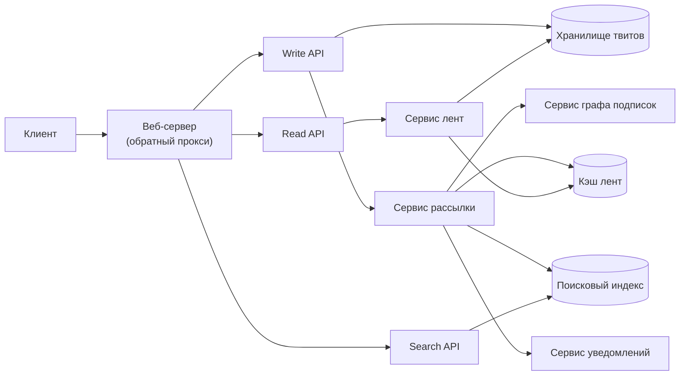
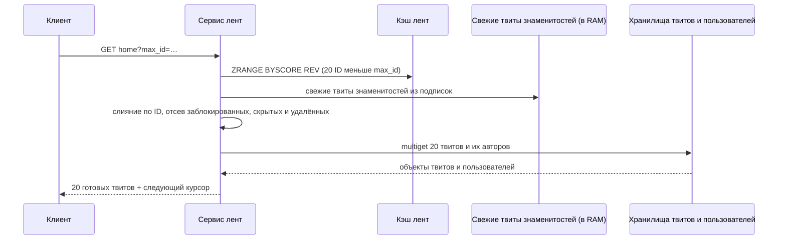
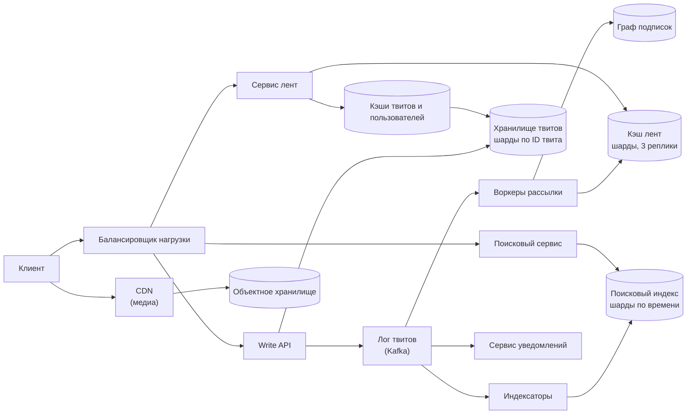

import { Aside } from '@astrojs/starlight/components';

Социальная лента выглядит просто: покажи последние посты тех, на кого я подписан. Сложность — в форме графа подписок. У большинства аккаунтов несколько сотен подписчиков, у горстки — десятки миллионов. Чтений больше, чем публикаций, на порядок с лишним, и отвечать нужно за миллисекунды. В этом разборе проектируем домашнюю ленту, ленту пользователя, поиск по словам и уведомления для сервиса масштаба Twitter. Те же рассуждения работают для ленты Facebook, Instagram, Mastodon и Bluesky.

<Aside type="tip" title="Коротко">
- **Гибридная рассылка:** когда пишет обычный пользователь, ID твита добавляется в закэшированную ленту каждого активного подписчика (fan-out on write). Твиты аккаунтов с миллионами подписчиков **подтягиваются и вливаются при чтении** (fan-out on read).
- **Кэш лент:** домашняя лента активного пользователя — ограниченный список примерно из 800 ID твитов в реплицированном хранилище в памяти. Чтение ленты — одна выборка списка плюс пакетное получение (multiget) объектов твитов и авторов.
- **Надёжные хранилища** шардированы по ID твита и ID пользователя; из них кэш пересобирается, когда пользователь возвращается после долгого отсутствия.
- **Поиск** — отдельно шардированный инвертированный индекс, который наполняется из потока, а запросы идут по схеме scatter-gather. **Уведомления** — ещё один асинхронный потребитель того же потока твитов.
</Aside>

## Шаг 1 — Требования и ограничения

### Сценарии использования

Входят в задачу:

- **Пользователь** публикует твит. **Сервис** доставляет его в домашние ленты подписчиков и шлёт push-уведомления тем, кто их включил.
- **Пользователь** смотрит свою **ленту пользователя** (собственные твиты) и **домашнюю ленту** (твиты тех, на кого подписан) — от новых к старым, с постраничной загрузкой.
- **Пользователь** ищет твиты по ключевым словам.
- **Сервис** высокодоступен.

Не входят: публичный «firehose» для партнёров, правила видимости (блокировки, скрытые ответы, «скрыть ретвиты»), реклама и ML-ранжирование ленты «Для вас». К ранжированию вернёмся в разделе про 2026 год.

### Нефункциональные требования

- **Быстрое чтение:** p99 домашней ленты — до ~200 мс. Чтения преобладают.
- **Достаточно быстрая доставка:** твит должен попасть в ленты большинства подписчиков примерно за 5 секунд. Для аккаунтов с миллионами подписчиков допустимы минуты.
- **Доступность важнее согласованности:** лента, отстающая на несколько секунд или ненадолго потерявшая твит, — нормально. Страница с ошибкой — нет.
- **Свежесть поиска:** новые твиты должны находиться через считаные секунды.

### Допущения

- 100 млн активных пользователей, 500 млн твитов в сутки.
- 250 млрд чтений лент и 10 млрд поисковых запросов в месяц.
- Активный пользователь подписан в среднем на 200 аккаунтов. Оригинал закладывал всего 10 доставок на твит — для графа подписок это очень мало (см. примечание ниже).
- Трафик неравномерен: суточные пики и новости поднимают запись примерно в 3 раза выше среднего, чтение — примерно в 2.

### Прикидочный расчёт

| Величина | Расчёт | Результат |
|---|---|---|
| Твиты | 500 млн ÷ 86 400 с | ≈ 5 800/с в среднем, ≈ 17 000/с в пике |
| Чтения лент | 250 млрд ÷ 2,592 млн с | ≈ 96 000/с в среднем, ≈ 190 000/с в пике (≈ 83 на пользователя в сутки) |
| Поиск | 10 млрд ÷ 2,592 млн с | ≈ 3 900/с |
| Строки твитов | 500 млн × ~1 КБ | 500 ГБ/сутки, 15 ТБ/мес, 540 ТБ за 3 года |
| Медиа | 500 млн × 10 КБ в среднем | 5 ТБ/сутки, 150 ТБ/мес, 5,4 ПБ за 3 года |
| Кэш лент | 100 млн × 800 записей × 17 Б | 1,36 ТБ «сырых», ≈ 8 ТБ с двукратными накладными расходами и 3 репликами |
| Постинги поиска | 500 млн × ~20 термов × 8 Б | ≈ 80 ГБ/сутки, ≈ 560 ГБ на 7-дневный уровень в памяти |

<Aside type="note" title="Арифметика и оригинал">
Частоты оригинала (100 000 чтений/с, 6 000 твитов/с, 60 000 доставок/с, 4 000 поисков/с) — это точные 96 451, 5 787, 57 870 и 3 858, округлённые вверх правилом «2,5 млн секунд в месяце», а 150 ТБ контента в месяц сходятся. Слабое место — допущение о **10 доставках на твит**. В графе подписок суммарное число подписчиков равно суммарному числу подписок, так что при 200 подписках на пользователя средний твит попадает примерно в 200 лент, а не в 10. Это превращает рассылку из ~60 000 в более чем 1 млн записей в секунду — расчёт ниже.
</Aside>

## Шаг 2 — Высокоуровневый дизайн



**Публикация.** Write API сохраняет твит в хранилище твитов — оно же источник ленты автора — и передаёт его сервису рассылки. Тот запрашивает у сервиса графа список подписчиков и дописывает ID твита в ленту каждого из них в кэше. Ещё он отправляет твит индексатору поиска и сервису уведомлений. Медиа загружаются в объектное хранилище заранее, твит лишь ссылается на их ID.

**Чтение домашней ленты.** Сервис лент берёт из кэша список ID твитов и «гидратирует» его — пакетно получает объекты твитов и авторов.

**Чтение ленты пользователя.** Это диапазонный запрос к хранилищу твитов по `(author_id, tweet_id DESC)`, без всякой рассылки.

**Поиск.** Поисковый сервис разбирает запрос, рассылает его по всем шардам индекса (scatter), сливает и ранжирует частичные результаты (gather) и гидратирует лучшие.

## Шаг 3 — Ключевые компоненты

### API

```http title="Опубликовать твит"
POST /api/v2/tweets
Authorization: Bearer <token>
Idempotency-Key: 0b9e7c52-4a8f-4c21-9d0e-7f3a6b1c2d4e

{"text": "hello world!", "media_ids": ["1840011223344556677"]}
```

```http title="Ответ"
HTTP/1.1 201 Created

{"id": "1843692012345678848", "author_id": "123", "created_at": "2026-10-08T12:00:00Z", "text": "hello world!"}
```

```http title="Домашняя лента, пагинация по ID твита"
GET /api/v2/users/123/home?max_id=1843692012345678848&limit=20

{"tweets": [{"id": "1843691900000000000", "author": {"id": "456", "handle": "ana"}, "text": "foo"}],
 "next_max_id": "1843691900000000000"}
```

ID твитов — 64-битные числа в стиле Snowflake: в старших битах метка времени в миллисекундах, дальше биты воркера и счётчика. Поэтому сортировка по ID даёт почти хронологический порядок, а курсорная пагинация через `max_id` устойчива, даже пока сверху прибывают новые твиты. ID передаются строками: числа в JavaScript теряют точность выше 2⁵³.

### Модель данных

- **Твиты:** `tweet_id` (первичный ключ), `author_id`, `text`, `media_ids`, `reply_to`, `created_at`; счётчики (лайки, репосты) — в отдельной, часто обновляемой таблице. Шардирование по `tweet_id`. Ленту пользователя обслуживает вторичный индекс по `(author_id, tweet_id)` или вторая таблица, шардированная по `author_id`.
- **Граф подписок:** два списка рёбер, `followers(user_id) → [ids]` и `following(user_id) → [ids]`, оба шардированы по `user_id`; каждая подписка пишет в оба. Горячая копия живёт в памяти: её читает каждая рассылка.
- **Кэш домашних лент:** у каждого пользователя — сортированное множество (`ZADD` в Redis/Valkey) с ключом-оценкой по ID твита. Запись — `tweet_id` (8 Б), `author_id` (8 Б) и байт флагов (ретвит, ответ). Множество обрезается до ~800 записей. В докладе Twitter 2013 года фигурировали 800 записей на ленту и 3 реплики каждой ленты; Mastodon и сейчас ограничивает домашнюю ленту 800 элементами.

### Рассылка при записи, сборка при чтении или оба подхода?

Есть две «чистые» стратегии.

- **Рассылка при записи (push, fan-out on write):** в момент публикации ID твита вставляется в ленту каждого подписчика. Чтение — одна выборка списка. Платим за каждого **подписчика**, во время записи.
- **Сборка при чтении (pull, fan-out on read):** при чтении собираем свежие твиты всех, на кого подписан пользователь, и сливаем. Запись — одна вставка. Платим за каждую **подписку**, на каждом чтении.

В масштабе всей системы push стоит около `твитов/с × среднее число подписчиков`, а pull — около `чтений/с × среднее число подписок`. У каждого ребра один подписчик и один автор, поэтому средние равны, и если публикации распределены равномерно, отношение сводится к «чтения/с ÷ твиты/с» ≈ 96 000 ÷ 5 800 ≈ **17**. Push делает примерно в 17 раз меньше работы — поэтому ленты и считают заранее. Проблема в перекосе.

**Модель с перекосом.** 100 млн пользователей подписаны на 200 аккаунтов каждый — это 20 млрд рёбер. Пусть 1 000 «знаменитостей» владеют четвертью рёбер (около 5 млн подписчиков у каждой) и публикуют по 20 твитов в день. У всех остальных в среднем по 150 подписчиков.

| Стратегия | Работа в сутки | Частота | Что болит |
|---|---|---|---|
| Всё через push | 499,98 млн × 150 + 20 000 × 5 млн = 75 млрд + 100 млрд вставок | ≈ 2,0 млн вставок/с | Один твит знаменитости — 5 млн вставок. Знаменитости — 0,004 % твитов, но 57 % записей рассылки |
| Всё через pull | 96 000 чтений/с × 200 подписок | ≈ 19 млн обращений к авторам/с | Каждое чтение собирает данные примерно с 200 шардов, хвостовая задержка взлетает |
| Гибрид | Push для обычных; при чтении подтягиваем ~50 знаменитостей | ≈ 870 000 вставок/с плюс ≈ 4,8 млн чтений списков в памяти/с | Логика слияния и порог, который надо поддерживать |

Сторона pull в гибриде дешёвая. Все твиты знаменитостей за двое суток — 1 000 × 20 × 2 × 1 КБ ≈ 40 МБ, так что каждый экземпляр сервиса лент держит их копию в RAM. Слияние 50 коротких списков в памяти стоит процессорного времени, а не сетевых запросов.

Статья Feeding Frenzy (Silberstein и др., SIGMOD 2010) формализует это. Решение принимается **для каждой пары «автор — читатель»**: push, если читатель заходит чаще, чем автор пишет, иначе pull. Знаменитость с 20 твитами в день «подтягивается» для фанатов, открывающих приложение 5 раз в день, и «рассылается» тем, кто обновляет ленту 100 раз. На практике один порог по числу подписчиков, порядка 10⁵–10⁶, даёт почти весь выигрыш.

Почему push так тяжёл для знаменитостей: Bluesky намерил около 600 мкс на запись в одну ленту. Последовательная рассылка на 2 млн подписчиков заняла бы около 20 минут. Twitter в 2013 году сообщал, что доставка 1 млн подписчиков занимает около 3,5 с по p50 и до 5 минут по p99.

```python title="timeline.py"
import bisect
import heapq
from collections import defaultdict
from dataclasses import dataclass

TIMELINE_CAP = 800              # сколько записей хранить в домашней ленте
CELEBRITY_FOLLOWERS = 1_000_000


@dataclass(frozen=True, order=True)
class Entry:
    tweet_id: int               # ID в стиле Snowflake: больше = новее
    author_id: int


class TimelineCache:
    """Заглушка сортированного множества Redis/Valkey на пользователя (ZADD + ZREMRANGEBYRANK)."""

    def __init__(self) -> None:
        self.sets: dict[int, list[Entry]] = defaultdict(list)   # по возрастанию tweet_id

    def push(self, user_id: int, entry: Entry) -> None:
        items = self.sets[user_id]
        bisect.insort(items, entry)          # рассылка может прийти не по порядку
        if len(items) > TIMELINE_CAP:
            del items[0]                     # выбрасываем самую старую запись

    def page(self, user_id: int, max_id: int | None, n: int) -> list[Entry]:
        items = self.sets[user_id]
        hi = len(items) if max_id is None else bisect.bisect_left(items, Entry(max_id, -1))
        return items[max(0, hi - n):hi][::-1]   # от новых к старым


def fan_out(author_id: int, tweet_id: int, followers: list[int],
            follower_count: int, active: set[int], cache: TimelineCache) -> int:
    """Рассылает активным подписчикам, если автор не знаменитость; возвращает число вставок."""
    if follower_count >= CELEBRITY_FOLLOWERS:
        return 0                             # такие твиты подтягиваются при чтении
    pushed = 0
    for f in followers:
        if f in active:                      # пропускаем давно не заходивших
            cache.push(f, Entry(tweet_id, author_id))
            pushed += 1
    return pushed


def home_timeline(user_id: int, cache: TimelineCache,
                  celebrity_followees: list[int],
                  recent_by_author: dict[int, list[Entry]],
                  max_id: int | None = None, n: int = 20) -> list[Entry]:
    """Сливает разосланную ленту с твитами знаменитостей, подтянутыми при чтении."""
    streams = [cache.page(user_id, max_id, n)]
    for celeb in celebrity_followees:        # каждый список — от новых к старым
        streams.append([e for e in recent_by_author.get(celeb, [])
                        if max_id is None or e.tweet_id < max_id][:n])
    merged = heapq.merge(*streams, key=lambda e: e.tweet_id, reverse=True)
    return [e for _, e in zip(range(n), merged)]


cache = TimelineCache()
fan_out(author_id=1, tweet_id=105, followers=[42, 43], follower_count=2, active={42}, cache=cache)
fan_out(author_id=2, tweet_id=101, followers=[42], follower_count=1, active={42}, cache=cache)
recent = {9: [Entry(107, 9), Entry(103, 9)]}   # знаменитость 9, от новых к старым
first = home_timeline(42, cache, [9], recent, n=3)
print([e.tweet_id for e in first])                                        # [107, 105, 103]
print([e.tweet_id for e in home_timeline(42, cache, [9], recent, max_id=first[-1].tweet_id)])  # [101]
```

### Чтение домашней ленты



Гидратация — самая дорогая часть чтения: 96 000 чтений/с × 20 твитов ≈ 1,9 млн обращений к твитам в секунду плюс обращения к авторам. Поэтому объекты твитов и пользователей стоят за собственными кэшами (Memcached или Valkey) с очень высокой долей попаданий: одни и те же популярные твиты есть в миллионах лент. Гидратация заодно дёшево решает удаление. Удалённый твит не нужно вычищать из миллионов лент: объект твита получает отметку удаления (tombstone), и гидратация его отбрасывает.

**Пограничные случаи, которые стоит назвать:**

- **Новая подписка:** асинхронно подкачиваем свежие твиты автора в ленту подписчика.
- **Отписка:** сразу фильтруем при чтении, а список чистим лениво.
- **Ответ пришёл раньше твита, на который он отвечает:** рассылка идёт параллельно и может нарушить порядок. Сортированное множество с ключом по Snowflake ID это поглощает, а путь чтения всё равно сортирует.
- **Неактивные пользователи:** при рассылке их пропускаем — так Mastodon поступает с давно не заходившими. Когда они возвращаются, ленту пересобираем из графа подписок и свежих твитов. Это разовая сборка примерно по 200 авторам — терпимо.

### Поиск

Поиску нужен **инвертированный индекс**: для каждого терма — список постингов, то есть ID твитов, в которых он встречается.

1. **Приём данных:** индексатор читает поток твитов, токенизирует текст (нормализация Unicode, нижний регистр, хештеги и упоминания как токены, определение языка) и дописывает постинги.
2. **Партиционирование:** шардируем **по документам** (ID твита), а не по термам. Индекс, шардированный по термам, отправляет каждый популярный терм в один горячий шард, а запросы из нескольких термов вынуждает ходить между шардами. При шардировании по документам каждый запрос идёт во все шарды, но каждый делает равную небольшую долю работы. Шарды группируются **по времени**: уровень реального времени в памяти покрывает последние дни, более старые уровни лежат на SSD.
3. **Запрос:** разбираем его (термы, фразы, `from:`, булевы операторы, исправление опечаток), рассылаем во все шарды нужных уровней, берём top-K с каждого шарда по дешёвой оценке (свежесть, вовлечённость), сливаем, переранжируем и гидратируем.
4. **Свежесть:** движок Earlybird в Twitter до 2019 года индексировал твит примерно через 15 секунд после публикации. Переделка 2020 года (постинги на списках с пропусками, ID документов по времени) сократила это примерно до секунды.

При ~3 900 поисках/с и перекосе в сторону трендовых термов кэш популярных запросов с коротким TTL перед кластером снимает заметную часть нагрузки.

### Уведомления

Уведомления — ещё один потребитель потока твитов, а не часть рассылки по лентам:

- **Поводы:** упоминания, ответы, лайки, новые подписчики и подписки «уведомлять меня» на конкретные аккаунты.
- **Конвейер:** событие → правила (настройки пользователя, заглушенные аккаунты, «тихие часы») → агрегация («Ана и ещё 41 человек оценили ваш пост») → ограничение частоты на пользователя → доставка через APNs, FCM, почту или ящик в приложении.
- **Идемпотентность:** повторные попытки неизбежны, поэтому перед отправкой дедуплицируем по `(event_id, recipient)`.
- **Объём:** если каждый получает около 20 уведомлений в день, это 2 млрд в сутки, или ~23 000/с. Пост знаменитости, на которую миллионы фанатов включили «уведомлять меня», — та же задача рассылки, что и с лентой, и решается так же: пачками, растянутыми на секунды и минуты.

## Шаг 4 — Масштабирование

Узкие места по очереди:

1. **Пропускная способность рассылки.** Между Write API и воркерами рассылки ставим надёжный лог (Kafka или управляемый аналог). Публикация остаётся быстрой, а всплеск превращается в длину очереди, а не в тайм-ауты. Партиционируем по автору, чтобы твиты одного автора рассылались по порядку. Огромные списки подписчиков режем на куски по 1 000–10 000 и раздаём разным воркерам. Неактивных подписчиков пропускаем.
2. **Знаменитости.** Гибрид из шага 3 плюс небольшое хранилище их свежих твитов в памяти каждого экземпляра сервиса лент. «Lossy timelines» в Bluesky (2025) решают зеркальную проблему — пользователей, подписанных на десятки тысяч аккаунтов: выше разумного порога подписок записи рассылки в ленту такого пользователя отбрасываются с вероятностью, растущей вместе с числом подписок. Это почти убрало горячие шарды и сократило p99 полной рассылки поста более чем на 96 %.
3. **Размер и доступность кэша лент.** Около 8 ТБ по шардам с ключом `user_id` и репликами в каждой зоне. Храним только активных пользователей (например, за последние 30 дней). Потерянный шард пересобирается из надёжных хранилищ, так что резервные копии кэшу не нужны.
4. **Запись в хранилище твитов.** ~17 000 записей/с в пике — значит, шардирование по `tweet_id`. Snowflake ID позволяют любому шарду выдавать ID без координации. Подойдут колоночные (wide-column) хранилища (Cassandra, ScyllaDB, Bigtable) или шардированный MySQL/Vitess. Свежие твиты держим «горячими», старые читают редко — их можно увести на дешёвое хранение.
5. **Гидратация.** Кэши объектов твитов и пользователей, multiget с группировкой по шардам и счётчики (лайки, просмотры) в отдельном быстро меняющемся хранилище, чтобы сами объекты твитов хорошо кэшировались.
6. **Поиск.** Реплицированный индекс с уровнями по времени, кэш результатов запросов и отдельные кластеры для реального времени и архива.
7. **Медиа.** Объектное хранилище и CDN. Клиенты загружают файлы напрямую по предподписанным URL (pre-signed URL), и байты медиа не проходят через API.



| Что добавили | Что даёт | Чего стоит |
|---|---|---|
| Лог твитов (поток) | Быстрая публикация, буферизация, повторное проигрывание, единый источник для всех потребителей | Ещё одна система; потребители должны быть идемпотентными |
| Рассылка кусками | Секунды вместо минут для крупных аккаунтов | Нарушение порядка (поглощается сортировкой по ID) |
| Pull для знаменитостей | Убирает около половины записей рассылки | Логика слияния и порог, который нужно настраивать |
| Шардированный кэш лент | Чтение за единицы мс при 190 000/с | ~8 ТБ RAM; механизм пересборки потерянных шардов |
| Кэши объектов | Дешёвая гидратация | Инвалидация отредактированных и удалённых твитов |
| Поисковый индекс с уровнями по времени | Быстрый поиск по свежему, дешёвая история | Scatter-gather по всем шардам уровня |

## Что изменилось к 2026 году

- **Большинство лент ранжируются.** «Для вас» в X, Instagram и Threads собирают ленту на каждый запрос: набирают кандидатов и ранжируют их обученной моделью. Открытый код рекомендаций X (twitter/the-algorithm в 2023 году; xai-org/x-algorithm, обновлявшийся ещё в августе 2026) описывает кандидатов из подписок, которые достаются при чтении из хранилища свежих постов в памяти, кандидатов вне подписок, найденных поиском по эмбеддингам, и нейросетевой ранжировщик. Хронологическая лента «Подписки» из этого разбора остаётся базой — именно её показывают Mastodon и лента подписок Bluesky по умолчанию.
- **Открытые сети используют те же приёмы.** Mastodon рассылает при записи в сортированные множества Redis до 800 элементов и только недавно активным пользователям. Bluesky рассылает при записи в ленты на ScyllaDB и добавил «потерю» записей для экстремального числа подписок.
- **Управляемые кирпичики:** управляемый Kafka-совместимый поток (MSK, Confluent, Redpanda) или Kinesis/Pub/Sub для лога твитов; кластеры Valkey или Redis (ElastiCache, Memorystore) для лент; ScyllaDB, Cassandra, DynamoDB или Bigtable для твитов и рёбер; OpenSearch, Elasticsearch или Vespa для поиска; объектное хранилище и CDN для медиа. Бессерверные функции лучше подходят для побочных задач (рассылка уведомлений, обработка медиа), чем для основной рассылки, которая работает непрерывно и с высокой частотой.
- **Поиск гибридный.** Поиск по ключевым словам (BM25) сочетают с векторным для смысловых совпадений и переранжируют общий результат. Инвертированный индекс по-прежнему основа для точных и свежих результатов.
- **Что не изменилось:** заранее считаем частый случай, отдельно обрабатываем перекос, держим ID сортируемыми по времени, гидратируем через кэши, а побочные эффекты (поиск, уведомления, аналитику) оставляем асинхронными потребителями потока.

<Aside type="note" title="На собеседовании">
- **«Push или pull?»** Дайте модель стоимости (подписчики × публикации против подписок × чтений), затем гибрид и способ выбрать порог.
- **«Пишет пользователь с 50 млн подписчиков».** Рассылка кусками или отказ от рассылки плюс слияние при чтении. Упомяните кэш знаменитостей в памяти.
- **«Как удалить твит из 10 млн лент?»** Никак: отметка удаления плюс фильтрация при гидратации.
- **«Кэш лент потерял шард».** Это производные данные: пересобираем из графа подписок и свежих твитов, а пока отдаём упрощённую ленту, собранную через pull.
- **«Сделайте поиск в реальном времени».** Потоковое индексирование, уровень реального времени в памяти, шардирование по документам и scatter-gather.
- **Типичные ошибки:** рассылка внутри обработки запроса, одна SQL-таблица для лент, шардирование поиска по термам, забытые неактивные пользователи и удаления.
</Aside>

## Что почитать

- [The architecture Twitter uses to deal with 150M active users (High Scalability, 2013)](https://highscalability.com/the-architecture-twitter-uses-to-deal-with-150m-active-users/)
- [Timelines at Scale, Raffi Krikorian (QCon SF 2012, InfoQ)](https://www.infoq.com/presentations/Twitter-Timeline-Scalability/)
- [Feeding Frenzy: selectively materializing users' event feeds (SIGMOD 2010)](https://sns.cs.princeton.edu/assets/papers/2010-sigmod-silberstein.pdf)
- [When imperfect systems are good, actually: Bluesky's lossy timelines (2025)](https://jazco.dev/2025/02/19/imperfection/)
- [Reducing search indexing latency to one second (Twitter Engineering, 2020)](https://blog.x.com/engineering/en_us/topics/infrastructure/2020/reducing-search-indexing-latency-to-one-second)
- [Исходный код рекомендательного алгоритма X (xai-org/x-algorithm)](https://github.com/xai-org/x-algorithm)

## Связанные темы

- [Стратегии кэширования](/caching/cache-strategies/): кэш лент и кэши объектов — производные данные с механизмом пересборки.
- [Партиционирование и шардирование](/data/partitioning-and-sharding/): шардирование твитов, рёбер и лент, горячие шарды.
- [Потоковая обработка событий](/async/event-streaming/): лог твитов, который питает рассылку, поиск и уведомления.
- [Очереди и обратное давление](/async/queues-and-back-pressure/): как поглощать всплески рассылки от постов знаменитостей.
- [Структуры данных для социального графа](/practice/social-graph/): хранение графа подписок и запросы к нему.
- [NoSQL](/data/nosql/): колоночные хранилища для твитов и лент.
