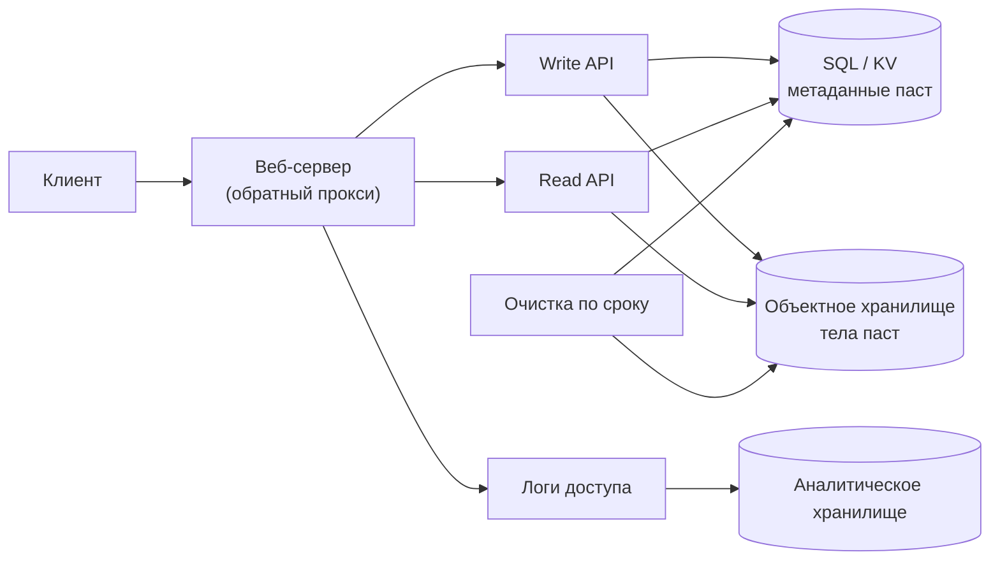
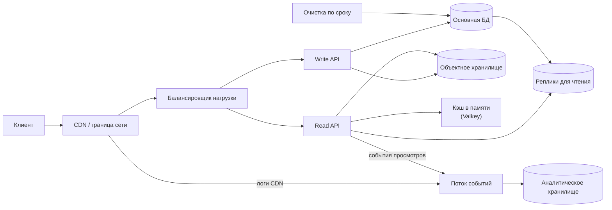

import { Aside } from '@astrojs/starlight/components';

Pastebin и Bitly решают одну и ту же задачу. Пользователь отдаёт что-то длинное (кусок текста или URL) и получает короткий ключ вроде `aB3xY9q`, по которому любой потом найдёт исходное. Pastebin хранит за ключом содержимое, сокращатель ссылок — целевой URL и отвечает редиректом. Система достаточно мала, чтобы набросать её за 45 минут, и всё же в ней есть настоящие решения: как выдавать короткие ключи без конфликтов, какой код редиректа возвращать, как удалять устаревшие данные и как считать клики, не замедляя чтение.

<Aside type="tip" title="Коротко">
- **Ключи:** случайный ключ Base62 из 7–8 символов плюс атомарная вставка «только если такого ключа нет» работают без всякой координации. Если нужны гарантированная уникальность и самые короткие ключи — диапазоны счётчика с перемешивающей перестановкой.
- **Хранение:** метаданные — в таблице SQL или key-value по короткому ключу, тела паст — в объектном хранилище или прямо в строке, если они маленькие.
- **Чтений** в 10 раз больше, чем записей, и пасты после создания не меняются, поэтому CDN и кэш в памяти принимают на себя почти весь трафик. Срок жизни проверяется при каждом чтении, а фоновая задача удаляет данные позже.
- **Редиректы и аналитика:** если нужно считать каждый клик, отвечайте 302 (или 301 с коротким временем кэширования). Клики уходят событиями в поток, который питает колоночное аналитическое хранилище, — никакой синхронной записи в базу.
</Aside>

## Шаг 1 — Требования и ограничения

### Сценарии использования

Входят в задачу:

- **Пользователь** отправляет текст и получает короткую ссылку. Срок жизни можно задать; по умолчанию паста хранится бессрочно.
- **Пользователь** открывает короткую ссылку и видит пасту (в варианте сокращателя — попадает на целевой URL).
- **Сервис** ведёт помесячную статистику просмотров по каждой ссылке.
- **Сервис** удаляет пасты с истёкшим сроком.
- **Сервис** высокодоступен, а ссылки открываются быстро.

Не входят: регистрация и вход, редактирование паст, пользовательские псевдонимы («красивые» ссылки) и настройки приватности. Псевдонимы упомянем там, где они меняют дизайн.

### Нефункциональные требования

- **Низкая задержка чтения.** Разрешение ключа стоит перед каждым кликом, поэтому p99 — десятки миллисекунд.
- **Долговечность.** Выданная ссылка должна работать, пока не истечёт её срок. Короткие ссылки печатают на плакатах и в статьях.
- **Неугадываемые ключи.** Пасты не публикуются в списках, так что ключ — фактически единственная защита доступа. Последовательных ключей быть не должно.
- **Аналитика с отставанием.** Статистика может отставать на минуты или часы.
- **Неравномерный трафик.** Большинство паст читают пару раз, а немногие «вирусные» собирают львиную долю чтений.

### Допущения

- 10 млн пользователей, 10 млн новых паст и 100 млн чтений в месяц (10:1).
- Средняя паста — 1 КБ текста. Метаданные (ключ, указатель на объект, отметки времени, статус) — около 100 байт.
- Для варианта сокращателя проверим и масштаб в 100 раз больше: 1 млрд новых ссылок и 10 млрд переходов в месяц.

### Прикидочный расчёт

В 30-дневном месяце 2,592 млн секунд. Популярное округление до 2,5 млн секунд завышает частоты примерно на 4 % — для собеседования это допустимо.

| Величина | Расчёт | Результат |
|---|---|---|
| Записи паст | 10 млн ÷ 2,592 млн с | ≈ 3,9/с в среднем, в пике закладываем ≈ 40/с |
| Чтения паст | 100 млн ÷ 2,592 млн с | ≈ 39/с в среднем, ≈ 390/с в пике |
| Содержимое за месяц | 10 млн × 1 КБ | ≈ 10 ГБ |
| Метаданные за месяц | 10 млн × 100 Б | ≈ 1 ГБ |
| Паст за 3 года | 10 млн × 36 | 360 млн ключей |
| Объём за 3 года | 360 млн × 1,1 КБ | ≈ 400 ГБ (360 ГБ текста, 36 ГБ метаданных) |
| Исходящий трафик | 39/с × 1 КБ | ≈ 40 КБ/с в среднем |
| Горячий набор (7 дней) | 2,3 млн паст × 1,1 КБ | ≈ 2,6 ГБ, помещается в один узел кэша |
| Сокращатель ×100 | 1 млрд ссылок и 10 млрд переходов в месяц | ≈ 390 записей/с, ≈ 3 900 чтений/с в среднем, ≈ 39 000/с в пике |
| Объём сокращателя ×100 | 36 млрд ссылок × 200 Б за 3 года | ≈ 7,2 ТБ |

Цифры скромные: на базовом масштабе хватит одного основного узла PostgreSQL и бакета. Вся работа — в **генерации ключей**, **поведении кэша при перекосе нагрузки** и в том, чтобы **вынести аналитику с горячего пути**.

<Aside type="note" title="Арифметика и оригинал">
Цифры оригинала (1,27 КБ на пасту при полной ширине 255-байтового пути, 12,7 ГБ в месяц, «~450 ГБ» за три года, точнее 457 ГБ) согласуются с его допущениями. Его 4 и 40 запросов/с получены через округление до 2,5 млн секунд (точно — 3,86 и 38,6). Настоящая ошибка — в схеме ключей: если брать **первые** 7 символов MD5 в Base62, используется лишь около 1/7 пространства 62⁷ (см. ниже).
</Aside>

## Шаг 2 — Высокоуровневый дизайн



- **Создание.** Write API проверяет текст (лимит размера, антиспам) и генерирует ключ. Тело пишется в объектное хранилище, затем вставляется строка метаданных; вставка падает, если ключ уже занят. API возвращает короткий URL.
- **Чтение.** Read API ищет ключ, отклоняет просроченные и заблокированные пасты и достаёт тело. Сокращатель вместо этого отвечает редиректом на сохранённый URL.
- **Аналитика.** Каждый просмотр пишется в лог, отдельная задача превращает логи в помесячные счётчики. Чтение её никогда не ждёт.
- **Срок жизни.** Фоновая задача удаляет строки и объекты, у которых прошёл `expires_at`.

Чтение и запись разнесены по разным сервисам: у них разный профиль масштабирования, и волна злонамеренных записей не должна тормозить открытие ссылок.

## Шаг 3 — Ключевые компоненты

### API

```http title="Создать пасту"
POST /api/v1/pastes
Content-Type: application/json
Idempotency-Key: 6f1c2a9e-1b7d-4f0e-9a51-3c2d8e7f9a10

{"content": "Hello, world!", "expires_in_seconds": 86400}
```

```http title="Ответ"
HTTP/1.1 201 Created
Location: https://paste.example/aB3xY9q

{"key": "aB3xY9q", "url": "https://paste.example/aB3xY9q", "expires_at": "2026-10-09T12:00:00Z"}
```

```http title="Прочитать пасту"
GET /api/v1/pastes/aB3xY9q

HTTP/1.1 200 OK
Cache-Control: public, max-age=3600

{"content": "Hello, world!", "created_at": "2026-10-08T12:00:00Z", "expires_at": "2026-10-09T12:00:00Z"}
```

Заголовок `Idempotency-Key` позволяет клиенту повторить запрос после тайм-аута и не получить две пасты. Просроченная или удалённая паста отдаёт `410 Gone`, неизвестный ключ — `404 Not Found`. Сокращатель на `GET /aB3xY9q` отвечает `302` (или `301`) с заголовком `Location` (об этом выборе — в разделе о редиректах ниже).

### Модель данных

```sql title="Таблица pastes (PostgreSQL)"
CREATE TABLE pastes (
  shortlink   CHAR(7)      PRIMARY KEY,           -- уникальный индекс «бесплатно»
  object_key  VARCHAR(64)  NOT NULL,              -- например, 'p/aB3xY9q'
  size_bytes  INTEGER      NOT NULL,
  created_at  TIMESTAMPTZ  NOT NULL DEFAULT CURRENT_TIMESTAMP,
  expires_at  TIMESTAMPTZ,                        -- NULL = бессрочно
  status      SMALLINT     NOT NULL DEFAULT 0     -- 0 активна, 1 истекла, 2 заблокирована
);
-- Частичный индекс: очистке нужны только пасты со сроком жизни.
CREATE INDEX pastes_expiry ON pastes (expires_at) WHERE expires_at IS NOT NULL;
```

Доступ — чистый поиск по ключу без соединений, поэтому key-value-хранилище (DynamoDB, Bigtable, Cassandra) подходит не хуже SQL. Для сокращателя `object_key` заменяется на `long_url`. Тела в несколько килобайт можно хранить прямо в строке: это экономит второй сетевой запрос и плату за каждое обращение к объектному хранилищу. Большие тела уходят в бакет.

### Генерация коротких ключей

Это сердце задачи. Обычно берут алфавит Base62 (`0-9A-Za-z`): он безопасен для URL без экранирования, а в Base64 есть `+` и `/`, которые в URL приходится экранировать. Каждый дополнительный символ умножает пространство ключей на 62:

| Длина | Пространство ключей | Хватит для |
|---|---|---|
| 5 | 62⁵ ≈ 9,2 × 10⁸ | 360 млн ключей — только при последовательной выдаче |
| 6 | 62⁶ ≈ 5,7 × 10¹⁰ | Небольших сервисов со случайными ключами |
| 7 | 62⁷ ≈ 3,5 × 10¹² | Наших 360 млн случайных ключей |
| 8 | 62⁸ ≈ 2,2 × 10¹⁴ | Сокращателя ×100 (36 млрд ключей) |

Есть четыре семейства подходов.

#### 1. Хеш, затем кодирование

Хешируем что-нибудь (содержимое, URL или IP плюс время) через MD5 или SHA-256, кодируем в Base62 и оставляем 7 символов.

- *Детерминированность.* Если хешировать содержимое или URL, одинаковые входы получат один ключ — это дедупликация. Часто она вредна: два пользователя, сократившие один URL, обычно хотят раздельные счётчики кликов и сроки жизни. А хеш содержимого позволяет любому проверить, вставлялся ли когда-нибудь данный текст.
- *Усечение всё равно даёт коллизии.* В 7 символах около 41,7 бита, так что коллизии подчиняются парадоксу дней рождения, какой бы хорошей ни была хеш-функция. Проверка уникальности и повтор с «солью» всё равно нужны.
- *Брать надо правильные символы.* 128-битное число в Base62 занимает 21–22 цифры, и старшая цифра 22-значного результата бывает только от `1` до `7`. Поэтому **первые** 7 символов покрывают лишь около 1/7 пространства (≈ 4,9 × 10¹¹ реальных ключей вместо 3,5 × 10¹²), и за три года выйдет около 132 000 коллизий вместо 18 000. Правильно — брать хеш по модулю 62⁷.

#### 2. Случайный ключ и условная вставка

Берём 7 случайных символов Base62 из криптографического генератора и вставляем с семантикой «только если ключа нет»: ограничение первичного ключа, `INSERT ... ON CONFLICT DO NOTHING`, условное выражение DynamoDB или запись в S3 с `If-None-Match: *`. При конфликте генерируем заново.

```python title="shortlinks.py"
import secrets
import string

ALPHABET = string.digits + string.ascii_uppercase + string.ascii_lowercase  # 62 символа
KEY_LEN = 7
KEYSPACE = 62 ** KEY_LEN  # 3.52e12


def base62(n: int, width: int = KEY_LEN) -> str:
    """Кодирует неотрицательное целое в Base62 фиксированной ширины."""
    chars: list[str] = []
    while n:
        n, r = divmod(n, 62)
        chars.append(ALPHABET[r])
    return "".join(reversed(chars)).rjust(width, ALPHABET[0])


class KeyTaken(Exception):
    pass


class PasteStore:
    """Заглушка таблицы с уникальным первичным ключом `shortlink`."""

    def __init__(self) -> None:
        self._rows: dict[str, str] = {}

    def insert_if_absent(self, key: str, object_path: str) -> None:
        if key in self._rows:  # в реальной БД: INSERT ... ON CONFLICT DO NOTHING
            raise KeyTaken(key)
        self._rows[key] = object_path


def create_shortlink(store: PasteStore, object_path: str, max_tries: int = 5) -> str:
    for _ in range(max_tries):
        key = base62(secrets.randbelow(KEYSPACE))  # равномерно по всем 62^7 ключам
        try:
            store.insert_if_absent(key, object_path)
            return key
        except KeyTaken:
            continue  # ~1 из 10 000 при 360 млн ключей: просто пробуем ещё раз
    raise RuntimeError("пространство ключей переполнено - удлините ключ")


store = PasteStore()
print(create_shortlink(store, "s3://pastes/2026/10/08/abc"))
```

Как часто будут повторы? Если в пространстве размера `N` уже лежит `n` ключей, новый случайный ключ совпадёт с занятым с вероятностью `n / N`. В сумме по всем вставкам ожидаемое число коллизий — около `n² / 2N`:

| Длина ключа | Шанс коллизии нового ключа (занято 360 млн) | Ожидаемых повторов за 3 года |
|---|---|---|
| 6 | 1 из 158 | ≈ 1,1 млн |
| 7 | 1 из 9 800 | ≈ 18 000 |
| 8 | 1 из 607 000 | ≈ 300 |

Два вывода. Коллизии неизбежны: при 7 символах вероятность хотя бы одной превышает 50 % уже после 2,2 млн ключей, так что ветка повтора обязательна. Но они дёшевы: около 18 000 лишних запросов за три года. На масштабе ×100 (36 млрд ключей) при 7 символах повторялась бы 1 % вставок, поэтому сокращатель переходит на 8 символов.

#### 3. Счётчик или тикет-сервер

Центральный счётчик (последовательность в БД, `INCR` в Redis или тикет-серверы в стиле Flickr) выдаёт целые числа, которые кодируются в Base62. У Flickr было два тикет-сервера на MySQL: один выдавал нечётные числа, другой чётные, так что любой мог отказать. Счётчик никогда не даёт коллизий и даёт самые короткие ключи: 360 млн помещаются в 5 символов.

Проблем две. Счётчик — централизованная зависимость на пути записи. А последовательные ключи **перечислимы**: можно пройти `aaaab`, `aaaac`, … и выкачать все неопубликованные пасты. Вторую проблему решает перестановка пространства ключей с секретом — маленький шифр, сохраняющий формат. Каждое значение счётчика переходит ровно в один «разбросанный» ключ, так что уникальность сохраняется:

```python title="permute.py"
import hashlib

KEYSPACE = 62 ** 7  # 3 521 614 606 208 < 2**42
HALF_BITS = 21
MASK = (1 << HALF_BITS) - 1


def _round(half: int, rnd: int, secret: bytes) -> int:
    digest = hashlib.blake2b(f"{rnd}:{half}".encode(), key=secret, digest_size=8).digest()
    return int.from_bytes(digest, "big") & MASK


def _feistel(x: int, secret: bytes, rounds: int = 4) -> int:
    left, right = x >> HALF_BITS, x & MASK
    for rnd in range(rounds):
        left, right = right, left ^ _round(right, rnd, secret)
    return (left << HALF_BITS) | right


def scramble(counter: int, secret: bytes) -> int:
    """Биекция на [0, 62^7): последовательные значения -> разбросанные ключи, без коллизий."""
    assert 0 <= counter < KEYSPACE
    x = _feistel(counter, secret)
    while x >= KEYSPACE:  # «цикл-обход»: шифруем повторно, пока не попадём в пространство
        x = _feistel(x, secret)
    return x


secret = b"rotate-me-in-a-kms"
keys = [scramble(i, secret) for i in range(100_000)]
assert len(set(keys)) == len(keys)
print(keys[:3])
```

#### 4. Заранее выделенные диапазоны

Чтобы убрать счётчик с горячего пути, каждый API-сервер арендует **блок** значений (скажем, 10 000) у координатора — строки с `UPDATE ... RETURNING`, etcd или ZooKeeper — и расходует его из памяти. Даже в пике, при 40 записях/с, весь парк серверов расходует один блок примерно за 4 минуты, так что координатор почти простаивает. Если сервер упал, остаток блока просто теряется — при триллионах ключей это не страшно. Так же устроен отдельный «сервис генерации ключей», который хранит заранее созданные случайные ключи и раздаёт их пачками.

#### ID в стиле Snowflake

Snowflake от Twitter упаковывает в 64 бита 41-битную метку времени в миллисекундах, 10-битный номер воркера и 12-битный счётчик внутри миллисекунды. Получив номер, воркеры ни с кем не координируются, ID примерно упорядочены по времени, а 41 бита хватает примерно на 69 лет от собственной эпохи. Варианты этой схемы используют Instagram и Discord. Подвох для сокращателя — **длина**: 64-битный ID занимает 11 символов Base62, UUIDv7 (RFC 9562, 2024) — 22. Это отличные внутренние первичные ключи, но как публичные короткие ключи они слишком длинные и раскрывают время создания.

#### Что выбрать

| Подход | Длина ключа (360 млн) | Координация | Коллизии | Угадываемость | Главный риск |
|---|---|---|---|---|---|
| Хеш + усечение | 7 | Нет | Да, повтор с солью | Нет | Перекос при неверном усечении; лишняя дедупликация |
| Случайный + условная вставка | 7 | Нет (следит БД) | Да, редкие повторы | Нет | Доля повторов растёт по мере заполнения |
| Счётчик / тикет-сервер | 5 | На каждую запись | Никогда | Да, если не перемешать | Узкое место в центре |
| Арендованные диапазоны | 5–7 | Раз на блок | Никогда | Если не перемешать | Потерянные блоки (безвредно) |
| Snowflake / UUIDv7 | 11 / 22 | Выдача номеров воркеров | Никогда | Частично (упорядочены по времени) | Слишком длинно для короткой ссылки |

Для Pastebin выбираем **случайные 7–8 символов с условной вставкой**: не нужен ни один новый компонент, а ключи не угадать. Очень крупному сокращателю, которому важны самые короткие ключи, подойдут **арендованные диапазоны с перемешивающей перестановкой**.

<Aside type="caution" title="«Не в списке» — не значит «приватно»">
При 360 млн живых ключей в пространстве 62⁷ атакующий, делающий 1 000 попыток в секунду, находит реальную пасту примерно раз в 10 секунд — около 8 800 в сутки. Ограничивайте частоту запросов с одного клиента и берите ключи от 10 символов для всего чувствительного. При 10 символах тот же атакующий находит одну пасту примерно раз в 27 дней.
</Aside>

### Редиректы: 301 или 302

От кода ответа сокращателя зависит, кто увидит следующий клик.

| Код | Смысл | Кэшируется браузером по умолчанию? | Аналитика | Где применяют |
|---|---|---|---|---|
| `301 Moved Permanently` | Постоянный | Да, если заголовки не запрещают | Повторные клики могут до вас не дойти | Постоянные ссылки, передача SEO-веса |
| `308 Permanent Redirect` | Как 301, метод сохраняется | Да | Как у 301 | Для GET-ссылок почти не нужен |
| `302 Found` | Временный | Только с явными заголовками свежести | Виден каждый клик | Подсчёт, редактируемые и отзываемые ссылки |
| `307 Temporary Redirect` | Как 302, метод сохраняется | Как у 302 | Как у 302 | Не-GET-сценарии |

- **301** кэшируется по умолчанию, поэтому при следующем клике браузер может обойти вас стороной. Это снижает нагрузку, но клики теряются, а блокировка ссылки до таких браузеров не доходит. Поисковики воспринимают 301 как «засчитать целевой странице». Bitly, например, документирует, что отвечает 301.
- **302** возвращает вам каждый клик: точные счётчики, возможность перенаправить ссылку и мгновенно отключить фишинговую — ценой обслуживания всех повторных переходов.
- Явный `Cache-Control` перекрывает поведение по умолчанию, поэтому компромисс — 301 с коротким `max-age` или `Cache-Control: private, no-store`, когда важен каждый клик.

### Срок жизни

- Храните `expires_at`, а не длительность. Каждое чтение его проверяет, так что просроченная паста сразу отдаёт `410`, даже если данные ещё лежат. Удаление — это уборка, а не условие корректности.
- **Очистка** удаляет небольшими пачками по частичному индексу (`WHERE expires_at < now() ORDER BY expires_at LIMIT 1000`), чтобы не блокировать таблицу. Управляемые хранилища делают это сами: TTL в DynamoDB и политики сборки мусора в Bigtable удаляют просроченные строки лениво (DynamoDB пишет — обычно в течение нескольких дней). До этого просроченные записи ещё могут вернуться в ответе, поэтому фильтровать при чтении всё равно нужно. Правила жизненного цикла S3 удаляют объекты по возрасту или по тегу, например `ttl=1d`, `ttl=30d` и так далее.
- TTL в кэше и CDN не должен переживать пасту: ставьте `min(default, expires_at - now)` и сбрасывайте кэш при блокировке.
- **Не переиспользуйте** просроченные ключи быстро. Старые ссылки живут в документах, кэшах браузеров и чатах, и пусть они лучше отдают `410`, чем чужое содержимое.

### Аналитика

Аналитика в реальном времени не нужна, поэтому в оригинале по логам веб-серверов раз в сутки запускался MapReduce. Сегодня та же идея проще — события плюс SQL:

1. Путь чтения (или CDN, если ответил он) отправляет маленькое событие: ключ, время, страну, реферер, класс user-agent и хеш посетителя с солью. Отправка идёт в локальный буфер по принципу «отправил и забыл», и редирект её не ждёт.
2. События идут через поток (Kafka, Kinesis, Pub/Sub) в объектное хранилище — файлами Parquet с разбиением по дням — и в колоночное хранилище (ClickHouse, BigQuery, Druid) для дашбордов.
3. Помесячная статистика — это `GROUP BY`. Уникальных посетителей на большом масштабе считают скетчами HyperLogLog: фиксированные ~12 КБ на счётчик и погрешность меньше 1 %.

```sql title="Просмотры по ссылкам за месяц (диалект SQLite)"
SELECT shortlink,
       strftime('%Y-%m', ts)      AS month,
       COUNT(*)                   AS views,
       COUNT(DISTINCT visitor_id) AS unique_visitors
FROM   view_events
WHERE  is_bot = 0
GROUP  BY shortlink, month
ORDER  BY views DESC;
```

Объём невелик: 100 млн событий × ~200 байт ≈ 20 ГБ в месяц. Самое трудное — **отсеять ботов**. Генераторы превью в мессенджерах, сканеры безопасности почтовых шлюзов и поисковые краулеры на свежей ссылке могут превосходить людей числом, поэтому их нужно распознавать и исключать.

## Шаг 4 — Масштабирование

Масштабируем итеративно: нагрузочный тест, поиск узкого места, исправление, повтор. Узкие места — примерно в порядке появления:

1. **Горячие ключи на чтение.** «Вирусная» паста может получать тысячи чтений в секунду по одному ключу. Пасты неизменяемы, поэтому CDN кэширует и страницу, и ответ API с длинным TTL (не дольше срока жизни). Кэш в памяти (Valkey или Redis) хранит `ключ → метаданные` по схеме cache-aside, а объединение одновременных запросов (request coalescing) не даёт «лавине» обрушиться на холодный ключ. Недельный горячий набор в 2,6 ГБ помещается в один узел, реплика обеспечивает переключение на резерв (failover).
2. **Обращения к объектному хранилищу.** Задержка первого байта в десятки миллисекунд и оплата за каждый запрос делают объектное хранилище плохим выбором для миллионов чтений по 1 КБ. Маленькие тела храним в строке, большие — в бакете и отдаём через CDN.
3. **Чтения из БД.** Промахи кэша уходят на **реплики**. Новую пасту часто открывают сразу после создания, поэтому «свою запись» читаем с основного узла (или из кэша, заполненного при записи) — иначе отставание реплики даст `404`.
4. **Записи в БД.** 40 записей/с — пустяк для одного основного узла с синхронным резервом. На масштабе ×100 (≈ 3 900 записей/с в пике) шардируем по хешу ключа или переходим на управляемое key-value-хранилище. Ключи случайные, нагрузка распределяется равномерно, горячих партиций нет.
5. **Генерация ключей.** Случайные ключи масштабируются горизонтально сами собой. Если используется счётчик, арендуйте диапазоны, чтобы координатор участвовал раз на блок.
6. **Злоупотребления.** Анонимная запись притягивает спам, хостинг вредоносов и фишинговые редиректы. Нужны [ограничение частоты запросов](/reliability/rate-limiting/) по IP и подсетям на границе, CAPTCHA при всплесках, проверка новых URL по репутационным спискам и флаг блокировки, который проверяет путь чтения (здесь 302 окупается).
7. **Несколько регионов.** Чтения обслуживаются ближайшим регионом с реплицированной таблицей. Случайные ключи можно безопасно выдавать в любом регионе, схемам со счётчиком нужны биты региона или региональные диапазоны.



| Что добавили | Что даёт | Чего стоит |
|---|---|---|
| CDN | Принимает «вирусные» чтения рядом с пользователем; щит от DDoS | Сброс кэша при блокировке; логи собирать отдельно |
| Кэш в памяти | Поиск за доли миллисекунды; разгружает БД | Инвалидация при блокировке; память |
| Реплики для чтения | Масштаб чтения и failover | Отставание реплики сразу после создания |
| Поток событий + OLAP | Аналитика без влияния на чтение | Ещё один конвейер в эксплуатации |
| Шардирование / управляемый KV | Масштаб записи ×100 | Межшардовые операции; привязка к вендору |

## Что изменилось к 2026 году

- **Бессерверная модель подходит под такую нагрузку.** Четыре записи в секунду — естественный случай для функций (Lambda, Cloud Run, Workers) перед управляемой key-value-таблицей: платим за запросы, а не за простаивающие серверы. Вопросы дизайна те же — ключи, кэш и срок жизни.
- **В объектных хранилищах появились условные записи.** С августа 2024 года S3 поддерживает `If-None-Match` в `PutObject`, так что сам бакет может гарантировать «создать, только если ключ новый». У GCS и Azure Blob похожие предусловия есть давно. Минимальный pastebin может хранить каждую пасту объектом `p/<key>` и обойтись вовсе без базы данных.
- **Редиректы на границе сети.** CloudFront Functions с KeyValueStore и Cloudflare Workers с KV разрешают `ключ → URL` прямо в CDN, без похода на origin. Но граничные key-value-хранилища согласованы в конечном счёте (eventual consistency): Cloudflare указывает до ~60 секунд на распространение записи. Поэтому при промахе по совсем новой ссылке нужно идти на origin, а не отвечать `404`.
- **Движки кэша.** В 2025 году Redis 8 вернулся к открытой лицензии (AGPLv3). Форк Valkey, созданный в 2024 году под крылом Linux Foundation, теперь предлагают как управляемый кэш несколько облачных провайдеров. Дизайн кэша от выбора не зависит.
- **Сокращатель — это долгосрочное обещание.** 25 августа 2025 года Google перестал обслуживать ссылки goo.gl, по которым не было активности в конце 2024 года, а активные сохранил. Долговечность, экспорт и план на случай закрытия — часть дизайна.
- **Что не изменилось:** разделение чтения и записи, неизменяемый контент за CDN, парадокс дней рождения и асинхронная аналитика.

<Aside type="note" title="На собеседовании">
- **«Как гарантировать уникальность ключей?»** Покажите расчёт коллизий и условную вставку, затем сравните счётчики, диапазоны и Snowflake и объясните, почему последовательные ключи — дыра в приватности.
- **«301 или 302?»** Свяжите ответ с аналитикой, возможностью отзыва ссылки и SEO; упомяните, что `Cache-Control` подстраивает оба варианта.
- **«Паста стала вирусной».** CDN плюс кэш, объединение запросов, неизменяемый контент с TTL не дольше срока жизни.
- **«А пользовательские псевдонимы?»** Они делят пространство имён с ключами: резервируйте служебные слова, проверяйте той же условной вставкой и ограничивайте частоту — короткие псевдонимы ценны.
- **Типичные ошибки:** проверка «ключ существует?» и вставка двумя отдельными шагами (гонка), подсчёт кликов синхронной записью в БД, кэширование дольше срока жизни и повторное использование просроченных ключей.
</Aside>

## Что почитать

- [Announcing Snowflake (Twitter Engineering, 2010)](https://blog.x.com/engineering/en_us/a/2010/announcing-snowflake)
- [Ticket servers: distributed unique primary keys on the cheap (Flickr, 2010)](https://code.flickr.net/2010/02/08/ticket-servers-distributed-unique-primary-keys-on-the-cheap/)
- [Sharding & IDs at Instagram](https://medium.com/@instagram-engineering/sharding-ids-at-instagram-1cf5a71e5a5c)
- [RFC 9562: Universally Unique IDentifiers, включая UUIDv7](https://www.rfc-editor.org/rfc/rfc9562.html)
- [MDN: 301 Moved Permanently](https://developer.mozilla.org/en-US/docs/Web/HTTP/Reference/Status/301)
- [Amazon S3 now supports conditional writes (2024)](https://aws.amazon.com/about-aws/whats-new/2024/08/amazon-s3-conditional-writes/)

## Связанные темы

- [Стратегии кэширования](/caching/cache-strategies/): cache-aside, TTL и защита от «лавины» на пути чтения.
- [CDN](/traffic/cdn/): раздача неизменяемых паст и редиректов с границы сети.
- [Объектное хранилище](/data/object-storage/): где живут тела паст, правила жизненного цикла и условные записи.
- [Партиционирование и шардирование](/data/partitioning-and-sharding/): шардирование таблицы ключей на масштабе ×100.
- [Потоковая обработка событий](/async/event-streaming/): конвейер событий кликов для аналитики.
- [Ограничение частоты запросов](/reliability/rate-limiting/): защита анонимных эндпоинтов записи и поиска.
