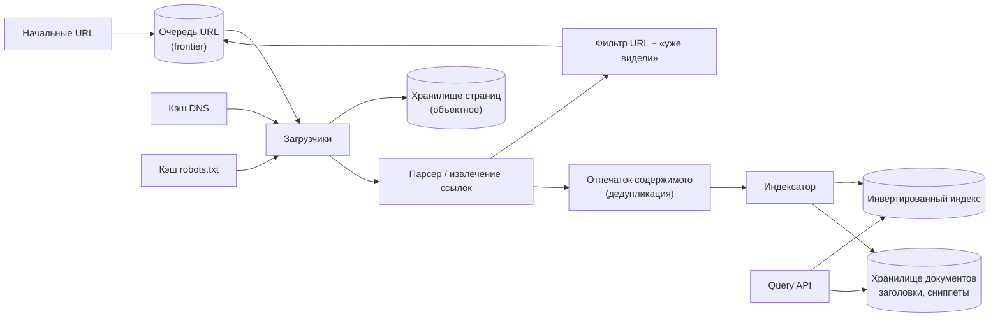
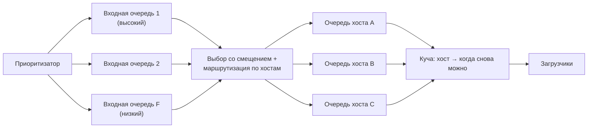
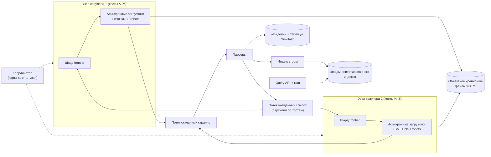

import { Aside } from '@astrojs/starlight/components';

В принципе веб-краулер прост: скачать страницу, вытащить ссылки, добавить их в список дел, повторить. Но при миллиарде страниц в неделю каждая часть этого цикла превращается в задачу проектирования. Список дел должен учитывать приоритеты и быть вежливым к каждому сайту, дубли прячутся за разными URL, DNS становится узким местом, а веб всё время меняется. В этом разборе проектируем краулер, который наполняет поисковый индекс, и коротко набрасываем сторону запросов — выдачу страниц с заголовками и сниппетами.

<Aside type="tip" title="Коротко">
- **Очередь URL (frontier):** приоритетные очереди питают **очереди по хостам**, а куча «когда к хосту снова можно обратиться» обеспечивает вежливость: ни один сайт не перегружается, и при этом тысячи хостов работают параллельно.
- **Соблюдаем robots.txt** (RFC 9309): кэшируем по хосту не дольше 24 часов и замедляемся при `429`/`503`.
- **Дедуплицируем дважды:** нормализуем URL и проверяем по множеству «уже видели» или фильтру Блума до попадания во frontier, а после скачивания снимаем отпечаток содержимого — точный хеш для одинаковых тел и **SimHash** для почти-дублей.
- **Шардируем по хостам** между узлами краулера (консистентное хеширование), сырые страницы храним в объектном хранилище (файлы WARC), а парсинг, индексацию и расписание повторных обходов кормим из потока. Каждую страницу переобходим с частотой, зависящей от того, как часто она реально меняется.
</Aside>

## Шаг 1 — Требования и ограничения

### Сценарии использования

Входят в задачу:

- **Сервис** обходит начальный список URL и постоянно находит новые.
- **Сервис** строит инвертированный индекс и хранит для каждой страницы статический заголовок и сниппет.
- **Сервис** регулярно переобходит страницы, чтобы индекс оставался свежим.
- **Пользователь** ищет и получает ранжированный список страниц с заголовками и сниппетами — только на уровне общей схемы.
- **Сервис** высокодоступен.

Не входят: ранжирование по ссылкам (PageRank), персонализация, аналитика поиска и выполнение JavaScript на каждой странице (рендеринг — отдельный дорогой уровень по желанию).

### Нефункциональные требования

- **Вежливость:** никогда не перегружать сайт, соблюдать robots.txt и отступать при ошибках.
- **Устойчивость:** переживать «ловушки для пауков» (бесконечные календари, ID сессий в URL), битый HTML и огромные файлы.
- **Свежесть:** популярные страницы — в пределах часов или суток, «длинный хвост» — недель.
- **Горизонтальное масштабирование:** больше машин — больше обход, без центрального узкого места.
- **Быстрые запросы:** результаты поиска за несколько сотен миллисекунд.

### Допущения

- В корпусе 1 млрд URL, в среднем переобход раз в неделю — около 4,3 млрд скачиваний в месяц.
- Средняя страница — около 100 КБ HTML. Оригинал закладывал 500 КБ, что похоже на полный вес страницы с картинками и скриптами, а краулер для текстового индекса качает только HTML.
- Сжатие примерно 4:1. Около 10 КБ извлечённого текста на страницу.
- 100 млрд поисковых запросов в месяц.

### Прикидочный расчёт

| Величина | Расчёт | Результат |
|---|---|---|
| Скачивания | 1 млрд × 30/7 в месяц ÷ 2,592 млн с | ≈ 1 650/с в среднем (в оригинале 1 600) |
| Входящий трафик | 1 650/с × 100 КБ | ≈ 165 МБ/с ≈ 1,3 Гбит/с постоянно |
| Одновременные скачивания | 1 650/с × ~1–2 с на скачивание | ≈ 1 700–3 300 открытых соединений |
| Хостов в ротации | 1 650/с ÷ 0,1 запроса/с на хост (пауза 10 с) | ≥ 16 500 хостов с URL в очереди в любой момент |
| Сырой HTML за месяц | 4,3 млрд × 100 КБ | ≈ 430 ТБ сырых, ≈ 107 ТБ сжатых |
| История за 3 года | 107 ТБ × 36 | ≈ 3,9 ПБ сжатых, если хранить каждое скачивание |
| Только последний снимок | 1 млрд × 100 КБ ÷ 4 | ≈ 25 ТБ сжатых |
| Извлечённый текст | 1 млрд × 10 КБ | ≈ 10 ТБ (вход индексации) |
| Множество «видели URL» | 10 млрд URL, фильтр Блума, 1 % ложных срабатываний | ≈ 12 ГБ |
| Отпечатки содержимого | 1 млрд × 8-байтовый SimHash | ≈ 8 ГБ |
| Поиск | 100 млрд ÷ 2,592 млн с | ≈ 38 600/с в среднем |

<Aside type="note" title="Арифметика и оригинал">
Оригинал умножает 4 млрд скачиваний на 500 КБ и получает 2 ПБ в месяц и 72 ПБ за три года — сами произведения верны. Но картину меняют две вещи. Во-первых, 1 млрд страниц с еженедельным обновлением — это около 4,3 млрд скачиваний в месяц, а не 4 млрд. Во-вторых, 500 КБ сильно больше типичного HTML: в ежемесячных обходах Common Crawl 2026 года около 185 КБ несжатых данных на сохранённую страницу, а Web Almanac 2025 даёт медиану HTML-документа около 33–35 КБ. При 100 КБ на страницу и сжатии архив за три года — около 3,9 ПБ, а если хранить только последнюю версию — 25 ТБ. К тому же новая копия нужна только для действительно изменившихся страниц.
</Aside>

## Шаг 2 — Высокоуровневый дизайн



1. **Frontier** решает, какой URL качать следующим, с учётом приоритета и вежливости к каждому хосту.
2. **Загрузчик** разрешает имя хоста через локальный кэш DNS, сверяется с закэшированными правилами robots.txt и скачивает страницу с тайм-аутами и лимитом размера.
3. Сырой ответ уходит в **хранилище страниц**, а **парсер** извлекает текст, заголовок и исходящие ссылки.
4. Новые ссылки нормализуются, фильтруются (схема, тип файла, эвристики ловушек) и сверяются с множеством **«уже видели»**. Во frontier попадают только новые URL.
5. С содержимого снимается отпечаток. Точные и почти-дубли записываются как псевдонимы канонической страницы и повторно не индексируются.
6. **Индексатор** обновляет инвертированный индекс и хранилище документов (URL, заголовок, сниппет). **Query API** читает и то и другое.

## Шаг 3 — Ключевые компоненты

### Frontier: приоритеты и вежливость

У frontier две задачи, тянущие в разные стороны: сначала качать самые важные URL и никогда не слать много запросов одному хосту. Классический ответ пришёл из краулера Mercator и описан в книге *Introduction to Information Retrieval*:



- **Входные очереди (front queues)** хранят URL по приоритетам. Приоритет отражает оценку важности (ссылочный вес, авторитет сайта, подсказки из sitemap, новый это URL или переобход) и потребность в свежести.
- **Выходные очереди (back queues)** содержат URL **одного хоста** каждая. Селектор вычерпывает входные очереди со смещением в пользу высокого приоритета и раскладывает URL по очередям их хостов.
- **Куча** с ключом «самое раннее время, когда можно обратиться к хосту» решает, какой хост обслуживать следующим. Если скачивание заняло `t` секунд, Mercator ждал `10·t`, прежде чем снова обратиться к тому же хосту. Нижней границей служит фиксированный минимум около 1 с или `Crawl-delay` самого сайта. Эмпирическое правило Mercator — около 3 выходных очередей на поток загрузки, чтобы потоки не простаивали.

```python title="frontier.py"
import heapq
import time
from collections import defaultdict, deque
from dataclasses import dataclass, field
from urllib.parse import urlsplit


@dataclass(order=True)
class HostSlot:
    ready_at: float
    host: str = field(compare=False)


class Frontier:
    """Входные очереди по приоритету, своя очередь на хост, куча «когда хост готов»."""

    def __init__(self, levels: int = 3, min_delay: float = 1.0, max_hosts: int = 1000) -> None:
        self.front: list[deque[str]] = [deque() for _ in range(levels)]   # 0 = самое важное
        self.back: dict[str, deque[str]] = defaultdict(deque)
        self.ready: list[HostSlot] = []
        self.in_flight: set[str] = set()
        self.next_ok: dict[str, float] = defaultdict(float)             # «часы вежливости» хоста
        self.min_delay = min_delay                                       # или задержка из robots.txt
        self.max_hosts = max_hosts

    def add(self, url: str, priority: int) -> None:
        self.front[priority].append(url)

    def _refill(self) -> None:
        for q in self.front:                  # для краткости строгий приоритет; в жизни — веса
            while q and len(self.ready) < self.max_hosts:
                url = q.popleft()
                host = urlsplit(url).hostname or ""
                if not self.back[host] and host not in self.in_flight:
                    heapq.heappush(self.ready, HostSlot(self.next_ok[host], host))
                self.back[host].append(url)

    def next_url(self) -> tuple[str, float] | None:
        """Возвращает (url, сколько секунд ждать) для хоста, который освободится раньше всех."""
        if len(self.ready) < self.max_hosts:
            self._refill()
        if not self.ready:
            return None
        slot = heapq.heappop(self.ready)
        self.in_flight.add(slot.host)         # не больше одного соединения на хост
        url = self.back[slot.host].popleft()
        return url, max(0.0, slot.ready_at - time.monotonic())

    def done(self, url: str, fetch_seconds: float) -> None:
        host = urlsplit(url).hostname or ""
        self.in_flight.discard(host)
        gap = max(self.min_delay, 10 * fetch_seconds)   # Mercator: ждать 10x от времени скачивания
        self.next_ok[host] = time.monotonic() + gap
        if self.back[host]:
            heapq.heappush(self.ready, HostSlot(self.next_ok[host], host))


f = Frontier()
for u in ("https://a.example/1", "https://a.example/2", "https://b.example/1"):
    f.add(u, priority=0)
first, second = f.next_url(), f.next_url()
assert first and second
print(first[0], second[0])          # по одному URL на хост, прежде чем снова идти на a.example
f.done(first[0], fetch_seconds=0.2)
nxt = f.next_url()
assert nxt
print(nxt[0], round(nxt[1], 1))     # https://a.example/2 примерно через 2,0 с (10 x 0,2 с)
```

Здесь важна арифметика. Если каждому хосту достаётся примерно один запрос в 10 секунд, то для 1 650 скачиваний/с в очереди постоянно должны быть URL **как минимум от 16 500 разных хостов**. Frontier, забитый URL нескольких больших сайтов, встанет, сколько железа ему ни дай. Вежливость стоит группировать ещё и **по IP-адресу или хостинг-провайдеру**, а не только по имени хоста: тысячи мелких сайтов могут жить на одном сервере.

Frontier на миллиарды URL в RAM не помещается. В памяти держим «голову» каждой очереди, остальное — на диске: RocksDB, шардированное key-value-хранилище или логи в стиле Kafka на каждый уровень приоритета.

### robots.txt и хорошие манеры

Протокол исключений для роботов стал стандартом в 2022 году (RFC 9309):

- Прежде всего скачиваем `/robots.txt` для каждого хоста (схема, хост и порт) и кэшируем его **не дольше 24 часов**.
- Разбираем как минимум первые **500 КиБ** и проходим не меньше 5 редиректов подряд.
- `4xx` (например, `404`) означает «ограничений нет». `5xx` или сетевая ошибка означают **«считать, что запрещено всё»** и повторить позже. Если файл долго недоступен (порядка 30 дней), краулер может перейти на закэшированную копию или считать сайт свободным от ограничений.
- Применяется самая специфичная группа `User-agent` и самое длинное совпавшее правило `Allow`/`Disallow`. `Crawl-delay` в RFC не входит: одни краулеры его соблюдают, Google игнорирует.

```python title="robots.py"
from urllib.robotparser import RobotFileParser

ROBOTS_TXT = """\
User-agent: *
Disallow: /search
Disallow: /tmp/

User-agent: ExampleBot
Disallow: /private/
"""

rp = RobotFileParser()
rp.parse(ROBOTS_TXT.splitlines())       # в продакшене: скачать, кэшировать <= 24 ч, не больше 500 КиБ
for agent in ("ExampleBot", "OtherBot"):
    print(agent, [rp.can_fetch(agent, "https://example.com" + p) for p in ("/search?q=x", "/private/x")])
# ExampleBot [True, False]  - бот со своей группой игнорирует группу '*'
# OtherBot   [False, True]
```

Помимо robots.txt: честный `User-Agent` со ссылкой для связи; условные запросы (`If-None-Match`, `If-Modified-Since`), чтобы неизменившаяся страница стоила ответа `304` без тела; автоматическое замедление при `429`/`503` и росте задержки; `sitemap.xml` (с датами `lastmod`) для поиска новых страниц.

### Дедупликация, часть 1: URL

Множество разных строк ведёт на одну страницу. Перед проверкой «видели ли мы его?» каждый URL нормализуем:

```python title="normalize.py"
from urllib.parse import parse_qsl, urlencode, urlsplit, urlunsplit

TRACKING = {"utm_source", "utm_medium", "utm_campaign", "utm_term", "utm_content", "gclid", "fbclid"}
DEFAULT_PORTS = {"http": 80, "https": 443}


def normalize(url: str) -> str:
    parts = urlsplit(url.strip())
    scheme = parts.scheme.lower()
    host = (parts.hostname or "").lower().rstrip(".")
    port = f":{parts.port}" if parts.port and parts.port != DEFAULT_PORTS.get(scheme) else ""
    path = parts.path or "/"
    query = urlencode(sorted((k, v) for k, v in parse_qsl(parts.query, keep_blank_values=True)
                             if k.lower() not in TRACKING))
    return urlunsplit((scheme, host + port, path, query, ""))  # фрагмент отбрасываем


assert normalize("HTTPS://Example.COM:443/a?utm_source=x&b=2&a=1#top") == "https://example.com/a?a=1&b=2"
assert normalize("http://example.com") == "http://example.com/"
print("ok")
```

Затем нормализованный URL проверяется по множеству **«уже видели»**. Для 10 млрд URL точное множество 8-байтовых хешей занимает около 80 ГБ (правда, 64-битные хеши 10 млрд URL дают в среднем около 3 ложных совпадений). Фильтр Блума с 1 % ложных срабатываний — около 12 ГБ, и при разбиении между узлами краулера он помещается в RAM. Ложное срабатывание означает, что изредка новый URL будет пропущен, — для краулера это приемлемо. Учитываем и `<link rel="canonical">` с редиректами: они говорят, какой URL сайт считает основным.

**Ловушки для пауков** — бесконечные пространства URL: календари со ссылкой на следующий месяц до бесконечности, ID сессий, фасетный поиск с бесконечными комбинациями параметров. Защита: лимиты на длину URL, глубину пути и число параметров запроса; бюджет страниц на хост; распознавание почти одинакового содержимого под множеством URL (следующий раздел).

### Дедупликация, часть 2: содержимое

Заметная доля скачанных страниц — точные или почти точные копии: зеркала, версии для печати, та же статья с другой рекламой или обвязкой.

- **Точные дубли:** хешируем нормализованное тело (SHA-256 или быстрый 64/128-битный хеш) и ищем в key-value-таблице `хеш → канонический URL`.
- **Почти-дубли:** **SimHash** (Charikar, 2002) отображает документ в 64-битный отпечаток, у которого похожие документы отличаются лишь несколькими битами. Google сообщал (Manku и др., WWW 2007), что для 8 млрд страниц хорошо работают 64-битные отпечатки с расстоянием Хэмминга не больше 3.

```python title="simhash.py"
import hashlib
import re
from collections import Counter


def _h64(token: str) -> int:
    return int.from_bytes(hashlib.blake2b(token.encode(), digest_size=8).digest(), "big")


def simhash(text: str, shingle: int = 3) -> int:
    """64-битный SimHash по триграммам слов: похожие тексты -> мало различающихся битов."""
    words = re.findall(r"\w+", text.lower())
    grams = Counter(" ".join(words[i:i + shingle]) for i in range(max(1, len(words) - shingle + 1)))
    acc = [0] * 64
    for gram, weight in grams.items():
        h = _h64(gram)
        for bit in range(64):
            acc[bit] += weight if (h >> bit) & 1 else -weight
    return sum(1 << bit for bit in range(64) if acc[bit] > 0)


def hamming(a: int, b: int) -> int:
    return (a ^ b).bit_count()


body = " ".join(f"Paragraph {i} explains how crawlers schedule hosts politely." for i in range(40))
a = simhash(body + " Copyright 2025.")
b = simhash(body + " Copyright 2026.")     # та же статья, новый подвал
c = simhash("A completely different page about sourdough bread and starter cultures. " * 10)
print(hamming(a, b), hamming(a, c))        # мало против примерно 32
```

Найти все сохранённые отпечатки на расстоянии до 3 бит от нового, не перебирая 1 млрд значений, помогает **приём с блоками**. Делим 64 бита на 4 блока по 16. Любой отпечаток на расстоянии не больше 3 совпадает с новым точно хотя бы в одном блоке. Держим 4 таблицы, каждая отсортирована по своему блоку, и проверяем только кандидатов с совпадающим блоком. Это около 15 000 кандидатов на таблицу при 1 млрд страниц и около 32 ГБ в сумме, а каждая проверка — быстрые XOR и подсчёт битов. Альтернатива, если нужна мера Жаккара по шинглам, — MinHash с хешированием, чувствительным к близости (LSH).

### DNS

При 1 650 скачиваниях/с отправка каждого запроса в публичный резолвер добавляет задержку, создаёт нагрузку и рискует упереться в ограничение частоты. На каждом узле краулера держим **локальный кэширующий резолвер** (Unbound или кэш внутри загрузчика) и соблюдаем TTL с нижней границей. Имена следующих хостов разрешаем **асинхронно**, заранее, до того как их URL дойдут до загрузчика. Отрицательные ответы кэшируем ненадолго. Раз URL сгруппированы по хостам, доля попаданий высока: при 95 % вверх уходит около 80 запросов/с.

### Скачивание

- **Асинхронный ввод-вывод:** один процесс с циклом событий держит тысячи соединений. Соединения с одним хостом переиспользуем (keep-alive в HTTP/1.1 или HTTP/2).
- **Лимиты:** тайм-ауты на соединение и чтение, максимальный размер тела (например, 10 МБ), допустимые типы содержимого и максимальная длина цепочки редиректов.
- **Рендеринг:** большинство страниц индексируются по HTML. Небольшую приоритетную долю (одностраничные приложения с ценным контентом) отправляем в отдельный **уровень headless-браузеров**, который обходится в 10–100 раз дороже на страницу.
- **Транспорт:** страницы скачиваются по HTTP поверх TCP и TLS. Совет оригинала «перейти на UDP» имеет смысл только для DNS, который и так работает по UDP. HTTP/3 (QUIC поверх UDP) можно использовать там, где его поддерживают серверы, но сам по себе он краулер не ускоряет.

### Хранение и индексация

- **Сырые страницы:** ответы дописываются в большие файлы **WARC** (стандарт веб-архивов; типично около 1 ГБ каждый) в объектном хранилище, плюс отдельный индекс `URL → (файл, смещение, длина)`. Большие неизменяемые файлы подходят объектному хранилищу гораздо лучше, чем миллиарды объектов по 100 КБ.
- **Состояние обхода:** key-value-таблица с ключом по хешу URL: время последнего скачивания, статус, ETag/Last-Modified, хеш содержимого, SimHash, история изменений и время следующего обхода.
- **Конвейер индексации:** парсинг → извлечение текста, заголовка и текста исходящих ссылок → токенизация → запись постингов. Инвертированный индекс шардируем **по документам**: каждый запрос параллельно идёт во все шарды, результаты сливаются (scatter-gather). Сегменты индекса строим пакетно (Spark или MapReduce по последнему снимку) и подмешиваем небольшие инкрементальные обновления для свежих страниц.
- **Хранилище документов:** URL, заголовок и статический сниппет каждого документа — для отрисовки выдачи.

```http title="Search API"
GET /api/v1/search?q=consistent+hashing&page=1

{"results": [{"url": "https://example.com/ch", "title": "Consistent hashing explained", "snippet": "Consistent hashing maps keys and servers onto a ring…"}],
 "next_page": 2}
```

### Расписание повторных обходов

Страницы меняются с очень разной скоростью: главная новостного сайта — каждые несколько минут, старый пост в блоге может не меняться никогда. Храним историю изменений каждого URL и оцениваем частоту изменений λ (изменений в сутки), например по пуассоновской модели. Следующий визит планируем исходя из λ и важности страницы.

Стоит знать два результата Чо и Гарсиа-Молины о свежести обхода:

- Переобход **пропорционально** частоте изменений даёт в среднем худшую свежесть, чем равномерный. Страницы, меняющиеся каждые несколько минут, устаревают почти сразу, и гоняться за ними — значит тратить бюджет обхода впустую.
- Оптимальная политика ближе к равномерной, увеличивает частоту визитов **сублинейно** относительно частоты изменений и отказывается от страниц, которые меняются слишком часто, чтобы держать их свежими.

На практике: важные страницы переобходим часто; если `ETag` или хеш содержимого не изменился, пропускаем (ответ `304` почти ничего не стоит); долго не менявшиеся страницы посещаем реже; используем push-сигналы, где сайты их дают: sitemap с `lastmod`, RSS и Atom, уведомления IndexNow.

## Шаг 4 — Масштабирование

1. **Распределяем frontier по хостам.** Каждый хост закрепляется за одним узлом краулера через консистентное хеширование по регистрируемому домену. Узел владеет очередью хоста, «часами вежливости», кэшами robots.txt и DNS, так что вежливость не требует глобальных блокировок. Ссылки, найденные для чужих хостов, пачками отправляются владельцам через поток. При добавлении или уходе узла переезжает лишь около 1/N хостов.
2. **Загрузчики ограничены вводом-выводом.** Около 3 300 одновременных соединений обслуживает горстка машин с асинхронным вводом-выводом. Парсинг упирается в процессор, поэтому парсеры — отдельные потребители потока скачанных страниц и масштабируются независимо.
3. **Множество «видели» и таблицы дедупликации партиционируем** по хешу URL и по блокам SimHash — рядом с узлами frontier или в шардированном key-value-хранилище.
4. **Всплески поглощают потоки.** «Скачивание → парсинг → дедупликация ссылок → frontier» и «скачивание → индексация» — отдельные стадии на топиках в стиле Kafka. Каждая масштабируется сама, а медленный индексатор копит отставание, не останавливая обход.
5. **Делаем работу идемпотентной.** Узел, упавший и скачавший страницу повторно, не должен ничего посчитать дважды. Ключ всего — хеш URL и время скачивания.
6. **Полоса и репутация IP.** При ~1,3 Гбит/с постоянного трафика распределяем исходящие запросы по регионам поближе к контенту. Публикуем диапазоны IP и идентификацию краулера, чтобы сайты могли его проверить.
7. **Сторона запросов.** ~38 600 поисков/с требуют реплицированного индекса, шардированного по документам, и кэша результатов для популярных запросов: частоты запросов сильно перекошены. См. [разбор кэша поисковых запросов](/practice/search-query-cache/).



| Что добавили | Что даёт | Чего стоит |
|---|---|---|
| Frontier, разбитый по хостам | Вежливость без глобальных блокировок; горизонтальный рост | Перебалансировка при смене узлов; перекос от очень больших хостов |
| Потоки между стадиями | Независимое масштабирование, буферизация, повторное проигрывание | Дубли при повторе — стадии должны быть идемпотентными |
| Фильтр Блума для «видели» | 12 ГБ вместо 80+ ГБ | Небольшой шанс пропустить новый URL |
| Таблицы SimHash | Поиск почти-дублей за несколько обращений | Около 32 ГБ таблиц; подбор порога |
| Файлы WARC в объектном хранилище | Дешёвый, надёжный архив с возможностью переигровки | Для случайного доступа нужен индекс смещений |
| Уровень headless-рендеринга | Индексация сайтов на JavaScript | В 10–100 раз дороже на страницу |

## Что изменилось к 2026 году

- **Управляемые кирпичики:** объектное хранилище (S3, GCS, R2) для файлов WARC, Kafka-совместимые потоки или Pub/Sub между стадиями, шардированное key-value-хранилище (DynamoDB, Bigtable, ScyllaDB) для состояния обхода, Spark или BigQuery для пакетной дедупликации и построения индекса. Загрузчикам подходят контейнеры или долгоживущие ВМ, где соединения и кэш DNS остаются «тёплыми». Бессерверные функции платят холодным стартом и теряют эти кэши, поэтому лучше подходят для побочных задач со всплесками нагрузки, чем для основного цикла скачивания.
- **Открытые датасеты:** Common Crawl публикует около 2 млрд страниц в месяц — примерно 360 ТиБ несжатых данных на обход в 2026 году — файлами WARC в S3. Для исследований или первичного наполнения индекса начинайте с него, а не с собственного обхода.
- **ИИ-краулеры изменили этикет.** Обучение LLM и «отвечающие» поисковики обходят веб в огромных объёмах, и сайты сопротивляются. С июля 2025 года Cloudflare по умолчанию блокирует ИИ-краулеры для своих клиентов и предлагает оплату за обход (pay per crawl). Владельцы сайтов разделяют поисковых и обучающих краулеров в robots.txt по user agent. Рабочая группа IETF Web Bot Auth готовит стандарт, по которому боты подписывают запросы через HTTP Message Signatures, чтобы сайты могли проверить, кто их обходит. Краулер 2026 года должен точно представляться, публиковать свои диапазоны IP и ключи и соблюдать отказы, заданные по назначению обхода.
- **Обнаружение по сигналам от сайтов:** sitemap и IndexNow (его поддерживают Bing, Yandex, Naver и Seznam, но не Google) позволяют сайтам сообщать об изменениях, не дожидаясь переобхода.
- **Рендеринг стал обыденным, но остался дорогим:** пулы headless Chromium (Playwright, Puppeteer) — стандарт, но их по-прежнему оставляют для страниц, которым он действительно нужен.
- **Что не изменилось:** frontier в духе Mercator, вежливость по хостам, нормализация URL плюс множество «видели», SimHash для почти-дублей и переобход по оценке частоты изменений.

<Aside type="note" title="На собеседовании">
- **«Как оставаться вежливым при 1 000+ страниц в секунду?»** Очереди по хостам, куча времени готовности и достаточно разных хостов в ротации. Покажите расчёт про 16 500 хостов.
- **«Как не качать одно и то же дважды?»** Нормализация URL плюс фильтр Блума, затем хеши содержимого и SimHash с приёмом блоков.
- **«Ловушки для пауков?»** Лимиты глубины, длины и параметров, бюджеты на хост, распознавание дублирующегося содержимого.
- **«Как часто переобходить?»** По оценке частоты изменений и важности; условные GET; результат «пропорционально — не оптимально».
- **«Как распределить?»** Консистентное хеширование хостов на узлы, маршрутизация ссылок владельцам через поток.
- **Типичные ошибки:** одна глобальная очередь (невежливо и узкое место), незнание семантики `5xx` для robots.txt, хранение миллиардов крошечных объектов и забытый DNS.
</Aside>

## Что почитать

- [RFC 9309: Robots Exclusion Protocol](https://www.rfc-editor.org/rfc/rfc9309.html)
- [Mercator: a scalable, extensible web crawler (Heydon, Najork, 1999)](https://www.cs.ucr.edu/~vagelis/classes/CS242/publications/scalable-crawler.pdf)
- [The URL frontier, *Introduction to Information Retrieval* (Manning, Raghavan, Schütze)](https://nlp.stanford.edu/IR-book/html/htmledition/the-url-frontier-1.html)
- [Detecting near-duplicates for web crawling (Manku, Jain, Das Sarma, WWW 2007)](https://archives.iw3c2.org/www2007/papers/paper215.pdf)
- [Как Google интерпретирует спецификацию robots.txt](https://developers.google.com/search/docs/crawling-indexing/robots/robots_txt)
- [Common Crawl: архив обхода за август 2026 года](https://commoncrawl.org/blog/august-2026-crawl-archive-now-available)

## Связанные темы

- [Потоковая обработка событий](/async/event-streaming/): потоки, связывающие скачивание, парсинг, дедупликацию и индексацию.
- [Партиционирование и шардирование](/data/partitioning-and-sharding/): консистентное хеширование хостов на узлы и индексы, шардированные по документам.
- [Объектное хранилище](/data/object-storage/): хранение сырых страниц большими файлами WARC.
- [DNS](/traffic/dns/): зачем краулеру собственный кэширующий резолвер.
- [Ограничение частоты запросов](/reliability/rate-limiting/): вежливость — это rate limiting, применённый к самому себе.
- [Кэш для поисковой системы](/practice/search-query-cache/): сторона запросов этой системы.
