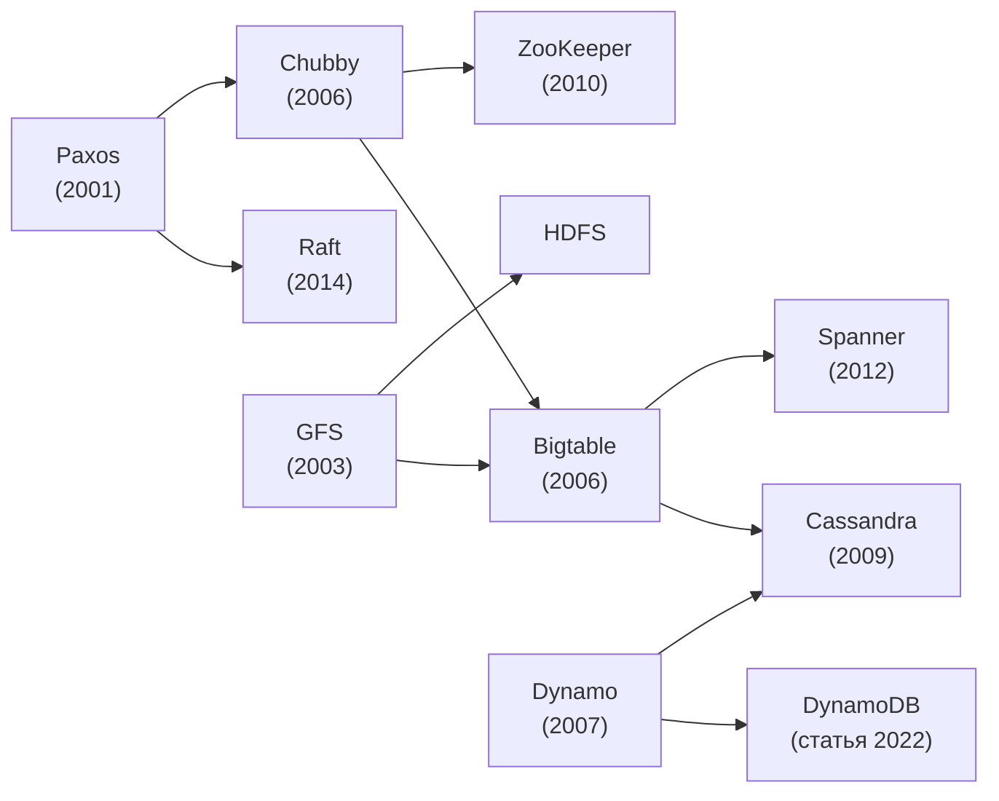
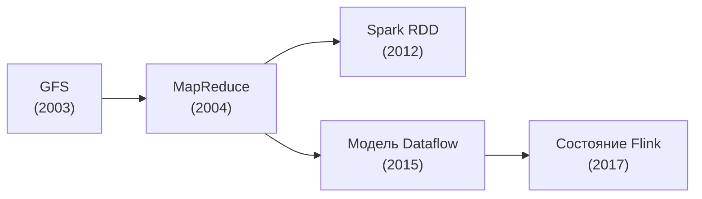

import { Aside } from '@astrojs/starlight/components';

Большинство строительных блоков, о которых говорят на собеседованиях по проектированию систем, впервые описаны в нескольких статьях Google, Amazon, Facebook, LinkedIn и университетов. Эти статьи показывают, откуда взялись современные базы данных, очереди и планировщики и какие компромиссы их авторы приняли сознательно. Здесь основные работы сгруппированы по задаче, которую они решают, и для каждой в одной строке сказано, что из неё вынести.

<Aside type="tip" title="Коротко">
- Читайте ради **задачи, ключевой идеи и компромисса**, а не ради деталей реализации.
- Почти все системы, которые вы назовёте на собеседовании, восходят примерно к двадцати статьям. GFS, MapReduce, Bigtable, Dynamo, Chubby, Spanner, Kafka, Dapper, Borg и Raft покрывают бо́льшую часть.
- Одни и те же идеи повторяются: **разбить данные на партиции, реплицировать лог, договариваться через консенсус, ставить кэш перед хранилищем и считать сбои нормой**.
- Часть систем позже заменили (GFS на Colossus, MapReduce на dataflow-движки, ZooKeeper внутри Kafka на KRaft), но рассуждения в статьях по-прежнему верны.
</Aside>

## Как читать эти статьи

Не пытайтесь запомнить числа или внутренние API. На собеседовании статья полезна, если вы можете пересказать её в трёх предложениях и связать с решением, которое принимаете. В каждой статье ищите:

1. **Задачу и ограничения.** Под какую нагрузку, масштаб и частоту сбоев проектировали систему? Авторы GFS исходили из того, что диски и машины ломаются каждый день, а файлы огромные и в основном дописываются в конец. Это допущение объясняет почти все остальные решения в статье.
2. **Ключевую идею.** Обычно статью держит один механизм: TrueTime в Spanner, происхождение данных (lineage) в Spark, кворумы и hinted handoff в Dynamo, лог коммитов в Kafka.
3. **Назначение каждого компонента и его пределы.** Отметьте, какая часть отвечает за метаданные, какая хранит данные, а какая координирует. Затем спросите себя, где схема перестаёт работать: единственный мастер, горячая партиция, задержка между регионами.
4. **Общие паттерны.** Сравнивайте статьи одной группы. Chubby и ZooKeeper оформляют консенсус в небольшой сервис; Bigtable и Cassandra хранят данные в отсортированных неизменяемых файлах плюс буфер в памяти.
5. **Извлечённые уроки.** Разделы с оценкой и «опытом эксплуатации» часто самые практичные: в них написано, что удивило команду в продакшене.

Хорошо работает чтение в три прохода. Сначала просмотрите аннотацию, заголовки и рисунки (минут 10). Затем внимательно прочитайте раздел с архитектурой. Доказательства и оценку читайте, только если они нужны. Этот метод описан в короткой заметке С. Кешава [How to Read a Paper](https://svr-sk818-web.cl.cam.ac.uk/keshav/papers/07/paper-reading.pdf).

## Как связаны идеи

Многие системы напрямую опираются друг на друга. На обеих схемах ниже стрелка означает «развивает или заимствует идеи». Первая показывает координацию и хранение данных:

Вторая — как из GFS и MapReduce выросли пакетная и потоковая обработка:

## Обработка данных

| Система | Год и конференция | Чем важна | Статья |
|---|---|---|---|
| **MapReduce** (Google) | 2004, OSDI | Пользователь пишет две функции, а фреймворк берёт на себя разбиение данных, планирование, отстающие задачи и отказы машин. Образец пакетной обработки на обычных серверах. | [research.google](https://research.google/pubs/mapreduce-simplified-data-processing-on-large-clusters/) |
| **Spark: Resilient Distributed Datasets** (UC Berkeley) | 2012, NSDI | Рабочие данные хранятся в памяти как неизменяемые наборы. Потерянные партиции пересчитываются по их происхождению (lineage), а не реплицируются, поэтому итеративные и интерактивные задачи работают быстро. | [usenix.org](https://www.usenix.org/conference/nsdi12/technical-sessions/presentation/zaharia) |
| **Модель Dataflow** (Google) | 2015, VLDB | Единая модель для пакетной и потоковой обработки: время события и время обработки, окна, водяные знаки (watermarks) и триггеры. Основа Apache Beam и большинства современных потоковых движков. | [vldb.org (PDF)](https://www.vldb.org/pvldb/vol8/p1792-Akidau.pdf) |
| **Управление состоянием в Apache Flink** | 2017, VLDB | Как потоковый движок сохраняет согласованность большого состояния при сбоях с помощью асинхронных распределённых снимков. На этом механизме держится потоковая обработка exactly-once. | [vldb.org (PDF)](https://www.vldb.org/pvldb/vol10/p1718-carbone.pdf) |

## Хранилища данных

| Система | Год и конференция | Чем важна | Статья |
|---|---|---|---|
| **Bigtable** (Google) | 2006, OSDI | Отсортированная разреженная таблица, поделённая на таблеты и хранящаяся в GFS, с memtable и неизменяемыми SSTable. Отсюда пошла модель wide-column, которой следуют HBase и Cassandra. | [research.google](https://research.google/pubs/bigtable-a-distributed-storage-system-for-structured-data/) |
| **Dynamo** (Amazon) | 2007, SOSP | Классическое хранилище «ключ — значение» без лидера, всегда доступное для записи: консистентное хеширование, нестрогие кворумы (sloppy quorum), hinted handoff, векторные часы и восстановление через деревья Меркла. | [allthingsdistributed.com (PDF)](https://www.allthingsdistributed.com/files/amazon-dynamo-sosp2007.pdf) |
| **Cassandra** (Facebook) | 2009, LADIS | Партиционирование и репликация из Dynamo плюс модель хранения из Bigtable. Хороший пример настраиваемой согласованности и её цены. | [cornell.edu (PDF)](https://www.cs.cornell.edu/projects/ladis2009/papers/lakshman-ladis2009.pdf) |
| **Spanner** (Google) | 2012, OSDI | Глобальный SQL с внешне согласованными транзакциями. TrueTime ограничивает неопределённость часов, а данные разбиты на группы, реплицируемые через Paxos. Предок распределённых SQL-баз. | [usenix.org](https://www.usenix.org/conference/osdi12/technical-sessions/presentation/corbett) |
| **Aurora** (Amazon) | 2017, SIGMOD | Отправляет только записи redo-лога в общий слой хранения, который держит шесть копий в трёх зонах доступности и подтверждает запись, когда её получили 4 из 6. Разделение вычислений и хранения стало стандартом для облачных баз данных. | [amazon.science](https://www.amazon.science/publications/amazon-aurora-design-considerations-for-high-throughput-cloud-native-relational-databases) |
| **Amazon DynamoDB** | 2022, USENIX ATC | Десять лет эксплуатации управляемого NoSQL-сервиса: предсказуемая задержка, разделение партиций, контроль допуска нагрузки и репликация через Multi-Paxos. Сильно отличается от Dynamo 2007 года. | [usenix.org](https://www.usenix.org/conference/atc22/presentation/elhemali) |
| **Memcache в Facebook** | 2013, NSDI | Кэш сбоку от базы (look-aside) на миллиардах запросов в секунду: аренды (leases) против устаревших записей и «стада» запросов (thundering herd), региональные пулы и инвалидация по потоку репликации базы. | [usenix.org](https://www.usenix.org/conference/nsdi13/technical-sessions/presentation/nishtala) |
| **TAO** (Facebook) | 2013, USENIX ATC | Оптимизированный для чтения кэш над шардированным MySQL, который понимает структуру графа и отдаёт объекты и связи между ними. Показывает, как построить хранилище социального графа с согласованностью в конечном счёте. | [usenix.org](https://www.usenix.org/conference/atc13/technical-sessions/presentation/bronson) |

## Файловые системы и хранение блобов

| Система | Год и конференция | Чем важна | Статья |
|---|---|---|---|
| **Google File System (GFS)** | 2003, SOSP | Один мастер хранит метаданные, данные лежат в чанках по 64 МБ с тремя репликами, а согласованность ослаблена ради нагрузки, где файлы в основном дописываются. Отказы компонентов считаются нормой. | [research.google](https://research.google/pubs/the-google-file-system/) |
| **Архитектура HDFS** (Apache Hadoop) | Проектный документ | Открытый аналог GFS: NameNode и DataNode, размещение реплик с учётом стоек, пути записи и чтения. | [hadoop.apache.org](https://hadoop.apache.org/docs/stable/hadoop-project-dist/hadoop-hdfs/HdfsDesign.html) |
| **Haystack** (Facebook) | 2010, OSDI | Складывает миллиарды мелких фотографий в большие файлы-тома, чтобы чтение фото требовало примерно одного обращения к диску. Та же идея используется во многих хранилищах блобов. | [usenix.org](https://www.usenix.org/conference/osdi10/finding-needle-haystack-facebooks-photo-storage) |
| **Tectonic** (Facebook) | 2021, FAST | Единая мультиарендная файловая система эксабайтного масштаба, заменившая Haystack, f4 и HDFS; метаданные хранятся в хранилище «ключ — значение» ZippyDB. Показывает переход от специализированных хранилищ к одной общей платформе. | [usenix.org](https://www.usenix.org/conference/fast21/presentation/pan) |

## Координация и консенсус

| Система | Год и конференция | Чем важна | Статья |
|---|---|---|---|
| **Paxos Made Simple** (Лесли Лэмпорт) | 2001 | Алгоритм консенсуса, изложенный простым языком. На этой идее держатся все реплицируемые логи и сервисы выбора лидера. | [lamport.azurewebsites.net (PDF)](https://lamport.azurewebsites.net/pubs/paxos-simple.pdf) |
| **Chubby** (Google) | 2006, OSDI | Сервис крупнозернистых блокировок и хранения небольших файлов поверх Paxos. Объясняет, почему командам проще правильно использовать сервис блокировок, чем библиотеку консенсуса. | [research.google](https://research.google/pubs/the-chubby-lock-service-for-loosely-coupled-distributed-systems/) |
| **ZooKeeper** (Yahoo!) | 2010, USENIX ATC | Простые неблокирующие примитивы (znode, watch, последовательные узлы), из которых клиенты собирают блокировки, выбор лидера, членство в группе и конфигурацию. | [usenix.org](https://www.usenix.org/conference/usenix-atc-10/zookeeper-wait-free-coordination-internet-scale-systems) |
| **Raft** (Stanford) | 2014, USENIX ATC | Консенсус, спроектированный так, чтобы его было легко понять: сильный лидер, репликация лога и безопасная смена состава кластера. Используется в etcd, Consul и большинстве распределённых SQL-баз. | [usenix.org](https://www.usenix.org/conference/atc14/technical-sessions/presentation/ongaro) · [raft.github.io](https://raft.github.io/) |

## Сообщения и логи

| Система | Год и конференция | Чем важна | Статья |
|---|---|---|---|
| **Kafka** (LinkedIn) | 2011, NetDB | Разбитый на партиции лог на диске, в который только дописывают. Потребители сами забирают данные и хранят свои смещения, поэтому сообщения становятся надёжными потоками, которые можно перечитать. | [microsoft.com (PDF)](https://www.microsoft.com/en-us/research/wp-content/uploads/2017/09/Kafka.pdf) |
| **The Log** (Джей Крепс, эссе) | 2013 | Не научная статья, но самое понятное объяснение того, почему упорядоченный лог связывает базы данных, репликацию, интеграцию данных и потоковую обработку. | [engineering.linkedin.com](https://engineering.linkedin.com/distributed-systems/log-what-every-software-engineer-should-know-about-real-time-datas-unifying) |

## Наблюдаемость

| Система | Год и конференция | Чем важна | Статья |
|---|---|---|---|
| **Dapper** (Google) | 2010, технический отчёт | Трассировка с выборкой и малыми накладными расходами: идентификаторы трассы и спана передаются с каждым RPC. Модель, на которой построены Zipkin, Jaeger и трассировка OpenTelemetry. | [research.google](https://research.google/pubs/dapper-a-large-scale-distributed-systems-tracing-infrastructure/) |

## Управление кластерами

| Система | Год и конференция | Чем важна | Статья |
|---|---|---|---|
| **Borg** (Google) | 2015, EuroSys | Запускает чувствительные к задержке сервисы и пакетные задачи вместе на общих кластерах до десятков тысяч машин. Приоритеты, квоты и переподписка ресурсов держат загрузку высокой. | [research.google](https://research.google/pubs/large-scale-cluster-management-at-google-with-borg/) |
| **Borg, Omega, and Kubernetes** | 2016, ACM Queue | Уроки трёх поколений менеджеров кластеров Google и то, как они повлияли на Kubernetes: поды, метки и цикл согласования состояния (reconciliation loop). | [research.google](https://research.google/pubs/borg-omega-and-kubernetes/) |

## Что ещё стоит прочитать

| Система | Год и конференция | Чем важна | Статья |
|---|---|---|---|
| **Zanzibar** (Google) | 2019, USENIX ATC | Глобальный сервис авторизации на кортежах отношений поверх Spanner. Его модель повторяют многие открытые системы управления правами. | [usenix.org](https://www.usenix.org/conference/atc19/presentation/pang) |
| **FoundationDB** (Apple) | 2021, SIGMOD | Транзакционное хранилище «ключ — значение», разделённое на независимые компоненты и проверяемое детерминированной симуляцией. Показывает, как сделать распределённую базу тестируемой. | [foundationdb.org (PDF)](https://www.foundationdb.org/files/fdb-paper.pdf) |
| **Metastable failures in the wild** (Penn State, UNH, Twitter) | 2022, OSDI | Разбор 22 реальных инцидентов в 11 организациях, где система оставалась перегруженной и после того, как исходная причина исчезла: её удерживала петля обратной связи, например повторные попытки. Объясняет, почему важны сброс нагрузки и ограничение повторов. | [usenix.org](https://www.usenix.org/conference/osdi22/presentation/huang-lexiang) |

В оригинальном Primer также были ссылки на вводные слайды по HBase, MongoDB, Memcached и Redis. Этих презентаций больше нет; тот же материал есть на страницах о [NoSQL](/data/nosql/) и [кэшировании](/caching/caching-layers/).

## Что изменилось к 2026 году

- **GFS превратилась в Colossus.** Google перенесла метаданные файловой системы в Bigtable, и их обслуживает множество серверов метаданных вместо единственного мастера. [Обзор Colossus от Google](https://cloud.google.com/blog/products/storage-data-transfer/a-peek-behind-colossus-googles-file-system) — короткое продолжение статьи о GFS.
- **MapReduce уступил место dataflow-движкам.** Spark, Flink, Beam и облачные хранилища данных заменили написанные вручную задачи map и reduce. Идеи разбиения работы и перезапуска упавших задач остались прежними.
- **Kafka больше не нужен ZooKeeper.** Теперь Kafka хранит метаданные в собственном кворуме на Raft (KRaft), а в Kafka 4.0 режим ZooKeeper удалён. Консенсус переехал из отдельного сервиса внутрь самой системы. В 2025 году LinkedIn, где родилась Kafka, [представил Northguard](https://www.infoq.com/news/2025/06/linkedin-northguard-xinfra/) — собственное хранилище логов с шардированными метаданными на Raft, чтобы обойти ограничения Kafka на своём масштабе.
- **В новых базах победила репликация с лидером.** Сама DynamoDB использует Multi-Paxos, а не схему Dynamo без лидера, а распределённые SQL-базы, вдохновлённые Spanner, используют группы Raft или Paxos на каждый диапазон ключей. При этом статья о Dynamo остаётся лучшим объяснением подхода без лидера.
- **Хранение отделилось от вычислений.** Схема Aurora — общий слой хранения на основе лога под вычислительными узлами без состояния — теперь распространена в управляемых сервисах Postgres и MySQL.
- **Из Borg вырос Kubernetes, из Dapper — OpenTelemetry.** Обе статьи объясняют, почему открытые инструменты, которыми вы пользуетесь, устроены именно так.

<Aside type="note" title="На собеседовании">
Пересказывать статьи никто не попросит. Полезно другое: обосновать решение механизмом из статьи. Например: «Как в Dynamo, возьму консистентное хеширование с виртуальными узлами, чтобы при добавлении узла переезжала лишь малая часть ключей». Или: «Как в статье Facebook о memcache, выдам аренду (lease) на заполнение кэша, чтобы избежать thundering herd».

Типичные уточняющие вопросы: что сломается при отказе единственного мастера в GFS; зачем Spanner точные часы; как Kafka сохраняет порядок (только внутри партиции); почему в ZooKeeper не стоит хранить данные приложения.

Частые ошибки: считать Dynamo (статья 2007 года) и DynamoDB (сервис) одной архитектурой; называть Cassandra строго согласованной, не указав настройки кворума; применять консенсус там, где хватит одного лидера с арендой.
</Aside>

## Что почитать

- [How to Read a Paper](https://svr-sk818-web.cl.cam.ac.uk/keshav/papers/07/paper-reading.pdf), С. Кешав: метод трёх проходов на двух страницах.
- [Papers We Love](https://github.com/papers-we-love/papers-we-love): большой каталог статей по информатике, который ведёт сообщество, с разбивкой по темам.
- [Архив The Morning Paper](https://blog.acolyer.org/): разборы более тысячи статей от Адриана Колиера. Новых записей нет с 2021 года, но архив превосходный.
- [Блог Мурата Демирбаша](https://muratbuffalo.blogspot.com/): регулярные понятные обзоры новых статей по распределённым системам.
- [Анализы Jepsen](https://jepsen.io/analyses): проверки того, как реальные базы данных ведут себя при разделении сети, в сравнении с тем, что обещает документация.

## Связанные темы

- [Теорема CAP и PACELC](/fundamentals/cap-theorem/): компромисс, по разные стороны которого находятся Dynamo и Spanner.
- [Репликация](/data/replication/): репликация с лидером и без лидера, как в этих системах.
- [Партиционирование и шардирование](/data/partitioning-and-sharding/): консистентное хеширование и разбиение по диапазонам на практике.
- [Потоковая передача событий](/async/event-streaming/): логи в стиле Kafka и потоковая обработка сегодня.
- [Наблюдаемость](/reliability/observability/): трассировка, метрики и логи, продолжение идей Dapper.
- [Как это устроено у компаний](/real-world/company-architectures/): инженерные статьи, в которых эти идеи применяются.
