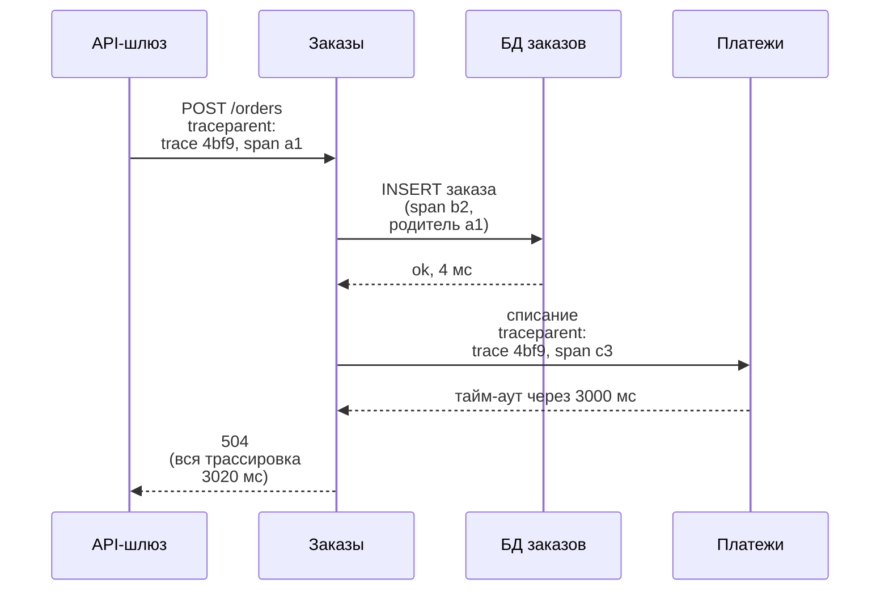

import { Aside } from '@astrojs/starlight/components';

Наблюдаемость (observability) — то, насколько хорошо можно понять, что делает работающая система и почему, по данным, которые она отдаёт, не выкатывая новый код ради нового вопроса. Мониторинг проверяет сбои, которые вы предвидели. Наблюдаемость помогает с теми, которые вы не предвидели. В дизайне нужно и то и другое: несколько сигналов, которые говорят, что пользователям плохо, и достаточно контекста, чтобы быстро найти причину среди десятков сервисов.

<Aside type="tip" title="Коротко">
- **Метрики** дёшево сообщают, *что* что-то не так. **Трассировки** — *где*. **Логи** — *почему*. Связывайте их общим ID трассировки.
- Каждый сервис инструментируйте по **RED** (частота, ошибки, длительность), каждый ресурс — по **USE** (загрузка, насыщение, ошибки).
- Задержку записывайте **гистограммами**. Усреднять p99 разных хостов нельзя, а складывать корзины гистограмм можно.
- Алерты ставьте на **скорость сгорания бюджета ошибок** SLO (burn rate) — она отражает боль пользователей, — а не на CPU или отдельные ошибки.
- **OpenTelemetry** — вендор-нейтральный стандарт инструментирования. Следите за **кардинальностью**: от неё зависит стоимость.
</Aside>

## Три сигнала — три вопроса

| Сигнал | Что это | На что отвечает | Что определяет стоимость |
|---|---|---|---|
| Метрики | Числа, агрегированные по времени, с метками | Сломано ли? Насколько? С какого момента? | Число временных рядов (кардинальность) |
| Логи | Записи отдельных событий с метками времени | Что именно случилось с этим запросом? | Объём (принятые и хранимые ГБ) |
| Трассировки | Дерево спанов одного запроса через сервисы | Куда ушло время? Какой переход упал? | Спанов на запрос × доля сэмплирования |

Типичное расследование проходит их по порядку. Срабатывает алерт по метрике доли ошибок оформления заказа. Вы открываете трассировку-пример (exemplar) из плохой минуты и видите, что спан `payments` длится 3 с и заканчивается тайм-аутом. Его логи, найденные по ID трассировки, показывают `connection pool exhausted` сразу после деплоя. Профили — формирующийся четвёртый сигнал — затем показывают, какая функция сжигает CPU.

## Что измерять: RED, USE и золотые сигналы

- **RED** — для сервисов, обрабатывающих запросы: **R**ate (запросов в секунду), **E**rrors (неудачных запросов в секунду), **D**uration (распределение задержки). Метод предложил Том Уилки для микросервисов. Одинаковые для всех сервисов дашборды сильно облегчают дежурства.
- **USE** — для ресурсов (CPU, память, диски, сетевые карты, а также пулы потоков, пулы соединений и очереди): **U**tilisation (загрузка), **S**aturation (насыщение — ожидающая работа: длина очереди на выполнение, глубина очереди) и **E**rrors (ошибки). Это метод анализа производительности Брендана Грегга.
- **Четыре золотых сигнала** из книги Google SRE: задержка, трафик, ошибки и насыщение. Первые три — это RED, а насыщение добавляет USE.

Две важные детали. Измеряйте задержку успешных и неудачных запросов *раздельно*: быстрые ошибки делают задержку обманчиво хорошей. И считайте ошибками то, что вы возвращаете намеренно (200 с ошибкой в теле, пустой результат поиска из-за тайм-аута).

## Гистограммы и перцентили

Распределение задержек скошено, поэтому среднее прячет медленные запросы, которые замечают пользователи. Используйте перцентили: p50, p95, p99, p99.9. Их получают из **гистограмм**, которые раскладывают наблюдения по корзинам задержки.

**Перцентили не усредняются.** Сервер A обрабатывает 9000 запросов, все за 40 мс. Сервер B — 1000, из них 200 длятся 2 с. p99 у A — 40 мс, у B — 2000 мс. Их среднее, 1020 мс, ничего не описывает. Настоящий p99 всего парка — 2000 мс, потому что медленные 2% всех запросов приходятся на B. При другом соотношении трафика среднее, наоборот, завысит истинное значение. Единственный правильный способ — **сначала сложить счётчики корзин, потом считать перцентиль**.

- **Summary в Prometheus** считают квантили внутри процесса, поэтому их нельзя объединить по экземплярам. Предпочитайте гистограммы.
- **Классические гистограммы** с фиксированными корзинами точны ровно настолько, насколько узка корзина, в которую попал перцентиль. Выбирайте границы вокруг порога SLO, примерно экспоненциально (книга Google SRE предлагает шаг около ×3).
- **Экспоненциальные или нативные гистограммы** (экспоненциальные гистограммы OpenTelemetry, нативные гистограммы Prometheus) подбирают границы корзин сами, с ограниченной относительной ошибкой и меньшей стоимостью хранения. С версии 3.8 нативные гистограммы — стабильная функция Prometheus (сбор их по-прежнему нужно включать явно), и Prometheus рекомендует их там, где их поддерживают клиентские библиотеки.
- **Exemplars** прикрепляют ID трассировки к значению в корзине, так что от «скакнул p99» можно перейти к реальной медленной трассировке.

## SLI, SLO и алерты по скорости сгорания

- **SLI** (service level indicator, индикатор уровня обслуживания): хорошие события ÷ все учитываемые события, измеренные как можно ближе к пользователю. Пример: доля запросов оформления заказа, вернувших не-5xx быстрее 300 мс.
- **SLO** (цель уровня обслуживания): целевое значение SLI на окне, например 99,9% за 30 дней.
- **Бюджет ошибок** (error budget): 1 − SLO. Для 99,9% за 30 дней это 0,1% запросов, или 43,2 минуты полного простоя. Когда бюджет израсходован, работа над надёжностью получает приоритет над новыми функциями. Сколько стоит каждая следующая девятка — см. [паттерны доступности](/fundamentals/availability-patterns/).

Алерты ставят на **скорость сгорания** (burn rate): насколько быстро тратится бюджет по сравнению с равномерным расходом за окно. Скорость 1 тратит весь бюджет ровно за 30 дней, скорость 14,4 — примерно за 2 дня. Рабочая тетрадь Google SRE (SRE Workbook) рекомендует для SLO 99,9% алерты с несколькими окнами и несколькими скоростями:

| Важность | Длинное окно | Короткое окно | Скорость сгорания | Израсходовано бюджета при срабатывании |
|---|---|---|---|---|
| Вызов дежурного | 1 час | 5 минут | 14,4 | 2% |
| Вызов дежурного | 6 часов | 30 минут | 6 | 5% |
| Тикет | 3 дня | 6 часов | 1 | 10% |

Длинное окно делает алерт значимым, чтобы двухминутный всплеск никого не будил. Короткое окно тоже должно превышать порог, чтобы алерт затихал вскоре после того, как проблема ушла. Такие алерты срабатывают на то, что ощущают пользователи, независимо от причины, поэтому они заменяют десятки алертов «CPU выше 80%». Ресурсные сигналы оставьте на дашбордах или в тикетах.

## Распределённая трассировка

**Трассировка** (trace) следует за одним запросом через сервисы. Это дерево **спанов** (spans), по одному на единицу работы (HTTP-обработчик, запрос к базе, публикация в очередь), у каждого есть время начала, длительность, родительский спан и атрибуты.



- **Истоки.** Статья Google о **Dapper** (2010) задала образец: передавать ID трассировки и спана через каждый RPC, сэмплировать, чтобы держать накладные расходы низкими, и делать инструментирование прозрачным, встраивая его в общие библиотеки. За ней последовали Zipkin и Jaeger. В 2019 году OpenTracing и OpenCensus объединились в OpenTelemetry.
- **Передача контекста.** Контекст пересекает границы процессов в заголовках. Заголовок `traceparent` стандарта **W3C Trace Context** (рекомендация W3C) несёт версию, 16-байтный ID трассировки, 8-байтный ID родительского спана и флаги. Для асинхронных переходов кладите его в заголовки сообщений, чтобы трассировка продолжалась через очереди и топики Kafka.
- **OpenTelemetry (OTel)** — вендор-нейтральный стандарт: API, SDK, протокол OTLP и **Collector**, который принимает, обрабатывает и экспортирует телеметрию в любой бэкенд. В мае 2026 года проект получил статус **graduated** в CNCF. На октябрь 2026 года спецификация считает стабильными **трассировки** (API, SDK и протокол), у **метрик** стабильны API и протокол (зрелость SDK зависит от языка), **логи** стабильны через bridge API, который подключает существующие библиотеки логирования, а **профили** находятся в публичной альфе (объявлена в марте 2026 года) и пока не рекомендуются для критичного продакшена. Зрелость по языкам всё ещё различается — проверяйте свой SDK.
- **Сэмплирование.** Трассировать всё при большом объёме дорого. *Head sampling* решает в начале запроса (оставить 1%): дёшево, но не учитывает исход. *Tail sampling* решает после завершения трассировки и оставляет все ошибки и медленные трассировки плюс небольшую долю остальных. Для этого все спаны одной трассировки должны попасть в один экземпляр коллектора, что обычно требует слоя балансировки по ID трассировки.

## Структурированные логи и ID корреляции

Пишите логи как **структурированные события** (JSON или logfmt) со стабильными именами полей, а не свободным текстом:

```json
{"ts":"2026-10-08T10:15:02.731Z","level":"error","service":"orders",
 "msg":"payment call failed","trace_id":"4bf92f3577b34da6a3ce929d0e0e4736",
 "span_id":"00f067aa0ba902b7","order_id":"o-81723","error":"deadline_exceeded",
 "duration_ms":3000,"version":"2026.10.07-3"}
```

- Включайте **ID трассировки** в каждую строку лога. Мосты логов OTel и большинство библиотек логирования добавляют его автоматически — так логи и связываются с трассировками. Старые системы используют отдельный заголовок с ID корреляции или запроса; идея та же.
- Предпочитайте **одно «широкое» событие на запрос в каждом сервисе** (весь полезный контекст в одной записи) десяткам узких строк. Широкие события можно запрашивать как таблицу: у какой сборки, региона и тарифа клиентов ошибки?
- Уровни логирования и **сэмплирование** держат объём в разумных пределах. Ошибки сохраняйте все, рутинные успехи — выборочно.
- Не логируйте секреты и ненужные персональные данные. Логи часто копируют и хранят дольше, чем саму базу.

## Кардинальность и стоимость

**Кардинальность** метрики — число различных комбинаций значений меток, и каждая комбинация — отдельный временной ряд. Они перемножаются:

| Метки | Различных значений | Рядов |
|---|---|---|
| эндпоинт × метод × класс статуса | 50 × 4 × 5 | 1000 |
| × под | × 200 | 200 000 |
| × 14 рядов на гистограмму (12 корзин, sum, count) | × 14 | 2,8 млн |
| × `customer_id` | × 10 000 | 28 млрд — неподъёмно |

Практические правила:

- В метриках — **только ограниченные метки**: регион, шаблон эндпоинта (`/users/{id}`, но не сырой путь), класс статуса, версия сборки. Неограниченные значения (ID пользователя, ID заказа, полный URL, текст ошибки) отправляйте в трассировки и логи — они рассчитаны на высокую кардинальность.
- **Агрегируйте рано.** Уберите метку пода для дашбордов, которым нужен только уровень сервиса. OTel Collector и recording rules умеют делать это до записи в хранилище.
- **Разделяйте хранение по уровням.** Сырые данные храните дни, прореженные — месяцы. Логи переносите в объектное хранилище и запрашивайте по необходимости.
- **Сэмплируйте трассировки** политикой tail sampling, а не храните всё подряд.
- **Планируйте бюджет телеметрии, как любой ресурс.** Привяжите счёт каждой команды к её потреблению. Если расходы на наблюдаемость растут быстрее трафика, обычно «взорвалась» какая-то метка или строка лога.

## Компромиссы

| Выбор | Выгода | Цена |
|---|---|---|
| Сначала метрики | Дёшево, быстро, идеально для алертов | Нет деталей по отдельным запросам |
| Широкие события и трассировки | Отвечают на новые вопросы постфактум | Стоимость хранения и запросов; решения о сэмплировании |
| Head sampling | Просто, низкие накладные расходы | Пропускает редкие ошибки |
| Tail sampling | Сохраняет интересные трассировки | Состояние в коллекторе, маршрутизация по ID трассировки |
| Агент вендора | Быстрый старт, богатый интерфейс | Привязка к вендору; сложно сменить бэкенд |
| OpenTelemetry + Collector | Переносимость, один конвейер для всех сигналов | Конвейер эксплуатируете вы; зрелость по языкам разная |

<Aside type="note" title="На собеседовании">
- Назовите конкретные SLI и SLO для системы («99,9% загрузок ленты быстрее 400 мс за 30 дней») и скажите, что алерты будут по скорости сгорания бюджета.
- Упомяните RED-дашборды для каждого сервиса, USE для очередей и пулов и отставание потребителей для асинхронных конвейеров.
- Объясните, как искали бы причину скачка задержки: метрика → трассировка-пример → логи по ID трассировки.
- Если спросят про масштаб, говорите о сэмплировании, лимитах кардинальности и уровнях хранения. Наблюдаемость может стоить столько же, сколько система, за которой она следит.
- Типичные ошибки: усреднение перцентилей, алерты на CPU вместо влияния на пользователей и ID пользователей в метках метрик.
</Aside>

## Что почитать

- [Monitoring distributed systems](https://sre.google/sre-book/monitoring-distributed-systems/): книга Google SRE о четырёх золотых сигналах и хвостовой задержке.
- [Alerting on SLOs](https://sre.google/workbook/alerting-on-slos/): вывод алертов с несколькими окнами и скоростями сгорания в SRE Workbook.
- [Dapper, a large-scale distributed systems tracing infrastructure](https://research.google/pubs/dapper-a-large-scale-distributed-systems-tracing-infrastructure/): статья 2010 года, на которой построена современная трассировка.
- [OpenTelemetry specification status](https://opentelemetry.io/docs/specs/status/): текущая зрелость каждого сигнала.
- [Prometheus: histograms and summaries](https://prometheus.io/docs/practices/histograms/): почему квантили не агрегируются и когда использовать нативные гистограммы.
- [The USE method](https://www.brendangregg.com/usemethod.html): чек-лист Брендана Грегга для поиска узких мест в ресурсах.

## Связанные темы

- [Паттерны доступности](/fundamentals/availability-patterns/): SLO, бюджеты ошибок и цена каждой девятки.
- [Задержка и пропускная способность](/fundamentals/latency-vs-throughput/): перцентили, хвостовая задержка и почему средние вводят в заблуждение.
- [Паттерны устойчивости](/reliability/resilience-patterns/): что делать, когда наблюдаемость показала сбой зависимости.
- [Потоковая передача событий](/async/event-streaming/): отставание потребителей — главная метрика здоровья потокового конвейера.
- [Обнаружение сервисов и service mesh](/architecture/service-discovery-and-mesh/): mesh, который бесплатно отдаёт RED-метрики и спаны.
