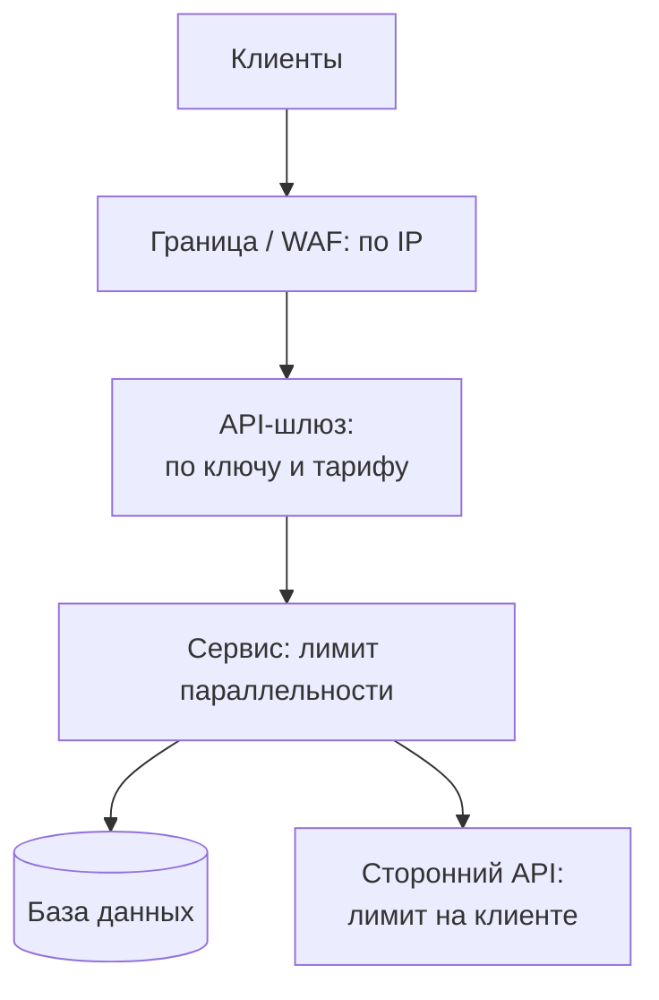

import { Aside } from '@astrojs/starlight/components';

Ограничитель частоты запросов (rate limiter) задаёт, сколько запросов клиент может сделать за период времени, а остальные отклоняет или откладывает. Он не даёт одному шумному клиенту съесть общую ёмкость, замедляет злоупотребления вроде подбора паролей и скрейпинга, делает расходы предсказуемыми и обеспечивает тарифные планы. Ограничитель есть почти у каждого публичного API, а «спроектируйте rate limiter» — классическая задача на собеседовании.

<Aside type="tip" title="Коротко">
- Ограничивайте слоями: по IP на границе сети, по API-ключу или пользователю на шлюзе и по числу одновременных запросов внутри каждого сервиса.
- **Token bucket** — выбор по умолчанию. Он пропускает всплески до размера корзины и держит заданную среднюю частоту, храня всего два числа на ключ.
- **Фиксированное окно** на стыке окон пропускает до 2× лимита. **Счётчик скользящего окна** убирает большую часть этой ошибки ценой одного дополнительного счётчика.
- В общем хранилище проверка и обновление должны быть **атомарными**: Lua-скрипт или `MULTI` с `INCR` и `EXPIRE … NX`.
- Отказывайте ответом **429 Too Many Requests** с `Retry-After`. Клиенты отступают с разбросом (jitter). Заголовки IETF `RateLimit` пока остаются черновиком.
</Aside>

## Зачем и где ограничивать

У ограничений четыре задачи, и каждая указывает на своё место в стеке:

| Цель | Типичный ключ | Где |
|---|---|---|
| Отбить флуд и злоупотребления | IP-адрес, префикс IPv6 `/64`, ASN | CDN, WAF, пограничный прокси |
| Честное использование и тарифы | API-ключ, пользователь, клиент (tenant) | API-шлюз |
| Защитить хрупкий ресурс | Эндпоинт, клиент или ничего (глобально) | В сервисе, рядом с ресурсом |
| Уложиться в чужую квоту | Собственные учётные данные | На клиенте, перед вызовом стороннего API |



Ключ надо выбирать аккуратно. Множество пользователей сидит за одним IPv4-адресом через операторский NAT (CGNAT) или корпоративный прокси, а один клиент IPv6 распоряжается миллиардами адресов, поэтому IPv6 ограничивают по префиксу. Аутентифицированные ключи (пользователь, API-ключ, клиент) честнее, но появляются только после аутентификации, поэтому эндпоинтам входа нужны ещё и лимиты по IP и по атакуемому аккаунту.

Запросы различаются и по стоимости. Один поиск может стоить в 100 раз больше чтения профиля. Списывайте разное число токенов на разных эндпоинтах или держите отдельные лимиты для дорогих операций. Stripe, например, сочетает ограничитель частоты с **ограничителем параллельности**, который задаёт предел запросов *в обработке* на пользователя, и двумя механизмами сброса нагрузки, защищающими критичный трафик, когда парку не хватает мощности.

## Алгоритмы

### Token bucket

Корзина вмещает до `b` токенов и пополняется со скоростью `r` токенов в секунду. Каждый запрос забирает токен. Когда корзина пуста, запрос отклоняется или ждёт появления токена. За любой интервал `t` проходит не больше `b + r·t` запросов: всплески допускаются до `b`, а в долгосрочной перспективе средняя частота равна `r`. Хранятся только число токенов и время последнего пополнения, а пополнение считается лениво при каждом запросе. Этот алгоритм используют и локальный ограничитель Envoy, и лимиты API Stripe.

### Leaky bucket

Есть два варианта. **Как очередь**: запросы попадают в FIFO фиксированного размера, которая опустошается с постоянной скоростью. Выход идеально ровный, но всплески ждут, и задержка растёт. Так работает `limit_req` в Nginx: `burst` задаёт размер очереди, а `nodelay` обслуживает запросы из очереди сразу, продолжая их учитывать. **Как счётчик** (GCRA, generic cell rate algorithm): на ключ хранится одна метка времени, «теоретическое время прибытия», и поведение совпадает с token bucket.

### Фиксированное окно

Считаем запросы по ключу в календарных окнах (`user42:2026-10-08T10:15`) и обнуляем при смене окна. Один `INCR` на запрос — дешевле некуда. Изъян на стыке: при лимите 100 в минуту клиент может отправить 100 запросов в 10:15:59 и ещё 100 в 10:16:00 — 200 за две секунды.

### Скользящий журнал

Храним метку времени каждого принятого запроса, например в sorted set Redis. При каждом запросе удаляем записи старше окна и считаем оставшиеся. Точно, но память растёт вместе с лимитом: при 1 млн активных ключей и лимите 1000 в окно это миллиард меток времени, около 8 ГБ без учёта накладных расходов структуры данных.

### Счётчик скользящего окна

Держим счётчики фиксированных окон для текущего и предыдущего окна и учитываем предыдущий с весом, равным доле, которая ещё попадает в скользящее окно:

```text
estimate = previous_count × (window − elapsed) / window + current_count
```

Лимит 100 в минуту, с начала текущей минуты прошло 15 с, в предыдущей минуте было 84 запроса, в текущей 36: `84 × 45/60 + 36 = 99`, значит, ещё один запрос пройдёт. Оценка предполагает, что запросы предыдущего окна распределены равномерно. Cloudflare проверила метод на 400 млн запросов и получила всего 0,003% ошибочно пропущенных или ограниченных.

### Сравнение

| Алгоритм | Память на ключ | Всплески | Точность | Где хорош |
|---|---|---|---|---|
| Token bucket | 2 числа | До размера корзины, по замыслу | Точен в своей модели | API по умолчанию |
| Leaky bucket (очередь) | Очередь запросов | Ждут в очереди, выход сглажен | Точен | Сглаживание потока к хрупкому бэкенду |
| Leaky bucket (GCRA) | 1 метка времени | До допуска | Точен | То же, что token bucket, меньше состояния |
| Фиксированное окно | 1 счётчик | До 2× на стыке окон | Грубый | Дневные и месячные квоты, биллинг |
| Скользящий журнал | 1 запись на запрос | Не выше лимита | Точен | Малые лимиты, где важна точность (вход) |
| Счётчик скользящего окна | 2 счётчика | Возможно небольшое превышение | Приближённый, обычно в пределах нескольких % | Массовые лимиты по ключам |

## Token bucket на Python

```python title="token_bucket.py"
import threading
import time
from dataclasses import dataclass, field


@dataclass
class TokenBucket:
    """В среднем `rate` запросов в секунду, всплески до `capacity`."""

    rate: float                      # токенов в секунду
    capacity: float                  # максимальный всплеск
    tokens: float = field(init=False)
    updated: float = field(init=False)
    lock: threading.Lock = field(default_factory=threading.Lock, repr=False)

    def __post_init__(self) -> None:
        self.tokens = self.capacity          # начинаем с полной корзины: первый всплеск разрешён
        self.updated = time.monotonic()

    def try_acquire(self, cost: float = 1.0) -> tuple[bool, float]:
        """Вернуть (разрешено, секунд_до_нужного_числа_токенов)."""
        with self.lock:
            now = time.monotonic()
            # Ленивое пополнение: без фонового таймера, просто прошедшее время × rate.
            self.tokens = min(self.capacity, self.tokens + (now - self.updated) * self.rate)
            self.updated = now
            if self.tokens >= cost:
                self.tokens -= cost
                return True, 0.0
            return False, (cost - self.tokens) / self.rate


if __name__ == "__main__":
    bucket = TokenBucket(rate=5, capacity=10)        # 5 запросов/с, всплески до 10
    burst = [bucket.try_acquire()[0] for _ in range(12)]
    print("burst of 12:", burst.count(True), "allowed")   # пропущено 10
    allowed, wait = bucket.try_acquire()
    print(f"next allowed={allowed}, retry after {wait:.2f}s")  # ~0,20 с
    time.sleep(1.0)                                  # пополнилось ~5 токенов
    print("after 1 s:", sum(bucket.try_acquire()[0] for _ in range(10)), "allowed")  # 5
```

Второе значение `try_acquire` — ровно то, что сервер должен отправить в `Retry-After`, округлив вверх до целых секунд.

## Распределённое ограничение

Если за балансировщиком 20 узлов шлюза, корзина на каждом узле работает, только когда трафик распределён равномерно. Выдать каждому узлу `limit / 20` дёшево и не требует координации, но клиент, чьи соединения прилипли к одному узлу, получит двадцатую часть квоты. Для точного глобального лимита состояние держат в общем хранилище вроде Redis или Valkey.

Классическая ошибка — **«проверить, потом действовать»** (check-then-act): `GET` счётчика, сравнение, затем `INCR`. Два узла одновременно читают 99, оба пропускают запрос, и счётчик доходит до 101. Вторая классическая ошибка — `INCR` и отдельный `EXPIRE`. Если процесс умрёт между вызовами, ключ никогда не истечёт, и клиент останется заблокированным навсегда. Два безопасных шаблона:

**Фиксированное окно в транзакции.** `INCR` атомарно возвращает новое значение. `EXPIRE … NX` (Redis 7.0+) ставит TTL, только если его ещё нет, поэтому повторы не продлевают окно:

```text
MULTI
INCR rl:user42:29857575        # id окна = unix_time // 60 (10:15 UTC)
EXPIRE rl:user42:29857575 60 NX
EXEC                           # пропускаем, если результат INCR <= лимита
```

**Token bucket в виде Lua-скрипта.** Redis выполняет скрипт атомарно, поэтому чтение, пополнение и запись не перемежаются с другими клиентами:

```lua title="token_bucket.lua"
-- KEYS[1]: ключ корзины, например "rl:{api-key-42}"
-- ARGV[1]: скорость пополнения (токенов/с), ARGV[2]: ёмкость, ARGV[3]: стоимость
local rate, capacity, cost = tonumber(ARGV[1]), tonumber(ARGV[2]), tonumber(ARGV[3])
local t = redis.call('TIME')                       -- одни часы для всех серверов приложения
local now = tonumber(t[1]) + tonumber(t[2]) / 1000000
local s = redis.call('HMGET', KEYS[1], 'tokens', 'ts')
local tokens = tonumber(s[1]) or capacity
local ts = tonumber(s[2]) or now
tokens = math.min(capacity, tokens + math.max(0, now - ts) * rate)
local allowed = 0
if tokens >= cost then
  tokens = tokens - cost
  allowed = 1
end
redis.call('HSET', KEYS[1], 'tokens', tokens, 'ts', now)
redis.call('EXPIRE', KEYS[1], math.ceil(capacity / rate) + 1)  -- простаивающие корзины исчезают
return {allowed, tostring(tokens)}
```

Время сервера Redis (`TIME`) избавляет от рассинхронизации часов между серверами приложения. Загрузите скрипт один раз через `SCRIPT LOAD` и вызывайте по хешу через `EVALSHA`.

Эксплуатационные вопросы, которые надо решить заранее:

- **Задержка.** Каждый запрос теперь ждёт обращения к хранилищу — обычно заметно меньше миллисекунды внутри одной зоны. Конвейерная отправка или локальная предварительная проверка экономят его для клиентов, далёких от лимита.
- **Отказ хранилища.** Решите заранее: **fail open** (пропускать трафик, рискуя перегрузкой) или **fail closed** (отклонять, рискуя устроить отказ самим себе). Большинство публичных API выбирают fail open с грубым локальным лимитом в качестве страховки.
- **Горячие ключи.** Один огромный клиент нагружает один шард. Помогают локальные кэши токенов, которые забирают из общей корзины сразу несколько токенов и периодически синхронизируются: немного точности в обмен на намного меньшее число обращений. Envoy использует похожую двухступенчатую схему: локальный token bucket поглощает всплески, а глобальный сервис ограничений (в эталонной реализации — на Redis) следит за общим лимитом.
- **Несколько регионов.** Один глобальный счётчик на все регионы стоит межрегионального обращения на каждый запрос. Обычно каждому региону выделяют долю лимита или синхронизируют счётчики асинхронно, соглашаясь на ограниченное превышение.

## Ответ ограниченным клиентам

- **429 Too Many Requests** (RFC 6585) означает, что *этот клиент* превысил *свой* лимит. **503 Service Unavailable** — что сервер перегружен для всех. `limit_req` в Nginx по умолчанию отвечает 503, поэтому для лимитов на клиента задайте `limit_req_status 429`.
- **`Retry-After`** (RFC 9110) содержит число секунд или HTTP-дату. Отправляйте его и с 429, и с 503.
- **Заголовки квоты.** Многие API отдают нестандартные `X-RateLimit-Limit`, `-Remaining` и `-Reset`. GitHub, например, отдаёт заголовки `x-ratelimit-*` и при превышении лимита отвечает 403 или 429. Рабочая группа IETF httpapi стандартизирует это как структурированные поля `RateLimit-Policy` и `RateLimit`, например `RateLimit-Policy: "default";q=100;w=60` и `RateLimit: "default";r=37;t=21`. На октябрь 2026 года это всё ещё Internet-Draft (ревизия -11, май 2026), и синтаксис менялся от ревизии к ревизии. Если внедряете, фиксируйте версию.
- **Делайте тело ответа полезным.** Скажите, какой лимит сработал, и дайте ссылку на документацию. Но не раскрывайте лимиты, которые помогут атакующему настроить перебор.
- **Сначала теневой режим.** Прежде чем включать новый лимит, логируйте, что *было бы* отклонено. Ошибочный лимит на платёжном эндпоинте — это авария.

## Поведение клиента

Хорошие клиенты делают ограничение дешёвым для всех:

- Соблюдайте `Retry-After`. Если его нет — **экспоненциальная задержка с полным разбросом** (full jitter) и ограниченное число попыток. Никогда не повторяйте 429 в плотном цикле.
- **Ограничивайте себя сами.** Поставьте token bucket в SDK или в воркер, который вызывает сторонний API, с лимитом чуть ниже вашей квоты, чтобы ждать локально, а не собирать 429.
- **Разносите плановую работу.** Десять тысяч клиентов, которые синхронизируются ровно в начале минуты, — это самодельное «стадо» (thundering herd). Добавьте случайные смещения.
- Используйте пакетные запросы, где API их поддерживает. Воспринимайте заголовки вроде `RateLimit-Remaining` как сигнал притормозить до того, как квота кончится.

## Компромиссы

| Решение | Вариант A | Вариант B |
|---|---|---|
| Где ставить | Граница или шлюз: дешёвый отказ, грубые ключи | В сервисе: знает стоимость и клиента, но работа уже началась |
| Состояние | Локально на узле: быстро, приблизительно | Общее хранилище: точно, но лишний переход и зависимость |
| Отказ хранилища | Fail open: доступность важнее | Fail closed: защита важнее |
| Лишние запросы | Отклонить (429): просто, клиент повторит | Поставить в очередь или задержать: ровнее, но задержка и память |
| Алгоритм | Token bucket: всплески разрешены | Скользящий журнал: строго, больше памяти |

<Aside type="note" title="На собеседовании">
- Начните с требований: что ограничиваем (запросы, байты, одновременные вызовы), по какому ключу, насколько точно и что происходит на пределе.
- Нарисуйте, где стоит ограничитель, и обоснуйте алгоритм. Token bucket с двумя числами на ключ в Redis — сильный ответ по умолчанию.
- Ждите вопроса о гонках. Отвечайте атомарным Lua-скриптом или `INCR` с `EXPIRE NX` и временем сервера хранилища.
- Обсудите отказы: Redis недоступен (fail open или closed), горячие ключи, лимиты в нескольких регионах, ответ 429 с `Retry-After`.
- Типичные ошибки: фиксированное окно без понимания всплеска на стыке, ограничение только по IP и забытые клиенты, повторяющие запросы синхронно.
</Aside>

## Что почитать

- [Scaling your API with rate limiters](https://stripe.com/blog/rate-limiters): четыре типа ограничителей Stripe и их реализация token bucket на Redis.
- [How we built rate limiting capable of scaling to millions of domains](https://blog.cloudflare.com/counting-things-a-lot-of-different-things/): счётчик скользящего окна и его точность в продакшене.
- [Redis `INCR`: rate limiter patterns](https://redis.io/docs/latest/commands/incr/): официальные шаблоны и гонки, которых они избегают.
- [RateLimit header fields for HTTP (IETF draft)](https://datatracker.ietf.org/doc/draft-ietf-httpapi-ratelimit-headers/): текущая ревизия и статус черновика.
- [Envoy global rate limiting](https://www.envoyproxy.io/docs/envoy/latest/intro/arch_overview/other_features/global_rate_limiting): локальные token bucket плюс центральный сервис.
- [Nginx `limit_req` module](https://nginx.org/en/docs/http/ngx_http_limit_req_module.html): leaky bucket с `burst`, `nodelay` и `limit_req_status`.

## Связанные темы

- [Паттерны устойчивости](/reliability/resilience-patterns/): повторные попытки, задержка с разбросом и сброс нагрузки.
- [Очереди сообщений и обратное давление](/async/queues-and-back-pressure/): что делать с работой, которую приняли, но пока не можете обработать.
- [Обратный прокси и API-шлюз](/traffic/reverse-proxy-and-api-gateway/): где чаще всего применяются лимиты.
- [Безопасность](/reliability/security/): злоупотребления, перебор паролей и credential stuffing.
- [Уровни кэширования](/caching/caching-layers/): Redis и Valkey как общее хранилище состояния.
- [Системы на базе LLM](/architecture/llm-applications/): лимиты по токенам в минуту, а не только по запросам, когда один вызов может стоить в сто раз дороже другого.
