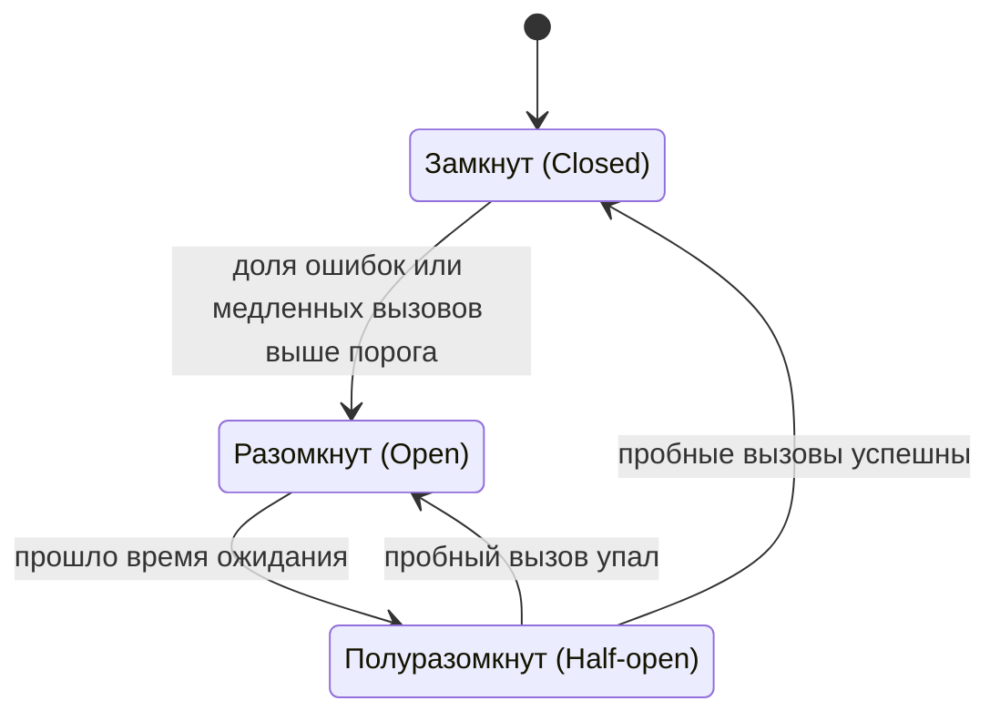

import { Aside } from '@astrojs/starlight/components';

В распределённой системе что-то всегда тормозит или сломано: диск, узел, зависимость, целая зона. Паттерны устойчивости не дают такому частичному отказу распространиться. Они ограничивают, сколько мы ждём, как часто повторяем и сколько нагрузки принимаем, и решают, что отбросить. Большие аварии чаще вызывает не первый отказ, а реакция системы на него, поэтому эти паттерны — не только о восстановлении, но и о сдержанности.

<Aside type="tip" title="Коротко">
- У каждого удалённого вызова должен быть **тайм-аут**. Ещё лучше — передавать **дедлайн**, чтобы нижние сервисы не работали над запросами, которых уже никто не ждёт.
- Повторяйте только идемпотентные операции (или используйте **ключи идемпотентности**), с **экспоненциальной задержкой и разбросом** (jitter), на **одном уровне** и в рамках **бюджета повторов**.
- **Предохранитель** (circuit breaker) быстро отказывает, когда зависимость сломана. **Переборки** (bulkheads) не дают одной медленной зависимости занять все потоки.
- При перегрузке **сбрасывайте нагрузку рано** и по приоритету, а **деградируйте плавно** вместо полного отказа.
- **Дублирующие запросы** (hedged requests) меняют несколько процентов лишней нагрузки на заметно более короткий хвост задержки.
</Aside>

## Как возникают каскадные отказы

Каскадный отказ — это петля обратной связи: сбой вызывает больше нагрузки или ожидания, а они — новые сбои. Типичные цепочки:

1. **Перегрузка расползается.** Из трёх реплик умирает одна, две оставшиеся получают по 50% лишнего трафика, выходят за предел, замедляются, не проходят проверки здоровья и выводятся из ротации. Последняя получает всё.
2. **Ресурсы кончаются.** Зависимость замедляется с 20 мс до 2 с. Вызывающие сохраняют прежнюю частоту запросов, поэтому по закону Литтла запросов в обработке становится в 100 раз больше. Пулы потоков, пулы соединений и память заполняются, и вызывающий сервис перестаёт обслуживать даже запросы, которые медленную зависимость не трогают.
3. **Повторы усиливают нагрузку.** Каждый уровень повторяет по 3 раза. При 4 уровнях сервисов один пользовательский запрос превращается в 3⁴ = 81 вызов нижнего уровня, и все они приходят именно тогда, когда ему тяжело.
4. **Восстановление срывается.** Перезапущенный сервис с холодным кэшем сразу получает весь трафик и снова падает. Клиенты, упавшие вместе, вместе и повторяют.

У последней стадии есть имя — **метастабильный отказ** (metastable failure). Триггер уже исчез, а система остаётся сломанной, потому что петля обратной связи (повторы, очереди, холодные кэши) держит нагрузку выше ёмкости. Для восстановления нагрузку часто приходится снизить *намного ниже* уровня, с которого всё началось. Паттерны ниже разрывают такие петли.


## Тайм-ауты и дедлайны

Вызов без тайм-аута может держать поток вечно. gRPC, например, по умолчанию дедлайн не ставит.

- **Выбирайте тайм-ауты по измерениям.** Чуть выше p99.9 задержки зависимости, а не круглые «30 с». Тайм-аут ниже обычного хвоста превращает медленные успехи в ошибки и повторы.
- **Разделяйте тайм-ауты соединения и запроса.** Соединение должно устанавливаться за миллисекунды, а долгое соединение обычно значит, что хоста уже нет.
- **Передавайте дедлайн.** Граница задаёт сквозной бюджет, скажем 800 мс. Каждый переход передаёт дальше *оставшееся* время, а каждый сервис проверяет его, прежде чем начать дорогую работу или взять запрос из очереди. gRPC делает это сам и передаёт оставшийся тайм-аут, а не абсолютное время, поэтому рассинхронизация часов не мешает. В HTTP дедлайн передают в заголовке.
- **Бросайте брошенную работу.** Запрос, чей вызывающий уже отвалился по тайм-ауту, — чистые потери. Отбросить его — самый дешёвый сброс нагрузки.

## Повторы без «шторма повторов»

Повторы лечат временные сбои: потерянный пакет, перезапуск узла, 503 от занятой реплики. Правила:

- **Повторяйте только то, что безопасно повторить:** чтения, идемпотентные записи или записи с ключом идемпотентности (см. ниже). Не повторяйте ошибки 4xx, кроме 408 и 429.
- **Увеличивайте задержку экспоненциально и с разбросом.** Полный разброс (full jitter): `sleep = random(0, min(cap, base × 2^attempt))`. Синхронные повторы бьют по зависимости волнами, а моделирование AWS показывает, что полный разброс даёт наименьший суммарный объём работы.
- **Ограничивайте попытки и соблюдайте дедлайн.** Три попытки — обычный потолок. Никогда не спите дольше дедлайна вызывающего.
- **Повторяйте на одном уровне.** Обычно это уровень, ближайший к пользователю, или тот, кто знает, что операция идемпотентна. Нижние уровни отказывают быстро.
- **Используйте бюджет повторов.** Разрешайте повторы, только пока они составляют малую долю трафика. Книга Google SRE описывает бюджет на клиента в 10% запросов. В худшем случае три попытки на запрос утраивают нагрузку, а бюджет в 10% ограничивает рост примерно 1,1×. Так работает token bucket в коде ниже: каждая первая попытка добавляет 0,1 токена, а каждый повтор стоит целый токен.

```python title="retry.py"
import random
import time
from collections.abc import Callable
from dataclasses import dataclass


class RetryableError(Exception):
    """Тайм-ауты, 429, 503: запрос может пройти позже."""


@dataclass
class RetryBudget:
    """Разрешать повторы, только пока их меньше `ratio` от первых попыток."""

    ratio: float = 0.1
    max_tokens: float = 10.0
    tokens: float = 10.0

    def on_request(self) -> None:          # каждая первая попытка приносит долю токена
        self.tokens = min(self.max_tokens, self.tokens + self.ratio)

    def try_spend(self) -> bool:           # каждый повтор стоит целый токен
        if self.tokens >= 1:
            self.tokens -= 1
            return True
        return False


def call_with_retries[T](
    op: Callable[[float], T],
    budget: RetryBudget,
    deadline_s: float = 2.0,
    max_attempts: int = 3,
    base_s: float = 0.05,
    cap_s: float = 1.0,
) -> T:
    deadline = time.monotonic() + deadline_s
    budget.on_request()
    for attempt in range(max_attempts):
        remaining = deadline - time.monotonic()
        if remaining <= 0:
            break
        try:
            return op(remaining)           # передаём оставшееся время дальше
        except RetryableError:
            if attempt + 1 == max_attempts or not budget.try_spend():
                raise
            # «Полный разброс»: спим случайное время в [0, min(cap, base * 2^attempt)]
            sleep = random.uniform(0, min(cap_s, base_s * 2**attempt))
            time.sleep(min(sleep, max(0.0, deadline - time.monotonic())))
    raise TimeoutError("deadline exceeded")


if __name__ == "__main__":
    calls = 0

    def flaky(timeout_s: float) -> str:
        global calls
        calls += 1
        if calls < 3:
            raise RetryableError("503")
        return f"ok after {calls} attempts (had {timeout_s:.2f}s left)"

    print(call_with_retries(flaky, RetryBudget()))
```

## Ключи идемпотентности

Тайм-аут не говорит, успел ли сервер что-то сделать. Списали деньги до обрыва соединения или нет? **Ключ идемпотентности** делает неидемпотентную запись безопасной для повтора. Клиент генерирует уникальный ключ (UUIDv4) на каждую *логическую* операцию и отправляет его с каждой попыткой, например в заголовке `Idempotency-Key`. Сервер:

1. атомарно сохраняет ключ вместе с отпечатком запроса до начала работы;
2. при повторе с тем же ключом и теми же параметрами возвращает сохранённый ответ, не выполняя действие снова;
3. при повторе с другими параметрами возвращает ошибку: ключ использован повторно по ошибке;
4. если исходный запрос ещё выполняется, просит клиента повторить позже (обычно `409 Conflict`);
5. удаляет ключи по истечении срока хранения. Stripe разрешает удалять ключи старше 24 часов.

Храните ключ в той же транзакции базы, что и сам эффект, иначе в гарантии появится дыра. Черновик IETF пытался стандартизировать заголовок `Idempotency-Key`, но в 2026 году истёк, не став RFC. Само соглашение по-прежнему широко используется.

## Предохранитель

Когда зависимость явно сломана, ждать тайм-аута на каждом вызове значит тратить потоки и нагружать то, что и так падает. **Предохранитель** (circuit breaker) оборачивает вызов и следит за последними результатами:



- **Замкнут** (closed). Вызовы проходят. Ошибки и медленные вызовы считаются в скользящем окне — по числу вызовов или по времени.
- **Разомкнут** (open). Вызовы сразу завершаются ошибкой или уходят в запасной путь, не трогая зависимость. Это даёт ей время восстановиться.
- **Полуразомкнут** (half-open). После паузы пропускается несколько пробных вызовов. Успех замыкает предохранитель, неудача снова размыкает.

Берите библиотеку: resilience4j для JVM (Netflix Hystrix находится в режиме поддержки), Polly для .NET или обнаружение выбросов (outlier detection), встроенное в Envoy и service mesh. Держите отдельный предохранитель на эндпоинт и шард: один предохранитель на шардированную зависимость размыкается для всех шардов, когда плох один. Предохранители прячут сбои, поэтому ставьте алерты на их состояние.

## Переборки

Как водонепроницаемые отсеки корабля, **переборка** (bulkhead) даёт каждой зависимости или клиенту свой ограниченный пул ресурсов: потоки, соединения, слоты параллельности, даже отдельные экземпляры. Когда сервис рекомендаций зависает, он может занять только свои 20 соединений. У оформления заказа остаётся свой пул.

В большем масштабе та же идея превращается в **ячеистую архитектуру** (cell-based architecture): независимые копии всего стека, каждая обслуживает часть клиентов, так что неудачный деплой или «ядовитый» запрос затрагивает одну ячейку. Цена — простаивающая ёмкость и больше конфигурации. Размер пулов считайте по закону Литтла: интенсивность × задержка плюс запас.

## Сброс нагрузки и контроль допуска

Когда спрос превышает ёмкость, медленно обслуживать всех значит никого не обслуживать с пользой. **Полезная пропускная способность** (goodput) — завершённая полезная работа — обваливается, даже когда общая пропускная способность выглядит высокой. **Сброс нагрузки** (load shedding) рано и дёшево отклоняет часть запросов, чтобы остальные успели в свои дедлайны.

- **Отказывайте на входе.** До разбора тела и обращения к базе. Ответ 503 за 1 мс лучше успеха за 2 с, пришедшего, когда клиент уже ушёл.
- **Используйте настоящий сигнал.** Следите за параллельностью (запросы в обработке сверх лимита), временем ожидания в очереди или ростом задержки выше цели. Один CPU реагирует слишком поздно.
- **Сбрасывайте по приоритету.** Проверки здоровья и начатая работа (шаг 2 оформления заказа) идут первыми. Google помечает запросы уровнем критичности от `CRITICAL_PLUS` до `SHEDDABLE` и сбрасывает самые низкие первыми.
- **Адаптивные лимиты параллельности** сами находят предел, считая рост задержки признаком перегрузки, как это делает TCP. Пример — библиотека Netflix `concurrency-limits`; в Envoy есть похожий фильтр.
- **Ограничение на стороне клиента.** В адаптивном троттлинге Google каждый клиент сравнивает отправленные запросы с принятыми, и когда отправленных становится вдвое больше, часть запросов отбрасывается локально — отклонённый трафик даже не доходит до сети.
- **В очередях предпочитайте LIFO или дедлайны.** При перегрузке самые старые запросы в FIFO-очереди обычно уже истекли.

## Плавная деградация и запасные пути

Заранее решите, что продукт делает без каждой из зависимостей:

- Отдаёт **устаревшие данные** из кэша с пометкой, что они могут быть неактуальны.
- Возвращает **упрощённый вариант**: популярные товары вместо персональных рекомендаций.
- **Отключает второстепенные функции** флагами: прячет отзывы, приостанавливает аналитику, выключает ресайз картинок.
- Принимает запись и **обрабатывает её позже** через очередь.
- Возвращает **частичный результат**: поиск по 95 шардам из 100 с пометкой «неполный».

Запасной путь должен быть дешевле и надёжнее основного и обязательно проверенным: путь, который срабатывает раз в год, обычно в этот раз и ломается. Никогда не переключайтесь на общую систему, которая не выдержит нагрузку, например на базу данных за упавшим кэшем.

## Дублирующие запросы

При большом fan-out хвостовая задержка становится определяющей. Если ответ не пришёл примерно за время p95, отправьте копию запроса другой реплике и возьмите первый ответ. В статье *The Tail at Scale* бенчмарк BigTable, читающий 1000 ключей со 100 серверов, сократил p99.9 с 1800 мс до 74 мс при дублировании через 10 мс — ценой всего 2% лишних запросов. Дублировать безопасно только идемпотентные чтения. Отменяйте более медленную копию и ограничивайте дублирование бюджетом, чтобы медленная зависимость не получила двойной трафик именно тогда, когда ей тяжело.

## Сводка паттернов

| Паттерн | От какого сбоя защищает | Цена |
|---|---|---|
| Тайм-аут | Вечно висящие вызовы, занятые потоки | Подбор значений; ложные сбои, если слишком жёсткий |
| Передача дедлайна | Работа после того, как вызывающий сдался | Прокинуть заголовок через все переходы |
| Повтор с задержкой и разбросом | Временные сбои | Лишняя нагрузка; нужна идемпотентность |
| Бюджет повторов | Шторм повторов, умножение по уровням | Часть временных сбоев доходит до пользователя |
| Ключ идемпотентности | Дублирующиеся эффекты от повторов | Хранение ключей, отпечатки запросов |
| Предохранитель | Ожидание мёртвой зависимости, добивание её | Настройка порогов; скрывает ошибки |
| Переборка | Одна медленная зависимость занимает все ресурсы | Простаивающая ёмкость, больше конфигурации |
| Сброс нагрузки | Перегрузка обваливает полезную работу | Часть запросов отклоняется намеренно |
| Плавная деградация | Полный отказ из-за второстепенной части | Создание и тестирование запасных путей |
| Дублирующие запросы | Хвостовая задержка при большом fan-out | Несколько % лишней нагрузки; только идемпотентные чтения |

## Компромиссы

Паттерны влияют друг на друга. Сброшенный запрос, который тут же повторили, не сброшен, а внешний тайм-аут короче внутреннего цикла повторов делает повторы бессмысленными. Держите политику каждой зависимости (тайм-аут, попытки, бюджет, пороги предохранителя, запасной путь) в одном месте и проверяйте её внесением сбоев (fault injection): убивайте экземпляры, добавляйте задержку, заполняйте диски. Механизм, который ни разу не срабатывал, — это догадка.

<Aside type="note" title="На собеседовании">
- Рисуя вызов между сервисами, называйте его тайм-аут, политику повторов и что происходит при сбое.
- Ждите вопроса «а если платёжный сервис ответит тайм-аутом?». Ответ: ключ идемпотентности, повтор с задержкой и разбросом и процесс сверки.
- Покажите, что знаете, как повторы вызывают аварии: бюджеты, один уровень повторов, разброс, соблюдение `Retry-After`.
- Упомяните сброс нагрузки по приоритету и плавную деградацию второстепенных функций. Интервьюерам нравится конкретный запасной путь.
- Типичные ошибки: повторы без идемпотентности, тайм-ауты длиннее, чем у вызывающего, один общий пул потоков на все зависимости и предохранитель как единственная защита.
</Aside>

## Что почитать

- [Addressing cascading failures](https://sre.google/sre-book/addressing-cascading-failures/): книга Google SRE о спиралях перегрузки, повторах и передаче дедлайнов.
- [Handling overload](https://sre.google/sre-book/handling-overload/): критичность, троттлинг на клиенте и бюджеты повторов.
- [Using load shedding to avoid overload](https://builder.aws.com/content/3Eun1EEyX6p2e3VYNyRLSJzLuMV/using-load-shedding-to-avoid-overload): Amazon Builders' Library о goodput, приоритетах и дедлайнах.
- [Fixing retries with token buckets and circuit breakers](https://brooker.co.za/blog/2022/02/28/retries.html): Марк Брукер моделирует стратегии повторов.
- [The Tail at Scale](https://cacm.acm.org/research/the-tail-at-scale/): Дин и Баррозу о дублирующих и связанных запросах.
- [Metastable failures in the wild](https://www.usenix.org/conference/osdi22/presentation/huang-lexiang): исследование OSDI '22 о 22 реальных инцидентах, которые поддерживались петлями обратной связи.
- [Release It!, 2nd edition](https://pragprog.com/titles/mnee2/release-it-second-edition/): книга Майкла Найгарда, популяризировавшая предохранители и переборки.

## Связанные темы

- [Ограничение частоты запросов](/reliability/rate-limiting/): защита сервисов от отдельных клиентов.
- [Очереди сообщений и обратное давление](/async/queues-and-back-pressure/): ограниченные очереди и идемпотентные потребители.
- [Паттерны доступности](/fundamentals/availability-patterns/): резервирование, переключение на резерв и цифры доступности.
- [Задержка и пропускная способность](/fundamentals/latency-vs-throughput/): закон Литтла и усиление хвоста, на которых держатся эти паттерны.
- [Обнаружение сервисов и service mesh](/architecture/service-discovery-and-mesh/): где часто живут тайм-ауты, повторы и предохранители.
- [Наблюдаемость](/reliability/observability/): увидеть сбой до того, как начнётся каскад.
