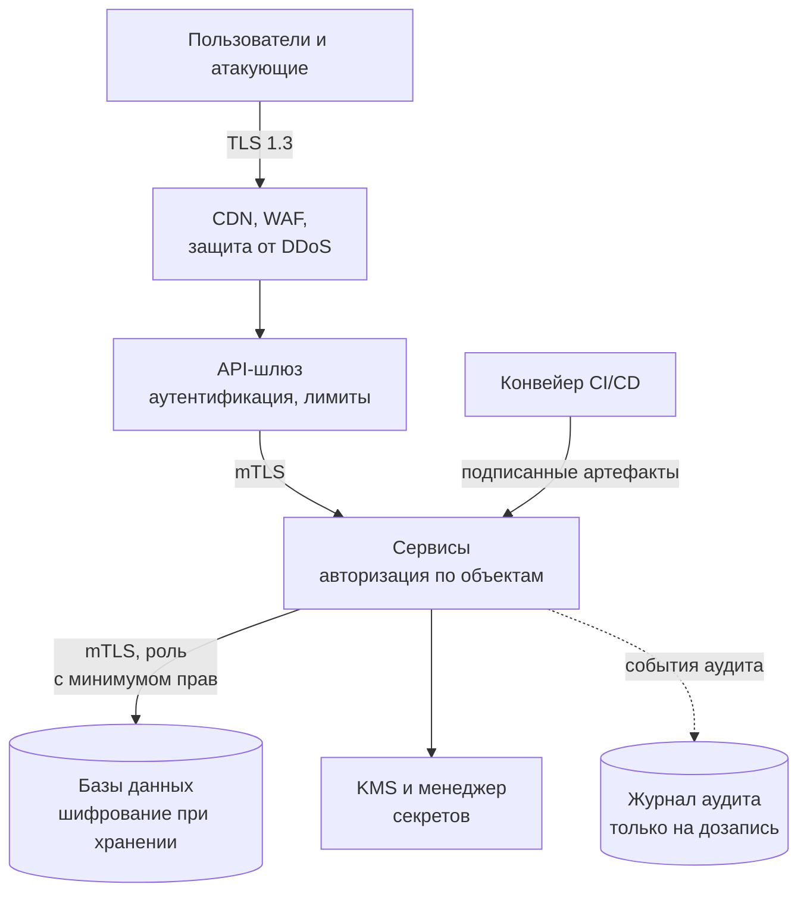
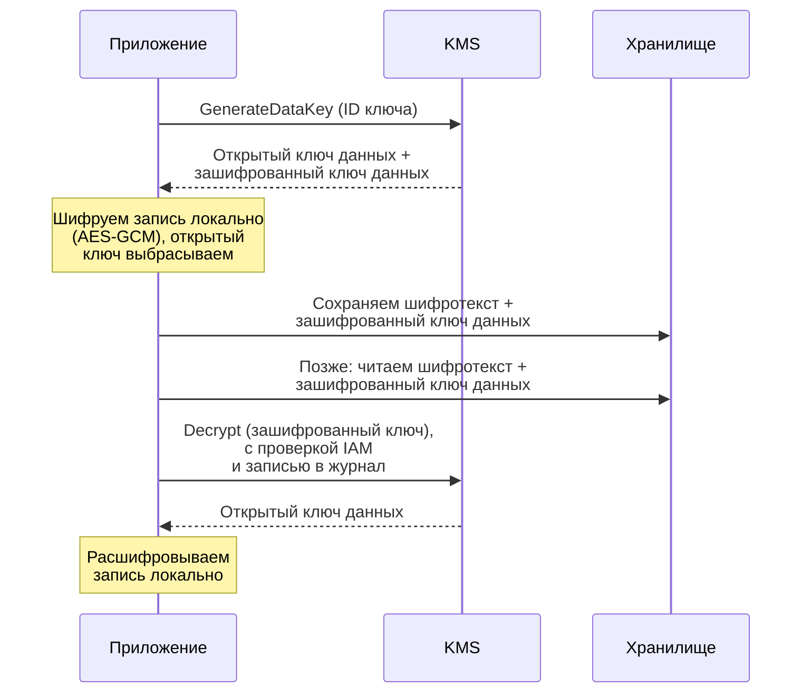
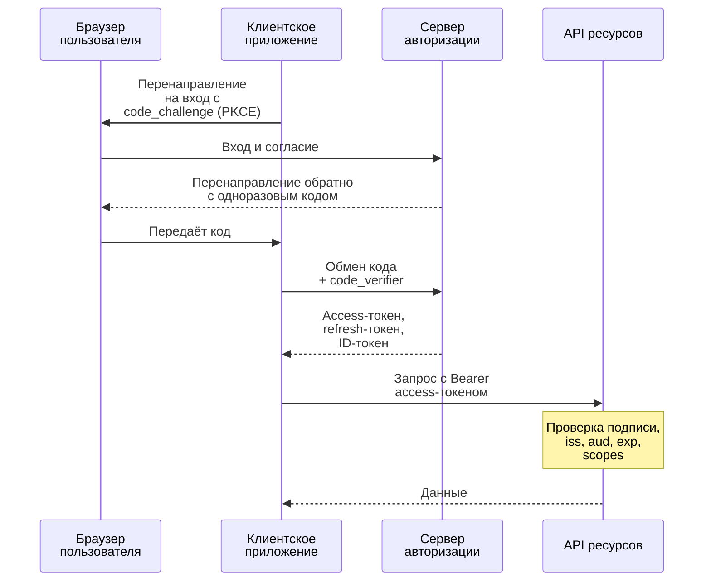

import { Aside } from '@astrojs/starlight/components';

Безопасность — не компонент, который добавляют в конце, а набор свойств, которые каждый компонент
обязан сохранять под атакой. Проектировщику не нужно быть криптографом, но нужно знать, где проходят
границы доверия, какой стандартный механизм защищает каждую из них и чего он стоит в задержке,
сложности и эксплуатации. На собеседованиях этот слой всё чаще ждут в любом дизайне, а не только в
«спроектируйте платёжную систему».

<Aside type="tip" title="Коротко">
- Шифруйте всё при передаче (TLS 1.3 на границе, mTLS между сервисами) и при хранении (ключи под управлением KMS и конвертное шифрование).
- Аутентификация отвечает на вопрос *кто*, авторизация — *что можно*. Проверяйте права на каждом запросе и для каждого объекта: нарушение контроля доступа — главный веб-риск.
- Везде предпочитайте короткоживущие учётные данные: сессии или короткие JWT для людей, идентичность рабочих нагрузок вместо статических ключей для сервисов, менеджер секретов для всего остального.
- Считайте любой ввод враждебным: параметризованные запросы, кодирование вывода по контексту, защита от CSRF, белые списки для исходящих URL.
- Исходите из того, что взлом уже произошёл: минимальные привилегии, сеть с нулевым доверием, журналы аудита, которым можно верить, и сбор меньшего объёма персональных данных.
</Aside>

## Начните с границ доверия

Прежде чем выбирать механизмы защиты, нарисуйте, где данные переходят из менее доверенных зон в
более доверенные: из интернета на вашу границу, с границы во внутренние сервисы, из сервисов в
хранилища, из CI в продакшен, из вашей системы к третьим сторонам. На каждом переходе нужны ответы
на одни и те же вопросы: зашифрован ли канал, аутентифицирован ли вызывающий, авторизовано ли
действие, проверен ли ввод и пишется ли журнал?



## Шифрование при передаче

- **TLS везде,** а не только на публичной границе. Внутренние сети общие, зеркалируются и бывают неверно настроены; «это же внутри VPC» — не мера защиты. Используйте TLS 1.3, где возможно, автоматизируйте выпуск и продление сертификатов (ACME) и отправляйте HSTS, чтобы браузеры никогда не откатывались на HTTP. Без автоматизации уже не обойтись: с марта 2026 года публичные TLS-сертификаты выдаются максимум на 200 дней, с 2027-го — на 100, а с 2029-го — на 47.
- **Взаимный TLS (mTLS)** аутентифицирует *обе* стороны: каждый сервис предъявляет сертификат со своей идентичностью. Сервисные сетки и идентичности рабочих нагрузок в духе SPIFFE автоматически выпускают короткоживущие сертификаты, и сервисы аутентифицируют друг друга без общих паролей.
- **Терминируйте осознанно.** Если TLS заканчивается на балансировщике или CDN, решите, шифруется ли трафик заново до origin (должен) и кто может прочитать его посередине.

TLS стоит одного RTT на новом соединении и немного CPU; переиспользование соединений снимает
большую часть этих затрат (см. [HTTP](/communication/http/)).

## Шифрование при хранении и управление ключами

Облачные объектные хранилища и большинство управляемых дисков и баз данных шифруют данные при
хранении по умолчанию или одной настройкой. Это защищает от украденных дисков и списанного
оборудования, но не от атакующего с действующими учётными данными: для него хранилище расшифровывает
всё прозрачно. Настоящая мера защиты — **кто может пользоваться ключами**.

**Служба управления ключами** (KMS) держит корневые ключи внутри аппаратных модулей безопасности
(HSM), откуда они никогда не выходят в открытом виде. Приложения используют **конвертное шифрование**
(envelope encryption): данные шифруются локально *ключом данных*, отдельным для объекта, а KMS
шифрует только этот маленький ключ.



Почему это стандарт: объёмные данные никогда не ходят в KMS, каждый вызов KMS авторизуется и
журналируется, ротация корневого ключа не требует перешифровывать терабайты, а уничтожение ключа
делает нечитаемыми все записи, зашифрованные под ним. Для особо чувствительных полей (номера карт,
паспортные данные) добавьте **шифрование на уровне полей** или **токенизацию** в приложении — тогда
администраторы баз данных, бэкапы и аналитические копии видят только шифротекст или токены.

## Аутентификация и авторизация

**Аутентификация (authN)** устанавливает личность: пароль плюс второй фактор, passkey, клиентский
сертификат, подписанный токен. **Авторизация (authZ)** решает, может ли эта личность выполнить это
действие с этим объектом. Ломаются они по-разному: сбои аутентификации впускают чужих, сбои
авторизации позволяют легитимным пользователям читать данные друг друга — и встречаются гораздо
чаще.

Для входа людей актуальные рекомендации (NIST SP 800-63B-4, 2025) — отказаться от требований к
составу пароля и принудительной периодической смены, требовать длинные пароли (от 15 символов,
если пароль — единственный фактор), проверять их по спискам утёкших паролей и предпочитать факторы,
устойчивые к фишингу, такие как passkeys. Храните пароли только как медленные хеши с солью —
Argon2id, а на старых стеках scrypt или bcrypt, — никогда не в зашифрованном виде и никогда не
быстрым хешем вроде SHA-256.

### Сессии и токены

| | Сессия на сервере | Самодостаточный токен (JWT) |
|---|---|---|
| Что хранит клиент | Случайный ID сессии в cookie | Подписанные утверждения (пользователь, scopes, срок) |
| Проверка | Поиск в хранилище сессий | Локальная проверка подписи, без поиска |
| Отзыв | Удалить сессию — мгновенно | Сложно: ждать истечения или вести denylist |
| Масштабирование | Нужно общее хранилище (Redis или Valkey, БД) | Без состояния, проверить может любой сервис |
| Типичное применение | Браузерные веб-приложения | API, мобильные приложения, вызовы между сервисами |

Для браузеров непрозрачный ID сессии в cookie с флагами `HttpOnly`, `Secure` и `SameSite=Lax` (или
`Strict`) остаётся самым простым и безопасным выбором. Токены сильны там, где многим сервисам нужно
проверять личность без центрального поиска; делайте их короткоживущими (минуты) и дополняйте
refresh-токенами, которые можно отозвать.

### OAuth 2.0 и OpenID Connect вкратце

**OAuth 2.0** позволяет пользователю выдать приложению ограниченный доступ к API, не сообщая ему свой
пароль; приложение получает *токен доступа* (access token) с конкретными разрешениями. **OpenID
Connect (OIDC)** добавляет поверх аутентификацию: *ID-токен* (JWT) сообщает приложению, кто вошёл.
«Войти через Google» и корпоративный единый вход (SSO) — это OIDC.



Актуальная практика (RFC 9700, 2025): использовать **поток с кодом авторизации и PKCE** для любых
клиентов, включая мобильные и одностраничные приложения; не использовать implicit grant и password
grant; для вызовов между сервисами брать **client credentials**. OAuth 2.1, собирающий эти правила в
один документ, в 2026 году всё ещё остаётся черновиком IETF.

### Подводные камни JWT

- **Принимать `alg: none` или позволять токену выбирать алгоритм.** Жёстко задавайте ожидаемый алгоритм и ключ; иначе атакующий сменит RS256 на HS256 и подпишет токен вашим *публичным* ключом.
- **Слабые секреты HMAC.** Угадываемый ключ HS256 подбирается офлайн по любому перехваченному токену.
- **Пропуск проверки утверждений.** Проверяйте `iss`, `aud` и `exp`; токен, выпущенный для другого сервиса, должен отклоняться.
- **Секреты в полезной нагрузке.** JWT подписан, а не зашифрован — его может раскодировать из base64 кто угодно.
- **Долгий срок жизни без отзыва.** Украденный токен на 30 дней — это утечка на 30 дней. Используйте короткие access-токены, ротацию refresh-токенов и токены, привязанные к отправителю (mTLS или DPoP), для ценных API.
- **Хранение токенов в `localStorage`,** откуда их прочитает любая XSS. В браузере предпочитайте cookie с `HttpOnly` или «бэкенд для фронтенда», который держит токены на сервере.

### Минимальные привилегии: RBAC, ABAC и отношения

Выдавайте каждому человеку, сервису и задаче минимум прав, нужных для работы, и на минимальный срок.

- **RBAC** назначает права ролям (`viewer`, `editor`, `billing-admin`), а роли — пользователям. Его легко проверять при аудите, но роли склонны разрастаться до сотен.
- **ABAC** вычисляет политики по атрибутам пользователя, ресурса и контекста («руководитель может утверждать расходы до 10 000 в своём отделе в рабочее время»). Движки политик вроде OPA или Cedar выносят эти правила из кода приложения.
- **Доступ на основе отношений** (ReBAC), популяризированный статьёй Google о Zanzibar, отвечает на вопрос «может ли X смотреть документ Y?» по графу отношений — на этой модели построен общий доступ к документам в приложениях для совместной работы.

Какой бы ни была модель, применяйте её **на сервере при каждом обращении к объекту**. Главная
уязвимость API — получить `/invoices/1043`, имея право видеть только `/invoices/1042`.

## Управление секретами

Пароли баз данных, ключи API и ключи подписи никогда не должны лежать в исходном коде, образах
контейнеров или закоммиченных конфигах.

- Храните их в **менеджере секретов** (сервис облачного провайдера, HashiCorp Vault или его открытый форк OpenBao): секреты читаются во время работы, шифруются через KMS, доступ к ним контролируется и журналируется.
- Лучше всего — **вовсе без статических секретов:** идентичность рабочей нагрузки (IAM-роли облака для ВМ и подов, федерация OIDC для задач CI) автоматически выдаёт короткоживущие учётные данные.
- Где секреты остаются, генерируйте **динамические короткоживущие**, а остальные ротируйте автоматически.
- Включите **сканирование секретов** в pre-commit-хуках и CI и держите регламент отзыва утёкшего ключа за минуты.

## Обработка ввода: инъекции, XSS, CSRF, SSRF

**Инъекции.** Никогда не собирайте запросы, команды оболочки или LDAP-фильтры конкатенацией ввода.
При параметризованных запросах драйвер передаёт значения отдельно от текста запроса, и ввод не может
изменить его структуру:

```python title="param_query.py"
import sqlite3

db = sqlite3.connect(":memory:")
db.execute("CREATE TABLE users (id INTEGER PRIMARY KEY, email TEXT, is_admin INTEGER)")
db.executemany("INSERT INTO users (email, is_admin) VALUES (?, ?)",
               [("ana@example.com", 0), ("root@example.com", 1)])

user_input = "nobody@example.com' OR '1'='1"

# Уязвимо: ввод становится частью текста SQL.
unsafe = db.execute(f"SELECT email FROM users WHERE email = '{user_input}'").fetchall()

# Безопасно: драйвер передаёт значение отдельно, оно не может изменить структуру запроса.
safe = db.execute("SELECT email FROM users WHERE email = ?", (user_input,)).fetchall()

print("string-built query returned:", unsafe)   # утекают все строки
print("parameterized query returned:", safe)    # []
```

Идентификаторы, которые нельзя передать параметром (колонки сортировки, имена таблиц), пропускайте
через белый список.

**Межсайтовый скриптинг (XSS).** Кодируйте вывод под контекст, куда он попадает (тело HTML,
атрибут, JavaScript, URL); современные шаблонизаторы и фреймворки делают это по умолчанию, так что
опасность — в обходах вроде хелперов для «сырого» HTML. Санитизируйте HTML, написанный
пользователями, поддерживаемой библиотекой и добавьте Content Security Policy как второй слой.

**Подделка межсайтовых запросов (CSRF).** Вредоносная страница заставляет браузер жертвы отправить
запрос, меняющий состояние, вместе с её cookie. Защита: cookie с `SameSite`, отклонение межсайтовых
запросов по заголовку `Sec-Fetch-Site` (с проверкой `Origin` как запасным вариантом) и анти-CSRF-токены
во фреймворках, которые их предоставляют. Никогда не меняйте состояние на GET.

**Подделка серверных запросов (SSRF).** Любая функция, которая загружает URL от пользователя, —
вебхуки, превью ссылок, импорт картинок — может быть нацелена на внутренние сервисы или эндпоинты
метаданных облака. Определяйте IP-адрес по имени хоста, блокируйте частные и link-local диапазоны и пускайте такой трафик
через прокси для исходящих соединений.

## OWASP Top 10:2025

OWASP Top 10 — общий для индустрии перечень рисков веб-приложений; актуальная редакция — 2025 года.
Читайте его как список проектных обязанностей:

| Риск (2025) | Мера на уровне дизайна |
|---|---|
| A01 Broken Access Control (теперь включает SSRF) | Запрет по умолчанию; проверка прав для каждого объекта; белые списки исходящих адресов |
| A02 Security Misconfiguration | Защищённые настройки по умолчанию в виде кода; без отладочных эндпоинтов и паролей по умолчанию |
| A03 Software Supply Chain Failures | Зафиксированные зависимости, SBOM, подписанные сборки |
| A04 Cryptographic Failures | TLS везде, ключи под управлением KMS, никакой самодельной криптографии |
| A05 Injection | Параметризованные запросы, кодирование по контексту |
| A06 Insecure Design | Моделирование угроз на этапе дизайна, сценарии злоупотреблений, лимиты |
| A07 Authentication Failures | MFA или passkeys, проверка утёкших паролей, ограничение попыток входа |
| A08 Software or Data Integrity Failures | Проверка подписей обновлений, артефактов и десериализуемых данных |
| A09 Security Logging and Alerting Failures | Журналы аудита с алертами, на которые кто-то реагирует |
| A10 Mishandling of Exceptional Conditions | Безопасный отказ (fail closed), без стек-трейсов клиенту, обработка частичных сбоев |

Для API у OWASP есть отдельный API Security Top 10 (редакция 2023 года), который возглавляет
нарушение авторизации на уровне объектов.

## Защита от DDoS и злоупотреблений

Атаки продолжают расти: Cloudflare сообщала о флуде HTTP/2 «Rapid Reset» с пиком более 201 млн
запросов в секунду в 2023 году и о сетевой атаке в 31,4 Тбит/с в конце 2025 года, длившейся
35 секунд. Ни один origin такого не выдержит, поэтому защита строится слоями:

- **Сетевые флуды (L3/L4):** anycast-CDN и центры очистки трафика поглощают объём далеко от ваших серверов; скрывайте IP-адреса origin и принимайте трафик только с границы.
- **Флуды на уровне приложения (L7):** правила WAF, обнаружение ботов, проверки для подозрительных клиентов, агрессивное кэширование всего публичного.
- **Злоупотребление легитимными функциями:** подбор учётных данных, скрейпинг, спам-регистрации, дорогие поисковые или GraphQL-запросы — с этим справляются [ограничение частоты запросов (rate limiting)](/reliability/rate-limiting/) по пользователю и ключу, квоты по стоимости и обнаружение аномалий.
- **Мягкая деградация при перегрузке:** автомасштабирование с верхней границей (атакующий не должен бесконечно раздувать ваш счёт), сброс нагрузки и тайм-ауты, чтобы перегруженная зависимость не уронила всё остальное.

## Сеть с нулевым доверием

Старая модель доверяла всему внутри корпоративной сети или VPC. Нулевое доверие (zero trust; NIST
SP 800-207, BeyondCorp от Google) убирает расположение в сети как источник доверия: каждый запрос
аутентифицируется и авторизуется по идентичности пользователя *и* рабочей нагрузки или устройства,
откуда бы он ни пришёл.

На практике: сотрудники ходят во внутренние инструменты через прокси с проверкой идентичности, а не
через VPN; сервисы аутентифицируют друг друга через mTLS с идентичностями рабочих нагрузок и
авторизуются на каждый вызов; сегментация сети остаётся, но как эшелонированная защита, а не главный
механизм; учётные данные короткоживущие, и украденные быстро истекают.

## Безопасность цепочки поставок

Ваша система включает каждую зависимость, базовый образ, инструмент сборки и раннер CI. Бэкдор в
xz-utils в 2024 году, спрятанный в релизных архивах широко используемой библиотеки сжатия, показал,
как высоко по цепочке может начаться атака. Базовые меры:

- Фиксируйте зависимости lock-файлами, проверяйте обновления и сканируйте их на известные уязвимости.
- Формируйте **SBOM** (перечень компонентов ПО) для каждого релиза, чтобы за часы отвечать на вопрос «нас это затрагивает?».
- **Подписывайте** артефакты сборки и образы контейнеров (Sigstore позволяет делать это без долгоживущих ключей) и проверяйте подписи при деплое.
- Собирайте в изолированных одноразовых раннерах CI с короткоживущими учётными данными и фиксируйте происхождение (provenance) — уровни для этого задаёт фреймворк SLSA.

## Журналы аудита

Журналы аудита отвечают на вопрос «кто, что, с каким ресурсом, когда, откуда сделал и было ли это
разрешено?» для событий, важных для безопасности: входов, изменений прав, выгрузок данных, действий
администраторов, использования ключей.

- Пишите их в хранилище **только на дозапись** с защитой от подделки, в отдельном аккаунте, который администраторы приложения изменить не могут; туда же — облачные журналы аудита (например, вызовов KMS и IAM).
- Делайте их структурированными, с ID запроса, связывающим их с трассировками приложения (см. [наблюдаемость](/reliability/observability/)).
- Никогда не пишите в журналы секреты, токены, пароли или полные персональные данные.
- Настройте алерты на важные события (повышение привилегий, массовая выгрузка, повторные отказы в авторизации); журнал, который никто не смотрит, — это пункт A09 из списка выше.

## Приватность и минимизация данных

Данные, которые вы не собрали, не утекут. Законы о приватности, такие как европейский GDPR,
превращают это в требования, влияющие на архитектуру:

- **Инвентаризируйте и классифицируйте** персональные данные (PII): какие таблицы, топики, бакеты, журналы и аналитические копии их содержат.
- **Минимизируйте:** собирайте только то, что нужно функции, храните только пока нужно (политики TTL для таблиц, журналов и объектного хранилища), псевдонимизируйте данные для аналитики.
- **Право на удаление:** статья 17 GDPR требует удалять данные человека «без неоправданной задержки» по обоснованному запросу. Удаление должно дойти до реплик, кэшей, поисковых индексов, хранилищ данных, логов событий и бэкапов — проектируйте конвейер удаления по ID пользователя с самого начала.
- **Криптоудаление** (crypto-shredding) делает это выполнимым для неизменяемых хранилищ: шифруйте данные каждого пользователя его собственным ключом и удаляйте ключ — тогда все копии, включая бэкапы, станут нечитаемыми.
- **Локализация:** некоторые данные должны оставаться в определённой юрисдикции; разделяйте хранилища по регионам.

## Угрозы и меры защиты

| Угроза | Основные меры |
|---|---|
| Прослушивание и подмена при передаче | TLS 1.3, HSTS, mTLS между сервисами |
| Украденные диски, снимки или бэкапы | Шифрование при хранении, политики ключей KMS, отдельные аккаунты для бэкапов |
| Подбор учётных данных, фишинг | MFA или passkeys, проверка утёкших паролей, лимиты на вход |
| Украденная сессия или токен | Короткий срок жизни, cookie с `HttpOnly`, ротация refresh-токенов, отзыв |
| Доступ к чужим объектам | Проверка прав для каждого объекта, запрет по умолчанию, тесты на IDOR |
| SQL- или командные инъекции | Параметризованные запросы, белые списки, роли БД с минимумом прав |
| XSS | Кодирование вывода по контексту, санитизация HTML, CSP |
| CSRF | Cookie с SameSite, проверки Fetch Metadata, CSRF-токены |
| SSRF | Белые списки исходящих адресов, блокировка частных диапазонов, исходящий прокси |
| Утёкшие секреты | Менеджер секретов, идентичность рабочих нагрузок, сканирование, быстрая ротация |
| DDoS, скрейпинг, злоупотребления | CDN и очистка трафика, WAF, rate limiting, квоты по стоимости |
| Скомпрометированная зависимость или сборка | Lock-файлы, SBOM, подписанные артефакты, изолированный CI |
| Злоупотребления инсайдеров | Минимальные привилегии, доступ «точно в срок», журналы аудита с алертами |
| Утечка персональных данных | Минимизация данных, шифрование полей или токенизация, TTL хранения |

<Aside type="note" title="На собеседовании">
- Упоминайте безопасность кратко в каждом дизайне: TLS, аутентификация на шлюзе, авторизация в сервисах, шифрование при хранении, лимиты, журналы аудита. Тридцати секунд достаточно, если не просят подробностей.
- Ждите вопроса «сессии или JWT?» — объясните отзыв и где что уместно. Ждите «как сервисы аутентифицируют друг друга?» — mTLS или подписанные короткоживущие токены, а не общие ключи API.
- Для чувствительных данных опишите конвертное шифрование и кто может вызывать KMS.
- Если есть URL от пользователей или вебхуки, сами поднимите тему SSRF — это говорит о реальном опыте.
- Типичные ошибки: доверие внутренней сети, проверка прав только на шлюзе, долгоживущие токены без отзыва, забытые бэкапы и журналы при запросе на удаление данных пользователя.
</Aside>

## Что почитать

- [OWASP Top 10:2025](https://top10.owasp.org/2025/) — актуальный перечень рисков веб-приложений.
- [OWASP Cheat Sheet Series](https://cheatsheetseries.owasp.org/) — краткие практические руководства по XSS, CSRF, SQL-инъекциям, секретам и хранению паролей.
- [RFC 9700: Best Current Practice for OAuth 2.0 Security](https://www.rfc-editor.org/rfc/rfc9700.html) — что использовать и от чего отказаться в OAuth.
- [RFC 8725: JSON Web Token Best Current Practices](https://www.rfc-editor.org/rfc/rfc8725.html) — подводные камни JWT и способы защиты.
- [NIST SP 800-207: Zero Trust Architecture](https://csrc.nist.gov/pubs/sp/800/207/final) — эталонное определение нулевого доверия.
- [AWS KMS cryptography essentials](https://docs.aws.amazon.com/kms/latest/developerguide/kms-cryptography.html) — конвертное шифрование и иерархия ключей.

## Связанные темы

- [Ограничение частоты запросов](/reliability/rate-limiting/) — первая линия против злоупотреблений и флудов на уровне приложения.
- [HTTP](/communication/http/) — TLS 1.3, риск повтора 0-RTT и кэширование приватных данных.
- [Обратный прокси и API-шлюз](/traffic/reverse-proxy-and-api-gateway/) — где обычно живут аутентификация, WAF и лимиты.
- [Обнаружение сервисов и service mesh](/architecture/service-discovery-and-mesh/) — mTLS и идентичность рабочих нагрузок между сервисами.
- [Наблюдаемость](/reliability/observability/) — журналы, трассировки и алерты, на которых строится аудит.
- [Стили API](/communication/api-styles/) — подписи вебхуков, защита от повторов и лимиты стоимости GraphQL.
