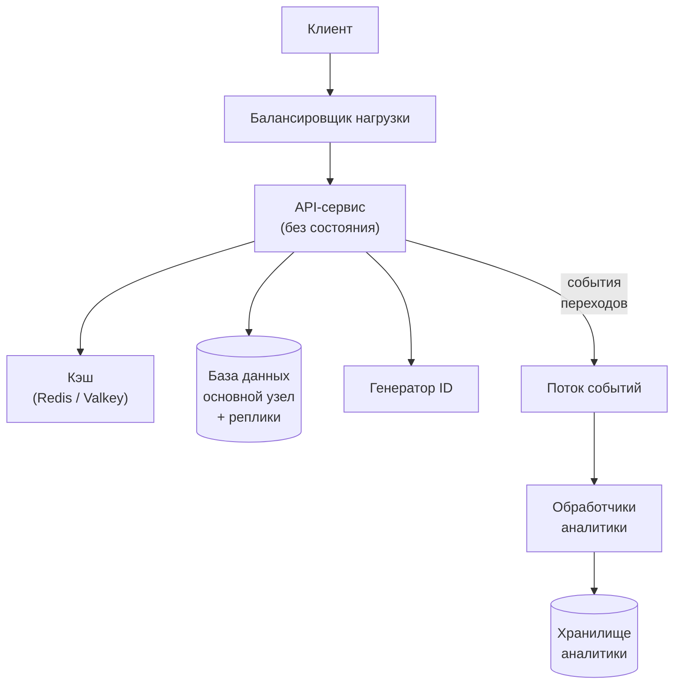

import { Aside, Steps } from '@astrojs/starlight/components';

Собеседование по системному дизайну — это открытый разговор, который ведёте вы. Интервьюер даёт задачу в одну строку («спроектируйте сокращатель ссылок», «спроектируйте ленту новостей») и смотрит, как вы за отведённое время превращаете её в работающий дизайн. Фиксированная последовательность шагов не даёт растратить время, так и не дойдя до самого интересного, и освобождает внимание для самой задачи.

<Aside type="tip" title="Коротко">
- Первые 5–10 минут — на требования и цифры. Большинство неудачных собеседований проваливаются именно здесь.
- Нарисуйте самый простой дизайн, закрывающий функциональные требования, а затем доведите его до нефункциональных.
- Углубитесь в один-два компонента: углубиться во всё не получится.
- Называйте компромисс за каждым решением и сценарий отказа для каждого компонента.
- Следите за временем и сверяйтесь с интервьюером между шагами.
</Aside>

## Схема кратко

Классические четыре шага (сценарии, высокоуровневый дизайн, ключевые компоненты, масштабирование) здесь развёрнуты в семь: прикидки и API выделены в отдельные шаги, масштабирование дополнено разбором отказов, а в конце добавлен итог. В [разборах задач](/practice/url-shortener-pastebin/) сохранены четыре классических заголовка, а семь шагов разложены внутри них: в шаге 1 — требования и прикидки, в шаге 2 — высокоуровневый дизайн, в шаге 3 — API, модель данных и углублённый разбор, в шаге 4 — масштабирование и отказы.

<Steps>

1. **Уточнить требования.** Договориться, что система должна делать, насколько хорошо и в каком масштабе.

2. **Прикинуть цифры.** Перевести масштаб в запросы в секунду, объём хранения и полосу пропускания. Дальше решения опираются на эти цифры.

3. **Описать API и модель данных.** Зафиксировать контракт и основные сущности до того, как рисовать прямоугольники.

4. **Набросать высокоуровневый дизайн.** Пройти каждый основной путь запроса от начала до конца минимальным набором компонентов.

5. **Углубиться в один-два компонента.** Выбрать, где самые сложные проблемы, или пойти туда, куда ведёт интервьюер.

6. **Масштабировать и ломать.** Найти узкие места и единые точки отказа, устранить их и назвать компромиссы.

7. **Подвести итог.** Сверить решение с требованиями, назвать слабые места и следующие шаги.

</Steps>

## Бюджет времени

Из 45-минутного слота после знакомства и ваших вопросов в конце на сам дизайн обычно остаётся около 40 минут, из 60-минутного — около 55. Это ориентиры, а не правила: если интервьюер рано уводит вас в детали, идите за ним и сожмите что-то другое.

| Шаг | Собеседование на 45 минут | Собеседование на 60 минут |
|---|---|---|
| 1. Требования | 4 мин | 6 мин |
| 2. Прикидки | 3 мин | 4 мин |
| 3. API и модель данных | 4 мин | 6 мин |
| 4. Высокоуровневый дизайн | 10 мин | 12 мин |
| 5. Углублённый разбор | 11 мин | 17 мин |
| 6. Масштаб, отказы, компромиссы | 6 мин | 7 мин |
| 7. Итог | 2 мин | 3 мин |
| **Всего на дизайн** | **40 мин** | **55 мин** |

Полезная контрольная точка: к середине собеседования на доске должен быть полный высокоуровневый дизайн. Если на 15-й минуте вы всё ещё обсуждаете требования, скажите об этом и двигайтесь дальше, явно проговорив допущения.

## Шаг 1 — Уточнить требования

Формулировка задачи нарочно расплывчата. Ваша первая задача — сузить её до объёма, который реально решить за отведённое время, и показать, что вы не начинаете строить, не поняв, что нужно.

Разделите услышанное на два списка и запишите оба так, чтобы интервьюер их видел:

| Функциональные требования | Нефункциональные требования |
|---|---|
| Что система делает: сценарии использования | Насколько хорошо: качества системы |
| «Пользователь создаёт короткую ссылку» | «Редирект быстрее 50 мс на p99» |
| «Пользователь видит число переходов» | «Доступность редиректов 99,99%» |
| «У ссылки может быть срок жизни» | «Созданные ссылки не теряются (надёжность хранения)» |

Договоритесь о трёх–пяти основных сценариях и явно отложите остальные («дашборды аналитики вне рамок, если вы не против»). Для нефункциональных требований выбирайте цифры, а не прилагательные: «быстро» — не требование, «p99 меньше 200 мс» — требование.

### Какие вопросы задать

- **Пользователи и сценарии.** Кто пользуется системой и зачем? Какие два-три потока важнее всего?
- **Масштаб.** Сколько активных пользователей в день? Сколько запросов в секунду в среднем и в пике? Как быстро растёт нагрузка?
- **Соотношение чтений и записей.** Нагрузка в основном на чтение (ленты, редиректы) или на запись (логи, телеметрия)?
- **Данные.** Что храним, какого размера каждый элемент и сколько времени его держим?
- **Задержка (latency).** Какие операции видит пользователь и какая цель по p99?
- **Доступность и согласованность.** Можно ли показывать устаревшие на несколько секунд данные? Что будет, если запись потеряется?
- **География.** Один регион или весь мир? Есть ли требования к размещению данных?
- **Клиенты.** Веб, мобильные приложения, другие сервисы, публичный API?
- **Ограничения.** Существующая инфраструктура, облачный провайдер, бюджет, размер команды, регуляторные требования (платежи, медицинские и персональные данные)?

Если интервьюер отвечает «решайте сами», решите вслух, назовите допущение и двигайтесь дальше.

## Шаг 2 — Прикидочные расчёты

Прикидки нужны, чтобы принимать решения, а не чтобы блеснуть арифметикой. Двух-трёх минут хватает, чтобы ответить на вопросы: помещаются ли данные на одну машину, выдержит ли трафик одна база и не упрёмся ли в сеть? Метод и справочные цифры — на странице о [прикидочных расчётах](/start/estimation/).

Пример для сокращателя ссылок: 100 млн новых ссылок в месяц, соотношение чтений к записям 10:1.

| Величина | Расчёт | Результат |
|---|---|---|
| Записей в секунду | 100 млн / (30 × 86 400 с) | ≈ 40/с |
| Чтений в секунду | 40 × 10 | ≈ 400/с в среднем, ≈ 1200/с в пике (×3) |
| Объём за год | 100 млн × 12 × 500 байт | ≈ 0,6 ТБ |
| Объём за 5 лет | 0,6 ТБ × 5 | ≈ 3 ТБ |

Затем скажите, что из этих цифр следует: нагрузка на запись мизерная, несколько терабайт спокойно помещаются в одну базу с репликами, а кэширование окупится на пути чтения. Эта фраза важнее самой таблицы.

## Шаг 3 — API и модель данных

Опишите контракт раньше компонентов. Это заставляет точно определить входы и выходы и даёт названия, которыми вы будете пользоваться до конца собеседования.

```http title="Набросок API"
POST /v1/links
  body: { "url": "https://example.com/very/long/path", "expires_at": null }
  201:  { "code": "aZ3kP9q", "short_url": "https://sho.rt/aZ3kP9q" }

GET /{code}
  302 Location: https://example.com/very/long/path
```

Детали, которые интервьюеры замечают: версионирование API, курсорная пагинация для списков, ключ идемпотентности для записей, которые клиент может повторить, и чёткое разделение на публичные и внутренние вызовы. REST поверх HTTP — безопасный выбор для публичного API; между внутренними сервисами часто используют gRPC (см. [RPC и REST](/communication/rpc-and-rest/)).

Для модели данных перечислите основные сущности, их ключевые поля и, главное, **паттерны доступа**: какие запросы выполняются, как часто и по какому ключу. Выбор между реляционным и NoSQL-хранилищем следует из этих паттернов, а не из моды (см. [SQL или NoSQL](/data/sql-or-nosql/)).

```sql title="Основная таблица"
CREATE TABLE links (
  code        VARCHAR(10) PRIMARY KEY,   -- ключ поиска для каждого редиректа
  long_url    TEXT        NOT NULL,
  owner_id    BIGINT,
  created_at  TIMESTAMPTZ NOT NULL,
  expires_at  TIMESTAMPTZ
);
```

## Шаг 4 — Высокоуровневый дизайн

Нарисуйте самую простую систему, которая закрывает функциональные требования, и вслух пройдите каждый основной путь запроса от начала до конца. Добавляйте компонент, только если можете сказать, зачем он нужен.



В этом примере рассказ звучал бы так:

- **Путь записи.** API-сервис получает уникальный код у генератора ID, сохраняет строку в базе и возвращает короткую ссылку.
- **Путь чтения.** API-сервис ищет код в кэше, при промахе идёт в реплику базы и возвращает редирект.
- **Аналитика.** Каждый редирект отправляет событие в поток; обработчики асинхронно агрегируют счётчики, поэтому горячий путь чтения никогда не ждёт аналитику.

Когда схема готова, сверьтесь с интервьюером: «Основные сценарии покрыты. Углубиться в генерацию ID или в путь чтения под большой нагрузкой?»

## Шаг 5 — Углублённый разбор

Именно здесь вы показываете глубину. Выберите один-два компонента, где требования выполнить труднее всего, предложите их и дайте интервьюеру выбрать. Типичные кандидаты:

- **Уникальность или порядок**: генерация коротких кодов без коллизий, порядок сообщений в чате.
- **Горячий путь под экстремальной нагрузкой**: поиск при редиректе, пост знаменитости, расходящийся по лентам миллионов подписчиков.
- **Согласованность**: счётчики, складские остатки, платежи — всё, где «в конечном счёте» не годится.
- **Рост данных**: как и когда [шардировать](/data/partitioning-and-sharding/), что архивировать.

Для каждого компонента предложите два-три варианта, сравните их по записанным требованиям, выберите один и скажите, чем жертвуете. Например, короткий код можно получить хешированием URL (просто, но нужно обрабатывать коллизии), из счётчика в base62 (коллизий нет, но счётчик должен быть распределённым) или из заранее сгенерированных случайных ключей (быстро, но нужен отдельный сервис ключей). Конкретные цифры и сценарии отказов делают разбор убедительным.

## Шаг 6 — Масштаб, узкие места, отказы и компромиссы

Теперь нагрузите дизайн. Пройдите по компонентам и задайте два вопроса: что сломается первым при десятикратной нагрузке и что произойдёт, если этот компонент откажет?

- **Узкие места.** Одна база на запись, горячий ключ или горячая партиция, веерная рассылка (fan-out), умножающая записи, синхронная цепочка вызовов, в которой задержки складываются.
- **Решения и их цена.** Реплики для чтения (отставание репликации), кэш (устаревание и [инвалидация](/caching/cache-strategies/)), шардирование (запросы между шардами), очереди (отложенный результат, повторные попытки), CDN (сброс кэша).
- **Сценарии отказа.** Единые точки отказа, «холодный» кэш после падения, заваливающий базу запросами, шквал повторных попыток, медленная зависимость. Назовите защиту: реплики и переключение на резерв (failover), тайм-ауты, повторные попытки с экспоненциальной задержкой (backoff) и джиттером, предохранители (circuit breaker), [ограничение частоты запросов](/reliability/rate-limiting/), плавная деградация (см. [паттерны устойчивости](/reliability/resilience-patterns/)).
- **Эксплуатация.** Как узнать, что система сломалась (метрики, SLO и алерты; см. [наблюдаемость](/reliability/observability/)), как безопасно выкатывать изменения и сколько всё это стоит.

Подытожьте главные компромиссы явно, например: «Редиректы читают из реплик и кэша, поэтому новая ссылка может начать работать везде с задержкой в секунду. Для наших требований это нормально, а вот платежи бы такого не выдержали».

## Шаг 7 — Итог

Последние минуты потратьте на то, чтобы «приземлить» дизайн, а не дорисовать ещё один прямоугольник:

- Перескажите дизайн в трёх-четырёх предложениях, сверяясь с требованиями из шага 1.
- Назовите самые слабые места и что бы вы сделали дальше, будь у вас больше времени (мультирегиональность, защита от злоупотреблений, стоимость).
- Оставьте время на последние вопросы интервьюера и на свои вопросы о команде и её системах.

## Что оценивают на разных уровнях

Ожидания растут вместе с уровнем, на который вы претендуете. Названия грейдов в компаниях различаются, поэтому воспринимайте таблицу как грубые ориентиры.

| Уровень | Как выглядит сильное выступление |
|---|---|
| Middle | Ведёт разговор с небольшой помощью. Уточняет требования, строит работающий сквозной дизайн, правильно использует стандартные компоненты, хорошо реагирует на подсказки. |
| Senior | Ведёт всё собеседование сам. Обосновывает решения цифрами, глубоко разбирает самый сложный компонент, сам поднимает узкие места и сценарии отказов, сравнивает альтернативы с ясными компромиссами. |
| Staff и выше | Формулирует задачу и при необходимости оспаривает требования. Обсуждает эксплуатацию, стоимость, миграцию и выкатку, мультирегиональность и организационные вопросы. Понимает, когда что-то строить не нужно и когда достаточно более простого дизайна. |

На любом уровне оценивают и коммуникацию: рассуждения вслух, структуру на доске, умение слышать подсказки и менять курс, не уходя в оборону.

<Aside type="note" title="На собеседовании">
- Типичные уточняющие вопросы: «Что будет, если этот компонент упадёт?», «Трафик вырос в 100 раз — что сломается первым?», «Как сделать систему мультирегиональной?», «Почему эта база, а не другая?», «Как вы поймёте, что система работает?»
- Если застряли, скажите, между чем выбираете, и выберите направление. Молчание обходится дороже неидеального решения.
</Aside>

## Частые ошибки

- **Сразу к схеме.** Рисовать прямоугольники до того, как договорились о требованиях и масштабе, и в итоге спроектировать не ту систему.
- **Переусложнение.** Начинать с микросервисов, Kafka и пяти баз для задачи, которая помещается на один сервер. Начинайте с простого и усложняйте, только когда этого требует конкретное требование.
- **Архитектура из модных слов.** Называть технологии, не объясняя, что они здесь делают и чего стоят.
- **Прикидки в никуда.** Потратить пять минут на арифметику и ни разу не воспользоваться результатом.
- **Нет компромиссов.** Подавать каждое решение как очевидно верное. У любого решения есть цена — назовите её.
- **Игнорирование отказов.** Дизайн без ответа на вопрос «а если этот узел умрёт?» не закончен.
- **Слишком ранние детали.** Двадцать минут на один компонент — и сквозной дизайн так и не дорисован.
- **Монолог.** Не сверяться с интервьюером, пропускать подсказки или отстаивать решение, от которого вас явно уводят.
- **Забыть о времени.** Дойти до 40-й минуты без обсуждения масштабирования и без итога.

## Чек-лист на один экран

Скопируйте, распечатайте или держите перед глазами во время тренировок.

```text title="system-design-checklist.txt"
1. ТРЕБОВАНИЯ (≈10%)
   [ ] Согласованы 3–5 основных сценариев; записано, что вне рамок
   [ ] Масштаб: DAU, QPS (средний/пик), чтение:запись, объём данных, рост
   [ ] Цель по задержке (p99), доступность, согласованность, сохранность
   [ ] География, клиенты, ограничения (регуляторика, стоимость)
2. ПРИКИДКИ (≈7%)
   [ ] QPS, объём хранения, полоса пропускания, размер кэша
   [ ] Одна фраза о том, что из цифр следует
3. API + МОДЕЛЬ ДАННЫХ (≈10%)
   [ ] Основные эндпоинты с запросом/ответом
   [ ] Сущности, ключи, паттерны доступа -> выбор хранилища
4. ВЫСОКОУРОВНЕВЫЙ ДИЗАЙН (≈25%)
   [ ] Самый простой дизайн, покрывающий все сценарии
   [ ] Пройти путь записи и путь чтения от начала до конца
   [ ] Свериться: «Куда углубимся?»
5. УГЛУБЛЁННЫЙ РАЗБОР (≈28%)
   [ ] 1–2 самых сложных компонента, по 2–3 варианта
   [ ] Выбрать один, назвать, чем жертвуем
6. МАСШТАБ + ОТКАЗЫ (≈15%)
   [ ] Что сломается первым при x10? Горячие ключи, fan-out, одна БД
   [ ] Единые точки отказа, failover, тайм-ауты, повторы, backpressure
   [ ] Мониторинг, SLO, выкатка, стоимость
7. ИТОГ (≈5%)
   [ ] Сверка с требованиями, слабые места, следующие шаги
ВСЕГДА: думать вслух · цифры вместо прилагательных · называть компромисс
```

## Что почитать

- [The system design process](https://www.hiredintech.com/system-design/the-system-design-process/) (HiredInTech) — короткое классическое описание процесса, на которое ссылается оригинальный Primer.
- [My System Design Template](https://leetcode.com/discuss/career/229177/My-System-Design-Template) (LeetCode Discuss) — популярный пошаговый шаблон, тоже из ссылок оригинала.
- [System Design Delivery Framework](https://www.hellointerview.com/learn/system-design/in-a-hurry/delivery) (Hello Interview) — современная схема с целевым временем на каждый шаг.
- [A Senior Engineer's Guide to the System Design Interview](https://interviewing.io/guides/system-design-interview) (interviewing.io) — что ищут интервьюеры и как говорить как техлид.
- [Non-Abstract Large System Design](https://sre.google/workbook/non-abstract-design/) (Google SRE Workbook) — как инженеры Google оценивают размер системы по требованиям, с разобранным примером.

## Связанные темы

- [Прикидочные расчёты](/start/estimation/) — метод, на котором держится шаг 2.
- [План подготовки](/start/study-plan/) — сколько прочитать, прежде чем начинать тренироваться.
- [Сокращатель ссылок и Pastebin](/practice/url-shortener-pastebin/) — полный разбор той же задачи, со своими допущениями.
- [Цифры задержек](/reference/latency-numbers/) — цифры, которые понадобятся в любой прикидке.
