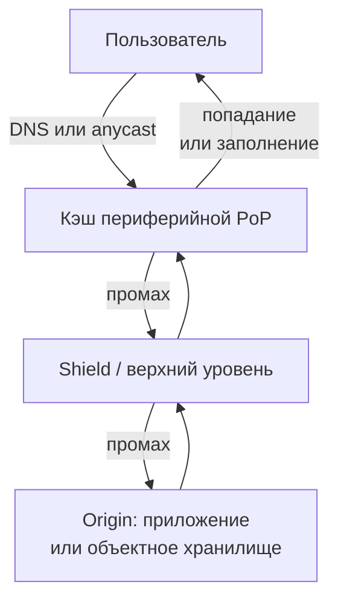

import { Aside } from '@astrojs/starlight/components';

Сеть доставки контента — это парк кэширующих обратных прокси, разбросанных по сотням точек присутствия (PoP) по всему миру. Пользователь общается с ближайшей точкой, а не пересекает океан до вашего origin-сервера, и до origin доходят только те запросы, на которые периферия ответить не смогла. Для большинства потребительских продуктов CDN отдаёт основную часть байтов, поэтому её правила кэширования определяют и задержку, и размер парка origin-серверов.

<Aside type="tip" title="Коротко">
- CDN снижает задержку (короткие сетевые обмены, TLS завершается рядом с пользователем) и разгружает origin. Важен каждый процент попаданий: рост с 95% до 99% уменьшает трафик на origin в пять раз.
- Pull-CDN забирает контент при первом промахе и подходит почти для всего. Push-CDN требует явной загрузки и подходит для больших, редко меняющихся файлов.
- Кэшированием управляют через `Cache-Control` (`max-age`, `s-maxage`, `stale-while-revalidate`), ключ кэша и API очистки. Версионированные URL лучше, чем очистка.
- Origin shield (многоуровневый кэш) схлопывает промахи всех PoP в один запрос к origin.
- Современные CDN выполняют код на периферии, проверяют подписанные URL, фильтруют атаки и ускоряют некэшируемый трафик. Крупные сайты часто используют две CDN, потому что CDN тоже падают.
</Aside>

## Путь запроса



1. DNS (часто CNAME на имя CDN) или anycast-адрес приводит пользователя к ближайшей PoP. См. [DNS](/traffic/dns/).
2. PoP строит из запроса **ключ кэша** и ищет по нему.
3. При попадании отвечает сразу, часто за несколько миллисекунд.
4. При промахе обращается к верхнему уровню или к origin, сохраняет ответ, если заголовки это разрешают, и отвечает.

Выигрывают даже некэшируемые запросы: рукопожатия TLS и TCP проходят по короткому пути до PoP, а PoP повторно использует «прогретые» долгоживущие соединения до origin.

## Push или pull

| | Pull-CDN | Push-CDN |
|---|---|---|
| Как контент попадает в CDN | Периферия забирает его с origin при первом запросе | Вы заранее загружаете контент в хранилище CDN |
| Первый запрос | Медленнее: это промах кэша | Быстрый: контент уже на месте |
| Актуальность | Управляется TTL и очисткой | Управляется вами: загрузили новую версию, удалили старую |
| Хранение | В кэше остаётся только то, что реально запрашивают | Всё загруженное, независимо от спроса |
| Трафик на origin | Повторные загрузки по истечении TTL, даже если ничего не изменилось (ревалидация делает их дешёвыми) | Только при загрузке |
| Эксплуатация | Один раз настроить заголовки | Построить и поддерживать конвейер загрузки, переписать URL на хост CDN |
| Подходит для | Нагруженных сайтов, больших и «длинных» каталогов, API | Больших файлов с предсказуемым спросом (дистрибутивы, патчи игр, видеопакеты) и небольших редко меняющихся сайтов |

Сегодня граница размыта. Типичная схема — pull-CDN перед **объектным хранилищем**: конвейер сборки выкладывает ассеты с хешем в имени в бакет (это и есть «push» в хранилище), а CDN забирает их из бакета по требованию. См. [объектное хранилище](/data/object-storage/).

## Ключи кэша и заголовки

**Ключ кэша** определяет, какие запросы разделяют один сохранённый ответ. По умолчанию это примерно схема, хост, путь и строка запроса. Настройка ключа — главный рычаг для доли попаданий:

- **Нормализуйте** ключ: отбрасывайте параметры отслеживания (`utm_*`), сортируйте строку запроса, приводите хост к нижнему регистру.
- **Добавляйте только то, что меняет ответ**: например, `Accept-Encoding` или класс устройства. Каждое дополнительное измерение дробит кэш. `Vary: User-Agent` способен уничтожить долю попаданий.
- **Никогда не кэшируйте персонализированные ответы случайно.** Ответ, который ставит cookie или зависит от `Authorization`, должен быть `private` или исключён из кэширования. Страница залогиненного пользователя под общим ключом утечёт к другим пользователям.

Заголовки ответа origin задают, сколько ответ остаётся свежим (RFC 9111):

```http
# Статический ассет с хешем в имени (app.3f9c2b.js): кэшировать год, никогда не ревалидировать
Cache-Control: public, max-age=31536000, immutable

# HTML или ответ API: в браузере сразу устаревает, на CDN остаётся свежим 60 с.
# Потом кэши с поддержкой stale-while-revalidate (CDN и браузеры, которые её
# реализуют) ещё 5 минут могут отдавать старую копию, обновляя её в фоне
Cache-Control: public, max-age=0, s-maxage=60, stale-while-revalidate=300, stale-if-error=86400

# Данные конкретного пользователя: общим кэшам хранить нельзя
Cache-Control: private, no-store
```

- `max-age` действует на все кэши. `s-maxage` переопределяет его для общих кэшей, таких как CDN.
- `stale-while-revalidate` позволяет кэшу мгновенно отдать старую копию, параллельно загружая новую. `stale-if-error` продолжает отдавать старую копию, когда origin возвращает ошибки 5xx (обе директивы — из RFC 5861). Вместе они скрывают медлительность origin и короткие сбои.
- `CDN-Cache-Control` (RFC 9213) задаёт правила только для CDN, не затрагивая браузеры. Многие CDN понимают и собственный заголовок, например `Surrogate-Control`.
- `ETag` и `Last-Modified` позволяют кэшам дёшево **ревалидировать** ответ: origin отвечает `304 Not Modified` без тела.

## Очистка и инвалидация

Контент будет меняться раньше, чем истечёт TTL. Варианты — от лучшего к худшему:

1. **Версионированные URL.** Добавьте хеш содержимого в имя файла (`app.3f9c2b.js`) и кэшируйте навсегда. Деплой публикует новые имена, а старые просто устаревают. Ни очистки, ни гонок.
2. **Очистка по тегам.** Origin помечает ответы тегами (*surrogate keys* в Fastly, *cache tags* в Cloudflare). Один вызов API инвалидирует все объекты с тегом `product-123` — на всех URL, где показан этот товар.
3. **Очистка по URL или префиксу.** Точно, но нужно знать каждый затронутый URL, включая варианты строки запроса.
4. **Очистить всё.** Крайняя мера: все PoP одновременно промахиваются, и на origin обрушивается лавина запросов.

Очистка не бесплатна. Провайдеры ограничивают её частоту или берут плату за пути, ей нужно время, чтобы дойти до всех PoP, а копии могут остаться в кэшах браузеров. Некоторые CDN поддерживают **мягкую очистку** (soft purge): объекты помечаются устаревшими, а не удаляются, так что `stale-while-revalidate` и `stale-if-error` продолжают работать.

## Origin shield и многоуровневое кэширование

Без shield каждая PoP промахивается самостоятельно. При 300 PoP и TTL в 60 секунд один популярный объект может давать до 5 запросов в секунду к origin. Умножьте на множество объектов и частые деплои — и origin получает постоянный поток промахов.

**Origin shield** (CloudFront Origin Shield, shielding в Fastly, Tiered Cache в Cloudflare) ставит между PoP и origin один выделенный узел верхнего уровня. PoP промахиваются в shield, а shield **схлопывает** одновременные запросы одного объекта в одну загрузку с origin. В примере выше остаётся один запрос к origin на объект раз в 60 секунд. Платим лишним переходом при промахах и иногда — отдельной платой за shield. Взамен получаем более высокую общую долю попаданий, спокойный origin и более дешёвую обработку на лету, например изменение размеров изображений или упаковку видео.

## Защита контента: подписанные URL и закрытый origin

- **Подписанные URL** содержат срок действия и подпись (HMAC или открытый ключ), которую периферия проверяет без обращения к origin. Их используют для платных загрузок, приватных медиа и пользовательских файлов. **Подписанные cookie** делают то же для целого пути, например для всех сегментов видеопотока.
- **Закройте origin.** Если злоумышленник может обратиться к бакету или балансировщику напрямую, подписанные URL и периферийный файрвол бесполезны. Разрешите доступ только CDN: например, *origin access control* в CloudFront для S3, секретный заголовок, mTLS между CDN и origin или опубликованные диапазоны IP-адресов провайдера.
- На периферии же происходят **поглощение DDoS, правила WAF и фильтрация ботов** — только у этого уровня хватает ёмкости, чтобы выдержать атаку.

## Ускорение динамического контента

Персонализированные страницы и вызовы API кэшировать нельзя, но CDN всё равно помогает:

- TLS и HTTP/3 завершаются рядом с пользователем, поэтому рукопожатие занимает несколько миллисекунд, а не время пути через Атлантику и обратно.
- PoP держат прогретые мультиплексированные соединения до origin, и медленный старт TCP не мешает.
- Некоторые провайдеры гонят трафик по собственной магистрали или выбирают самый быстрый путь в реальном времени (Cloudflare Argo Smart Routing, ныне часть Smart Shield; AWS Global Accelerator делает похожее на уровне 4).
- **Микрокэширование**: кэширование нагруженного неперсонализированного ответа API на 1–5 секунд может снять большую часть нагрузки с origin во время всплеска без заметной устарелости.

## Вычисления на периферии

CDN теперь выполняют код клиентов прямо в PoP:

| Платформа | Модель выполнения |
|---|---|
| Cloudflare Workers | Изоляты V8. JavaScript, TypeScript, Python, Rust и другие языки через WebAssembly |
| Fastly Compute (ранее Compute@Edge) | Модули WebAssembly, несколько языков |
| AWS CloudFront Functions | Лёгкий JavaScript, только запрос и ответ зрителя, бюджет меньше миллисекунды |
| AWS Lambda@Edge | Node.js и Python, может срабатывать и на запросы к origin и ответы от него |
| Akamai EdgeWorkers | JavaScript |

Хорошие применения: переписывание URL и редиректы, нормализация ключей кэша, проверка JWT или подписанной cookie до того, как запрос дойдёт до origin, распределение по группам A/B-теста, правила по географии, заголовки безопасности, выбор формата изображения.

Осторожнее со всем, что ходит в базу данных. Если данные живут в одном регионе, функция на периферии, которая делает три запроса в этот регион, работает *медленнее*, чем код рядом с данными. Вычисления на периферии окупаются, когда работа самодостаточна или использует данные, реплицированные на периферию (хранилища «ключ-значение», реплики для чтения рядом с PoP). Кроме того, это ещё одна площадка, которую нужно тестировать, мониторить и отлаживать.

## Несколько CDN

CDN — общая инфраструктура, и её сбои глобальны. 8 июня 2021 года ошибка, спровоцированная вполне корректной настройкой клиента, заставила около 85% сети Fastly возвращать ошибки. 18 ноября 2025 года неверный конфигурационный файл на несколько часов вывел из строя значительную часть сети Cloudflare. В январе 2025 года закрытие Edgio вынудило его клиентов, включая пользователей Azure CDN from Edgio, мигрировать за считаные недели.

Поэтому крупные сайты используют две CDN или больше и переключаются между ними — обычно через взвешенный или основанный на производительности DNS, который питается измерениями реальных пользователей. Цена ощутима: каждой CDN нужны та же конфигурация, сертификаты, правила кэша, хуки очистки, логирование и код на периферии. На практике вы ограничены возможностями, которые есть у обоих провайдеров. Origin shield перед origin помогает двум CDN не удваивать нагрузку на него.

## Стоимость и подводные камни

- **Цены.** CDN берут плату за исходящий трафик за ГБ (дешевле при больших объёмах, зависит от региона), за запросы и за дополнительные функции: shield, WAF, вычисления на периферии, логи. Сравните это с тем, сколько стоили бы трафик и серверы без CDN. CDN обычно выигрывает, когда трафик глобальный или неравномерный.
- **Арифметика попаданий.** При 10 000 запросов в секунду и доле попаданий 95% до origin доходит 500 запросов в секунду, при 99% — 100. Рассчитывайте origin на долю промахов *после* полной очистки или с холодным кэшем, а не в установившемся режиме.
- **Устаревший контент.** Цена длинных TTL. Используйте версионированные URL и очистку по тегам, а не короткие TTL повсюду.
- **Переписывание URL.** Ассеты должны указывать на хост CDN, или весь сайт должен стоять за CDN. Смешанные схемы приводят к пропущенным ассетам, ошибкам CORS и cookie, отправленным не на тот хост.
- **Отравление кэша и утечки.** Заголовки, которые CDN не включает в ключ, но которые использует origin, позволяют злоумышленнику сохранить вредоносный ответ для всех. Проверьте, какие входные данные влияют на ответ.
- **«Громоподобное стадо» (thundering herd) при истечении.** Когда горячий объект истекает, многие PoP промахиваются одновременно. Схлопывание запросов, shield и `stale-while-revalidate` это предотвращают.

## Компромиссы

| Выигрыш | Цена |
|---|---|
| Меньше задержка, особенно для далёких пользователей | Ещё один поставщик, ещё один счёт, ещё один источник сбоев |
| Разгрузка origin и меньший парк серверов | Устаревание: инвалидацию нужно проектировать |
| Защита от DDoS и WAF на периферии | Отладка сложнее: какая PoP что отдала и почему |
| Дешёвая логика на запрос на периферии | Привязка к среде выполнения и лимитам поставщика |

<Aside type="note" title="На собеседовании">
Ставьте CDN перед статикой и медиа по умолчанию и объясняйте, как туда попадает контент (обычно pull из объектного хранилища) и как он инвалидируется (версионированные URL, очистка по тегам). Ожидайте вопросов: «Как отдавать приватные файлы?» (подписанные URL и закрытый origin), «Что происходит при деплое?» (новые имена с хешем, без очистки), «Как защитить origin от лавины промахов?» (shield, схлопывание запросов, stale-while-revalidate), «Можно ли кэшировать этот API?» (только общие неперсонализированные ответы, с `s-maxage`). Типичная ошибка — считать, что с CDN origin больше не важен: ему всё равно нужно пережить холодный кэш.
</Aside>

## Что почитать

- [RFC 9111: HTTP Caching](https://www.rfc-editor.org/rfc/rfc9111.html) — правила, которым следует любой кэш CDN.
- [MDN: Cache-Control](https://developer.mozilla.org/en-US/docs/Web/HTTP/Reference/Headers/Cache-Control) — понятный справочник с примерами по каждой директиве.
- [RFC 9213: Targeted HTTP Cache Control](https://www.rfc-editor.org/rfc/rfc9213.html) — `CDN-Cache-Control` и правила только для CDN.
- [CloudFront Origin Shield](https://docs.aws.amazon.com/AmazonCloudFront/latest/DeveloperGuide/origin-shield.html) — когда shield помогает, а когда нет.
- [Fastly: Working with surrogate keys](https://www.fastly.com/documentation/guides/full-site-delivery/purging/working-with-surrogate-keys/) — очистка по тегам на практике.
- [Summary of June 8 outage](https://www.fastly.com/blog/summary-of-june-8-outage) — почему стоит задуматься о нескольких CDN.

## Связанные темы

- [DNS](/traffic/dns/) — как пользователей направляют к ближайшей PoP.
- [Уровни кэширования](/caching/caching-layers/) — CDN — самый внешний кэш в стеке кэшей.
- [Стратегии кэширования](/caching/cache-strategies/) — TTL, инвалидация и защита от лавины запросов в общем виде.
- [Объектное хранилище](/data/object-storage/) — обычный origin для статики и медиа.
- [HTTP](/communication/http/) — заголовки кэширования, HTTP/2 и HTTP/3 на периферии.
