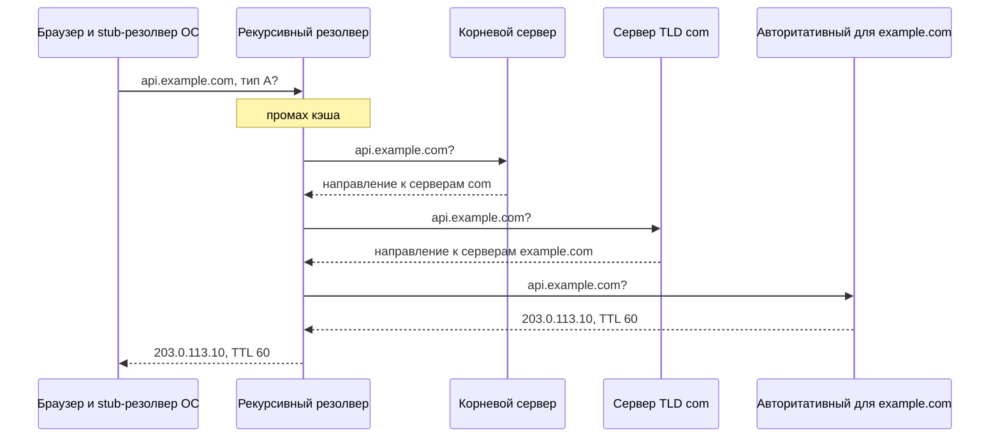
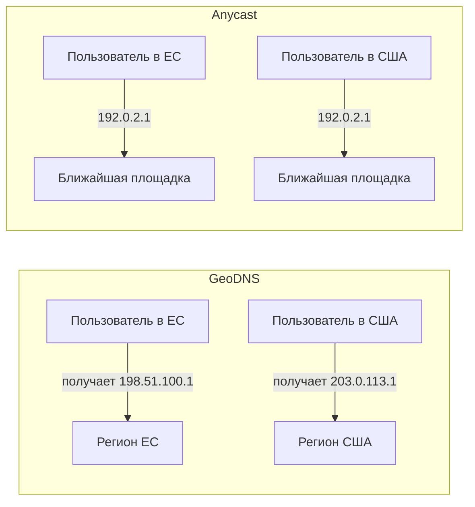

import { Aside } from '@astrojs/starlight/components';

Система доменных имён превращает имена вроде `api.example.com` в адреса и параметры, нужные клиенту для подключения. Это первый шаг почти любого запроса, дешёвый инструмент глобального управления трафиком и, если что-то сломается, способ сделать недоступной вполне здоровую систему. Проектировщику важно понимать, как работают разрешение имён и кэширование, какие бывают записи и как не дать DNS стать самым слабым звеном.

<Aside type="tip" title="Коротко">
- Запрос идёт по цепочке: stub-резолвер → рекурсивный резолвер → корневой сервер → сервер TLD → авторитативный сервер. Кэши на каждом уровне превращают большинство запросов в один локальный шаг.
- TTL — это регулятор между гибкостью и нагрузкой: короткий TTL позволяет быстро перевести трафик, но увеличивает число запросов и задержку при промахах кэша.
- Управляемый DNS умеет распределять трафик по весам, задержке, географии и состоянию здоровья, но лишь с точностью до резолверов и TTL. По сравнению с балансировщиком это грубый и медленный инструмент.
- Anycast анонсирует один IP-адрес из многих площадок, и ближайшую выбирает BGP. GeoDNS выдаёт разные адреса для разных регионов. Крупные провайдеры сочетают оба подхода.
- Относитесь к DNS как к критической инфраструктуре: два независимых авторитативных провайдера, зоны в виде кода и путь восстановления, который не зависит от вашего собственного DNS.
</Aside>

## Как разрешается имя

В разрешении имени участвуют серверы четырёх видов:

- **Stub-резолвер** — небольшая библиотека в ОС. Она обращается к одному настроенному резолверу и кэширует ответ.
- **Рекурсивный резолвер** — его держит провайдер, корпоративная сеть, облачная VPC или публичный сервис вроде 1.1.1.1 и 8.8.8.8. Он выполняет всю работу и активно кэширует.
- **Корневые серверы и серверы TLD** ответа не знают. Они отсылают резолвер к серверам зоны `.com`, а те — к серверам `example.com`. Корневую зону обслуживают 13 именованных серверов (от A до M), которыми управляют 12 операторов; за ними стоят более 2000 anycast-экземпляров.
- **Авторитативный сервер** хранит зону и даёт окончательный ответ.

Stub-резолвер отправляет один *рекурсивный* запрос. Дальше резолвер делает *итеративные* запросы и сам проходит по каждому направлению (referral). У направлений от корневых серверов и TLD длинные TTL (часто сутки и больше), поэтому «прогретый» резолвер на практике сразу идёт к авторитативному серверу. Холодное разрешение может стоить нескольких сетевых обменов — отчасти поэтому браузеры заранее разрешают имена для ссылок на странице.

## Кэширование и TTL

Каждый ответ несёт **время жизни** (TTL), заданное владельцем зоны. Браузеры, операционные системы и резолверы отсчитывают его и повторно используют ответ, пока срок не истечёт. «Распространение DNS» (DNS propagation) — это просто истечение старых закэшированных ответов.

| | Короткий TTL (30–60 с) | Длинный TTL (1 ч – 1 сутки) |
|---|---|---|
| Перевод трафика и переключение на резерв | Быстро | Медленно: старые ответы живут до одного TTL |
| Нагрузка на авторитативные серверы | Высокая: до 60 запросов в час от каждого резолвера при 60 с | Низкая: один запрос в час при 3600 с |
| Задержка разрешения для пользователей | Больше промахов кэша | Почти всегда из кэша |
| Последствия отказа провайдера | Кэши быстро пустеют | Кэши какое-то время продолжают отвечать |

Практические правила:

- **Перед миграцией** уменьшите TTL, подождите не меньше одного *старого* TTL, внесите изменение и затем снова увеличьте TTL.
- **Отрицательные ответы тоже кэшируются.** Ответ NXDOMAIN хранится в кэше в течение меньшего из двух значений: TTL записи SOA и её поля MINIMUM (RFC 2308). Если запросить имя до того, как оно создано, ответ «не существует» может задержаться в кэшах.
- **Не все клиенты соблюдают TTL.** Некоторые резолверы не принимают очень маленькие значения. Долгоживущие процессы — например, JVM с собственным DNS-кэшем или пулы соединений, которые никогда не разрешают имя заново, — могут держаться за адрес часами. Не стоит проектировать переключение через DNS быстрее, чем примерно за минуту.

## Типы записей

| Запись | Назначение | Примечание |
|---|---|---|
| `A` / `AAAA` | Имя → IPv4- или IPv6-адрес | Несколько записей дают грубое распределение на стороне клиента |
| `CNAME` | Имя → другое имя | Не может соседствовать с другими записями, поэтому недопустима в вершине зоны (`example.com`) |
| `MX` | Почтовые серверы домена с приоритетами | Сначала пробуется меньшее значение |
| `NS` | Какие серверы авторитативны для зоны или делегированной подзоны | Должны совпадать с делегированием у родительской зоны (регистратуры) |
| `TXT` | Произвольный текст | Подтверждение владения доменом, SPF, DKIM, DMARC |
| `SRV` | Хост и порт сервиса (`_sip._tcp`) | Используется рядом протоколов и Kubernetes для именованных портов |
| `CAA` | Какие удостоверяющие центры могут выпускать сертификаты для домена | Дешёвая защита от ошибочного выпуска (RFC 8659) |
| `SOA` | Метаданные зоны: основной сервер, серийный номер, TTL отрицательного кэша | Одна на зону |
| `HTTPS` / `SVCB` | Точка подключения, ALPN (например, `h3`) и другие подсказки | RFC 9460 (2023); заодно позволяет делать псевдонимы в вершине зоны |

**Записи alias / ANAME.** Часто нужно, чтобы сам `example.com` указывал на имя балансировщика или CDN, но CNAME в вершине зоны запрещён. Провайдеры решают это нестандартными записями: авторитативный сервер сам разрешает целевое имя и отдаёт обычные A/AAAA-записи. Это *alias*-записи в Route 53, *CNAME flattening* в Cloudflare, записи *ANAME* или *ALIAS* у других провайдеров. Кроме того, Route 53 не берёт плату за запросы к alias-записям, указывающим на ресурсы AWS. Стандартное решение — запись `HTTPS`, по мере того как её поддерживают клиенты.

## Управление трафиком через DNS

Управляемый авторитативный сервер не обязан отвечать всем одинаково. Типичные политики маршрутизации:

- **Взвешенная.** Отдавать адрес A на 90% запросов и B на 10%. Применения: канареечные релизы, вывод кластера из работы перед обслуживанием, распределение между кластерами разного размера, A/B-тесты.
- **По задержке.** Отдавать регион с наименьшей измеренной задержкой из сети резолвера.
- **По геолокации.** Выбор по стране или континенту. Применения: требования к размещению данных, локализованный контент, лицензионные ограничения.
- **Переключение на резерв (failover).** Отдавать основной адрес, пока он проходит проверку здоровья, иначе — резервный. Route 53, например, проверяет точку из многих мест и считает её недоступной, только когда здоровой её видят 18% проверяющих или меньше, — так один изолированный проверяющий узел не вызовет переключения.
- **Множественный ответ (multivalue).** Вернуть несколько здоровых адресов, чтобы клиент выбрал сам и при неудаче попробовал другой.

У всех политик два общих ограничения. Во-первых, авторитативный сервер видит IP-адрес **резолвера**, а не пользователя. Пользователь из Мадрида за резолвером во Франкфурте выглядит немцем. EDNS Client Subnet (RFC 7871) позволяет резолверу передать усечённый префикс клиента, но резолверы, ориентированные на приватность, часто этого не делают. Во-вторых, крупный резолвер кэширует один ответ для всех своих пользователей, поэтому веса 90/10 дают примерно 90/10 по резолверам, а не ровно 90/10 по запросам.

## GeoDNS и anycast

| | GeoDNS | Anycast |
|---|---|---|
| Механизм | Разные ответы в зависимости от расположения резолвера | Один IP-адрес, анонсируемый по BGP из многих площадок |
| Реакция на отказ | Один TTL плюс клиентские кэши | Отзыв маршрута, обычно от секунд до минуты |
| Управляемость | Тонкая: по странам, по весам | Грубая: BGP выбирает «ближайшую» площадку по сетевому пути |
| Поглощение DDoS | Каждый регион принимает свою часть атаки | Атака распределяется по всем площадкам |
| Что нужно | Функция управляемого DNS | Собственное адресное пространство и BGP или провайдер, у которого это есть |
| Кто использует | Мультирегиональные приложения | Корневые серверы, публичные резолверы, CDN, глобальные балансировщики |

Anycast хорошо подходит для коротких UDP-обменов вроде DNS. Для TCP он работает, пока маршруты стабильны, и крупные CDN строят на нём весь свой периметр. Облака предлагают его в виде статических anycast-адресов: например, глобальные балансировщики Google Cloud и AWS Global Accelerator. Многие провайдеры сочетают оба подхода: anycast для самих авторитативных DNS-серверов и ответы в стиле GeoDNS для приложения.

## DNS как единая точка отказа

21 октября 2016 года управляемый DNS-провайдер Dyn пережил три волны DDoS-атак ботнета Mirai, собранного из взломанных камер, роутеров и других IoT-устройств. Сайты, у которых Dyn был единственным DNS-провайдером, — GitHub, Netflix, Spotify, PayPal и другие — стали недоступны для многих пользователей в Северной Америке и Европе. Их серверы были исправны, но никто не мог узнать их адреса.

В октябре 2021 года Facebook продемонстрировал обратный сценарий. Сбой магистральной сети заставил его собственные DNS-серверы, как и было задумано, отозвать свои BGP-маршруты. Перестали разрешаться все домены Facebook, а вместе с ними и внутренние инструменты, нужные инженерам для исправления ситуации.

Как снизить риск:

- **Два независимых авторитативных провайдера.** Укажите у регистратора оба набора `NS`-записей и держите зоны идентичными — через передачу зон (основной/вторичный) или публикуя одну и ту же зону из кода (octoDNS, Terraform). Проприетарные политики маршрутизации между провайдерами обычно не переносятся, поэтому критичные записи делайте простыми или смиритесь с разным поведением.
- **Выведите DNS из собственного радиуса поражения.** Не размещайте единственные авторитативные серверы в той же сети или регионе, что и приложение, на которое они указывают.
- **Аварийный доступ.** Убедитесь, что консоли, VPN и инструкции доступны, даже когда ваши имена не разрешаются.
- **Мониторинг снаружи.** Проверяйте разрешение ключевых имён из нескольких сетей, а не только изнутри своей VPC.
- **Разумные TTL.** Умеренные TTL (минуты, а не секунды) позволяют кэшам пережить короткий сбой провайдера.

## Шифрованный DNS: DoT и DoH

Классический DNS ходит открытым текстом по UDP-порту 53, поэтому любой узел на пути может его прочитать или подменить. **DNS over TLS** (DoT, RFC 7858, 2016) заворачивает запросы в TLS на порту 853. **DNS over HTTPS** (DoH, RFC 8484, 2018) отправляет их как HTTPS-запросы на порт 443, где их трудно отличить от обычного веб-трафика. Позже появился **DNS over QUIC** (RFC 9250, 2022). Крупные браузеры и операционные системы поддерживают шифрованный DNS. Он защищает только участок от клиента до резолвера и может обходить корпоративный split-horizon DNS и фильтрацию — в корпоративных сетях это важно. Шифрование даёт конфиденциальность, но не подлинность: подлинность обеспечивает DNSSEC, подписывая записи, и это отдельное решение.

## Управляемые DNS-сервисы

Типичный выбор — Amazon Route 53, Cloudflare DNS, Google Cloud DNS, Azure DNS (вместе с Azure Traffic Manager для маршрутизации через DNS), IBM NS1 Connect и Akamai Edge DNS. Все они предлагают anycast-авторитативные серверы, API и в той или иной мере маршрутизацию с проверками здоровья. Внутри кластеров Kubernetes имена сервисов обслуживает CoreDNS — об этом в разделе про [обнаружение сервисов](/architecture/service-discovery-and-mesh/).

## Компромиссы

| Что даёт управление трафиком через DNS | Чем за это платим |
|---|---|
| Глобальный охват без лишнего узла на пути данных | Скорость реакции ограничена TTL и неаккуратными кэшами |
| Простое разделение по весам или регионам | Решения принимаются по расположению резолвера, а не пользователя |
| Переключение между регионами с проверками здоровья | Грубая детализация: нет маршрутизации по запросам или путям |
| Управляемый сервис с высоким SLA | Критическая зависимость, которой самой нужно резервирование |

<Aside type="note" title="На собеседовании">
DNS обычно появляется в первую же минуту («клиент разрешает наш домен…») и ещё раз — при обсуждении переключения между регионами. Интервьюер проверяет, понимаете ли вы, что изменения в DNS не мгновенны (TTL, клиентские кэши), что маршрутизация через DNS опирается на расположение резолвера и что DNS — зависимость, которая может отказать. Сильный ответ сочетает DNS для грубого распределения по регионам с балансировщиками или anycast для быстрого переключения. Типичные дополнительные вопросы: «Как быстро вы переключите регион?», «Почему нельзя поставить CNAME в вершину зоны?», «Что будет, если ляжет DNS-провайдер?»
</Aside>

## Что почитать

- [What is DNS?](https://www.cloudflare.com/learning/dns/what-is-dns/) — разбор от Cloudflare: резолверы, корневые, TLD- и авторитативные серверы.
- [RFC 9499: DNS Terminology](https://www.rfc-editor.org/rfc/rfc9499.html) — точные определения терминов, использованных выше.
- [Политики маршрутизации Route 53](https://docs.aws.amazon.com/Route53/latest/DeveloperGuide/routing-policy.html) — конкретный каталог: взвешенная, по задержке, по географии, failover.
- [Load Balancing at the Frontend](https://sre.google/sre-book/load-balancing-frontend/) — глава из книги Google SRE об ограничениях балансировки через DNS и роли anycast VIP.
- [DDoS attacks on Dyn](https://en.wikipedia.org/wiki/DDoS_attacks_on_Dyn) — хронология и последствия сбоя 2016 года.
- [More details about the October 4 outage](https://engineering.fb.com/2021/10/05/networking-traffic/outage-details/) — как DNS Facebook пропал из интернета.

## Связанные темы

- [Сети доставки контента](/traffic/cdn/) — CDN полагаются на DNS или anycast, чтобы направить пользователя к ближайшей точке присутствия.
- [Балансировщики нагрузки](/traffic/load-balancers/) — быстрый и точный уровень, к которому DNS направляет трафик.
- [Паттерны доступности](/fundamentals/availability-patterns/) — резервирование и переключение, одна из форм которого — failover через DNS.
- [Обнаружение сервисов и service mesh](/architecture/service-discovery-and-mesh/) — DNS внутри кластера.
