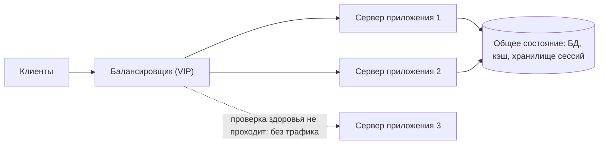

import { Aside } from '@astrojs/starlight/components';

Балансировщик нагрузки принимает трафик на один стабильный адрес и распределяет его по пулу взаимозаменяемых серверов. Именно он делает возможными горизонтальное масштабирование и постепенные (rolling) деплои: серверы появляются и исчезают, падают и восстанавливаются, а клиенты продолжают обращаться к той же точке. Балансировщики встречаются на каждом уровне — от периметра в интернете до вызовов между внутренними сервисами и подключений к репликам баз данных.

<Aside type="tip" title="Коротко">
- Три задачи: отправлять трафик только на здоровые серверы, равномерно распределять нагрузку и убрать отдельный сервер как точку отказа.
- L4-балансировщики маршрутизируют потоки TCP/UDP по адресам и портам — быстро и независимо от протокола. L7-балансировщики разбирают HTTP или gRPC и умеют маршрутизировать по пути, заголовку или cookie, завершать TLS и повторять запросы.
- Когда стоимость запросов различается, least connections или «сила двух случайных выборов» (power of two choices) работают лучше round robin. Консистентное хеширование нужно, когда один и тот же ключ должен попадать на один сервер.
- Делайте серверы приложений stateless (сессии во внешнем хранилище), чтобы любой сервер мог обработать любой запрос. Липкие сессии — запасной вариант, а не архитектура.
- Сам балансировщик должен быть зарезервирован (active-active или active-passive), а его проверки здоровья не должны выключать весь парк из-за сбоя общей зависимости.
</Aside>

## Что делает балансировщик

- **Здоровье.** Он опрашивает каждый бэкенд и перестаёт слать трафик на тех, кто не отвечает, так что упавший или перегруженный экземпляр недолго вызывает видимые пользователю ошибки.
- **Распределение нагрузки.** Ни один сервер не перегружается, а ёмкость наращивается добавлением серверов.
- **Отдельный сервер не точка отказа.** Клиенты знают только адрес балансировщика. Серверы можно заменять, деплоить по одному или выводить на обслуживание.
- **Дополнительно.** Завершение TLS, повторное использование соединений к бэкендам, логи и метрики запросов, ограничение частоты, повторные попытки, постепенное переключение трафика для канареечных релизов.

Аппаратные балансировщики (F5 BIG-IP, NetScaler) ещё встречаются в дата-центрах, но основная часть трафика сегодня идёт через программные решения: HAProxy, NGINX, Envoy, балансировщики уровня ядра на IPVS или eBPF/XDP (Katran от Facebook) и управляемые облачные балансировщики.

## Уровень 4 и уровень 7

**L4-балансировщик** работает с транспортными потоками. Он смотрит на IP-адреса и порты, выбирает бэкенд один раз на соединение и пересылает пакеты (через NAT, инкапсуляцию или прямой возврат от сервера — direct server return), не читая содержимое. **L7-балансировщик** завершает клиентское соединение, разбирает запрос, выбирает бэкенд для каждого запроса и открывает (или переиспользует) собственное соединение к нему.

| | Уровень 4 (транспортный) | Уровень 7 (прикладной) |
|---|---|---|
| Что видит | IP-адреса, порты, протокол | Метод, путь, заголовки, cookie, gRPC-сервис |
| Гранулярность решения | На соединение | На запрос (запросы в одном HTTP/2-соединении могут уйти на разные бэкенды) |
| Протоколы | Любой TCP или UDP | HTTP/1.1, HTTP/2, HTTP/3, gRPC, WebSocket |
| TLS | Пропускает насквозь (или завершает как TLS-прокси) | Обычно завершает и может зашифровать заново |
| Возможности | Очень высокая пропускная способность, низкая задержка, IP клиента сохраняется в режиме passthrough | Маршрутизация по хосту и пути, переписывание заголовков, повторы, аутентификация, сжатие, наблюдаемость на уровне запросов |
| Цена | Дёшево на пакет, мало состояния | Больше CPU и памяти на запрос |
| Примеры | AWS NLB, passthrough NLB в Google Cloud, IPVS, Katran, Maglev | AWS ALB, Application LB в Google Cloud, HAProxy или NGINX в режиме HTTP, Envoy |

Крупные платформы ставят их ярусами: anycast- или L4-уровень распределяет пакеты по парку L7-прокси, а L7-уровень выполняет «умную» маршрутизацию. Типичная ловушка L4: долгоживущие соединения (HTTP/2, gRPC) привязывают все запросы клиента к одному бэкенду, и новые бэкенды не получают трафика, пока клиенты не переподключатся. Решение — L7 или балансировка на стороне клиента.

## Алгоритмы балансировки

| Алгоритм | Как выбирает | Когда использовать | На что обратить внимание |
|---|---|---|---|
| Round robin | Следующий сервер по кругу | Одинаковые серверы, однородные короткие запросы | Неравномерная нагрузка, если стоимость запросов разная |
| Weighted round robin | По кругу, но больше ходов у серверов с большим весом | Разные размеры инстансов, канарейка на 5% | Веса статичны, пока их кто-то не обновит |
| Least connections / least outstanding requests | Сервер с наименьшим числом активных запросов | Длительность запросов сильно различается (загрузки, медленные запросы, WebSocket) | Нужны точные счётчики; каждый балансировщик видит только свой трафик |
| Least response time | Наименьшая недавняя задержка, часто вместе с числом активных запросов | Неоднородные или «шумные» бэкенды | Может завалить сервер, который очень быстро отвечает ошибками |
| Random | Равномерно случайный выбор | Очень много балансировщиков без общего состояния | Случайные перекосы на маленьких пулах |
| Power of two choices (P2C) | Выбрать два случайных, отправить на менее загруженный | Много независимых балансировщиков или балансировка на клиенте (режим least request по умолчанию в Envoy) | Немного хуже настоящего least connections на одном балансировщике |
| Хеш IP или заголовка | `hash(key) mod N` | Простая «липкость» | Изменение N перемещает почти все ключи |
| Консистентное хеширование (ring hash, Maglev) | Ключ → точка на кольце или в таблице | Локальность кэша, шардированные бэкенды, привязка соединений | Горячие ключи всё равно перегружают один сервер; нужны варианты с ограничением нагрузки |

Результат о «силе двух выборов» из диссертации Митценмахера (1996) впечатляет: выборка всего двух серверов устраняет почти весь перекос чисто случайного выбора практически бесплатно. Поэтому P2C хорошо подходит там, где решения независимо принимают много балансировщиков — например, sidecar-прокси или клиентские библиотеки, — и ни один не видит общей картины.

Аргумент в пользу консистентного хеширования в цифрах: при простом `hash mod N` рост пула с 10 до 11 серверов переносит около 91% ключей на другой сервер, обнуляя локальные кэши всех серверов. При консистентном хешировании переезжает лишь около 9% (одна одиннадцатая). Как устроено кольцо, см. в разделе [партиционирование и шардирование](/data/partitioning-and-sharding/).

Самостоятельный хостинг LLM сделал балансировку ещё на шаг сложнее. Стоимость запросов различается на порядки, а сервер, у которого префикс промпта уже лежит в KV-кэше, отвечает намного быстрее. Расширение Kubernetes Gateway API для инференса (Gateway API Inference Extension) позволяет шлюзу спрашивать у специального компонента выбора эндпоинта (endpoint picker), который учитывает состояние префиксного кэша, нагрузку и загруженные LoRA-адаптеры, а не просто число соединений.

## Проверки здоровья

- **Активные проверки**: балансировщик периодически опрашивает эндпоинт вроде `GET /healthz` и помечает сервер недоступным после N неудач и доступным после M успехов. С настройками AWS ALB по умолчанию (интервал 30 секунд, 2 неудачи для пометки нездоровым, 5 успехов для возврата) мёртвый сервер может получать трафик около минуты, а на возврат ему нужно около двух с половиной минут.
- **Пассивные проверки / обнаружение выбросов (outlier detection)**: балансировщик следит за реальным трафиком и исключает сервер, который возвращает слишком много ошибок 5xx или тайм-аутов. Это быстрее и отражает то, что видят пользователи.
- **Что проверять.** Живость (процесс запущен и может обслуживать) плюс локальные ресурсы (диск, загруженная конфигурация). Осторожнее с общими зависимостями вроде базы данных: если база моргнёт, проверку разом провалят все серверы, и балансировщику некуда будет слать трафик.
- **Fail open.** Многие балансировщики (AWS ALB и NLB, Route 53) при провале проверок у *всех* серверов отправляют трафик на все, считая, что сломана проверка, а не весь парк. Знайте, как ведёт себя ваш балансировщик.
- **Дренирование (draining).** При деплое или сокращении парка перестаньте слать на сервер новые запросы и дайте завершиться текущим (connection draining или deregistration delay — в целевых группах AWS по умолчанию 300 секунд), прежде чем его остановить.
- **Медленный старт (slow start).** Наращивайте трафик на новый экземпляр постепенно, чтобы холодная JVM или пустой кэш не получили сразу полную нагрузку.

## Сессии: липкость или stateless

Если сервер хранит состояние пользователя в памяти — сессию входа или корзину, — следующий запрос должен попасть на тот же сервер. **Сохранение сессии** (sticky sessions) достигается cookie, выданной балансировщиком, или хешем IP клиента. Это работает, но:

- нагрузка становится неравномерной, потому что «тяжёлые» пользователи привязаны к своим серверам;
- падение сервера теряет эти сессии;
- при сокращении парка или деплое приходится ждать, пока сессии истекут.

Лучший вариант по умолчанию — **stateless-серверы приложений**. Храните данные сессии в подписанном токене (JWT или зашифрованная cookie) или в общем хранилище, например Redis/Valkey или базе данных, чтобы любой сервер мог обработать любой запрос. То же касается загруженных файлов: их место в [объектном хранилище](/data/object-storage/), а не на локальных дисках. Липкость остаётся полезной как оптимизация для локальности кэша или WebSocket-соединений, но ничто не должно *ломаться*, если запрос попал на другой сервер.

## Завершение TLS

Завершение TLS на балансировщике собирает сертификаты в одном месте (часто они выпускаются и обновляются автоматически через ACME или облачный менеджер сертификатов), снимает с серверов приложений нагрузку рукопожатий и позволяет L7-балансировщику читать запрос и маршрутизировать по нему. Сведения о клиенте балансировщик передаёт в заголовках вроде `X-Forwarded-For` и `X-Forwarded-Proto`. Бэкенды должны доверять им, только если они пришли от балансировщика.

Внутри сети открытый текст для большинства организаций уже неприемлем. Варианты: **повторное шифрование** (TLS от балансировщика до бэкенда), **TLS passthrough** на L4-балансировщике, когда ключ должен быть у бэкенда, или **mTLS** между сервисами — часто его обеспечивает [service mesh](/architecture/service-discovery-and-mesh/).

## Резервирование самого балансировщика

Один балансировщик — единая точка отказа. Два распространённых подхода:

- **Active-passive**: два узла делят виртуальный IP. Резервный забирает адрес, когда пропадают heartbeat-сообщения, через VRRP (keepalived) или вызов облачного API. Это просто, но половина мощности простаивает, а переключение занимает секунды.
- **Active-active**: трафик обслуживают все узлы, распределение — через DNS (несколько A-записей), ECMP-маршрутизацию или anycast. Мощность используется полностью, и потеря узла уменьшает ёмкость, а не вызывает простой. У каждого узла должен быть запас, чтобы принять нагрузку упавшего соседа.

Два параллельных балансировщика с доступностью 99,9% и независимыми отказами дают паре около 99,9999%. Управляемые облачные балансировщики делают это за вас: они работают парком в нескольких зонах доступности за DNS-именем, поэтому клиенты должны разрешать это имя, а не зашивать IP-адреса.

## Горизонтальное масштабирование и его минусы

Балансировщики делают **горизонтальное масштабирование** — добавление обычных машин — основным способом роста. Оно повышает и ёмкость, и доступность, а автомасштабирование может следовать за спросом. Вертикальное масштабирование одной машины проще, но упирается в потолок и оставляет одну машину точкой отказа. См. [производительность и масштабируемость](/fundamentals/performance-vs-scalability/).

Цена:

- Серверы должны быть **stateless и одинаковыми**, а значит, состояние уезжает в базы данных, кэши и объектное хранилище.
- **Растёт давление на нижележащие системы.** Вдвое больше серверов приложений — вдвое больше соединений с базой; становятся необходимы пулы соединений и прокси вроде PgBouncer.
- **Узким местом может стать сам балансировщик**, если ему не хватает ресурсов или он плохо настроен: мало слотов соединений или файловых дескрипторов, предел CPU на TLS.
- **Больше движущихся частей** для настройки, наблюдения и отладки: один медленный сервер из пятидесяти найти труднее, чем один из одного.

## Глобальная балансировка нагрузки

Внутри региона балансировщик выбирает сервер. Между регионами **глобальная балансировка нагрузки** (global server load balancing, GSLB) выбирает регион. Есть два способа:

- **Через DNS**: маршрутизация по задержке, географии или с failover возвращает IP лучшего региона (см. [DNS](/traffic/dns/)). Дёшево, но ограничено TTL и расположением резолвера пользователя.
- **Через anycast**: один глобальный IP, анонсируемый из многих периферийных площадок, завершает соединение рядом с пользователем и передаёт его в здоровый регион по магистрали провайдера. Примеры — глобальные балансировщики Google Cloud и AWS Global Accelerator. Переключение занимает секунды и не требует изменений в DNS.

## Примеры

- **HAProxy**: зрелый и очень быстрый L4/L7-прокси с богатым набором алгоритмов, активными проверками здоровья и подробной статистикой. LTS-ветка выходит каждый год.
- **NGINX**: веб-сервер, обратный прокси и балансировщик. Открытая версия поддерживает round robin, least connections, хеширование, random с двумя выборами и, начиная с 1.31 (2026), least time; с версии 1.27.3 она также умеет заново разрешать через DNS имена upstream-серверов. Активные проверки здоровья и перенастройка upstream через API по-прежнему входят только в коммерческий NGINX Plus. (Поддерживаемый сообществом Kubernetes-контроллер *ingress-nginx* — отдельный проект; его поддержка прекращена в марте 2026 года, а в качестве преемника рекомендуется Gateway API.)
- **Envoy**: L4/L7-прокси с динамической настройкой через API xDS. Поддерживает P2C least request, ring hash, Maglev, обнаружение выбросов и повторы; служит плоскостью данных для многих service mesh и API-шлюзов.
- **Облака**: AWS ALB (L7) и NLB (L4), Application и Network Load Balancer в Google Cloud (глобальные или региональные), Azure Application Gateway и Azure Load Balancer, Azure Front Door, Cloudflare Load Balancing.

## Компромиссы

| Вариант | Плюсы | Минусы |
|---|---|---|
| L4 | Быстро, дёшево, любой протокол, IP клиента сохраняется | Нет маршрутизации по запросам; долгие соединения привязывают нагрузку |
| L7 | Умная маршрутизация, повторы, TLS, метрики по запросам | Больше CPU и задержки; нужно понимать протокол |
| Управляемый облачный балансировщик | Не нужно держать серверы; масштабируется и охватывает зоны сам | Меньше контроля, почасовая и поштучная оплата, ограничения провайдера |
| Собственный парк прокси | Полный контроль и все возможности | Резервирование, обновления и ёмкость — на вас |
| Центральный балансировщик | Простые клиенты, политика в одном месте | Лишний переход; общее узкое место |
| Балансировка на клиенте (библиотека или sidecar) | Нет лишнего перехода; балансировка по запросам для gRPC | Каждому клиенту нужна логика обнаружения и балансировки |

<Aside type="note" title="На собеседовании">
Ставьте балансировщик перед каждым stateless-уровнем и объясняйте, как он зарезервирован. Дальше интервьюер спросит: «L4 или L7 и почему?», «Какой алгоритм, если одни запросы длятся 10 мс, а другие 2 с?» (least requests или P2C), «Что, если сервер хранит сессии?» (вынести состояние; липкость — только как оптимизация), «Как при деплое не терять запросы?» (draining, slow start), «Что будет, если проверка здоровья зависит от базы, а база моргнула?» Типичная ошибка — нарисовать один прямоугольник «LB» и считать его бесконечно надёжным и бесконечно быстрым.
</Aside>

## Что почитать

- [Load Balancing in the Datacenter](https://sre.google/sre-book/load-balancing-datacenter/) — глава книги Google SRE о подмножествах (subsetting) и weighted round robin.
- [Maglev: A Fast and Reliable Software Network Load Balancer](https://research.google/pubs/maglev-a-fast-and-reliable-software-network-load-balancer/) — L4-балансировщик Google и его таблица консистентного хеширования (NSDI 2016).
- [Envoy: supported load balancers](https://www.envoyproxy.io/docs/envoy/latest/intro/arch_overview/upstream/load_balancing/load_balancers) — краткое описание P2C, ring hash и Maglev.
- [Test driving "power of two random choices" load balancing](https://www.haproxy.com/blog/power-of-two-load-balancing) — бенчмарк HAProxy: P2C против least connections.
- [Load Balancing](https://samwho.dev/load-balancing/) — интерактивное наглядное объяснение основных алгоритмов от Сэма Роуза.
- [Implementing health checks](https://builder.aws.com/content/3Ev53O39izHCtWLzp4XU6t8PC1O/implementing-health-checks) — AWS о проверках живости и зависимостей и о режиме fail open.

## Связанные темы

- [Обратный прокси и API-шлюз](/traffic/reverse-proxy-and-api-gateway/) — часто одно и то же ПО играет обе роли.
- [Паттерны доступности](/fundamentals/availability-patterns/) — active-active, active-passive и параллельная доступность.
- [Партиционирование и шардирование](/data/partitioning-and-sharding/) — консистентное хеширование подробно.
- [Обнаружение сервисов и service mesh](/architecture/service-discovery-and-mesh/) — откуда балансировщики узнают о бэкендах; балансировка на клиенте.
- [Паттерны устойчивости](/reliability/resilience-patterns/) — повторные попытки, тайм-ауты и исключение выбросов.
