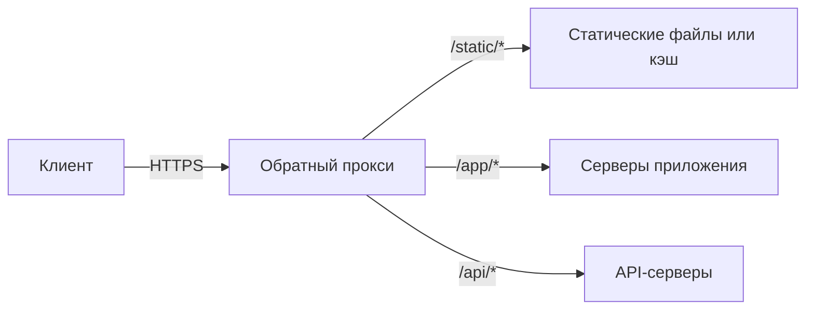
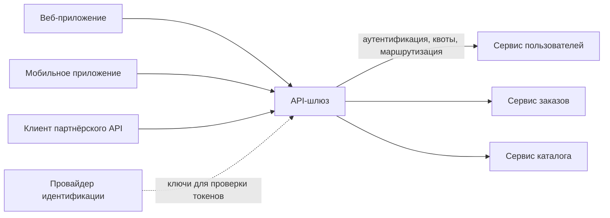

import { Aside } from '@astrojs/starlight/components';

Обратный прокси — это сервер, который клиенты принимают за само приложение. Он получает их запросы, пересылает каждый на внутренний сервер и возвращает ответ как свой. Положение у входной двери делает его естественным местом для TLS, кэширования, сжатия, фильтрации угроз и маршрутизации. API-шлюз — это обратный прокси, специализированный для API: он добавляет идентификацию, квоты и маршрутизацию на уровне API для множества бэкенд-сервисов.

<Aside type="tip" title="Коротко">
- Обратный прокси скрывает и защищает бэкенды, завершает TLS, сжимает, кэширует и отдаёт статику. Он полезен даже перед единственным сервером.
- Балансировщик нагрузки — это обратный прокси, главная задача которого — распределять трафик по многим одинаковым серверам. На практике обе роли выполняет одно и то же ПО (NGINX, HAProxy, Envoy).
- API-шлюз берёт на себя сквозные задачи API: аутентификацию, ограничение частоты запросов, маршрутизацию к сервисам, версионирование, иногда агрегацию. Backend-for-frontend (BFF) — шлюз, которым владеет команда одного клиента.
- Держите бизнес-логику вне шлюза. «Божественный шлюз» (god gateway) становится узким местом для деплоев и единой точкой отказа.
</Aside>

## Прямой и обратный прокси

**Прямой прокси** (forward proxy) действует от имени *клиентов*: например, корпоративный прокси на выходе, который решает, на какие сайты могут ходить сотрудники. **Обратный прокси** действует от имени *серверов*: клиенты обращаются к нему по публичному адресу, а он выбирает, какой внутренний сервер обработает запрос.

## Что даёт обратный прокси

- **Безопасность и изоляция.** Бэкенды получают приватные адреса и недоступны напрямую. Прокси может скрывать баннеры серверов, ограничивать размер запросов и заголовков, блокировать IP, ограничивать число соединений с одного клиента и гасить атаки медленными клиентами (slowloris), буферизуя запросы перед отправкой дальше. Обычно здесь же работает межсетевой экран веб-приложений (WAF).
- **Гибкость.** Клиенты видят только прокси. Бэкенды можно добавлять, заменять, переносить, переводить на другую платформу или делить одно приложение на несколько, не меняя ни DNS-записей, ни клиентов.
- **Завершение TLS.** Сертификаты лежат в одном месте и могут обновляться автоматически: Caddy, например, получает и продлевает сертификаты через ACME без всякой настройки. Бэкенды получают обычный HTTP в доверенной сети или заново зашифрованный трафик, если этого требует политика.
- **Сжатие.** gzip, Brotli или zstd для клиентов, которые их принимают, без нагрузки на код приложения.
- **Кэширование.** Ответы на повторяющиеся запросы сохраняются и отдаются, не трогая приложение (NGINX `proxy_cache`, Varnish). Идея та же, что у [CDN](/traffic/cdn/), только в вашем дата-центре.
- **Статика.** HTML, CSS, JS, изображения и видео отдаются прямо с диска или из объектного хранилища, а серверы приложений заняты только динамикой.
- **Трансляция протоколов.** Принимать HTTP/2 и HTTP/3 из интернета и говорить с бэкендами по HTTP/1.1 или gRPC. Переводить соединения на WebSocket.
- **Управление соединениями.** Множество коротких клиентских соединений превращается в несколько долгоживущих переиспользуемых соединений к бэкендам, и медленные мобильные клиенты больше не занимают рабочие процессы приложения.

Передавайте исходные сведения о клиенте дальше в заголовках `X-Forwarded-For` / `X-Forwarded-Proto` или в стандартном заголовке `Forwarded` (RFC 7239). Бэкенды должны доверять этим заголовкам, только если они пришли от прокси.

## Балансировщик нагрузки и обратный прокси

| | Обратный прокси | Балансировщик нагрузки |
|---|---|---|
| Главная цель | Единая контролируемая входная дверь с дополнительными функциями | Распределить нагрузку и пережить отказы бэкендов |
| Полезен при одном бэкенде | Да: TLS, кэширование, сжатие, безопасность | Не особенно |
| Уровень | L7 (понимает HTTP) | L4 или L7 |
| Типичные дополнения | Кэширование, статика, переписывание URL, WAF | Проверки здоровья, алгоритмы балансировки, дренирование |

Различие — в роли, а не в продукте. NGINX, HAProxy, Envoy, Caddy и Traefik умеют проксировать, балансировать и завершать TLS, а облачные «балансировщики приложений» — это управляемые L7-обратные прокси. На схеме подписывайте прямоугольник по тому, что он делает для системы. См. [балансировщики нагрузки](/traffic/load-balancers/).

## API-шлюз

Когда бэкенд-сервисов много, каждому нужны одни и те же функции на входе: проверить токен, применить квоты, записать вызов в лог, направить `/v2/orders` куда нужно. **API-шлюз** делает это один раз, на границе всего набора сервисов.

Типичные обязанности:

- **Аутентификация и грубая авторизация.** Проверка токенов доступа OAuth 2.0 / OIDC или API-ключей и передача сервисам проверенной идентичности — например, в виде подписанного внутреннего токена или доверенных заголовков. Тонкие проверки вида «может ли этот пользователь изменить этот заказ?» остаются в сервисе, которому принадлежит заказ.
- **Ограничение частоты запросов и квоты.** По API-ключу, пользователю, IP или тарифу, обычно на основе «ведра с токенами» (token bucket) в общем хранилище. См. [ограничение частоты запросов](/reliability/rate-limiting/).
- **Маршрутизация и версионирование.** Сопоставление публичных путей и версий с внутренними сервисами, перевод доли трафика на новую версию, сокрытие внутренних имён сервисов.
- **Преобразование запросов и ответов.** Добавление заголовков, трансляция протоколов (REST в gRPC), адаптация ответов для старых клиентов.
- **Агрегация запросов.** Один клиентский вызов разветвляется на несколько сервисов, и результаты объединяются, — мобильным клиентам на медленных сетях не приходится делать много обращений.
- **Наблюдаемость и монетизация.** Единое место для журналов доступа, метрик по потребителям, заголовков трассировки, порталов для разработчиков и тарификации использования.

### Backend for frontend (BFF)

Один шлюз для веба, iOS, Android и партнёров превращается в компромисс, который никого не устраивает, а все клиентские команды ждут команду шлюза. Паттерн **backend-for-frontend**, описанный Сэмом Ньюманом, даёт каждому пользовательскому интерфейсу собственный тонкий слой API, которым владеет команда этого клиента. BFF агрегирует и формирует данные ровно под нужды своих экранов. Общий периферийный шлюз при этом может по-прежнему отвечать за TLS, аутентификацию и глобальные лимиты перед BFF. Роль BFF часто играют GraphQL-серверы. См. [стили API](/communication/api-styles/).

## Когда шлюз становится проблемой

- **«Божественный шлюз».** В плагины и скрипты шлюза постепенно проникают бизнес-правила, оркестрация и объединение данных. Теперь любое изменение функциональности требует деплоя шлюза, которым владеет центральная команда, логику трудно тестировать, а шлюз знает предметные области всех команд. Thoughtworks много лет назад предостерегал от таких «чрезмерно амбициозных API-шлюзов» (overambitious API gateways), и предостережение актуально. Оставьте шлюзу сквозные задачи, а предметная логика пусть живёт в сервисах или BFF.
- **Узкое место и радиус поражения.** Через шлюз идёт весь трафик. Неудачная выкладка конфигурации, просроченный сертификат или медленный плагин аутентификации кладут сразу все API. Запускайте шлюз горизонтально масштабируемым парком в нескольких зонах, выкатывайте конфигурацию постепенно и держите плагины на горячем пути дешёвыми.
- **Добавленная задержка.** Каждый переход добавляет задержку, а удалённые вызовы из шлюза (интроспекция токенов, центральное хранилище лимитов) — ещё больше. Предпочитайте локальную проверку подписи JWT с кэшированными ключами и локальные счётчики лимитов с периодической синхронизацией.
- **Ловушки агрегации.** Разветвление умножает хвостовую задержку: время ответа задаёт самый медленный из пяти вызовов. Используйте тайм-ауты, частичные ответы и [паттерны устойчивости](/reliability/resilience-patterns/).

## Недостатки в целом

- Ещё один уровень, который нужно разворачивать, настраивать, мониторить и защищать, а его конфигурация — это код, требующий ревью и тестов.
- Один экземпляр прокси или шлюза — единая точка отказа. Несколько экземпляров за балансировщиком или anycast решают проблему, но добавляют сложности.
- Для отладки нужны идентификаторы корреляции и трассировка через лишний переход, иначе ошибки 502 и 504 превращаются в гадание.

## Примеры

- **Обратные прокси / L7-балансировщики**: NGINX, HAProxy, Envoy, Caddy, Traefik, Varnish (кэширование). Управляемые: AWS ALB, Application Load Balancer в Google Cloud, Azure Application Gateway и Front Door.
- **Самостоятельно разворачиваемые API-шлюзы**: Kong Gateway, Apache APISIX, Tyk, KrakenD, Envoy Gateway. Большинство решений для Kubernetes теперь реализуют **Kubernetes Gateway API** (`Gateway`, `HTTPRoute`, `GRPCRoute`) — преемника Ingress API.
- **Управляемые API-шлюзы**: Amazon API Gateway, Azure API Management, Google Cloud Apigee и API Gateway.
- **AI-шлюзы**: более новая разновидность для трафика к LLM-провайдерам (Kong AI Gateway, Cloudflare AI Gateway, Envoy AI Gateway). Роль на границе та же, но квоты считают токены и стоимость, а не запросы, а типичные функции — переключение между провайдерами, кэширование ответов и учёт использования.

## Компромиссы

| Вариант | Хорош для | Цена |
|---|---|---|
| Простой обратный прокси | TLS, кэширование, статика, простая маршрутизация | Нет идентификации и квот на уровне API |
| Центральный API-шлюз | Единые аутентификация, квоты, маршрутизация и аналитика для многих сервисов | Узкое место и радиус поражения; риск «божественной» логики |
| BFF для каждого клиента | API под конкретный клиент, автономия команд, меньше обращений | Больше сервисов в эксплуатации; часть логики дублируется |
| Управляемый шлюз | Не нужно эксплуатировать, встроенные портал и аналитика | Оплата за запросы, ограничения поставщика, лишняя задержка |

<Aside type="note" title="На собеседовании">
Рисуйте периметр явно: CDN, затем балансировщик или обратный прокси, затем шлюз (если сервисов много), затем сервисы. Объясняйте, что делает каждый уровень, и не рисуйте прямоугольники без назначения. Интервьюеры спрашивают: «Где проверяется токен?», «Где вы ограничиваете частоту запросов и как счётчик разделяется между узлами шлюза?», «Что будет, если шлюз упадёт?», «Почему бы не поместить эту агрегацию в шлюз?» Зрелый ответ держит шлюз тонким, использует BFF для подгонки под клиентов и оставляет тонкую авторизацию сервисам.
</Aside>

## Что почитать

- [NGINX: reverse proxy guide](https://docs.nginx.com/nginx/admin-guide/web-server/reverse-proxy/) — практическая настройка проксирования, заголовков и буферизации.
- [Pattern: API Gateway / Backends for Frontends](https://microservices.io/patterns/apigateway.html) — описание паттерна и его недостатков от Криса Ричардсона.
- [Backends For Frontends](https://samnewman.io/patterns/architectural/bff/) — исходное описание BFF от Сэма Ньюмана.
- [Overambitious API gateways](https://www.thoughtworks.com/radar/platforms/overambitious-api-gateways) — предостережение Thoughtworks Radar против логики в шлюзах.
- [Kubernetes Gateway API](https://gateway-api.sigs.k8s.io/docs/) — стандартный API маршрутизации для шлюзов и service mesh.
- [What is Envoy](https://www.envoyproxy.io/docs/envoy/latest/intro/what_is_envoy) — прокси, на котором построены многие шлюзы и service mesh.

## Связанные темы

- [Балансировщики нагрузки](/traffic/load-balancers/) — алгоритмы, проверки здоровья и резервирование того же уровня.
- [CDN](/traffic/cdn/) — кэширующий обратный прокси, распределённый по всему миру.
- [Ограничение частоты запросов](/reliability/rate-limiting/) — алгоритмы, на которых строятся квоты шлюза.
- [Безопасность](/reliability/security/) — TLS, аутентификация и WAF на периметре.
- [Монолит, модульный монолит и микросервисы](/architecture/monolith-and-microservices/) — почему шлюз появляется, когда сервисов становится много.
