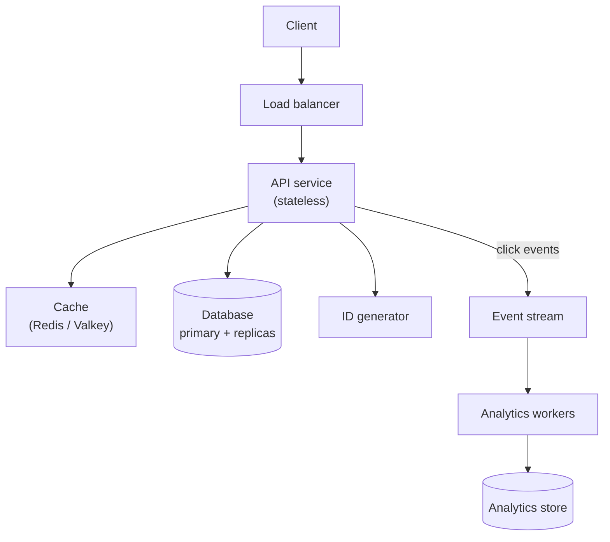

import { Aside, Steps } from '@astrojs/starlight/components';

A system design interview is an open-ended conversation that you are expected to lead. The interviewer gives a one-line prompt ("design a URL shortener", "design a news feed") and watches how you turn it into a working design within the time you have. A fixed sequence of steps keeps you from running out of time before the interesting part, and frees your attention for the problem itself.

<Aside type="tip" title="TL;DR">
- Spend the first 5–10 minutes on requirements and numbers. Many failed interviews go wrong here.
- Draw the simplest design that meets the functional requirements, then make it meet the non-functional ones.
- Go deep on one or two components; you cannot go deep on everything.
- Name the trade-off behind every choice, and the failure mode of every component.
- Keep an eye on the clock and check in with the interviewer between steps.
</Aside>

## The framework at a glance

This expands the classic four steps (use cases, high-level design, core components, scaling) into seven: estimates and the API get their own steps, scaling also covers failures, and a wrap-up closes the interview. The [case studies](/practice/url-shortener-pastebin/) keep the four classic headings, and the seven steps sit inside them: Step 1 holds the requirements and estimates, Step 2 the high-level design, Step 3 the API, data model and deep dives, and Step 4 scaling and failures.

<Steps>

1. **Clarify requirements.** Agree on what the system must do, how well, and at what scale.

2. **Estimate.** Turn the scale into requests per second, storage and bandwidth. Let the numbers drive later choices.

3. **Define the API and data model.** Fix the contract and the core entities before drawing boxes.

4. **Sketch the high-level design.** Walk each main request path end to end with the fewest components that work.

5. **Deep-dive into one or two components.** Pick where the hard problems are, or follow the interviewer's lead.

6. **Scale it and break it.** Find bottlenecks and single points of failure, fix them, and state the trade-offs.

7. **Wrap up.** Summarise against the requirements, name the weak spots and what you would do next.

</Steps>

## Time budget

A 45-minute slot usually leaves about 40 minutes for the design once introductions and your own questions at the end are taken out; a 60-minute slot leaves about 55. Treat these as targets, not rules: if the interviewer pulls you into a deep dive early, follow, and compress something else.

| Step | 45-minute interview | 60-minute interview |
|---|---|---|
| 1. Clarify requirements | 4 min | 6 min |
| 2. Estimate | 3 min | 4 min |
| 3. API and data model | 4 min | 6 min |
| 4. High-level design | 10 min | 12 min |
| 5. Deep dives | 11 min | 17 min |
| 6. Scale, failures, trade-offs | 6 min | 7 min |
| 7. Wrap-up | 2 min | 3 min |
| **Design time in total** | **40 min** | **55 min** |

A useful checkpoint: by the halfway mark you should have a complete high-level design on the board. If you are still on requirements at minute 15, say so and move on with stated assumptions.

## Step 1 — Clarify requirements

The prompt is deliberately vague. Your first job is to turn it into a problem small enough to solve in the time, and to show that you would not start building before understanding what is needed.

Split what you learn into two lists and write both down where the interviewer can see them:

| Functional requirements | Non-functional requirements |
|---|---|
| What the system does: the use cases | How well it does it: the qualities |
| "Users can create a short link" | "Redirects take under 50 ms at p99" |
| "Users can see click counts" | "99.99% availability for redirects" |
| "Links can expire" | "No lost links once created (durability)" |

Agree on three to five core use cases and explicitly park the rest ("analytics dashboards are out of scope unless you want them"). For non-functional requirements, prefer numbers to adjectives: "fast" is not a requirement, "p99 under 200 ms" is.

### Questions to ask

- **Users and use cases.** Who uses it, and for what? Which two or three flows matter most?
- **Scale.** How many daily active users? Requests per second, average and peak? How fast is it growing?
- **Read/write ratio.** Is it read-heavy (feeds, URL redirects) or write-heavy (logging, telemetry)?
- **Data.** What is stored, how big is each item, and how long is it kept?
- **Latency.** Which operations are user-facing and what is the target at p99?
- **Availability and consistency.** Can users see stale data for a few seconds? What happens if a write is lost?
- **Geography.** One region or global? Any data residency rules?
- **Clients.** Web, mobile, other services, public API?
- **Constraints.** Existing infrastructure, a cloud provider, budget, team size, compliance (payments, health data, personal data)?

If the interviewer says "you decide", decide out loud, state the assumption and keep going.

## Step 2 — Back-of-the-envelope estimates

Estimates exist to inform decisions, not to show off arithmetic. Two or three minutes are enough to answer: does the data fit on one machine, does the traffic fit on one database, and is bandwidth a concern? The method and the reference numbers are on the [estimation](/start/estimation/) page.

A worked example for a URL shortener with 100 million new links a month and a 10:1 read/write ratio:

| Quantity | Calculation | Result |
|---|---|---|
| Writes per second | 100 M / (30 × 86,400 s) | ≈ 40/s |
| Reads per second | 40 × 10 | ≈ 400/s average, ≈ 1,200/s at a 3× peak |
| Storage per year | 100 M × 12 × 500 bytes | ≈ 0.6 TB |
| Storage over 5 years | 0.6 TB × 5 | ≈ 3 TB |

Then say what the numbers mean: write traffic is tiny, a few terabytes fit comfortably in one database with replicas, and the read path is where caching pays off. That sentence matters more than the table.

## Step 3 — API and data model

Define the contract before the components. It forces precision about inputs and outputs and gives you names to use for the rest of the interview.

```http title="API sketch"
POST /v1/links
  body: { "url": "https://example.com/very/long/path", "expires_at": null }
  201:  { "code": "aZ3kP9q", "short_url": "https://sho.rt/aZ3kP9q" }

GET /{code}
  302 Location: https://example.com/very/long/path
```

A few details that interviewers notice: version the API, use cursor pagination for lists, accept an idempotency key on writes that clients may retry, and say which calls are public and which are internal. REST over HTTP is the safe default for public APIs; gRPC is common between internal services (see [RPC and REST](/communication/rpc-and-rest/)).

For the data model, list the core entities, their key fields and, above all, the **access patterns**: which queries run, how often, and by what key. The choice between a relational and a NoSQL store follows from those patterns, not from fashion (see [SQL or NoSQL](/data/sql-or-nosql/)).

```sql title="Core table"
CREATE TABLE links (
  code        VARCHAR(10) PRIMARY KEY,   -- lookup key for every redirect
  long_url    TEXT        NOT NULL,
  owner_id    BIGINT,
  created_at  TIMESTAMPTZ NOT NULL,
  expires_at  TIMESTAMPTZ
);
```

## Step 4 — High-level design

Draw the simplest system that satisfies the functional requirements, then walk each main request path out loud, end to end. Add a component only when you can say what it is for.



For this example the walkthrough would be:

- **Write path.** The API service gets a unique code from the ID generator, stores the row in the database and returns the short URL.
- **Read path.** The API service looks up the code in the cache, falls back to a database replica on a miss, and returns a redirect.
- **Analytics.** Each redirect emits an event to a stream; workers aggregate counts asynchronously so the hot read path never waits for analytics.

Check in once the diagram is complete: "This covers the core use cases. Shall I go deeper into ID generation or into the read path at scale?"

## Step 5 — Deep dives

The deep dive is where you show depth. Pick one or two components where the requirements are hardest to meet, propose them, and let the interviewer choose. Typical candidates:

- **A uniqueness or ordering problem**: generating short codes without collisions, ordering messages in a chat.
- **A hot path under extreme load**: the redirect lookup, a celebrity's post fanning out to millions of feeds.
- **A consistency problem**: counters, inventory, payments, anything where "eventually" is not good enough.
- **A data-growth problem**: how and when to [partition](/data/partitioning-and-sharding/), what to archive.

For each, lay out two or three options, compare them on the requirements you wrote down, pick one and say what you give up. For example, short codes can come from hashing the URL (simple, but collisions need handling), a counter encoded in base 62 (no collisions, but the counter must be distributed), or pre-generated random keys (fast, but needs a key service). Concrete numbers and failure scenarios make a deep dive convincing.

## Step 6 — Scale, bottlenecks, failure modes and trade-offs

Now stress the design. Go through it component by component and ask two questions: what breaks first at 10× the load, and what happens when this component fails?

- **Bottlenecks.** A single database for writes, a hot key or hot partition, a fan-out that multiplies writes, a synchronous call chain that adds up latency.
- **Fixes and their costs.** Read replicas (replication lag), caching (staleness and [invalidation](/caching/cache-strategies/)), sharding (cross-shard queries), queues (delayed results, retries), CDNs (purging).
- **Failure modes.** Single points of failure, a cache that fails cold and floods the database, retry storms, a slow dependency. Name the mitigations: replicas and failover, timeouts, retries with backoff and jitter, circuit breakers, [rate limiting](/reliability/rate-limiting/), graceful degradation (see [resilience patterns](/reliability/resilience-patterns/)).
- **Operations.** How you would know it is broken (metrics, SLOs and alerts; see [observability](/reliability/observability/)), how you would deploy safely, and what it costs to run.

Summarise the big trade-offs explicitly, for example: "Redirects read from replicas and cache, so a newly created link may take a second to resolve everywhere. That fits our requirements; payments would not tolerate it."

## Step 7 — Wrap-up

Use the last minutes to land the design rather than to add one more box:

- Restate the design in three or four sentences against the requirements from step 1.
- Name the weakest points and what you would do next with more time (multi-region, abuse protection, cost).
- Leave room for the interviewer's last questions and for your own questions about the team and its systems.

## Signals interviewers look for

Expectations rise with the level you are interviewing for. Titles differ between companies, so read these as rough bands.

| Level | What a strong performance looks like |
|---|---|
| Mid-level | Drives the conversation with some help. Clarifies requirements, produces a working end-to-end design, uses standard components correctly, responds well to hints. |
| Senior | Drives the whole interview. Lets numbers justify choices, goes deep on the hardest component, raises bottlenecks and failure modes before being asked, compares alternatives with clear trade-offs. |
| Staff and above | Frames the problem and challenges the requirements where useful. Covers operations, cost, migration and rollout, multi-region and organisational concerns. Knows when not to build something and when a simpler design is enough. |

At every level interviewers also judge communication: thinking out loud, structuring the board, listening to hints and changing course without getting defensive.

<Aside type="note" title="In the interview">
- Typical follow-ups: "What happens if this component goes down?", "Traffic grows 100×: what breaks first?", "How would you make this multi-region?", "Why this database and not that one?", "How would you know it is working?"
- If you get stuck, say what you are weighing and pick a direction. Silence costs more than an imperfect choice.
</Aside>

## Common mistakes

- **Jumping to the diagram.** Drawing boxes before agreeing on requirements and scale, then designing the wrong system.
- **Over-engineering.** Starting with microservices, Kafka and five databases for a problem that fits on one server. Start simple and add complexity when a requirement demands it.
- **Buzzword architecture.** Naming technologies without explaining what they do here and what they cost.
- **Estimates that go nowhere.** Spending five minutes on arithmetic and never using the result.
- **No trade-offs.** Presenting every choice as obviously right. Every choice has a cost; say it.
- **Ignoring failures.** A design with no answer to "what if this node dies?" is incomplete.
- **Going deep too early.** Spending 20 minutes on one component and never finishing the end-to-end design.
- **Monologue.** Not checking in with the interviewer, missing hints, or defending a choice they are clearly steering you away from.
- **Losing track of time.** Reaching minute 40 with no scaling discussion and no wrap-up.

## One-screen checklist

Copy this, print it, or keep it next to you while you practise.

```text title="system-design-checklist.txt"
1. REQUIREMENTS (≈10%)
   [ ] 3–5 core use cases agreed; out-of-scope list written down
   [ ] Scale: DAU, QPS (avg/peak), read:write, data size, growth
   [ ] Latency target (p99), availability, consistency, durability
   [ ] Geography, clients, constraints (compliance, cost)
2. ESTIMATES (≈7%)
   [ ] QPS, storage, bandwidth, cache size
   [ ] One sentence on what the numbers imply
3. API + DATA MODEL (≈10%)
   [ ] Main endpoints with request/response
   [ ] Entities, keys, access patterns -> choice of store
4. HIGH-LEVEL DESIGN (≈25%)
   [ ] Simplest design covering all use cases
   [ ] Walk write path and read path end to end
   [ ] Check in: "Where should we go deeper?"
5. DEEP DIVES (≈28%)
   [ ] 1–2 hardest components, 2–3 options each
   [ ] Pick one, state what you give up
6. SCALE + FAILURES (≈15%)
   [ ] What breaks first at 10x? Hot keys, fan-out, single DB
   [ ] SPOFs, failover, timeouts, retries, back pressure
   [ ] Monitoring, SLOs, deploys, cost
7. WRAP-UP (≈5%)
   [ ] Recap vs requirements, weak spots, next steps
ALWAYS: think aloud · numbers over adjectives · name the trade-off
```

## Further reading

- [The system design process](https://www.hiredintech.com/system-design/the-system-design-process/) (HiredInTech): a short, classic description of the process, credited by the original primer.
- [My System Design Template](https://leetcode.com/discuss/career/229177/My-System-Design-Template) (LeetCode Discuss): a widely shared step-by-step template, also linked from the original.
- [System Design Delivery Framework](https://www.hellointerview.com/learn/system-design/in-a-hurry/delivery) (Hello Interview): a current framework with per-step time targets.
- [A Senior Engineer's Guide to the System Design Interview](https://interviewing.io/guides/system-design-interview) (interviewing.io): what interviewers look for and how to communicate like a tech lead.
- [Non-Abstract Large System Design](https://sre.google/workbook/non-abstract-design/) (Google SRE Workbook): how Google engineers size a design from requirements, with a worked example.

## Related topics

- [Back-of-the-envelope estimation](/start/estimation/): the method behind step 2.
- [Study plan](/start/study-plan/): how much to read before you start practising.
- [URL shortener and Pastebin](/practice/url-shortener-pastebin/): the same problem designed end to end, with its own assumptions.
- [Latency numbers](/reference/latency-numbers/): numbers you will use in every estimate.
