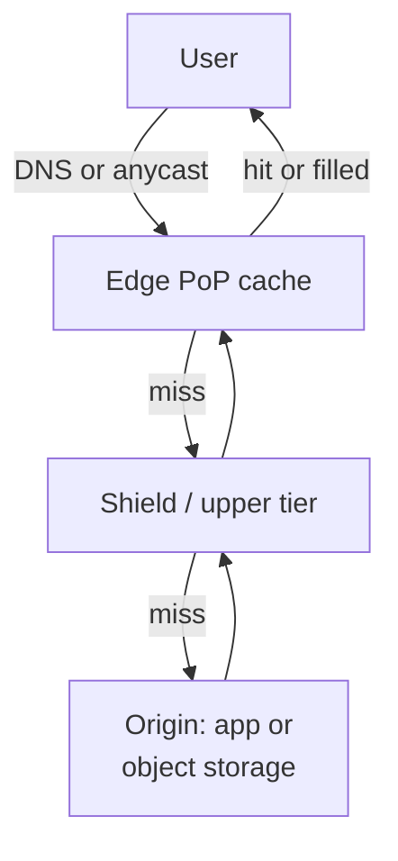

import { Aside } from '@astrojs/starlight/components';

A content delivery network is a fleet of caching reverse proxies spread over hundreds of points of presence (PoPs) worldwide. Users talk to a nearby PoP instead of crossing an ocean to your origin, and the origin only sees the requests the edge could not answer. For most consumer products the CDN serves the bulk of the bytes, so its cache rules shape both latency and the size of the origin fleet.

<Aside type="tip" title="TL;DR">
- A CDN cuts latency (short round trips, TLS ends near the user) and offloads the origin. Every point of hit ratio matters: going from 95% to 99% cuts origin traffic five-fold.
- Pull CDNs fetch on the first miss and suit almost everything. Push CDNs need an explicit upload and suit large, rarely changing files.
- You control caching with `Cache-Control` (`max-age`, `s-maxage`, `stale-while-revalidate`), the cache key, and purge APIs. Prefer versioned URLs over purges.
- An origin shield (tiered cache) collapses misses from all PoPs into one request to the origin.
- Modern CDNs also run code at the edge, sign URLs, filter attacks and accelerate uncacheable traffic. Big sites often run two CDNs because CDNs fail too.
</Aside>

## How a request flows



1. DNS (often a CNAME to the CDN's hostname) or an anycast IP brings the user to a nearby PoP. See [DNS](/traffic/dns/).
2. The PoP builds a **cache key** from the request and looks it up.
3. On a hit, it answers immediately, often in a few milliseconds.
4. On a miss, it asks an upper tier or the origin, stores the response if the headers allow it, and answers.

Even uncacheable requests benefit: TLS and TCP handshakes complete over a short round trip to the PoP, and the PoP reuses warm, long-lived connections to the origin.

## Push vs pull

| | Pull CDN | Push CDN |
|---|---|---|
| How content gets there | The edge fetches from the origin on the first request | You upload content to the CDN's storage ahead of time |
| First request | Slower: it is a cache miss | Fast: content is already there |
| Freshness | Controlled by TTLs and purges | Controlled by you: upload a new version, delete the old one |
| Storage | Only what users actually request stays cached | Everything you upload, whether requested or not |
| Origin traffic | Re-fetches when TTLs expire, even if nothing changed (revalidation keeps this cheap) | Only when you upload |
| Operational work | Set headers once | Build and run an upload pipeline, rewrite URLs to the CDN host |
| Best for | Busy sites, large or long-tail catalogues, APIs | Large files with predictable demand (installers, game patches, video packages) and small sites that rarely change |

Today the line is blurry. A typical setup is a pull CDN in front of **object storage**: the build pipeline uploads fingerprinted assets to a bucket (a "push" into storage), and the CDN pulls from the bucket on demand. See [object storage](/data/object-storage/).

## Cache keys and headers

The **cache key** decides which requests share a stored response. By default it is roughly the scheme, host, path and query string. Tuning it is the biggest lever on hit ratio:

- **Normalise** the key: drop tracking parameters (`utm_*`), sort the query string, lowercase the host.
- **Add only what changes the response**: for example `Accept-Encoding` or a device class. Every extra dimension splits the cache. `Vary: User-Agent` can destroy the hit ratio.
- **Never cache personalised responses by accident.** A response that sets a cookie or depends on `Authorization` must be `private` or excluded from caching. Caching a logged-in page under a shared key leaks one user's data to others.

The origin's response headers say how long a response stays fresh (RFC 9111):

```http
# Fingerprinted static asset (app.3f9c2b.js): cache for a year, never revalidate
Cache-Control: public, max-age=31536000, immutable

# HTML or API response: browsers revalidate, the CDN keeps it 60 s
# and may serve it stale for 5 more minutes while refreshing in the background
Cache-Control: public, max-age=0, s-maxage=60, stale-while-revalidate=300, stale-if-error=86400

# Per-user data: shared caches must not store it
Cache-Control: private, no-store
```

- `max-age` applies to every cache. `s-maxage` overrides it for shared caches such as CDNs.
- `stale-while-revalidate` lets the cache answer instantly with the old copy while it fetches a new one. `stale-if-error` keeps serving the old copy when the origin returns 5xx errors (both from RFC 5861). Together they hide origin slowness and short outages.
- `CDN-Cache-Control` (RFC 9213) sets CDN-only rules without affecting browsers. Many CDNs also accept their own header, such as `Surrogate-Control`.
- `ETag` and `Last-Modified` let caches **revalidate** cheaply: the origin answers `304 Not Modified` with no body.

## Purging and invalidation

Content will change before its TTL runs out. Options, from best to worst:

1. **Versioned URLs.** Put a content hash in the file name (`app.3f9c2b.js`) and cache it forever. A deploy publishes new names, and old ones simply age out. No purge, no race conditions.
2. **Tag-based purge.** The origin labels responses with tags (Fastly *surrogate keys*, Cloudflare *cache tags*). One API call then invalidates every object tagged `product-123`, across all URLs that show that product.
3. **URL or prefix purge.** Precise but you must know every affected URL, including query-string variants.
4. **Purge everything.** A last resort: every PoP misses at once and the origin takes a stampede.

Purges are not free. Providers rate-limit them or bill per path, they take time to reach every PoP, and clients may still hold copies in browser caches. Some CDNs support a **soft purge** that marks objects stale instead of deleting them, so `stale-while-revalidate` and `stale-if-error` still apply.

## Origin shield and tiered caching

Without a shield, every PoP misses independently. With 300 PoPs and a 60-second TTL, one popular object can generate up to 5 origin requests per second. Add many objects and frequent deploys, and the origin sees a steady storm of misses.

An **origin shield** (CloudFront Origin Shield, Fastly shielding, Cloudflare Tiered Cache) puts one designated upper-tier location between the PoPs and the origin. PoPs miss to the shield, and the shield **collapses** concurrent requests for the same object into a single origin fetch. The example above drops to one origin request per object per 60 seconds. You pay for an extra hop on misses and sometimes an extra fee. In return you get a higher overall hit ratio, a calmer origin, and cheaper on-the-fly processing such as image resizing or video packaging.

## Protecting content: signed URLs and locked origins

- **Signed URLs** carry an expiry time and a signature (HMAC or public-key) that the edge verifies without calling the origin. They are used for paid downloads, private media and user uploads. **Signed cookies** do the same for a whole path, such as all segments of a video stream.
- **Lock the origin down.** If attackers can reach the bucket or load balancer directly, signed URLs and edge firewalls are pointless. Allow only the CDN: for example, CloudFront *origin access control* for S3, a shared secret header, mTLS between CDN and origin, or the provider's published IP ranges.
- The edge is also where **DDoS absorption, WAF rules and bot filtering** happen, because it is the only layer with enough capacity to soak up an attack.

## Accelerating dynamic content

Personalised pages and API calls can't be cached, but a CDN still helps:

- TLS and HTTP/3 end close to the user, so handshakes take a few milliseconds instead of a transatlantic round trip.
- PoPs keep warm, multiplexed connections to the origin, which avoids TCP slow start.
- Some providers route over their own backbone or pick the fastest path in real time (Cloudflare Argo Smart Routing, now part of Smart Shield; AWS Global Accelerator does something similar at layer 4).
- **Micro-caching**: caching a busy, non-personalised API response for 1–5 seconds can remove most origin load during a traffic spike, with no visible staleness.

## Edge compute

CDNs now run customer code at the PoP:

| Platform | Runtime model |
|---|---|
| Cloudflare Workers | V8 isolates. JavaScript, TypeScript, Python, Rust and other WebAssembly languages |
| Fastly Compute (formerly Compute@Edge) | WebAssembly modules, several languages |
| AWS CloudFront Functions | Lightweight JavaScript, viewer request and response only, sub-millisecond budget |
| AWS Lambda@Edge | Node.js and Python, can also run on origin request and response |
| Akamai EdgeWorkers | JavaScript |

Good uses: rewriting and redirecting URLs, normalising cache keys, checking a JWT or signed cookie before the request reaches the origin, A/B bucketing, geo-based rules, header security policies, image format negotiation.

Be careful with anything that needs the database. If your data lives in one region, a function at the edge that makes three queries to that region is *slower* than running next to the data. Edge compute pays off when the work is self-contained or uses edge-replicated data (key-value stores, read replicas near the PoP). It is also another deployment target to test, monitor and debug.

## Multi-CDN

CDNs are shared infrastructure, and their failures are global. On 8 June 2021, a bug triggered by a valid customer configuration made about 85% of Fastly's network return errors. On 18 November 2025, a bad configuration file took down large parts of Cloudflare's network for several hours. In January 2025 the shutdown of Edgio forced its customers, including users of Azure CDN from Edgio, to migrate within weeks.

Large sites therefore run two or more CDNs and steer between them, usually with weighted or performance-based DNS fed by real-user measurements. The cost is real: each CDN needs the same configuration, certificates, cache rules, purge hooks, logging and edge code. In practice you are limited to features both providers support. An origin shield in front of the origin helps keep two CDNs from doubling origin load.

## Costs and pitfalls

- **Pricing.** CDNs bill for egress per GB (cheaper per GB at high volume and varying by region), per request and for extras: shield, WAF, edge compute, logs. Compare this with what you would pay for egress and servers without a CDN. The CDN usually wins once traffic is global or bursty.
- **Hit ratio math.** At 10,000 requests per second, a 95% hit ratio sends 500 requests per second to the origin. At 99% it sends 100. Size the origin for the miss rate *after* a full purge or a cold cache, not the steady state.
- **Stale content.** The price of long TTLs. Use versioned URLs and tag purges rather than short TTLs everywhere.
- **URL rewriting.** Assets must point to the CDN host, or the whole site must sit behind the CDN. Mixed setups lead to missed assets, CORS errors and cookies sent to the wrong host.
- **Cache poisoning and leaks.** Headers the CDN does not include in the key, but the origin uses, can let an attacker store a malicious response for everyone. Audit which inputs affect the response.
- **Thundering herd at expiry.** Many PoPs miss at once when a hot object expires. Request collapsing, a shield and `stale-while-revalidate` prevent this.

## Trade-offs

| Benefit | Cost |
|---|---|
| Lower latency, especially for distant users | Another vendor, another bill, another outage source |
| Origin offload and smaller origin fleet | Staleness: you must design invalidation |
| DDoS and WAF protection at the edge | Debugging gets harder: which PoP served what, and why |
| Edge compute for cheap per-request logic | Vendor-specific runtimes and limits |

<Aside type="note" title="In the interview">
Put a CDN in front of static assets and media as a matter of course, and say how content gets there (usually pull from object storage) and how it is invalidated (versioned URLs, tag purges). Expect follow-ups: "How do you serve private files?" (signed URLs plus a locked origin), "What happens when you deploy?" (new fingerprinted names, no purge), "How do you protect the origin from a cache stampede?" (shield, request collapsing, stale-while-revalidate), and "Can you cache this API?" (only shared, non-personalised responses, with `s-maxage`). A common mistake is assuming the CDN makes the origin irrelevant: it still has to survive a cold cache.
</Aside>

## Further reading

- [RFC 9111: HTTP Caching](https://www.rfc-editor.org/rfc/rfc9111.html) — the rules every CDN cache follows.
- [MDN: Cache-Control](https://developer.mozilla.org/en-US/docs/Web/HTTP/Reference/Headers/Cache-Control) — readable reference with examples for each directive.
- [RFC 9213: Targeted HTTP Cache Control](https://www.rfc-editor.org/rfc/rfc9213.html) — `CDN-Cache-Control` and CDN-specific rules.
- [CloudFront Origin Shield](https://docs.aws.amazon.com/AmazonCloudFront/latest/DeveloperGuide/origin-shield.html) — when a shield helps and when it does not.
- [Fastly: Working with surrogate keys](https://www.fastly.com/documentation/guides/full-site-delivery/purging/working-with-surrogate-keys/) — tag-based purging in practice.
- [Summary of June 8 outage](https://www.fastly.com/blog/summary-of-june-8-outage) — why multi-CDN is worth considering.

## Related topics

- [DNS](/traffic/dns/) — how users are routed to the nearest PoP.
- [Caching layers](/caching/caching-layers/) — the CDN is the outermost cache in a stack of caches.
- [Cache strategies](/caching/cache-strategies/) — TTLs, invalidation and stampede protection in general.
- [Object storage](/data/object-storage/) — the usual origin for static assets and media.
- [HTTP](/communication/http/) — caching headers, HTTP/2 and HTTP/3 at the edge.
