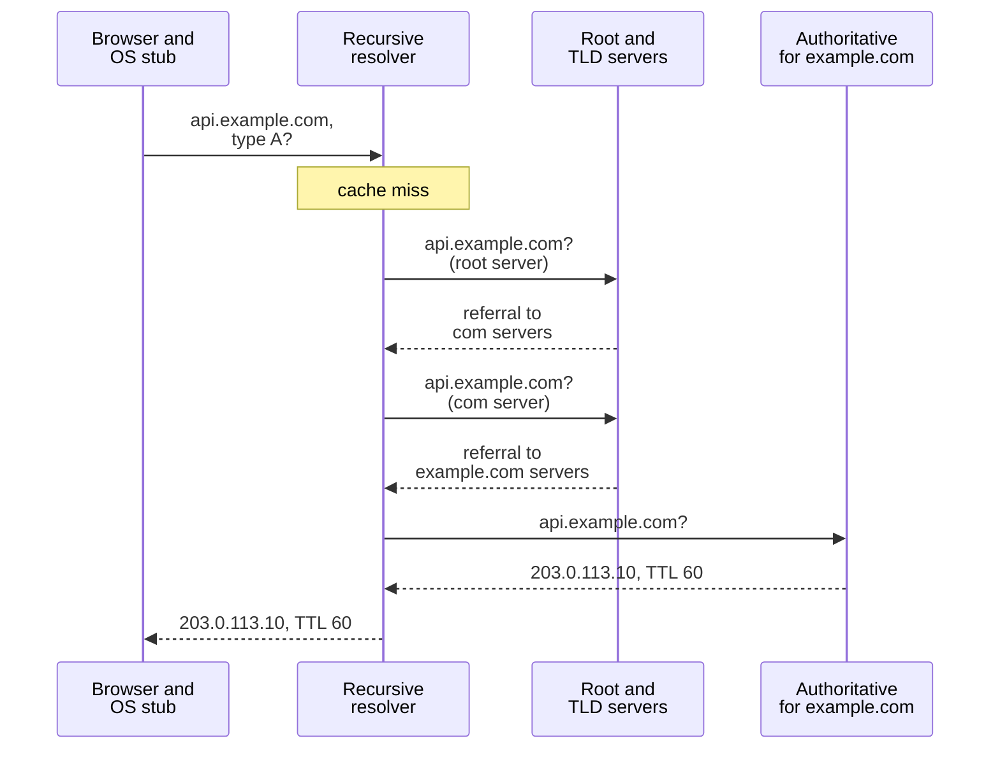
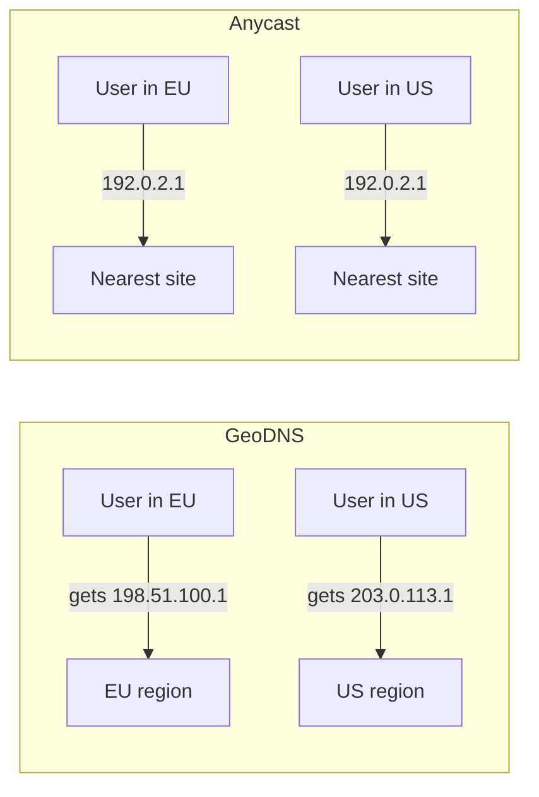

import { Aside } from '@astrojs/starlight/components';

The Domain Name System turns names such as `api.example.com` into the addresses and service details a client needs to connect. It is the first hop of nearly every request, a cheap global traffic-steering tool and, when it fails, a way to take a healthy system offline. A designer needs to know how lookups and caching work, which records exist, and how to keep DNS from becoming the weakest link.

<Aside type="tip" title="TL;DR">
- A lookup goes stub resolver → recursive resolver → root → TLD → authoritative server. Caches at every layer make most lookups a single local hop.
- The TTL is a dial between agility and load: short TTLs let you move traffic quickly but raise query volume and latency on cache misses.
- Managed DNS can steer traffic by weight, latency, geography or health, but only at the granularity of resolvers and TTLs. It is coarse and slow next to a load balancer.
- Anycast announces one IP from many sites and lets BGP pick the nearest. GeoDNS hands out different IPs per region. Large providers combine both.
- Treat DNS as critical infrastructure: use two independent authoritative providers, manage zones as code, and keep a recovery path that does not depend on your own DNS.
</Aside>

## How a name gets resolved

Four kinds of servers take part in a lookup:

- **Stub resolver**: a small library in the OS. It asks one configured resolver and caches the answer.
- **Recursive resolver**: run by the ISP, the corporate network, the cloud VPC, or a public service such as 1.1.1.1 or 8.8.8.8. It does the legwork and caches aggressively.
- **Root and TLD servers**: they do not know the answer. They refer the resolver to the servers for `.com`, then to the servers for `example.com`. The root zone is served by 13 named server identities (A to M) run by 12 operators, backed by more than 2,000 anycast instances.
- **Authoritative server**: holds the zone and gives the final answer.

The stub sends one *recursive* query. The resolver then makes *iterative* queries, following each referral itself. Root and TLD referrals carry long TTLs (often days), so in practice a warm resolver goes straight to the authoritative server. A cold lookup can cost several round trips, which is one reason browsers prefetch DNS for links on a page.

## Caching and TTL

Every answer carries a **time to live** set by the zone owner. Browsers, operating systems and resolvers count it down and reuse the answer until it expires. "DNS propagation" is just old cached answers expiring.

| | Short TTL (30–60 s) | Long TTL (1 h – 1 day) |
|---|---|---|
| Moving traffic or failing over | Fast | Slow: old answers live for up to one TTL |
| Query volume to authoritative servers | High: up to 60 queries per hour per resolver at 60 s | Low: one per hour at 3,600 s |
| Lookup latency seen by users | More cache misses | Almost always cached |
| Exposure if the provider is down | Caches empty quickly | Caches keep answering for a while |

Practical rules:

- **Before a migration**, lower the TTL, wait for at least one *old* TTL to pass, make the change, then raise the TTL again.
- **Negative answers are cached too.** An "NXDOMAIN" response is cached for the smaller of the SOA record's TTL and its MINIMUM field (RFC 2308). If you query a name before creating it, the "does not exist" answer can stick around.
- **Not every client honours TTLs.** Some resolvers clamp very small values. Long-lived processes, such as JVMs with a DNS cache and connection pools that never re-resolve, may hold an address for hours. Don't design for DNS failover faster than about a minute.

## Record types you will meet

| Record | Purpose | Notes |
|---|---|---|
| `A` / `AAAA` | Name → IPv4 / IPv6 address | Several records give crude client-side spreading |
| `CNAME` | Name → another name | Cannot share a name with other records, so it cannot sit at the zone apex (`example.com`) |
| `MX` | Mail servers for the domain, with priorities | Lower value is tried first |
| `NS` | Which servers are authoritative for a zone or delegated subzone | Must match the delegation at the parent (registry) |
| `TXT` | Free text | Domain ownership checks, SPF, DKIM, DMARC |
| `SRV` | Host and port for a service (`_sip._tcp`) | Used by some protocols and by Kubernetes for named ports |
| `CAA` | Which certificate authorities may issue certificates for the domain | Cheap protection against mis-issuance (RFC 8659) |
| `SOA` | Zone metadata: primary server, serial, negative-cache TTL | One per zone |
| `HTTPS` / `SVCB` | Endpoint, ALPN (for example `h3`) and other connection hints | RFC 9460 (2023); also allows aliasing at the apex |

**Alias / ANAME records.** People want `example.com` itself to point at a load balancer or CDN hostname, but a CNAME is not allowed at the apex. Providers solve this with non-standard records that the authoritative server resolves itself and answers with plain A/AAAA records: Route 53 *alias* records, Cloudflare *CNAME flattening*, and *ANAME* or *ALIAS* records at other providers. Route 53 also does not charge for alias queries to AWS resources. The standards-based fix is the `HTTPS` record, as clients add support for it.

## Steering traffic with DNS

A managed authoritative server does not have to return the same answer to everyone. Common routing policies:

- **Weighted.** Return endpoint A to 90% of queries and B to 10%. Uses: canary releases, draining a cluster before maintenance, splitting load across clusters of different sizes, A/B tests.
- **Latency-based.** Return the region with the lowest measured latency from the resolver's network.
- **Geolocation.** Choose by country or continent. Uses: data-residency rules, localised content, licensing.
- **Failover.** Return the primary while its health check passes, and the standby otherwise. Route 53, for example, probes from many locations and marks an endpoint unhealthy only when 18% or fewer of its checkers see it as healthy, so one isolated probe cannot trigger a failover.
- **Multivalue.** Return several healthy addresses and let the client pick and retry.

Two limits apply to all of them. First, the authoritative server sees the **resolver's** IP, not the user's. A user in Madrid behind a resolver in Frankfurt looks German. EDNS Client Subnet (RFC 7871) lets resolvers pass a truncated client prefix, but privacy-focused resolvers often leave it out. Second, a busy resolver caches one answer for all its users, so a 90/10 weight produces roughly 90/10 resolvers, not exactly 90/10 requests.

## GeoDNS vs anycast

| | GeoDNS | Anycast |
|---|---|---|
| Mechanism | Different answers per resolver location | One IP announced over BGP from many sites |
| Reaction to failure | One TTL plus client caching | Route withdrawal, usually seconds to a minute |
| Control | Fine-grained, per country or per weight | Coarse: BGP picks the "nearest" site by network path |
| DDoS absorption | Each region takes its own attack | Attack traffic is spread over all sites |
| Requirements | A managed DNS feature | Your own IP space and BGP, or a provider that has it |
| Typical users | Multi-region apps | Root servers, public resolvers, CDNs, global load balancers |

Anycast suits short UDP exchanges such as DNS. For TCP it works well as long as routes are stable, and large CDNs build their whole edge on it. Cloud products expose it as static anycast IPs: Google Cloud's global load balancers and AWS Global Accelerator are examples. Many providers combine both: anycast for the authoritative DNS servers themselves, and GeoDNS-style answers for the application.

## DNS as a single point of failure

On 21 October 2016 the managed DNS provider Dyn was hit by three waves of DDoS traffic from the Mirai botnet, made up of compromised cameras, routers and other IoT devices. Sites that used Dyn as their only DNS provider, including GitHub, Netflix, Spotify and PayPal, became unreachable for many users in North America and Europe. Their servers were healthy, but nobody could look up their addresses.

In October 2021 Facebook showed the opposite failure. A backbone outage made its own DNS servers withdraw their BGP routes by design. Every Facebook domain stopped resolving, and so did internal tools engineers needed to fix the problem.

In October 2025 the failure came from automation instead. A race condition in AWS's DNS management for DynamoDB left the `us-east-1` endpoint with an empty record for nearly three hours, and the outage spread to EC2, load balancers and many services that depend on DynamoDB.

Mitigations:

- **Two independent authoritative providers.** List both sets of `NS` records at the registrar and keep the zones identical, either through zone transfers (primary/secondary) or by pushing the same zone to both from code (octoDNS, Terraform). Proprietary routing policies rarely carry over between providers, so keep critical records simple or accept different behaviour on each side.
- **Keep DNS out of your own blast radius.** Don't host your only authoritative servers in the same network or region as the application they point to.
- **Break-glass access.** Make sure consoles, VPNs and runbooks are reachable when your own names do not resolve.
- **Monitor from outside.** Check resolution of key names from several networks, not only from inside your VPC.
- **Sensible TTLs.** Moderate TTLs (minutes, not seconds) let caches keep serving through a short provider outage.

## Encrypted DNS: DoT and DoH

Classic DNS travels in plaintext over UDP port 53, so anyone on the path can read or tamper with it. **DNS over TLS** (DoT, RFC 7858, 2016) wraps queries in TLS on port 853. **DNS over HTTPS** (DoH, RFC 8484, 2018) sends them as HTTPS requests on port 443, where they are hard to tell apart from web traffic. **DNS over QUIC** (RFC 9250, 2022) followed. Major browsers and operating systems support encrypted DNS. This protects only the hop from the client to its resolver, and it can bypass corporate split-horizon DNS and filtering, which matters in enterprise networks. The server name still leaks in the TLS handshake unless the site uses Encrypted Client Hello (RFC 9849, 2026), whose keys are published in the `HTTPS` record. Encryption gives privacy, not authenticity. DNSSEC addresses authenticity by signing records, and it is a separate decision.

## Managed DNS services

Typical choices are Amazon Route 53, Cloudflare DNS, Google Cloud DNS, Azure DNS (with Azure Traffic Manager for DNS-based routing), IBM NS1 Connect and Akamai Edge DNS. All of them offer anycast authoritative servers, an API and health-checked routing to some degree. Inside Kubernetes clusters, CoreDNS serves service names, which is covered in [service discovery](/architecture/service-discovery-and-mesh/).

## Trade-offs

| DNS-based steering gives you | It costs you |
|---|---|
| Global reach with no extra hop in the data path | Reaction time bounded by TTLs and misbehaving caches |
| Simple weighted or regional splits | Decisions based on the resolver's location, not the user's |
| Health-checked failover between regions | Coarse granularity: no per-request or per-path routing |
| A managed service with a strong SLA | A critical dependency that needs its own redundancy |

<Aside type="note" title="In the interview">
DNS usually comes up in the first minute ("the client resolves our domain…") and again during multi-region failover. Interviewers check whether you know that DNS changes are not instant (TTL, client caching), that DNS routing decides by resolver location, and that DNS is a dependency that can fail. A strong answer pairs DNS for coarse regional steering with load balancers or anycast for fast failover. Common follow-ups: "How fast can you fail over a region?", "Why not put a CNAME at the apex?", "What happens if your DNS provider goes down?"
</Aside>

## Further reading

- [What is DNS?](https://www.cloudflare.com/learning/dns/what-is-dns/) — Cloudflare's walk-through of resolvers, root, TLD and authoritative servers.
- [RFC 9499: DNS Terminology](https://www.rfc-editor.org/rfc/rfc9499.html) — precise definitions of the terms used above.
- [Route 53 routing policies](https://docs.aws.amazon.com/Route53/latest/DeveloperGuide/routing-policy.html) — a concrete catalogue of weighted, latency, geo and failover routing.
- [Load Balancing at the Frontend](https://sre.google/sre-book/load-balancing-frontend/) — Google SRE book on the limits of DNS load balancing and on spreading traffic behind a virtual IP.
- [DDoS attacks on Dyn](https://en.wikipedia.org/wiki/DDoS_attacks_on_Dyn) — timeline and impact of the 2016 outage.
- [More details about the October 4 outage](https://engineering.fb.com/2021/10/05/networking-traffic/outage-details/) — how Facebook's DNS disappeared from the internet.

## Related topics

- [Content delivery networks](/traffic/cdn/) — CDNs rely on DNS or anycast to send users to the nearest edge.
- [Load balancers](/traffic/load-balancers/) — the fast, fine-grained layer that DNS steers traffic towards.
- [Availability patterns](/fundamentals/availability-patterns/) — failover and redundancy, of which DNS failover is one form.
- [Service discovery and service mesh](/architecture/service-discovery-and-mesh/) — DNS inside the cluster.
