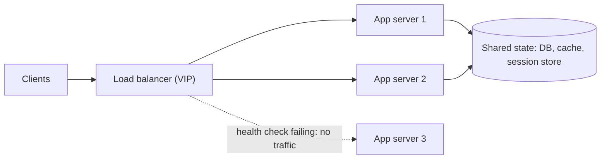

import { Aside } from '@astrojs/starlight/components';

A load balancer accepts traffic on one stable address and spreads it across a pool of interchangeable servers. It is what makes horizontal scaling and rolling deploys possible: servers can come and go, fail and recover, while clients keep using the same endpoint. Load balancers appear at every tier, from the internet edge down to calls between internal services and connections to database replicas.

<Aside type="tip" title="TL;DR">
- Three jobs: send traffic only to healthy servers, spread load evenly, and remove the single server as a point of failure.
- L4 balancers route TCP/UDP flows by address and port and are fast and protocol-agnostic. L7 balancers parse HTTP or gRPC and can route by path, header or cookie, terminate TLS and retry.
- Least-connections or power-of-two-choices beats round robin when request costs vary. Use consistent hashing when a key should keep landing on the same server.
- Keep app servers stateless (sessions in an external store) so any server can handle any request. Sticky sessions are a fallback, not a design.
- The balancer itself must be redundant (active-active or active-passive), and its health checks must not take the whole fleet down on a shared dependency failure.
</Aside>

## What a load balancer does

- **Health.** It probes each backend and stops sending traffic to those that fail, so a crashed or overloaded instance does not cause user-visible errors for long.
- **Load spreading.** It keeps any single server from being overloaded and lets you add capacity by adding servers.
- **No single server as SPOF.** Clients only know the balancer's address. Servers can be replaced, deployed one by one, or drained for maintenance.
- **Extras.** TLS termination, connection reuse to backends, request logging and metrics, rate limits, retries, gradual traffic shifting for canary releases.

Hardware appliances (F5, Citrix) still exist in data centres, but most traffic today goes through software: HAProxy, NGINX, Envoy, kernel-level balancers built on IPVS or eBPF/XDP (Facebook's Katran), and managed cloud balancers.

## Layer 4 vs layer 7

A **layer 4** balancer works on transport-level flows. It looks at IP addresses and ports, picks a backend once per connection, and forwards packets (with NAT, encapsulation, or direct server return) without reading the payload. A **layer 7** balancer terminates the client connection, parses the request, chooses a backend for each request, and opens or reuses its own connection to that backend.

| | Layer 4 (transport) | Layer 7 (application) |
|---|---|---|
| Sees | IPs, ports, protocol | Method, path, headers, cookies, gRPC service |
| Decision granularity | Per connection | Per request (many requests on one HTTP/2 connection can go to different backends) |
| Protocols | Any TCP or UDP | HTTP/1.1, HTTP/2, HTTP/3, gRPC, WebSocket |
| TLS | Passes through (or terminates as a TLS proxy) | Usually terminates and can re-encrypt |
| Features | Very high throughput, low latency, client IP preserved in passthrough mode | Path and host routing, header rewrites, retries, auth, compression, observability per request |
| Cost | Cheap per packet, little state | More CPU and memory per request |
| Examples | AWS NLB, Google Cloud passthrough NLB, IPVS, Katran, Maglev | AWS ALB, Google Cloud Application LB, HAProxy or NGINX in HTTP mode, Envoy |

Large platforms stack them: an anycast or L4 tier spreads packets across a fleet of L7 proxies, and the L7 tier does the smart routing. A common gotcha with L4: long-lived connections (HTTP/2, gRPC) pin all requests of a client to one backend, so new backends get no traffic until clients reconnect. L7 or client-side balancing fixes this.

## Balancing algorithms

| Algorithm | How it picks | Use when | Watch out for |
|---|---|---|---|
| Round robin | Next server in turn | Identical servers, uniform and short requests | Uneven load when request costs vary |
| Weighted round robin | Round robin, with more turns for bigger weights | Mixed instance sizes, canary at 5% | Weights are static unless something updates them |
| Least connections / least outstanding requests | Server with fewest active requests | Request durations vary a lot (uploads, slow queries, WebSockets) | Needs accurate counts; each balancer sees only its own traffic |
| Least response time | Lowest recent latency, often combined with active requests | Heterogeneous or noisy backends | Can pile onto a server that answers errors very fast |
| Random | Uniform random choice | Very many balancers, no shared state | Random clumping on small pools |
| Power of two choices (P2C) | Pick two at random, send to the less loaded one | Many independent balancers or client-side LB (Envoy's default least-request mode) | Slightly worse than true least-connections on a single balancer |
| IP or header hash | `hash(key) mod N` | Simple stickiness | Changing N remaps almost every key |
| Consistent hashing (ring hash, Maglev) | Key → point on a ring or lookup table | Cache locality, sharded backends, connection affinity | Hot keys still overload one server; needs bounded-load variants |

The power-of-two-choices result, from Mitzenmacher's 1996 thesis, is remarkable: sampling just two servers removes most of the imbalance of pure random choice, at almost no cost. That is why it suits setups where many balancers decide independently, such as sidecars or client libraries, and none sees the global picture.

The case for consistent hashing in numbers: with plain `hash mod N`, growing a pool from 10 to 11 servers moves about 91% of keys to a different server, which wipes out every server's local cache. With consistent hashing only about 9% (one eleventh) move. See [partitioning and sharding](/data/partitioning-and-sharding/) for how the ring works.

## Health checks

- **Active checks**: the balancer polls an endpoint such as `GET /healthz` on an interval and marks a server down after N failures and up after M successes. With AWS ALB defaults (30-second interval, 2 failures to mark unhealthy, 5 successes to recover) a dead server can receive traffic for about a minute and needs about two and a half minutes to return.
- **Passive checks / outlier detection**: the balancer watches real traffic and ejects a server that returns too many 5xx errors or timeouts. This is faster and sees what users see.
- **What to check.** A liveness check (process is up, can serve) plus local resources (disk, config loaded). Be careful about including shared dependencies such as the database: if the database blips, every server fails its check at once and the balancer has nowhere to send traffic.
- **Fail open.** Many balancers (AWS ALB and NLB, Route 53) send traffic to all servers when *all* fail checks, assuming the check is broken rather than the whole fleet. Know which way your balancer fails.
- **Draining.** On deploy or scale-in, stop sending new requests to a server and let in-flight ones finish (connection draining or deregistration delay, 300 seconds by default on AWS target groups) before killing it.
- **Slow start.** Ramp traffic to a fresh instance gradually, so a cold JVM or empty cache is not hit with full load.

## Sessions: sticky vs stateless

If a server keeps user state in memory, such as a login session or a shopping cart, the next request must reach the same server. **Session persistence** (sticky sessions) does this with a balancer-issued cookie or a hash of the client IP. It works, but:

- load becomes uneven, because heavy users stay pinned;
- a server crash loses those sessions;
- scaling in or deploying means waiting for sessions to drain.

The better default is **stateless application servers**. Keep session data in a signed token (a JWT or encrypted cookie) or in a shared store such as Redis/Valkey or a database, so any server can handle any request. The same applies to uploaded files, which belong in [object storage](/data/object-storage/), not on local disks. Stickiness is still useful as an optimisation for cache locality or WebSocket connections, but nothing should *break* if a request lands elsewhere.

## TLS termination

Terminating TLS at the balancer centralises certificates (often issued and rotated automatically through ACME or a cloud certificate manager), offloads the handshake from app servers, and lets an L7 balancer read and route on the request. The balancer passes client details in headers such as `X-Forwarded-For` and `X-Forwarded-Proto`. Backends must trust these only from the balancer.

Inside the network, plaintext is no longer acceptable for most organisations. Options are **re-encryption** (TLS from balancer to backend), **TLS passthrough** on an L4 balancer when the backend must hold the key, or **mTLS** between services, often provided by a [service mesh](/architecture/service-discovery-and-mesh/).

## Making the load balancer redundant

A single balancer is a single point of failure. Two common patterns:

- **Active-passive**: two nodes share a virtual IP. The standby takes over the IP when heartbeats stop, using VRRP (keepalived) or a cloud API call. It is simple, but half the capacity sits idle, and failover takes seconds.
- **Active-active**: all nodes serve traffic, spread by DNS (several A records), ECMP routing or anycast. Capacity is fully used and losing a node reduces capacity rather than causing an outage. Each node must have headroom to absorb the load of a failed peer.

Two balancers at 99.9% each, working in parallel with independent failures, give about 99.9999% for the pair. Managed cloud balancers do this for you: they run as fleets across availability zones behind a DNS name, so clients must resolve that name and not hard-code IPs.

## Horizontal scaling and its downsides

Load balancers make **horizontal scaling**, adding more commodity machines, the default way to grow. It improves availability as well as capacity, and autoscaling can follow demand. Scaling up a single machine is simpler but has a ceiling and keeps one box as a point of failure. See [performance vs scalability](/fundamentals/performance-vs-scalability/).

The costs:

- Servers must be **stateless and identical**, which pushes state into databases, caches and object storage.
- **Downstream pressure grows.** Twice the app servers means twice the database connections; connection pools and proxies such as PgBouncer become necessary.
- **The balancer can become the bottleneck** if undersized or misconfigured, for example with too few connection slots or file descriptors, or a TLS CPU limit.
- **More moving parts** to configure, observe and debug: one slow server among fifty is harder to spot than one slow server.

## Global server load balancing

Within a region, a balancer picks a server. Across regions, **global server load balancing** (GSLB) picks a region. There are two ways to do it:

- **DNS-based**: latency, geo or failover routing returns the IP of the best region (see [DNS](/traffic/dns/)). It is cheap, but bounded by TTLs and the location of the user's resolver.
- **Anycast-based**: one global IP, announced from many edge sites, terminates the connection near the user and forwards to a healthy region over the provider's backbone. Examples are Google Cloud's global load balancers and AWS Global Accelerator. Failover takes seconds and needs no DNS change.

## Examples

- **HAProxy**: a mature, very fast L4/L7 proxy with rich algorithms, active health checks and detailed stats. An LTS branch ships each year.
- **NGINX**: a web server, reverse proxy and load balancer. The open-source version covers round robin, least connections, hashing, random with two choices and least time. Active health checks and dynamic upstream reconfiguration are part of the commercial NGINX Plus. (Kubernetes' community *ingress-nginx* controller is a separate project and was retired in March 2026; the Gateway API is the suggested successor.)
- **Envoy**: an L4/L7 proxy configured dynamically through xDS APIs. It offers P2C least-request, ring hash, Maglev, outlier detection and retries, and is the data plane of many service meshes and API gateways.
- **Cloud**: AWS ALB (L7) and NLB (L4), Google Cloud Application and Network Load Balancers (global or regional), Azure Application Gateway and Azure Load Balancer, Azure Front Door, Cloudflare Load Balancing.

## Trade-offs

| Choice | Pros | Cons |
|---|---|---|
| L4 | Fast, cheap, any protocol, preserves client IP | No request-level routing; long connections pin load |
| L7 | Smart routing, retries, TLS, per-request metrics | More CPU and latency; must understand the protocol |
| Managed cloud LB | No servers to run; scales and spans zones automatically | Less control, per-hour and per-unit pricing, provider limits |
| Self-run proxy fleet | Full control and features | You own redundancy, upgrades and capacity |
| Central LB | Simple clients, one place for policy | Extra hop; a shared bottleneck |
| Client-side LB (library or sidecar) | No extra hop; per-request balancing for gRPC | Every client needs discovery and LB logic |

<Aside type="note" title="In the interview">
Put a load balancer in front of every stateless tier and say how it stays redundant. Interviewers then probe: "L4 or L7, and why?", "Which algorithm, given that some requests take 10 ms and others 2 s?" (least requests or P2C), "What if a server holds sessions?" (move state out; stickiness only as an optimisation), "How do deploys avoid dropped requests?" (draining, slow start), and "What happens when the health check depends on the database and the database blips?" A common mistake is drawing one box labelled LB and treating it as infinitely reliable and infinitely fast.
</Aside>

## Further reading

- [Load Balancing in the Datacenter](https://sre.google/sre-book/load-balancing-datacenter/) — Google SRE book on subsetting and weighted round robin.
- [Maglev: A Fast and Reliable Software Network Load Balancer](https://research.google/pubs/maglev-a-fast-and-reliable-software-network-load-balancer/) — Google's L4 balancer and its consistent-hashing table (NSDI 2016).
- [Envoy: supported load balancers](https://www.envoyproxy.io/docs/envoy/latest/intro/arch_overview/upstream/load_balancing/load_balancers) — concise description of P2C, ring hash and Maglev.
- [Test driving "power of two random choices" load balancing](https://www.haproxy.com/blog/power-of-two-load-balancing) — HAProxy benchmark of P2C vs least connections.
- [Load Balancing](https://samwho.dev/load-balancing/) — Sam Rose's interactive visual explanation of the main algorithms.
- [Implementing health checks](https://builder.aws.com/content/3Ev53O39izHCtWLzp4XU6t8PC1O/implementing-health-checks) — AWS on liveness vs dependency checks and failing open.

## Related topics

- [Reverse proxy and API gateway](/traffic/reverse-proxy-and-api-gateway/) — the same software often plays both roles.
- [Availability patterns](/fundamentals/availability-patterns/) — active-active, active-passive and availability in parallel.
- [Partitioning and sharding](/data/partitioning-and-sharding/) — consistent hashing in depth.
- [Service discovery and service mesh](/architecture/service-discovery-and-mesh/) — where balancers learn which backends exist; client-side balancing.
- [Resilience patterns](/reliability/resilience-patterns/) — retries, timeouts and outlier ejection.
