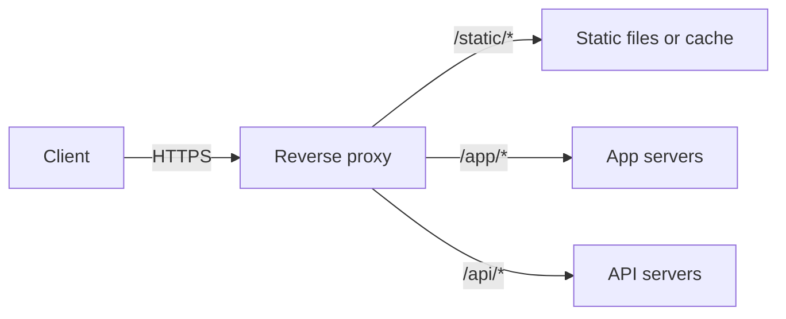
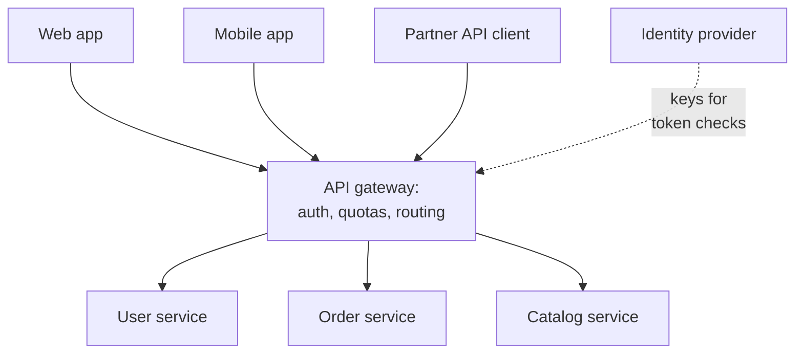

import { Aside } from '@astrojs/starlight/components';

A reverse proxy is a server that clients believe is the application. It receives their requests, forwards each one to an internal server, and returns the answer as its own. That position at the front door makes it the natural place for TLS, caching, compression, security filtering and routing. An API gateway is a reverse proxy specialised for APIs: it adds identity, quotas and API-level routing for many backend services.

<Aside type="tip" title="TL;DR">
- A reverse proxy hides and protects backends, terminates TLS, compresses, caches and serves static files. It is useful even in front of a single server.
- A load balancer is a reverse proxy whose main job is spreading traffic across many identical servers. In practice the same software (NGINX, HAProxy, Envoy) does both.
- An API gateway handles cross-cutting API concerns: authentication, rate limits, routing to services, versioning, sometimes aggregation. A backend-for-frontend (BFF) is a gateway owned by one client team.
- Keep business logic out of the gateway. A "god gateway" becomes a deployment bottleneck and a single point of failure.
</Aside>

## Forward vs reverse proxy

A **forward proxy** acts for *clients*: a corporate egress proxy that filters which sites employees reach, for example. A **reverse proxy** acts for *servers*: clients reach it at the public address, and it chooses which internal server handles the request.

## What a reverse proxy gives you

- **Security and isolation.** Backends get private addresses and are not directly reachable. The proxy can hide server banners, enforce request size and header limits, block IPs, cap connections per client and absorb slow-client attacks (slowloris) by buffering requests before passing them on. It is also where a web application firewall (WAF) usually runs.
- **Flexibility.** Clients see only the proxy. You can add, replace, move or re-platform backends, or split one app into several, without changing a DNS record or a client.
- **TLS termination.** Certificates live in one place and can be renewed automatically: Caddy, for example, obtains and renews certificates through ACME with no configuration. Backends receive plain HTTP on a trusted network, or re-encrypted traffic where policy requires it.
- **Compression.** gzip, Brotli or zstd responses for clients that accept them, without burdening application code.
- **Caching.** Store responses to repeated requests and answer them without touching the app (NGINX `proxy_cache`, Varnish). This is the same idea as a [CDN](/traffic/cdn/), but in your own data centre.
- **Static content.** Serve HTML, CSS, JS, images and video directly from disk or object storage, leaving app servers for dynamic work.
- **Protocol translation.** Accept HTTP/2 and HTTP/3 from the internet while talking HTTP/1.1 or gRPC to backends. Upgrade connections to WebSocket.
- **Connection management.** Many short client connections become a few long-lived, reused upstream connections, and slow mobile clients no longer tie up an app worker.

Pass the original client details downstream with `X-Forwarded-For` / `X-Forwarded-Proto` or the standard `Forwarded` header (RFC 7239). Backends should trust these headers only when they come from the proxy.

## Load balancer vs reverse proxy

| | Reverse proxy | Load balancer |
|---|---|---|
| Main purpose | A single, controlled front door with added features | Spread load and survive backend failures |
| Useful with one backend | Yes: TLS, caching, compression, security | Not really |
| Layer | L7 (HTTP-aware) | L4 or L7 |
| Typical extras | Caching, static files, rewrites, WAF | Health checks, balancing algorithms, draining |

The distinction is about role, not product. NGINX, HAProxy, Envoy, Caddy and Traefik all proxy, balance and terminate TLS, and cloud "application load balancers" are managed L7 reverse proxies. In a design diagram, label the box by what it does for the system. See [load balancers](/traffic/load-balancers/).

## API gateway

With many backend services, every one of them needs the same edge features: check the token, apply quotas, log the call, route `/v2/orders` to the right place. An **API gateway** does this once, at the edge of the service estate.

Typical responsibilities:

- **Authentication and coarse authorisation.** Validate OAuth 2.0 / OIDC access tokens or API keys, then pass a verified identity to services, for example as a signed internal token or trusted headers. Fine-grained "may this user edit this order?" checks stay in the service that owns the order.
- **Rate limiting and quotas.** Per API key, user, IP or plan, usually with token buckets backed by a shared store. See [rate limiting](/reliability/rate-limiting/).
- **Routing and versioning.** Map public paths and versions to internal services, shift a percentage of traffic to a new version, and hide internal service names.
- **Request and response transformation.** Header injection, protocol translation (REST to gRPC), response shaping for old clients.
- **Request aggregation.** Fan out one client call to several services and merge the results, saving mobile clients from making many round trips over slow networks.
- **Observability and monetisation.** One place for access logs, per-consumer metrics, tracing headers, developer portals and usage billing.

### Backend for frontend (BFF)

One gateway serving web, iOS, Android and partners becomes a compromise that suits nobody, and every client team waits on the gateway team. The **backend-for-frontend** pattern, described by Sam Newman, gives each user experience its own thin API layer owned by that client's team. The BFF aggregates and shapes data for exactly what its screens need. A shared edge gateway can still handle TLS, authentication and global rate limits in front of the BFFs. GraphQL servers often play the BFF role. See [API styles](/communication/api-styles/).

## When the gateway becomes the problem

- **The "god gateway".** Business rules, orchestration and data joins creep into gateway plugins or scripts. Now every feature change needs a gateway deploy owned by a central team, the logic is hard to test, and the gateway knows everyone's domain. Thoughtworks warned against these "overambitious API gateways" years ago, and the warning still holds. Keep the gateway to cross-cutting concerns. Domain logic belongs in services or BFFs.
- **Bottleneck and blast radius.** All traffic crosses it. A bad config push, an expired certificate or a slow auth plugin takes down every API at once. Run it as a horizontally scaled, multi-zone fleet, roll out config gradually, and keep plugins on the hot path cheap.
- **Added latency.** Each hop adds latency, and remote calls from the gateway (token introspection, a central rate-limit store) add more. Prefer local JWT signature checks with cached keys and local rate-limit counters with periodic sync.
- **Aggregation pitfalls.** Fan-out multiplies tail latency: the slowest of five calls sets the response time. Use timeouts, partial responses and the patterns in [resilience patterns](/reliability/resilience-patterns/).

## Disadvantages in general

- Another tier to deploy, configure, monitor and secure, and its configuration is code that needs review and tests.
- A single proxy or gateway instance is a single point of failure. Running several behind a load balancer or anycast fixes that but adds complexity.
- Debugging needs correlation IDs and tracing across the extra hop, or 502 and 504 errors become guesswork.

## Examples

- **Reverse proxies / L7 load balancers**: NGINX, HAProxy, Envoy, Caddy, Traefik, Varnish (caching). Managed: AWS ALB, Google Cloud Application Load Balancer, Azure Application Gateway and Front Door.
- **Self-hosted API gateways**: Kong Gateway, Apache APISIX, Tyk, KrakenD, Envoy Gateway. Most Kubernetes-native options now implement the **Kubernetes Gateway API** (`Gateway`, `HTTPRoute`, `GRPCRoute`), the successor to the Ingress API.
- **Managed API gateways**: Amazon API Gateway, Azure API Management, Google Cloud Apigee and API Gateway.
- **AI gateways**: a newer variant for traffic to LLM providers (Kong AI Gateway, Cloudflare AI Gateway, Envoy AI Gateway). Same edge role, but quotas count tokens and cost rather than requests, and typical features are provider failover, response caching and usage logging.

## Trade-offs

| Option | Good for | Costs |
|---|---|---|
| Plain reverse proxy | TLS, caching, static files, simple routing | No API-level identity or quotas |
| Central API gateway | Consistent auth, quotas, routing and analytics for many services | Bottleneck and blast radius; risk of god-gateway logic |
| BFF per client | Client-tailored APIs, team autonomy, fewer round trips | More services to run; some duplicated logic |
| Managed gateway | No ops, built-in portal and analytics | Per-request pricing, vendor limits, extra latency |

<Aside type="note" title="In the interview">
Draw the edge explicitly: CDN, then load balancer or reverse proxy, then gateway (if there are many services), then services. Say what each layer does, and avoid boxes with no purpose. Interviewers ask: "Where is the token validated?", "Where do you rate-limit, and how is the counter shared across gateway nodes?", "What happens if the gateway goes down?", and "Why not put this aggregation logic in the gateway?" A mature answer keeps the gateway thin, uses BFFs for client-specific shaping, and leaves fine-grained authorisation to the services.
</Aside>

## Further reading

- [NGINX: reverse proxy guide](https://docs.nginx.com/nginx/admin-guide/web-server/reverse-proxy/) — practical configuration of proxying, headers and buffering.
- [Pattern: API Gateway / Backends for Frontends](https://microservices.io/patterns/apigateway.html) — Chris Richardson's description of the pattern and its drawbacks.
- [Backends For Frontends](https://samnewman.io/patterns/architectural/bff/) — Sam Newman's original write-up of the BFF pattern.
- [Overambitious API gateways](https://www.thoughtworks.com/radar/platforms/overambitious-api-gateways) — the Thoughtworks Radar's Hold-ring warning against logic in gateways (last featured in 2018).
- [Kubernetes Gateway API](https://gateway-api.sigs.k8s.io/docs/) — the standard routing API for gateways and meshes.
- [What is Envoy](https://www.envoyproxy.io/docs/envoy/latest/intro/what_is_envoy) — the proxy behind many gateways and meshes.

## Related topics

- [Load balancers](/traffic/load-balancers/) — algorithms, health checks and redundancy for the same tier.
- [CDN](/traffic/cdn/) — a reverse-proxy cache distributed around the world.
- [Rate limiting](/reliability/rate-limiting/) — algorithms behind gateway quotas.
- [Security](/reliability/security/) — TLS, authentication and WAF at the edge.
- [Monolith, modular monolith and microservices](/architecture/monolith-and-microservices/) — why a gateway appears once there are many services.
